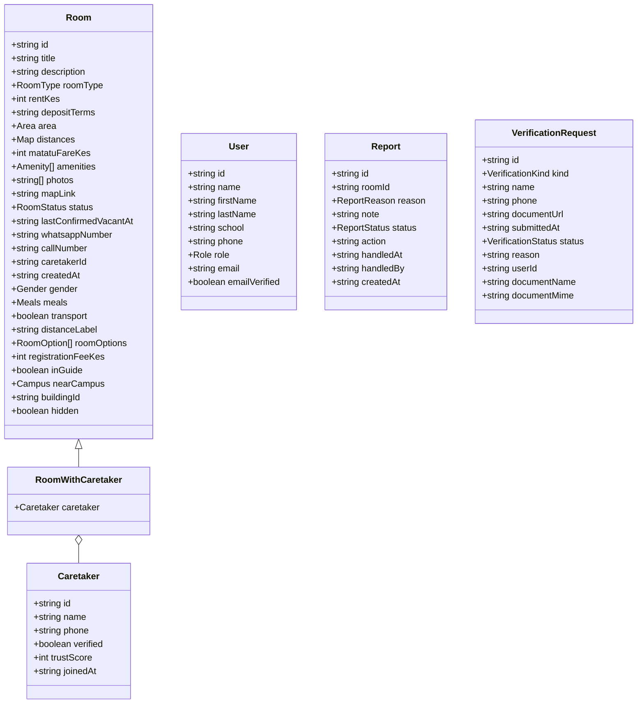
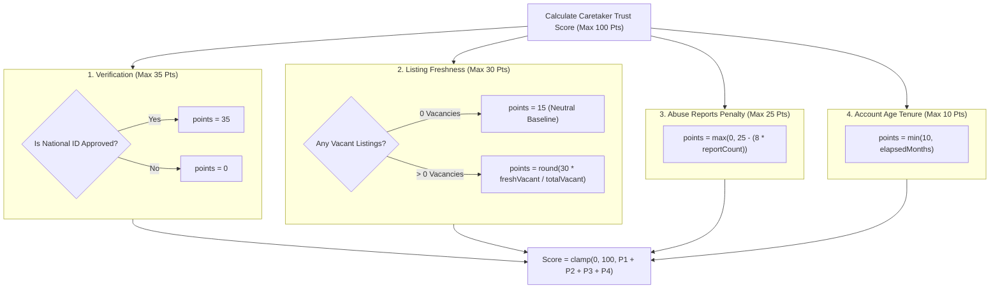
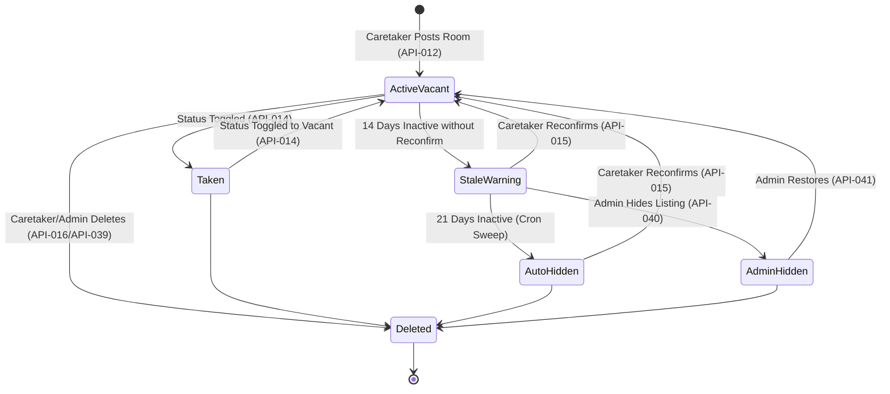

# Rommie REST API Contract & Specification

## Document Control & Metadata

| Attribute | Specification Detail |
| :--- | :--- |
| **Document ID** | `DOC-API-001` |
| **Version** | `1.0` |
| **Status** | `Draft (Proposed Contract — NOT working endpoints)` |
| **Author** | Antigravity AI Agent (Senior Systems Analyst & Backend Technical Lead) |
| **Created Date** | 2026-10-19 |
| **Last Updated** | 2026-10-19 |
| **Target Codebase** | `e:\Coding_Projects\rommie-webapp` |
| **Reference Architecture** | [SYSTEM_ARCHITECTURE.md](file:///e:/Coding_Projects/rommie-webapp/docs/SYSTEM_ARCHITECTURE.md) (DOC-ARCH-001) |
| **Requirements Source** | [SRS.md](file:///e:/Coding_Projects/rommie-webapp/docs/SRS.md) (DOC-SRS-001) & [house_hunting_web_app_nfrs.md](file:///e:/Coding_Projects/rommie-webapp/house_hunting_web_app_nfrs.md) |
| **Traceability Target** | `docs/RTM.md` |
| **Governing Standard** | AGENTS.md (Section 12), OpenAPI 3.1 & RFC 7807 (Problem Details) |

### Document Purpose
This document establishes the official proposed REST API Contract for the **Rommie** student accommodation web platform. It specifies the 52 RESTful endpoints required to transition the application from its current client-side mock service layer ([src/services/api.js](file:///e:/Coding_Projects/rommie-webapp/src/services/api.js) — 56 exported mock functions) to an enterprise-grade backend service. 

This contract defines request/response wire formats, authentication/authorization rules, parameter validation constraints, error formats, rate limiting boundaries, idempotency expectations, and direct data-shape mappings to the domain types defined in [src/types/index.js](file:///e:/Coding_Projects/rommie-webapp/src/types/index.js).

### Operational Scope
The endpoints defined herein govern all four platform operational domains:
1. **Student Discovery & Tenancy**: Public room search, geospatial proximity calculation, image lightboxes, contact deduplication, saved rooms, vacancy alerts, and student KYC verification.
2. **Caretaker Property Management**: Listing creation (standard rentals and multi-option hostels), field updates, optimistic vacancy toggling, 14-day vacancy reconfirmation, unit cloning, and trust score computation.
3. **Administrative Moderation & Governance**: Stale listing sweeps, report dispute resolution, listing hide/restore, inline catalog edits, caretaker suspension, identity verification arbitration, activity auditing, and platform analytics.
4. **Site Configuration & Upload Infrastructure**: Dynamic site settings and presigned direct object storage uploads.

### Document Change History
| Version | Date | Author | Description of Changes |
| :--- | :--- | :--- | :--- |
| **1.0** | 2026-10-19 | Antigravity AI Agent | Comprehensive baseline contract covering 52 endpoints (API-001 through API-052), strict type alignment with `src/types/index.js`, HTTP status matrices, and error envelopes. |

---

## 1. Architectural Principles & Global Conventions

### 1.1 Base URL & Protocol
- **Production Base URI**: `https://api.rommie.co.ke/api/v1`
- **Staging / Preview Base URI**: `https://api-staging.rommie.co.ke/api/v1`
- **Local Development Base URI**: `http://localhost:4000/api/v1`
- **Frontend Environment Reference**: Configured in client Vite environment as `VITE_API_URL` (e.g. `import.meta.env.VITE_API_URL + "/api/v1"`).
- **Transport Security**: Mandatory **TLS 1.3** across all public and staging environments (`NFR-SEC-001`). Plain HTTP requests are rejected or redirected with `301 Moved Permanently` to HTTPS.

### 1.2 Serialization & Character Encoding
- All request and response bodies MUST use JSON serialization (`application/json; charset=utf-8`), with the sole exception of direct binary uploads (`multipart/form-data`) or presigned storage uploads.
- Field naming in JSON payloads follows **camelCase** (e.g., `rentKes`, `lastConfirmedVacantAt`, `whatsappNumber`), matching the domain definitions in [src/types/index.js](file:///e:/Coding_Projects/rommie-webapp/src/types/index.js).
- Floating-point representations for currency are prohibited. Kenyan Shillings are represented strictly as unsigned whole integers (`rentKes: 8500`).

### 1.3 Authentication & Session Management
- **Token Mechanism**: Dual-token JSON Web Token (JWT) architecture (`ADR-003`).
  - **Access Token**: Short-lived (15 minutes TTL), stateless JWT transmitted in the standard HTTP header:
    ```http
    Authorization: Bearer <access_token>
    ```
  - **Refresh Token**: Long-lived (7 days TTL), cryptographically signed token stored in a secure, `HttpOnly`, `SameSite=Strict`, `Secure` cookie, or exchanged via `/auth/session`.
- **JWT Claims Payload**:
  ```json
  {
    "sub": "u-4f8a92b1",
    "role": "student",
    "emailVerified": true,
        "iat": 1776556800,
    "exp": 1776557700
  }
  ```
- **Role-Based Access Control (RBAC)**:
  - `public`: Unauthenticated visitors.
  - `student`: Verified or unverified student account.
  - `caretaker`: Landlord / property manager. Suspended caretakers are blocked from mutating operations (`HTTP 403`).
  - `admin`: Operations staff with full system privileges.

```mermaid
sequenceDiagram
    autonumber
    actor Client as React Client (api.js)
    participant WAF as Perimeter WAF & Rate Limiter
    participant API as Rommie REST API Gateway
    participant DB as PostgreSQL & PostGIS

    Client->>WAF: POST /api/v1/auth/login (email/phone + password)
    WAF->>API: Forward authenticated route request
    API->>DB: Query user by email/phone & verify Argon2id hash
    DB-->>API: User record (role, verified, suspended)
    API-->>Client: 200 OK + JWT Access Token + User Profile Payload
    Note over Client: Stores JWT in memory; sets User in React Context

    Client->>WAF: GET /api/v1/rooms?near=KSL (Bearer JWT)
    WAF->>API: Route authenticated request
    API->>DB: PostGIS spatial bounding query (< 150ms)
    DB-->>API: Matching room entities + caretaker profiles
    API-->>Client: 200 OK { data: RoomWithCaretaker[] }
```

### 1.4 Global Error Envelope
All error responses across all endpoints (4xx and 5xx) strictly follow the error shape expected by the frontend's [AuthError](file:///e:/Coding_Projects/rommie-webapp/src/services/api.js#L638-L645) class and form validation error handlers:

```json
{
  "error": {
    "code": "VALIDATION_FAILED",
    "message": "Enter a valid email address.",
    "field": "email",
    "details": [
      {
        "field": "email",
        "issue": "invalid_format",
        "message": "Enter a valid email address."
      }
    ]
  }
}
```

#### Standard Error Code Catalog
| Error Code | HTTP Status | Meaning | Typical Trigger |
| :--- | :--- | :--- | :--- |
| `BAD_REQUEST` | 400 | Malformed JSON or invalid parameter syntax | Non-numeric string provided for integer query parameter |
| `UNAUTHENTICATED` | 401 | Missing, malformed, or expired Bearer token | Expired access token presented without refresh |
| `FORBIDDEN` | 403 | Insufficient role or account state restriction | Student attempting to call `/admin/*` or suspended caretaker |
| `NOT_FOUND` | 404 | Target entity does not exist or is hidden | Room ID deleted, hidden, or non-existent |
| `CONFLICT` | 409 | Unique constraint or state conflict | Duplicate email/phone registration, concurrent pending KYC |
| `VALIDATION_FAILED`| 422 | Semantic payload validation error | Rent > 500,000 KES, title < 5 chars, bad Kenyan phone |
| `RATE_LIMITED` | 429 | Rate limit budget exhausted | Exceeding 5 OTP requests/hour or 60 search req/min |
| `INTERNAL_ERROR` | 500 | Unhandled server-side exception | Database connection drop or storage failure |

### 1.5 Pagination, Sorting & Filtering Conventions
- **Offset Pagination**: Default collection responses support `?limit=N&offset=N`.
  - Default `limit`: 20. Maximum `limit`: 100.
  - Collections return either a clean array (matching frontend array signatures) or an envelope with a `pagination` meta block:
    ```json
    {
      "data": [ ... ],
      "pagination": {
        "total": 142,
        "limit": 20,
        "offset": 0,
        "hasMore": true
      }
    }
    ```
- **Sorting Parameter (`sort`)**:
  - `newest`: Sorted by `lastConfirmedVacantAt` descending (vacant listings always prioritized first).
  - `rent_asc`: Sorted by `rentKes` ascending.
  - `rent_desc`: Sorted by `rentKes` descending.
- **Geospatial & Transit Filtering**:
  - `near`: Target campus acronym (`KSL`, `JKUAT`, `Tangaza`, `CUEA`, `Co-op`). Matches rooms with transit duration <= 20 minutes (walk or matatu) or properties cataloged in the Karen Campus Hostels Guide.

### 1.6 Phone Number & Date Time Formats
- **Phone Numbers**: Must conform strictly to **E.164 Kenyan format** (`+254XXXXXXXXX` regex: `/^\+254[17]\d{8}$/`). Local user input (`0712 345 678`) is normalized server-side or by the client via [normalizeKenyanPhone](file:///e:/Coding_Projects/rommie-webapp/src/lib/format.js#L62-L71).
- **Date/Time Values**: Must conform strictly to **ISO 8601 UTC string** (`YYYY-MM-DDTHH:mm:ss.sssZ`).

### 1.7 Idempotency & Rate Limiting Guidelines
- All `GET`, `PUT`, and `DELETE` operations must be naturally idempotent.
- Sensitive non-idempotent operations (such as `POST /auth/otp/send` and `POST /reports`) enforce rate-limiting locks in Redis.
- Rate limits are declared per endpoint:
  - **Public Search**: 120 req/minute per IP.
  - **OTP Dispatch**: 3 requests per 10 minutes, max 5 per hour per phone number.
  - **Contact Taps**: 60 req/minute per IP (with a 30-second server deduplication window per listing + channel).
  - **Admin Operations**: 300 req/minute per authenticated admin.

---

## 2. Domain Data Types & Contract Alignments

The following table documents the exact alignment between frontend JSDoc domain types ([src/types/index.js](file:///e:/Coding_Projects/rommie-webapp/src/types/index.js)) and the REST API wire contracts:



### Enumeration Reference
- **Area**: `"Gataka"` | `"Rongai"` | `"Maasai Lodge"` | `"Karen"`
- **RoomType**: `"bedsitter"` | `"single_room"` | `"one_bedroom"` | `"hostel"`
- **Campus**: `"KSL"` | `"JKUAT"` | `"Tangaza"` | `"CUEA"` | `"Co-op"`
- **Gender**: `"Ladies"` | `"Gents"` | `"Mixed"`
- **Meals**: `"none"` | `"available"`
- **Billing**: `"month"` | `"semester"`
- **RoomStatus**: `"Vacant"` | `"Taken"`
- **Amenity**: `"Water 24/7"` | `"WiFi"` | `"Tokens"` | `"Gated Security"`
- **ReportReason**: `"Fake listing"` | `"Already taken"` | `"Wrong price"` | `"Wrong photos"` | `"Other"`
- **ReportStatus**: `"open"` | `"resolved"` | `"dismissed"`
- **Role**: `"student"` | `"caretaker"` | `"admin"`
- **VerificationKind**: `"student"` | `"caretaker"`
- **VerificationStatus**: `"pending"` | `"approved"` | `"rejected"`

---

## 3. Complete REST API Endpoint Specifications

---

### 3.1 Authentication & Identity Endpoints (`API-001` to `API-009`)

#### API-001: Register New User Account
- **Route**: `POST /api/v1/auth/signup`
- **Purpose**: Creates a new student or caretaker user account with email, phone, and password.
- **Traceability**: `FR-033`, `US-032`, `UC-001`, `NFR-SEC-003`, `ADR-003`, `ENT-USER`.
- **Authorization**: Public (Unauthenticated).
- **Request Headers**: `Content-Type: application/json`.
- **Request Body Schema**:
  ```json
  {
    "name": "Jane Muthoni",
    "firstName": "Jane",
    "lastName": "Muthoni",
    "school": "CUEA",
    "email": "jane.muthoni@cuea.edu",
    "phone": "+254711222333",
    "role": "student",
    "password": "SecurePassword123!"
  }
  ```
  - `name`: string, 2–80 chars, required.
  - `firstName`: string, 1–40 chars, optional.
  - `lastName`: string, 1–40 chars, optional.
  - `school`: string (e.g. `"KSL"`, `"CUEA"`), optional (students only).
  - `email`: string, valid email format regex `/^[^\s@]+@[^\s@]+\.[^\s@]+$/`, required.
  - `phone`: string, E.164 format `+254XXXXXXXXX`, required.
  - `role`: string enum `["student", "caretaker"]`, required.
  - `password`: string, min 8 chars with at least 1 digit, required.
- **Response**:
  - `201 Created`:
    ```json
    {
      "token": "eyJhbGciOiJIUzI1NiIsInR5cCI6IkpXVCJ9...",
      "user": {
        "id": "u-a8f19c3b",
        "name": "Jane Muthoni",
        "firstName": "Jane",
        "lastName": "Muthoni",
        "school": "CUEA",
        "email": "jane.muthoni@cuea.edu",
        "phone": "+254711222333",
        "role": "student",
        "emailVerified": false
      }
    }
    ```
- **Error Status Codes**:
  - `400 Bad Request`: Malformed JSON syntax.
  - `409 Conflict`: 
    - `{ "error": { "code": "EMAIL_EXISTS", "message": "An account with this email already exists. Try logging in.", "field": "email" } }`
    - `{ "error": { "code": "PHONE_EXISTS", "message": "An account with this number already exists. Try logging in.", "field": "phone" } }`
  - `422 Unprocessable Entity`: Validation failure on email, password, or phone syntax.
  - `429 Too Many Requests`: Rate limit reached (5 signups/hr per IP).
- **Mock Source**: [src/services/api.js#L706-L727](file:///e:/Coding_Projects/rommie-webapp/src/services/api.js#L706-L727) (`signUp`).
- **Frontend Type Consumer**: `User` in [src/types/index.js#L77-L89](file:///e:/Coding_Projects/rommie-webapp/src/types/index.js#L77-L89).
- **Idempotency**: Non-idempotent.

---

#### API-002: User Login (Email or Phone + Password)
- **Route**: `POST /api/v1/auth/login`
- **Purpose**: Authenticates a user with password credentials and issues an access token.
- **Traceability**: `FR-034`, `US-032`, `UC-002`, `NFR-SEC-003`, `ADR-003`, `ENT-USER`.
- **Authorization**: Public.
- **Request Body Schema**:
  ```json
  {
    "email": "jane.muthoni@cuea.edu",
    "password": "SecurePassword123!"
  }
  ```
  *(Legacy/alternative phone login supported: `{ "phone": "+254711222333", "password": "..." }`)*
- **Response**:
  - `200 OK`: Returns `{ token, user }` (identical shape to API-001).
- **Error Status Codes**:
  - `401 Unauthorized`: `{ "error": { "code": "INVALID_CREDENTIALS", "message": "Email or password is incorrect.", "field": "password" } }`
  - `403 Forbidden`: `{ "error": { "code": "ACCOUNT_SUSPENDED", "message": "This account is suspended. Contact Rommie to get it restored.", "field": "password" } }`
  - `422 Unprocessable Entity`: `{ "error": { "code": "GOOGLE_ACCOUNT", "message": "This account uses Google. Tap Continue with Google instead.", "field": "password" } }`
  - `429 Too Many Requests`: Exceeded 5 failed attempts in 15 minutes (IP locked).
- **Mock Source**: [src/services/api.js#L729-L742](file:///e:/Coding_Projects/rommie-webapp/src/services/api.js#L729-L742) (`login`).

---

#### API-003: Google OAuth 2.0 / OIDC Authentication
- **Route**: `POST /api/v1/auth/google`
- **Purpose**: Authenticates or provisions accounts using a Google Identity Services credential.
- **Traceability**: `FR-035`, `US-032`, `UC-002`, `NFR-SEC-003`, `ADR-003`, `ENT-USER`.
- **Authorization**: Public.
- **Request Body Schema**:
  ```json
  {
    "idToken": "eyJhbGciOiJSUzI1NiIsImtpZCI6Ij...",
    "role": "student"
  }
  ```
- **Backend Verification**: Server validates Google JWT signature, issuer, and audience against Google Public Keys. Extracts verified email and full name.
- **Response**:
  - `200 OK` (Existing User) / `201 Created` (New User): Returns `{ token, user }`.
- **Error Status Codes**:
  - `401 Unauthorized`: Invalid or expired Google ID token.
  - `403 Forbidden`: Account is suspended.
  - `422 Unprocessable Entity`: Invalid role or malformed token payload.
- **Mock Source**: [src/services/api.js#L747-L762](file:///e:/Coding_Projects/rommie-webapp/src/services/api.js#L747-L762) (`loginWithGoogle`).

---

#### API-004: Send Email One-Time Password (OTP)
- **Route**: `POST /api/v1/auth/otp/send`
- **Purpose**: Generates and dispatches a 6-digit verification code to the user's registered email address via Transactional Email Service (Brevo / AWS SES / Postmark).
- **Traceability**: `FR-036`, `US-008`, `UC-008`, `NFR-SEC-003`, `ADR-005`, `ENT-OTP`.
- **Authorization**: Public or Authenticated User.
- **Rate Limiting**: Maximum 5 requests/hour per email address; maximum 20 requests/hour per client IP address. Minimum 60-second cooldown between successive resends.
- **Request Body Schema**:
  ```json
  {
    "email": "student@cuea.edu"
  }
  ```
- **Response**:
  - `200 OK`:
    ```json
    {
      "success": true,
      "message": "Verification code dispatched to your email address.",
      "expiresInSeconds": 300,
      "cooldownSeconds": 60
    }
    ```
  - `429 Too Many Requests`:
    ```json
    {
      "error": "RateLimitExceeded",
      "message": "Too many verification codes requested. Please wait 15 minutes before trying again."
    }
    ```

---

#### API-005: Verify Email One-Time Password (OTP)
- **Route**: `POST /api/v1/auth/otp/verify`
- **Purpose**: Validates the 6-digit code sent to the email. If the user is authenticated, marks `emailVerified = true`.
- **Traceability**: `FR-036`, `US-033`, `UC-003`, `NFR-SEC-003`, `ADR-005`, `ENT-OTP`.
- **Authorization**: Public or Authenticated User.
- **Request Body Schema**:
  ```json
  {
    "email": "student@cuea.edu",
    "code": "123456"
  }
  ```
- **Response**:
  - `200 OK`:
    ```json
    {
      "ok": true
    }
    ```
- **Error Status Codes**:
  - `400 Bad Request`:
    - Code expired (> 5 min): `{ "error": { "code": "OTP_EXPIRED", "message": "That code has expired. Request a new one.", "field": "code" } }`
    - Code incorrect: `{ "error": { "code": "OTP_INVALID", "message": "That code isn't right. Check it and try again.", "field": "code" } }`
  - `429 Too Many Requests`: Too many incorrect attempts (max 5 per OTP).
- **Mock Source**: [src/services/api.js#L802-L816](file:///e:/Coding_Projects/rommie-webapp/src/services/api.js#L802-L816) (`verifyOtp`).

---

#### API-006: Login with Phone & OTP
- **Route**: `POST /api/v1/auth/otp/login`
- **Purpose**: Passwordless authentication allowing users to sign in using their phone and a valid OTP code.
- **Traceability**: `FR-034`, `FR-036`, `US-034`, `UC-003`, `NFR-SEC-003`, `ENT-USER`.
- **Authorization**: Public.
- **Request Body Schema**:
  ```json
  {
    "phone": "+254712345678",
    "code": "123456"
  }
  ```
- **Response**:
  - `200 OK`: Returns `{ token, user }` with `emailVerified: true`.
- **Error Status Codes**:
  - `400 Bad Request`: Code expired or incorrect.
  - `403 Forbidden`: Account is suspended.
  - `404 Not Found`: `{ "error": { "code": "USER_NOT_FOUND", "message": "No account uses this number yet. Sign up first.", "field": "phone" } }`
- **Mock Source**: [src/services/api.js#L780-L793](file:///e:/Coding_Projects/rommie-webapp/src/services/api.js#L780-L793) (`loginWithOtp`).

---

#### API-007: User Logout & Session Invalidation
- **Route**: `POST /api/v1/auth/logout`
- **Purpose**: Destroys active session, revokes refresh token in Redis, and clears HttpOnly session cookies.
- **Traceability**: `FR-037`, `US-035`, `UC-035`, `NFR-SEC-003`.
- **Authorization**: Authenticated User.
- **Response**:
  - `200 OK`: `{ "success": true }`
- **Mock Source**: [src/services/api.js#L794](file:///e:/Coding_Projects/rommie-webapp/src/services/api.js#L794) (`logout`).

---

#### API-008: Get Current Authenticated Session
- **Route**: `GET /api/v1/auth/session`
- **Purpose**: Returns the currently signed-in user object, refreshing verification badges dynamically.
- **Traceability**: `FR-037`, `US-032`, `UC-034`, `NFR-SEC-003`, `ENT-USER`.
- **Authorization**: Authenticated User.
- **Response**:
  - `200 OK`:
    ```json
    {
      "user": {
        "id": "u-4f8a92b1",
        "name": "Alex Kimani",
        "email": "alex.kimani@tangaza.ac.ke",
        "phone": "+254711111111",
        "role": "student",
        "emailVerified": true
      }
    }
    ```
- **Error Status Codes**:
  - `401 Unauthorized`: Session expired or invalid Bearer token.
- **Mock Source**: [src/services/api.js#L674-L703](file:///e:/Coding_Projects/rommie-webapp/src/services/api.js#L674-L703) (`getSession`, `refreshSession`).

---

#### API-009: Update User Phone Number
- **Route**: `PATCH /api/v1/auth/phone`
- **Purpose**: Changes the authenticated person's telephone number for WhatsApp and voice call communication.
- **Traceability**: `FR-019`, `US-017`, `UC-020`, `NFR-SEC-003`, `ENT-USER`.
- **Authorization**: Authenticated User (`student`, `caretaker`, `admin`).
- **Request Body Schema**:
  ```json
  {
    "phone": "+254799000111"
  }
  ```
- **Response**:
  - `200 OK`: Returns updated `User` object.
- **Error Status Codes**:
  - `409 Conflict`: Number already associated with another active account.
  - `422 Unprocessable Entity`: Number invalid Kenyan format.
- **Mock Source**: [src/services/api.js#L764-L778](file:///e:/Coding_Projects/rommie-webapp/src/services/api.js#L764-L778) (`setMyPhone`).

---

### 3.2 Property & Listing Endpoints (`API-010` to `API-018`)

#### API-010: Search and Filter Room Listings
- **Route**: `GET /api/v1/rooms`
- **Purpose**: Primary search engine for student discovery. Executes compound filtering, spatial transit calculations, and sorting. Excludes hidden listings and listings from suspended caretakers.
- **Traceability**: `FR-001`, `FR-008`, `US-001`, `UC-004`, `NFR-PERF-001`, `ADR-002`, `ENT-ROOM`.
- **Authorization**: Public.
- **Query Parameters**:
  - `area` (string enum): `"Gataka"` | `"Rongai"` | `"Maasai Lodge"` | `"Karen"`
  - `roomType` (string enum): `"bedsitter"` | `"single_room"` | `"one_bedroom"` | `"hostel"`
  - `minRent` (integer): Minimum rent in KES (>= 0).
  - `maxRent` (integer): Maximum rent in KES (<= 500,000).
  - `near` (string enum): Target campus (`"KSL"`, `"JKUAT"`, `"Tangaza"`, `"CUEA"`, `"Co-op"`).
  - `amenities` (array of string): e.g. `?amenities=WiFi&amenities=Water%2024%2F7`. Conjunction `AND` matching.
  - `gender` (string enum): `"Ladies"` | `"Gents"` | `"Mixed"` (Hostels).
  - `mealsOnly` (boolean): If `true`, requires `meals === "available"`.
  - `transportOnly` (boolean): If `true`, requires `transport === true`.
  - `vacantOnly` (boolean, default: `true`): If `true`, restricts results to `status === "Vacant"`.
  - `sort` (string enum, default: `"newest"`): `"newest"` | `"rent_asc"` | `"rent_desc"`.
  - `limit` (integer, default: 50, max: 100): Pagination page size.
  - `offset` (integer, default: 0): Pagination offset.
- **Response**:
  - `200 OK`:
    ```json
    {
      "data": [
        {
          "id": "r1",
          "title": "Modern Studio Bedsitter, Rongai",
          "description": "Spacious room with constant water and prepaid power.",
          "roomType": "bedsitter",
          "rentKes": 8500,
          "depositTerms": "One month rent",
          "area": "Rongai",
          "distances": {
            "KSL": { "walkMin": 15 },
            "JKUAT": { "matatuMin": 10 }
          },
          "matatuFareKes": 50,
          "amenities": ["Water 24/7", "WiFi", "Tokens"],
          "photos": [
            "https://cdn.rommie.co.ke/rooms/r1/photo-1.webp",
            "https://cdn.rommie.co.ke/rooms/r1/photo-2.webp"
          ],
          "mapLink": "https://maps.google.com/?q=Rongai",
          "status": "Vacant",
          "lastConfirmedVacantAt": "2026-10-18T10:00:00.000Z",
          "whatsappNumber": "+254712345678",
          "callNumber": "+254712345678",
          "caretakerId": "c1",
          "createdAt": "2026-10-10T08:00:00.000Z",
          "caretaker": {
            "id": "c1",
            "name": "Mama Wanjiru",
            "phone": "+254712345678",
            "verified": true,
            "trustScore": 95,
            "joinedAt": "2026-06-01T00:00:00.000Z"
          }
        }
      ],
      "pagination": { "total": 28, "limit": 50, "offset": 0, "hasMore": false }
    }
    ```
- **Frontend Compatibility Note**: In [src/services/api.js#L172](file:///e:/Coding_Projects/rommie-webapp/src/services/api.js#L172), `getRooms()` returns `RoomWithCaretaker[]`. The API client wrapper unwraps `res.data`.
- **Mock Source**: [src/services/api.js#L135-L173](file:///e:/Coding_Projects/rommie-webapp/src/services/api.js#L135-L173) (`getRooms`).

---

#### API-011: Get Room Details
- **Route**: `GET /api/v1/rooms/:id`
- **Purpose**: Retrieves full listing detail including room options, transit matrix, and derived caretaker profile with trust score. Returns 404 if hidden or caretaker suspended.
- **Traceability**: `FR-002`, `FR-009`, `US-002`, `UC-005`, `NFR-PERF-003`, `ENT-ROOM`.
- **Authorization**: Public.
- **Response**:
  - `200 OK`: `RoomWithCaretaker` object.
- **Error Status Codes**:
  - `404 Not Found`: Listing does not exist, is hidden, or owned by a suspended caretaker.
- **Mock Source**: [src/services/api.js#L174-L178](file:///e:/Coding_Projects/rommie-webapp/src/services/api.js#L174-L178) (`getRoom`).

---

#### API-012: Create Room Listing
- **Route**: `POST /api/v1/rooms`
- **Purpose**: Creates a new room or hostel listing published by the authenticated caretaker.
- **Traceability**: `FR-010`, `FR-011`, `US-009`, `US-010`, `UC-011`, `UC-012`, `ENT-ROOM`.
- **Authorization**: Caretaker (`role === "caretaker"`).
- **Request Body Schema**:
  ```json
  {
    "title": "Quiet Bedsitter near KSL Gate 2",
    "description": "Clean water borehole, secure gate, 8 min walk to law school.",
    "roomType": "bedsitter",
    "area": "Karen",
    "rentKes": 11000,
    "depositTerms": "1 month deposit",
    "amenities": ["Water 24/7", "Gated Security", "Tokens"],
    "distances": {
      "KSL": { "walkMin": 8 }
    },
    "matatuFareKes": 0,
    "photos": [
      "https://cdn.rommie.co.ke/rooms/temp/photo1.webp",
      "https://cdn.rommie.co.ke/rooms/temp/photo2.webp",
      "https://cdn.rommie.co.ke/rooms/temp/photo3.webp"
    ],
    "mapLink": "https://maps.google.com/?q=Karen",
    "whatsappNumber": "+254712345678",
    "callNumber": "+254712345678",
    "buildingId": "b-4f9a"
  }
  ```
  *(Hostel-specific fields: `gender`, `meals`, `transport`, `distanceLabel`, `registrationFeeKes`, `roomOptions`)*
- **Validation Rules**:
  - `title`: 5 to 80 chars.
  - `description`: 0 to 600 chars.
  - `rentKes`: Integer 1 to 500,000. For hostels, derived server-side from cheapest option.
  - `photos`: Array of 2 to 10 valid image URLs.
  - `distances`: Must specify at least one campus transit time (walk or matatu).
- **Response**:
  - `201 Created`: Returns newly created `Room` object initialized with `status: "Vacant"`, `hidden: false`, `lastConfirmedVacantAt: now()`.
- **Error Status Codes**:
  - `401 Unauthorized`: Unauthenticated.
  - `403 Forbidden`: Account is suspended or user role is not caretaker.
  - `422 Unprocessable Entity`: Validation failure on required fields.
- **Mock Source**: [src/services/api.js#L233-L238](file:///e:/Coding_Projects/rommie-webapp/src/services/api.js#L233-L238) (`createListing`).

---

#### API-013: Update Room Listing
- **Route**: `PATCH /api/v1/rooms/:id`
- **Purpose**: Updates listing information. Restricted to listing owner or platform administrator.
- **Traceability**: `FR-012`, `US-013`, `UC-013`, `ENT-ROOM`.
- **Authorization**: Caretaker (owner) or Admin.
- **Request Body Schema**: Partial `Room` object.
- **Response**:
  - `200 OK`: Updated `Room` object.
- **Error Status Codes**:
  - `403 Forbidden`: User is not the owner or admin, or caretaker is suspended.
  - `404 Not Found`: Listing ID not found.
- **Mock Source**: [src/services/api.js#L239-L242](file:///e:/Coding_Projects/rommie-webapp/src/services/api.js#L239-L242) (`updateListing`).

---

#### API-014: Toggle Room Occupancy Status (Vacant / Taken)
- **Route**: `PATCH /api/v1/rooms/:id/status`
- **Purpose**: Rapid switch between "Vacant" and "Taken". When toggled to "Vacant", refreshes `lastConfirmedVacantAt` to `now()`.
- **Traceability**: `FR-013`, `US-011`, `UC-014`, `ENT-ROOM`.
- **Authorization**: Caretaker (owner) or Admin.
- **Request Body Schema**:
  ```json
  {
    "status": "Vacant"
  }
  ```
- **Response**:
  - `200 OK`:
    ```json
    {
      "id": "r1",
      "status": "Vacant",
      "lastConfirmedVacantAt": "2026-10-19T02:30:00.000Z"
    }
    ```
- **Mock Source**: [src/services/api.js#L243-L246](file:///e:/Coding_Projects/rommie-webapp/src/services/api.js#L243-L246) (`setRoomStatus`).

---

#### API-015: Reconfirm Room Vacancy
- **Route**: `POST /api/v1/rooms/:id/reconfirm`
- **Purpose**: Caretaker confirms a room is still vacant today. Resets `lastConfirmedVacantAt` to `now()` and lifts administrative `hidden: true` flag if the room was hidden due to staleness.
- **Traceability**: `FR-014`, `US-012`, `UC-015`, `ENT-ROOM`.
- **Authorization**: Caretaker (owner) or Admin.
- **Response**:
  - `200 OK`:
    ```json
    {
      "id": "r1",
      "status": "Vacant",
      "hidden": false,
      "lastConfirmedVacantAt": "2026-10-19T02:30:00.000Z"
    }
    ```
- **Mock Source**: [src/services/api.js#L248-L251](file:///e:/Coding_Projects/rommie-webapp/src/services/api.js#L248-L251) (`reconfirmRoom`).

---

#### API-016: Delete Room Listing
- **Route**: `DELETE /api/v1/rooms/:id`
- **Purpose**: Permanently deletes a listing owned by the caretaker.
- **Traceability**: `FR-016`, `US-014`, `UC-017`, `ENT-ROOM`.
- **Authorization**: Caretaker (owner).
- **Response**:
  - `204 No Content` or `200 OK`: `{ "success": true }`.
- **Mock Source**: [src/services/api.js#L252](file:///e:/Coding_Projects/rommie-webapp/src/services/api.js#L252) (`deleteListing`).

---

#### API-017: Get Sibling Rooms in Building
- **Route**: `GET /api/v1/rooms/:id/building`
- **Purpose**: Retrieves other active listings sharing the same `buildingId` as room `:id`, excluding `:id` itself.
- **Traceability**: `FR-015`, `US-008`, `UC-016`, `ENT-ROOM`.
- **Authorization**: Public.
- **Response**:
  - `200 OK`: `RoomWithCaretaker[]` (returns `[]` if room has no `buildingId` or no siblings).
- **Mock Source**: [src/services/api.js#L254-L257](file:///e:/Coding_Projects/rommie-webapp/src/services/api.js#L254-L257) (`getBuildingRooms`).

---

#### API-018: Track Caretaker Contact Tap
- **Route**: `POST /api/v1/rooms/:id/contact`
- **Purpose**: Records a student tapping WhatsApp or Call. Enforces 30s deduplication per room + channel. Bypassed for admins and listing owners. Non-blocking fire-and-forget.
- **Traceability**: `FR-003`, `FR-041`, `US-003`, `UC-006`, `ENT-CONTACT`.
- **Authorization**: Public or Authenticated Student.
- **Request Body Schema**:
  ```json
  {
    "channel": "whatsapp"
  }
  ```
  - `channel`: string enum `["whatsapp", "call"]`, required.
- **Response**:
  - `200 OK`: `{ "tracked": true }` (returns `{ "tracked": false }` if deduplicated or bypassed).
- **Mock Source**: [src/services/api.js#L59-L77](file:///e:/Coding_Projects/rommie-webapp/src/services/api.js#L59-L77) (`trackContact`).

---

### 3.3 Saved / Bookmarked Rooms Endpoints (`API-019` to `API-022`)

#### API-019: Get Saved Room IDs
- **Route**: `GET /api/v1/saved`
- **Purpose**: Returns the list of room IDs saved by the authenticated student (newest saved first).
- **Traceability**: `FR-004`, `US-004`, `UC-007`, `ENT-SAVED`.
- **Authorization**: Student (`role === "student"`). Returns `[]` for visitors.
- **Response**:
  - `200 OK`: `string[]` (e.g. `["r2", "r1"]`).
- **Mock Source**: [src/services/api.js#L182-L186](file:///e:/Coding_Projects/rommie-webapp/src/services/api.js#L182-L186) (`getSavedIds`).

---

#### API-020: Get Saved Rooms with Details
- **Route**: `GET /api/v1/saved/rooms`
- **Purpose**: Returns the full listing objects (`RoomWithCaretaker[]`) saved by the authenticated student. Automatically filters out hidden or suspended rooms.
- **Traceability**: `FR-004`, `US-004`, `UC-007`, `ENT-SAVED`.
- **Authorization**: Student (`role === "student"`).
- **Response**:
  - `200 OK`: `RoomWithCaretaker[]`.
- **Mock Source**: [src/services/api.js#L199-L208](file:///e:/Coding_Projects/rommie-webapp/src/services/api.js#L199-L208) (`getSavedRooms`).

---

#### API-021: Save a Room
- **Route**: `POST /api/v1/saved/:roomId`
- **Purpose**: Bookmarks a room for the authenticated student. Idempotent.
- **Traceability**: `FR-004`, `US-004`, `UC-007`, `ENT-SAVED`.
- **Authorization**: Student (`role === "student"`).
- **Response**:
  - `200 OK` / `201 Created`: `{ "saved": true, "roomId": "r1" }`.
- **Error Status Codes**:
  - `401 Unauthorized`: Unauthenticated.
  - `403 Forbidden`: Non-student role.
  - `404 Not Found`: Listing ID does not exist.
- **Mock Source**: [src/services/api.js#L187-L193](file:///e:/Coding_Projects/rommie-webapp/src/services/api.js#L187-L193) (`saveRoom`).

---

#### API-022: Unsave a Room
- **Route**: `DELETE /api/v1/saved/:roomId`
- **Purpose**: Removes a room from the student's saved list. Idempotent.
- **Traceability**: `FR-004`, `US-004`, `UC-007`, `ENT-SAVED`.
- **Authorization**: Student (`role === "student"`).
- **Response**:
  - `200 OK` / `204 No Content`: `{ "saved": false, "roomId": "r1" }`.
- **Mock Source**: [src/services/api.js#L194-L198](file:///e:/Coding_Projects/rommie-webapp/src/services/api.js#L194-L198) (`unsaveRoom`).

---

### 3.4 Vacancy Alerts Endpoints (`API-023` to `API-026`)

#### API-023: Get User's Vacancy Alerts
- **Route**: `GET /api/v1/alerts`
- **Purpose**: Retrieves all vacancy alert subscriptions created by the signed-in student.
- **Traceability**: `FR-005`, `US-005`, `UC-008`, `ENT-ALERT`.
- **Authorization**: Student (`role === "student"`).
- **Response**:
  - `200 OK`: `VacancyAlert[]` (matches [src/types/index.js#L98-L105](file:///e:/Coding_Projects/rommie-webapp/src/types/index.js#L98-L105)).
    ```json
    [
      {
        "id": "a1",
        "area": "Rongai",
        "maxRentKes": 6000,
        "roomType": "bedsitter",
        "active": true,
        "createdAt": "2026-10-18T12:00:00.000Z"
      }
    ]
    ```
- **Mock Source**: [src/services/api.js#L218-L222](file:///e:/Coding_Projects/rommie-webapp/src/services/api.js#L218-L222) (`getAlerts`).

---

#### API-024: Create Vacancy Alert
- **Route**: `POST /api/v1/alerts`
- **Purpose**: Creates a new notification subscription matching criteria.
- **Traceability**: `FR-005`, `FR-047`, `US-005`, `UC-008`, `ENT-ALERT`.
- **Authorization**: Student (`role === "student"`).
- **Request Body Schema**:
  ```json
  {
    "area": "Rongai",
    "maxRentKes": 6500,
    "roomType": "bedsitter"
  }
  ```
  - `area`: Area enum, optional.
  - `maxRentKes`: integer 1 to 500,000, optional.
  - `roomType`: RoomType enum, optional.
- **Response**:
  - `201 Created`: `VacancyAlert` object initialized with `active: true`.
- **Mock Source**: [src/services/api.js#L211-L217](file:///e:/Coding_Projects/rommie-webapp/src/services/api.js#L211-L217) (`createAlert`).

---

#### API-025: Update Vacancy Alert
- **Route**: `PATCH /api/v1/alerts/:id`
- **Purpose**: Modifies an existing alert (e.g. toggles `active: false` to pause notifications).
- **Traceability**: `FR-005`, `US-005`, `UC-008`, `ENT-ALERT`.
- **Authorization**: Student (owner).
- **Request Body Schema**: `{ "active": false }`
- **Response**:
  - `200 OK`: Updated `VacancyAlert` object.
- **Mock Source**: [src/services/api.js#L223-L227](file:///e:/Coding_Projects/rommie-webapp/src/services/api.js#L223-L227) (`updateAlert`).

---

#### API-026: Delete Vacancy Alert
- **Route**: `DELETE /api/v1/alerts/:id`
- **Purpose**: Permanently deletes an alert subscription.
- **Traceability**: `FR-005`, `US-005`, `UC-008`, `ENT-ALERT`.
- **Authorization**: Student (owner).
- **Response**:
  - `200 OK` / `204 No Content`: `{ "success": true }`.
- **Mock Source**: [src/services/api.js#L228-L232](file:///e:/Coding_Projects/rommie-webapp/src/services/api.js#L228-L232) (`deleteAlert`).

---

### 3.5 Abuse Reports & Moderation Endpoints (`API-027` to `API-029`)

#### API-027: Submit Listing Report
- **Route**: `POST /api/v1/reports`
- **Purpose**: Submits a user report against an inaccurate, fraudulent, or taken property.
- **Traceability**: `FR-007`, `US-007`, `UC-010`, `ENT-REPORT`.
- **Authorization**: Public or Authenticated Student.
- **Request Body Schema**:
  ```json
  {
    "roomId": "r2",
    "reason": "Fake listing",
    "note": "Photos belong to a different apartment building."
  }
  ```
  - `roomId`: string, required.
  - `reason`: string enum `["Fake listing", "Already taken", "Wrong price", "Wrong photos", "Other"]`, required.
  - `note`: string, max 300 chars, optional (mandatory if `reason === "Other"`).
- **Response**:
  - `201 Created`:
    ```json
    {
      "id": "rep-9c12",
      "roomId": "r2",
      "reason": "Fake listing",
      "status": "open",
      "createdAt": "2026-10-19T02:30:00.000Z"
    }
    ```
- **Mock Source**: [src/services/api.js#L285-L288](file:///e:/Coding_Projects/rommie-webapp/src/services/api.js#L285-L288) (`submitReport`).

---

#### API-028: Get Abuse Reports Queue
- **Route**: `GET /api/v1/admin/reports`
- **Purpose**: Administrative queue of user reports, categorized by `"open"` or `"handled"`, including attached room details and count of concurrent open reports on that property.
- **Traceability**: `FR-025`, `US-024`, `UC-024`, `ENT-REPORT`.
- **Authorization**: Admin (`role === "admin"`).
- **Query Parameters**:
  - `status` (string enum, default: `"open"`): `"open"` | `"handled"`.
- **Response**:
  - `200 OK`:
    ```json
    [
      {
        "id": "rep-1",
        "roomId": "r12",
        "reason": "Wrong price",
        "note": "Caretaker quotes KES 14,000 on WhatsApp instead of KES 12,000.",
        "status": "open",
        "createdAt": "2026-10-18T14:00:00.000Z",
        "openOnRoom": 2,
        "room": {
          "id": "r12",
          "title": "Hillside Studio, Rongai",
          "rentKes": 12000,
          "caretaker": { "name": "Samuel Maina" }
        }
      }
    ]
    ```
- **Mock Source**: [src/services/api.js#L593-L608](file:///e:/Coding_Projects/rommie-webapp/src/services/api.js#L593-L608) (`getReports`).

---

#### API-029: Review and Resolve Abuse Report
- **Route**: `PATCH /api/v1/admin/reports/:id`
- **Purpose**: Administrative decision on an open report: dismiss, resolve, or hide listing (which cascades to close all concurrent open reports on that listing). Logs action to audit trail.
- **Traceability**: `FR-025`, `US-024`, `UC-024`, `ENT-REPORT`, `ENT-ACTIVITY`.
- **Authorization**: Admin (`role === "admin"`).
- **Request Body Schema**:
  ```json
  {
    "decision": "hidden"
  }
  ```
  - `decision`: string enum `["dismissed", "resolved", "hidden"]`, required.
- **Response**:
  - `200 OK`: `{ "success": true, "action": "hidden", "handledAt": "..." }`
- **Error Status Codes**:
  - `400 Bad Request`: Unknown decision or report already handled.
  - `404 Not Found`: Report ID not found.
- **Mock Source**: [src/services/api.js#L613-L635](file:///e:/Coding_Projects/rommie-webapp/src/services/api.js#L613-L635) (`reviewReport`).

---

### 3.6 Identity KYC Verification Endpoints (`API-030` to `API-035`)

#### API-030: Get User's Own Verification Status
- **Route**: `GET /api/v1/verification/:kind`
- **Purpose**: Returns the signed-in user's current review status (`none`, `pending`, `approved`, `rejected`) and latest request details for kind `student` or `caretaker`.
- **Traceability**: `FR-006`, `FR-018`, `US-006`, `US-016`, `UC-009`, `UC-019`, `ENT-VERIF`.
- **Authorization**: Authenticated User.
- **Path Parameters**:
  - `kind`: string enum `["student", "caretaker"]`.
- **Response**:
  - `200 OK`:
    ```json
    {
      "status": "pending",
      "request": {
        "id": "vr-1",
        "kind": "student",
        "userId": "u-1",
        "name": "Jane Muthoni",
        "phone": "+254711111111",
        "documentUrl": "https://cdn.rommie.co.ke/docs/student-id.pdf",
        "documentName": "student_id_cuea.pdf",
        "documentMime": "application/pdf",
        "submittedAt": "2026-10-18T10:00:00.000Z",
        "status": "pending"
      }
    }
    ```
- **Mock Source**: [src/services/api.js#L318-L333](file:///e:/Coding_Projects/rommie-webapp/src/services/api.js#L318-L333) (`getMyVerification`).

---

#### API-031: Submit KYC Verification Document
- **Route**: `POST /api/v1/verification/:kind`
- **Purpose**: Enqueues a National ID, Student ID, or Admission Letter for administrative review. Rejects submissions if a pending request is already active.
- **Traceability**: `FR-006`, `FR-018`, `US-006`, `US-016`, `UC-009`, `UC-019`, `NFR-SEC-004`, `ENT-VERIF`.
- **Authorization**: Authenticated User.
- **Path Parameters**: `kind`: `"student"` | `"caretaker"`.
- **Request Body (Multipart or JSON)**:
  ```json
  {
    "documentUrl": "https://cdn.rommie.co.ke/docs/id-scan.webp",
    "documentName": "national_id.webp",
    "documentMime": "image/webp"
  }
  ```
  *(Accepts direct `multipart/form-data` with `file` parameter <= 8 MB, `image/*` or `application/pdf`)*
- **Response**:
  - `201 Created`: `VerificationRequest` object with `status: "pending"`.
- **Error Status Codes**:
  - `400 Bad Request`: File exceeds 8 MB or invalid MIME type.
  - `409 Conflict`: "You already have a request waiting for review."
- **Mock Source**: [src/services/api.js#L297-L316](file:///e:/Coding_Projects/rommie-webapp/src/services/api.js#L297-L316) (`submitVerification`).

---

#### API-032: Get Administrative Verification Queue
- **Route**: `GET /api/v1/admin/verification/queue`
- **Purpose**: Retrieves all pending identity verification submissions, ordered oldest first.
- **Traceability**: `FR-027`, `US-025`, `UC-026`, `ENT-VERIF`.
- **Authorization**: Admin (`role === "admin"`).
- **Response**:
  - `200 OK`: `VerificationRequest[]` (`status === "pending"`, sorted by `submittedAt` asc).
- **Mock Source**: [src/services/api.js#L335-L340](file:///e:/Coding_Projects/rommie-webapp/src/services/api.js#L335-L340) (`getVerificationQueue`).

---

#### API-033: Review Identity Verification (Approve or Reject)
- **Route**: `PATCH /api/v1/admin/verification/:id`
- **Purpose**: Admin approves or rejects a pending KYC request. Rejections mandate a descriptive reason. Approvals grant verified badges and update trust scores (+35 pts).
- **Traceability**: `FR-017`, `FR-027`, `US-025`, `UC-026`, `ENT-VERIF`, `ENT-ACTIVITY`.
- **Authorization**: Admin (`role === "admin"`).
- **Request Body Schema**:
  ```json
  {
    "decision": "rejected",
    "reason": "The student ID photo is blurry and the admission date is unreadable."
  }
  ```
  - `decision`: string enum `["approved", "rejected"]`, required.
  - `reason`: string, required if `decision === "rejected"`.
- **Response**:
  - `200 OK`: Updated `VerificationRequest` object.
- **Mock Source**: [src/services/api.js#L341-L350](file:///e:/Coding_Projects/rommie-webapp/src/services/api.js#L341-L350) (`reviewVerification`).

---

#### API-034: Get Verification Review History
- **Route**: `GET /api/v1/admin/verification/history`
- **Purpose**: Lists all historically reviewed KYC decisions, newest first.
- **Traceability**: `FR-029`, `US-027`, `UC-027`, `ENT-VERIF`.
- **Authorization**: Admin (`role === "admin"`).
- **Response**:
  - `200 OK`: `VerificationRequest[]` (`status !== "pending"`, sorted by `reviewedAt` desc).
- **Mock Source**: [src/services/api.js#L352-L358](file:///e:/Coding_Projects/rommie-webapp/src/services/api.js#L352-L358) (`getVerificationHistory`).

---

#### API-035: Undo Verification Review Decision
- **Route**: `POST /api/v1/admin/verification/:id/undo`
- **Purpose**: Reverts an approved or rejected decision, placing the request back into the pending queue and revoking any awarded verified badge or trust points.
- **Traceability**: `FR-028`, `US-026`, `UC-027`, `ENT-VERIF`, `ENT-ACTIVITY`.
- **Authorization**: Admin (`role === "admin"`).
- **Response**:
  - `200 OK`: Reverted `VerificationRequest` object with `status: "pending"`.
- **Mock Source**: [src/services/api.js#L360-L369](file:///e:/Coding_Projects/rommie-webapp/src/services/api.js#L360-L369) (`undoVerificationReview`).

---

### 3.7 Administration & Analytics Endpoints (`API-036` to `API-046`)

#### API-036: Get Admin Dashboard Statistics
- **Route**: `GET /api/v1/admin/stats`
- **Purpose**: High-level platform KPIs: total listings, vacancies, contact taps, stale listings, open reports, hidden listings, and stale room list.
- **Traceability**: `FR-020`, `US-019`, `UC-021`, `NFR-OBS-001`, `ENT-STATS`.
- **Authorization**: Admin (`role === "admin"`).
- **Response**:
  - `200 OK`: `AdminStats` object:
    ```json
    {
      "totalListings": 42,
      "vacancies": 18,
      "contactsMade": 134,
      "staleListings": 3,
      "openReports": 2,
      "hiddenListings": 1,
      "stale": [
        {
          "id": "r5",
          "title": "Bedsitter, Gataka",
          "lastConfirmedVacantAt": "2026-09-20T00:00:00.000Z",
          "caretaker": { "name": "John Otieno", "phone": "+254722111222" }
        }
      ]
    }
    ```
- **Mock Source**: [src/services/api.js#L384-L397](file:///e:/Coding_Projects/rommie-webapp/src/services/api.js#L384-L397) (`getAdminStats`).

---

#### API-037: Get All Admin Listings with Engagement Metrics
- **Route**: `GET /api/v1/admin/listings`
- **Purpose**: Comprehensive catalog of all listings (active, hidden, and stale), sorted newest first, augmented with individual `contactCount` totals.
- **Traceability**: `FR-023`, `US-022`, `UC-023`, `ENT-ROOM`, `ENT-CONTACT`.
- **Authorization**: Admin (`role === "admin"`).
- **Response**:
  - `200 OK`: `AdminListing[]` (`RoomWithCaretaker & { contactCount: number }`).
- **Mock Source**: [src/services/api.js#L426-L433](file:///e:/Coding_Projects/rommie-webapp/src/services/api.js#L426-L433) (`getAdminListings`).

---

#### API-038: Admin Inline Listing Edit
- **Route**: `PATCH /api/v1/admin/listings/:id`
- **Purpose**: Allows administrators to rectify titles, descriptions, and rent prices. Enforces hostel rent edit protection (rent must come from room options). Logs changelog to activity log.
- **Traceability**: `FR-023`, `US-022`, `UC-023`, `ENT-ROOM`, `ENT-ACTIVITY`.
- **Authorization**: Admin (`role === "admin"`).
- **Request Body Schema**:
  ```json
  {
    "title": "Bright Bedsitter, Maasai Lodge (Corrected)",
    "description": "Updated description text.",
    "rentKes": 6000
  }
  ```
- **Response**:
  - `200 OK`: Updated listing object.
- **Error Status Codes**:
  - `400 Bad Request`: Attempting to edit rent on a hostel listing: "Rent for hostels comes from the room options. Ask the caretaker to edit those."
  - `422 Unprocessable Entity`: Title not 5–80 chars, description > 600 chars, or rent not whole shillings <= 500,000.
- **Mock Source**: [src/services/api.js#L435-L473](file:///e:/Coding_Projects/rommie-webapp/src/services/api.js#L435-L473) (`adminUpdateListing`).

---

#### API-039: Admin Delete Listing
- **Route**: `DELETE /api/v1/admin/listings/:id`
- **Purpose**: Permanently deletes a fraudulent/spam listing and automatically cascades to close all associated open reports as `resolved / deleted`.
- **Traceability**: `FR-024`, `US-023`, `UC-023`, `ENT-ROOM`, `ENT-REPORT`, `ENT-ACTIVITY`.
- **Authorization**: Admin (`role === "admin"`).
- **Response**:
  - `200 OK` / `204 No Content`: `{ "success": true, "deleted": "r7" }`.
- **Mock Source**: [src/services/api.js#L475-L486](file:///e:/Coding_Projects/rommie-webapp/src/services/api.js#L475-L486) (`adminDeleteListing`).

---

#### API-040: Admin Hide Listing
- **Route**: `POST /api/v1/admin/listings/:id/hide`
- **Purpose**: Takes a listing off the public website while leaving it visible in the caretaker's private console. Logs action to audit trail.
- **Traceability**: `FR-021`, `US-020`, `UC-022`, `ENT-ROOM`, `ENT-ACTIVITY`.
- **Authorization**: Admin (`role === "admin"`).
- **Response**:
  - `200 OK`: `{ "id": "r4", "hidden": true }`.
- **Mock Source**: [src/services/api.js#L399-L405](file:///e:/Coding_Projects/rommie-webapp/src/services/api.js#L399-L405) (`hideListing`).

---

#### API-041: Admin Restore Listing
- **Route**: `POST /api/v1/admin/listings/:id/restore`
- **Purpose**: Restores a previously hidden listing back to public view.
- **Traceability**: `FR-021`, `US-021`, `UC-022`, `ENT-ROOM`, `ENT-ACTIVITY`.
- **Authorization**: Admin (`role === "admin"`).
- **Response**:
  - `200 OK`: `{ "id": "r4", "hidden": false }`.
- **Error Status Codes**:
  - `400 Bad Request`: "That listing isn't hidden."
- **Mock Source**: [src/services/api.js#L413-L423](file:///e:/Coding_Projects/rommie-webapp/src/services/api.js#L413-L423) (`restoreListing`).

---

#### API-042: Get Hidden Listings Catalog
- **Route**: `GET /api/v1/admin/hidden`
- **Purpose**: Lists all listings currently hidden from the public index.
- **Traceability**: `FR-021`, `US-020`, `UC-022`, `ENT-ROOM`.
- **Authorization**: Admin (`role === "admin"`).
- **Response**:
  - `200 OK`: `RoomWithCaretaker[]` (`hidden === true`).
- **Mock Source**: [src/services/api.js#L407-L411](file:///e:/Coding_Projects/rommie-webapp/src/services/api.js#L407-L411) (`getHiddenListings`).

---

#### API-043: Get All Platform Users
- **Route**: `GET /api/v1/admin/users`
- **Purpose**: Administrative user directory segregating caretakers (with listing count, trust score, and open reports) and students (with verified state). Never exposes password hashes or admin rows.
- **Traceability**: `FR-026`, `US-028`, `UC-025`, `ENT-USER`.
- **Authorization**: Admin (`role === "admin"`).
- **Response**:
  - `200 OK`:
    ```json
    {
      "caretakers": [
        {
          "id": "c1",
          "name": "Mama Wanjiru",
          "phone": "+254712345678",
          "verified": true,
          "trustScore": 95,
          "joinedAt": "2026-06-01T00:00:00.000Z",
          "listingCount": 4,
          "openReports": 0,
          "suspended": false,
          "isHostel": false,
          "hasAccount": true
        }
      ],
      "students": [
        {
          "id": "u1",
          "name": "Jane Muthoni",
          "phone": "+254711111111",
          "verified": true,
          "hasAccount": true
        }
      ]
    }
    ```
- **Mock Source**: [src/services/api.js#L490-L508](file:///e:/Coding_Projects/rommie-webapp/src/services/api.js#L490-L508) (`getAdminUsers`).

---

#### API-044: Suspend or Restore Caretaker
- **Route**: `PATCH /api/v1/admin/users/:id/suspend`
- **Purpose**: Suspends or unsuspends a caretaker. Suspending hides all their properties from public search and terminates active login sessions. Logs action to audit trail.
- **Traceability**: `FR-026`, `US-028`, `UC-025`, `ENT-USER`, `ENT-ACTIVITY`.
- **Authorization**: Admin (`role === "admin"`).
- **Request Body Schema**:
  ```json
  {
    "suspended": true
  }
  ```
- **Response**:
  - `200 OK`: `{ "id": "c2", "suspended": true }`.
- **Mock Source**: [src/services/api.js#L510-L525](file:///e:/Coding_Projects/rommie-webapp/src/services/api.js#L510-L525) (`setCaretakerSuspended`).

---

#### API-045: Get Admin Activity Audit Log
- **Route**: `GET /api/v1/admin/activity`
- **Purpose**: Retrieves immutable audit trail entries recording administrative and moderation actions, newest first.
- **Traceability**: `FR-030`, `US-029`, `UC-028`, `NFR-SEC-004`, `ENT-ACTIVITY`.
- **Authorization**: Admin (`role === "admin"`).
- **Query Parameters**:
  - `limit` (integer, default: 200, max: 500).
- **Response**:
  - `200 OK`:
    ```json
    [
      {
        "id": "act-1",
        "at": "2026-10-18T16:30:00.000Z",
        "actorId": "u-admin",
        "actor": "Rommie Admin",
        "action": "listing.hidden",
        "summary": "Hid \"Hillside Studio\" after a \"Wrong price\" report",
        "target": { "roomId": "r12", "reportId": "rep-1" }
      }
    ]
    ```
- **Mock Source**: [src/services/api.js#L92-L96](file:///e:/Coding_Projects/rommie-webapp/src/services/api.js#L92-L96) (`getActivity`).

---

#### API-046: Get Platform Business Analytics
- **Route**: `GET /api/v1/admin/analytics`
- **Purpose**: Returns aggregate business performance metrics: area breakdowns, room type counts, vacancy rate, 14-day daily contact histogram, top listings, and 8-week caretaker signup trends.
- **Traceability**: `FR-031`, `US-030`, `UC-029`, `NFR-OBS-001`, `ENT-ANALYTICS`.
- **Authorization**: Admin (`role === "admin"`).
- **Response**:
  - `200 OK`: `AdminAnalytics` object (matching [src/services/api.js#L549-L592](file:///e:/Coding_Projects/rommie-webapp/src/services/api.js#L549-L592)).
    ```json
    {
      "byArea": [
        { "key": "Rongai", "total": 18, "vacant": 9 },
        { "key": "Gataka", "total": 12, "vacant": 5 }
      ],
      "byType": [
        { "key": "bedsitter", "total": 20, "vacant": 10 },
        { "key": "hostel", "total": 6, "vacant": 2 }
      ],
      "vacancyRate": 48,
      "contactsByDay": [
        { "key": "2026-10-06", "count": 12 },
        { "key": "2026-10-19", "count": 18 }
      ],
      "contactsTotal": 142,
      "topListings": [
        { "id": "r1", "title": "Modern Studio Bedsitter", "count": 34 }
      ],
      "caretakerSignups": [
        { "key": "2026-08-25", "count": 2 },
        { "key": "2026-10-19", "count": 4 }
      ]
    }
    ```
- **Mock Source**: [src/services/api.js#L549-L592](file:///e:/Coding_Projects/rommie-webapp/src/services/api.js#L549-L592) (`getAdminAnalytics`).

---

### 3.8 Site Settings Endpoints (`API-047` to `API-048`)

#### API-047: Get Public Site Settings
- **Route**: `GET /api/v1/settings`
- **Purpose**: Returns public contact details (support phone, WhatsApp number, email, operating hours, office location) displayed in footer and help pages.
- **Traceability**: `FR-032`, `FR-045`, `US-031`, `UC-030`, `ENT-SETTINGS`.
- **Authorization**: Public.
- **Response**:
  - `200 OK`:
    ```json
    {
      "whatsapp": "+254712345678",
      "phone": "+254712345678",
      "email": "help@rommie.co.ke",
      "hours": "Mon - Sat, 8:00 AM - 6:00 PM",
      "location": "Karen Commercial Center, Nairobi"
    }
    ```
- **Mock Source**: [src/lib/settings.js#L6-L27](file:///e:/Coding_Projects/rommie-webapp/src/lib/settings.js#L6-L27) (`getSettings`).

---

#### API-048: Update Site Settings
- **Route**: `PATCH /api/v1/settings`
- **Purpose**: Allows platform administrators to modify public contact parameters without requiring application redeployment. Logs changes to audit trail.
- **Traceability**: `FR-032`, `FR-045`, `US-031`, `UC-030`, `ENT-SETTINGS`, `ENT-ACTIVITY`.
- **Authorization**: Admin (`role === "admin"`).
- **Request Body Schema**:
  ```json
  {
    "whatsapp": "0712 345 678",
    "phone": "0712 345 678",
    "email": "support@rommie.co.ke",
    "hours": "Mon - Sun, 8:00 AM - 8:00 PM",
    "location": "Karen, Nairobi"
  }
  ```
- **Validation Rules**:
  - Phone and WhatsApp normalized to `+254` format.
  - Email verified against email regex.
  - Hours and location capped at 80 characters.
- **Response**:
  - `200 OK`: Updated settings object.
- **Error Status Codes**:
  - `422 Unprocessable Entity`: `{ "error": { "code": "VALIDATION_FAILED", "message": "Enter a valid Kenyan number, like 0712 345 678.", "field": "whatsapp" } }`
- **Mock Source**: [src/services/api.js#L527-L545](file:///e:/Coding_Projects/rommie-webapp/src/services/api.js#L527-L545) (`updateSiteSettings`).

---

### 3.9 Media & Document Upload Endpoints (`API-049` to `API-050`)

#### API-049: Upload Room Listing Photo
- **Route**: `POST /api/v1/uploads/photos`
- **Purpose**: Direct upload or presigned URL endpoint for property photos. Rejects non-images and files > 8 MB. Automatically converts image to WebP/AVIF via background worker.
- **Traceability**: `FR-010`, `FR-040`, `US-009`, `UC-031`, `NFR-PERF-003`, `ADR-004`.
- **Authorization**: Caretaker or Admin.
- **Request (Multipart/Form-Data)**: `file`: binary (image/jpeg, image/png, image/webp), max 8,388,608 bytes.
- **Alternative Presigned Workflow**: Client requests presigned S3/R2 PUT URL, uploads directly to CDN bucket.
- **Response**:
  - `201 Created`:
    ```json
    {
      "url": "https://cdn.rommie.co.ke/rooms/r1/photo-abc1234.webp",
      "width": 1600,
      "height": 1200,
      "mime": "image/webp"
    }
    ```
- **Error Status Codes**:
  - `400 Bad Request`: "That file isn't a photo."
  - `413 Payload Too Large`: "Photo is larger than 8 MB."
- **Mock Source**: [src/services/api.js#L269-L284](file:///e:/Coding_Projects/rommie-webapp/src/services/api.js#L269-L284) (`uploadPhoto`).

---

#### API-050: Upload KYC Verification Document
- **Route**: `POST /api/v1/uploads/documents`
- **Purpose**: Uploads confidential National ID or Student ID documents directly to a private, non-public S3/R2 bucket with AES-256 server-side encryption.
- **Traceability**: `FR-006`, `FR-018`, `US-006`, `US-016`, `UC-032`, `NFR-SEC-001`, `NFR-SEC-004`, `ADR-004`.
- **Authorization**: Authenticated User.
- **Request (Multipart/Form-Data)**: `file`: binary (`image/*` or `application/pdf`), max 8,388,608 bytes.
- **Response**:
  - `201 Created`:
    ```json
    {
      "url": "https://kyc-vault.rommie.co.ke/docs/doc-9812a.pdf",
      "filename": "student_admission.pdf",
      "mime": "application/pdf",
      "size": 1420580
    }
    ```
- **Mock Source**: [src/services/api.js#L289-L316](file:///e:/Coding_Projects/rommie-webapp/src/services/api.js#L289-L316) (`submitVerification`).

---

### 3.10 Caretaker Profile & Dashboard Endpoints (`API-051` to `API-052`)

#### API-051: Get Caretaker Profile & Trust Breakdown
- **Route**: `GET /api/v1/caretakers/:id/profile`
- **Purpose**: Returns caretaker profile, managed rooms, composite 100-pt trust score with itemized breakdown, and current verification status. If `:id` is omitted or `"me"`, defaults to the signed-in caretaker.
- **Traceability**: `FR-017`, `US-015`, `UC-018`, `ENT-CARETAKER`, `ENT-TRUST`.
- **Authorization**: Public or Authenticated Caretaker.
- **Response**:
  - `200 OK`: `CaretakerProfile` object (matching [src/types/index.js#L175-L180](file:///e:/Coding_Projects/rommie-webapp/src/types/index.js#L175-L180)):
    ```json
    {
      "caretaker": {
        "id": "c1",
        "name": "Mama Wanjiru",
        "phone": "+254712345678",
        "verified": true,
        "trustScore": 95,
        "joinedAt": "2026-06-01T00:00:00.000Z"
      },
      "rooms": [ ... ],
      "trust": {
        "score": 95,
        "items": [
          { "key": "verification", "label": "Verification", "points": 35, "max": 35, "note": "ID checked by our team" },
          { "key": "freshness", "label": "Listing freshness", "points": 30, "max": 30, "note": "3 of 3 vacant rooms confirmed in the last 14 days" },
          { "key": "reports", "label": "Reports", "points": 25, "max": 25, "note": "No reports on your listings" },
          { "key": "age", "label": "Account age", "points": 5, "max": 10, "note": "5 months on Rommie" }
        ]
      },
      "verification": {
        "status": "approved"
      }
    }
    ```
- **Mock Source**: [src/services/api.js#L370-L382](file:///e:/Coding_Projects/rommie-webapp/src/services/api.js#L370-L382) (`getCaretakerProfile`).

---

#### API-052: Get Caretaker's Own Listings
- **Route**: `GET /api/v1/caretakers/:id/listings`
- **Purpose**: Retrieves all properties posted by a caretaker (including hidden ones), used for the private management view (`/caretaker/listings`).
- **Traceability**: `FR-010`, `FR-013`, `US-018`, `UC-013`, `ENT-ROOM`.
- **Authorization**: Caretaker (owner) or Admin.
- **Response**:
  - `200 OK`: `Room[]`.
- **Mock Source**: [src/services/api.js#L258-L262](file:///e:/Coding_Projects/rommie-webapp/src/services/api.js#L258-L262) (`getMyListings`).

---

## 4. Cross-Cutting Systems & Business Logic Synchronization

### 4.1 Caretaker Trust Score Computation Algorithm
The trust score algorithm is calculated dynamically on the server per [src/lib/trust.js](file:///e:/Coding_Projects/rommie-webapp/src/lib/trust.js) and embedded directly into responses for `API-010`, `API-011`, `API-037`, `API-043`, and `API-051`:



### 4.2 14-Day Stale Listing Lifecycle & Automated Background Sweep
In compliance with `FR-014`, `FR-022`, `FR-046`, and `ADR-006`:
1. Every vacant room record has an authoritative timestamp: `lastConfirmedVacantAt`.
2. When `daysSince(lastConfirmedVacantAt) >= 14`, the listing is flagged as **stale**.
3. In the UI, stale listings display a warning badge: "Needs reconfirming".
4. A daily backend cron worker (`STALE_SWEEP_WORKER`) automatically sets `hidden: true` on listings stale for >= 21 days, taking them off the public index while keeping them in the caretaker's dashboard.
5. Reconfirming via `API-015` immediately resets the timer and sets `hidden: false`.



---

## 5. Frontend Migration & Adapter Strategy

To implement this contract without modifying existing UI page components or breaking imports:
1. Preserve all 56 export signatures in [src/services/api.js](file:///e:/Coding_Projects/rommie-webapp/src/services/api.js).
2. Configure a centralized HTTP client instance (`src/lib/httpClient.js`) that attaches `Authorization: Bearer <token>` and intercepts errors:
   ```javascript
   export async function apiRequest(path, options = {}) {
     const baseUrl = import.meta.env.VITE_API_URL || "https://api.rommie.co.ke/api/v1";
     const token = getAuthToken();
     const headers = {
       "Content-Type": "application/json",
       ...(token ? { Authorization: `Bearer ${token}` } : {}),
       ...options.headers,
     };
     const res = await fetch(`${baseUrl}${path}`, { ...options, headers });
     const json = await res.json().catch(() => ({}));
     if (!res.ok) {
       const err = new AuthError(json.error?.message || "Request failed", json.error?.field);
       err.code = json.error?.code;
       err.details = json.error?.details;
       throw err;
     }
     return json.data !== undefined ? json.data : json;
   }
   ```
3. Replace individual mock function bodies in `src/services/api.js` with calls to `apiRequest`:
   ```javascript
   export async function getRooms(filters = {}) {
     const params = new URLSearchParams();
     if (filters.area) params.set("area", filters.area);
     if (filters.roomType) params.set("roomType", filters.roomType);
     if (filters.minRent) params.set("minRent", filters.minRent);
     if (filters.maxRent) params.set("maxRent", filters.maxRent);
     if (filters.near) params.set("near", filters.near);
     if (filters.vacantOnly !== undefined) params.set("vacantOnly", filters.vacantOnly);
     if (filters.sort) params.set("sort", filters.sort);
     (filters.amenities || []).forEach(a => params.append("amenities", a));
     return apiRequest(`/rooms?${params.toString()}`);
   }
   ```
4. This preserves 100% backward compatibility with all 31 React pages and TanStack Query keys.

---

## 6. Requirements & Verification Traceability Matrix

| API Operation | HTTP Method & Path | Primary Requirement | User Story | Use Case | Target Verification Test |
| :--- | :--- | :--- | :--- | :--- | :--- |
| **API-001** | `POST /auth/signup` | `FR-033` | `US-032` | `UC-001` | `src/test/auth.test.js#L27-L39` |
| **API-002** | `POST /auth/login` | `FR-034` | `US-032` | `UC-002` | `src/test/auth.test.js#L21-L26` |
| **API-003** | `POST /auth/google` | `FR-035` | `US-032` | `UC-002` | `src/test/auth.test.js` |
| **API-004** | `POST /auth/otp/send` | `FR-036` | `US-033` | `UC-003` | `src/test/auth.test.js#L34-L47` |
| **API-005** | `POST /auth/otp/verify` | `FR-036` | `US-033` | `UC-003` | `src/test/auth.test.js#L33-L46` |
| **API-006** | `POST /auth/otp/login` | `FR-034`, `FR-036` | `US-034` | `UC-003` | `src/test/auth.test.js#L48-L52` |
| **API-007** | `POST /auth/logout` | `FR-037` | `US-035` | `UC-035` | `src/test/auth.test.js#L25` |
| **API-008** | `GET /auth/session` | `FR-037` | `US-032` | `UC-034` | `src/test/auth.test.js#L37` |
| **API-009** | `PATCH /auth/phone` | `FR-019` | `US-017` | `UC-020` | `src/test/auth.test.js` |
| **API-010** | `GET /rooms` | `FR-001` | `US-001` | `UC-004` | `src/test/rooms-filter.test.js` |
| **API-011** | `GET /rooms/:id` | `FR-002`, `FR-009` | `US-002` | `UC-005` | `src/test/room-detail.test.jsx` |
| **API-012** | `POST /rooms` | `FR-010`, `FR-011` | `US-009`, `US-010` | `UC-011` | `src/test/caretaker-post.test.jsx` |
| **API-013** | `PATCH /rooms/:id` | `FR-012` | `US-013` | `UC-013` | `src/test/caretaker-edit.test.jsx` |
| **API-014** | `PATCH /rooms/:id/status` | `FR-013` | `US-011` | `UC-014` | `src/test/auth.test.js#L53-L59` |
| **API-015** | `POST /rooms/:id/reconfirm` | `FR-014` | `US-012` | `UC-015` | `src/test/student-admin.test.js` |
| **API-016** | `DELETE /rooms/:id` | `FR-016` | `US-014` | `UC-017` | `src/test/caretaker-delete.test.jsx` |
| **API-017** | `GET /rooms/:id/building` | `FR-015` | `US-008` | `UC-016` | `src/test/buildings.test.js#L1-L20` |
| **API-018** | `POST /rooms/:id/contact` | `FR-003`, `FR-041` | `US-003` | `UC-006` | `src/test/contacts.test.js#L8-L58` |
| **API-019** | `GET /saved` | `FR-004` | `US-004` | `UC-007` | `src/test/student-admin.test.js#L46-L59` |
| **API-020** | `GET /saved/rooms` | `FR-004` | `US-004` | `UC-007` | `src/test/student-admin.test.js#L52` |
| **API-021** | `POST /saved/:roomId` | `FR-004` | `US-004` | `UC-007` | `src/test/student-admin.test.js#L48-L51` |
| **API-022** | `DELETE /saved/:roomId` | `FR-004` | `US-004` | `UC-007` | `src/test/student-admin.test.js#L53-L56` |
| **API-023** | `GET /alerts` | `FR-005` | `US-005` | `UC-008` | `src/test/student-admin.test.js#L60-L67` |
| **API-024** | `POST /alerts` | `FR-005` | `US-005` | `UC-008` | `src/test/student-admin.test.js#L61` |
| **API-025** | `PATCH /alerts/:id` | `FR-005` | `US-005` | `UC-008` | `src/test/student-admin.test.js#L63` |
| **API-026** | `DELETE /alerts/:id` | `FR-005` | `US-005` | `UC-008` | `src/test/student-admin.test.js#L65` |
| **API-027** | `POST /reports` | `FR-007` | `US-007` | `UC-010` | `src/test/admin-listings.test.js#L61` |
| **API-028** | `GET /admin/reports` | `FR-025` | `US-024` | `UC-024` | `src/test/admin-reports.test.js#L18-L26` |
| **API-029** | `PATCH /admin/reports/:id`| `FR-025` | `US-024` | `UC-024` | `src/test/admin-reports.test.js#L28-L58` |
| **API-030** | `GET /verification/:kind` | `FR-006`, `FR-018` | `US-006` | `UC-009` | `src/test/student-admin.test.js#L68` |
| **API-031** | `POST /verification/:kind`| `FR-006`, `FR-018` | `US-006` | `UC-009` | `src/test/student-admin.test.js#L70` |
| **API-032** | `GET /admin/verification/queue` | `FR-027` | `US-025` | `UC-026` | `src/test/admin-users.test.js` |
| **API-033** | `PATCH /admin/verification/:id` | `FR-027` | `US-025` | `UC-026` | `src/test/admin-users.test.js` |
| **API-034** | `GET /admin/verification/history` | `FR-029` | `US-027` | `UC-027` | `src/test/admin-users.test.js#L58` |
| **API-035** | `POST /admin/verification/:id/undo`| `FR-028` | `US-026` | `UC-027` | `src/test/admin-users.test.js` |
| **API-036** | `GET /admin/stats` | `FR-020` | `US-019` | `UC-021` | `src/test/contacts.test.js#L5` |
| **API-037** | `GET /admin/listings` | `FR-023` | `US-022` | `UC-023` | `src/test/admin-listings.test.js#L19-L27`|
| **API-038** | `PATCH /admin/listings/:id` | `FR-023` | `US-022` | `UC-023` | `src/test/admin-listings.test.js#L29-L59`|
| **API-039** | `DELETE /admin/listings/:id` | `FR-024` | `US-023` | `UC-023` | `src/test/admin-listings.test.js#L60-L70`|
| **API-040** | `POST /admin/listings/:id/hide` | `FR-021` | `US-020` | `UC-022` | `src/test/admin-reports.test.js#L52` |
| **API-041** | `POST /admin/listings/:id/restore` | `FR-021` | `US-021` | `UC-022` | `src/test/admin-reports.test.js#L60` |
| **API-042** | `GET /admin/hidden` | `FR-021` | `US-020` | `UC-022` | `src/test/admin-reports.test.js#L13` |
| **API-043** | `GET /admin/users` | `FR-026` | `US-028` | `UC-025` | `src/test/admin-users.test.js#L17-L24` |
| **API-044** | `PATCH /admin/users/:id/suspend` | `FR-026` | `US-028` | `UC-025` | `src/test/admin-users.test.js#L26-L46` |
| **API-045** | `GET /admin/activity` | `FR-030` | `US-029` | `UC-028` | `src/test/admin-listings.test.js#L35` |
| **API-046** | `GET /admin/analytics` | `FR-031` | `US-030` | `UC-029` | `src/test/admin-settings.test.js#L37-L54`|
| **API-047** | `GET /settings` | `FR-032`, `FR-045` | `US-031` | `UC-030` | `src/test/admin-settings.test.js#L1-L20` |
| **API-048** | `PATCH /settings` | `FR-032`, `FR-045` | `US-031` | `UC-030` | `src/test/admin-settings.test.js#L21-L34`|
| **API-049** | `POST /uploads/photos` | `FR-010`, `FR-040` | `US-009` | `UC-031` | `src/components/caretaker/PhotoUploader.jsx` |
| **API-050** | `POST /uploads/documents` | `FR-006`, `FR-018` | `US-006` | `UC-032` | `src/test/student-admin.test.js#L70` |
| **API-051** | `GET /caretakers/:id/profile` | `FR-017` | `US-015` | `UC-018` | `src/test/student-admin.test.js#L8-L33` |
| **API-052** | `GET /caretakers/:id/listings`| `FR-010`, `FR-013` | `US-018` | `UC-013` | `src/test/auth.test.js#L54-L58` |

---

## 7. Assumptions, Security Constraints, and Open Questions

### 7.1 Confirmed Architectural Assumptions
1. **Frontend Isolation**: The frontend remains completely decoupled from the backend implementation; the existing 56 functions in [src/services/api.js](file:///e:/Coding_Projects/rommie-webapp/src/services/api.js) will be replaced with HTTP fetch wrappers without modifying any component in `src/pages/` or `src/components/`.
2. **Caretaker Trust Independence**: The trust score is derived dynamically on the server from current verified state, freshness, reports, and account age, matching the exact logic in [src/lib/trust.js](file:///e:/Coding_Projects/rommie-webapp/src/lib/trust.js).
3. **Contact Tap Fire-and-Forget**: Contact tracking (`API-018`) operates as a non-blocking background request so network failure never prevents a student from launching WhatsApp or dialer apps.
4. **Kenyan Currency Standard**: Rent figures are strictly whole integer values (KES). No floating-point or currency subdivision is required.

### 7.2 Open Technical & Product Questions
1. **Direct Binary Uploads vs. Presigned S3 URLs**:
   - *Current Proposed Baseline*: For initial transition, `POST /uploads/photos` and `POST /uploads/documents` accept multipart form uploads to the backend, which forwards to Cloudflare R2 / AWS S3.
   - *Alternative Performance Option*: Generate short-lived presigned PUT URLs directly to the client, eliminating API server memory buffer overhead during image uploads.
2. **Push Notifications for Vacancy Alerts**:
   - `API-024` creates alert subscriptions in the database. When a matching listing is posted or reconfirmed vacant, will alerts be dispatched via SMS (Africa's Talking), WhatsApp Business API, or web push notifications?
3. **Email Verification & Abuse Mitigation**:
   - Following Alvan's review, verification dispatches 6-digit OTP codes via Transactional Email Service (Brevo / AWS SES), completely eliminating telco per-SMS charges. Rate limits are strictly enforced: maximum 5 requests/hour per email address and 20 requests/hour per client IP address. Google OAuth accounts bypass OTP verification completely.
