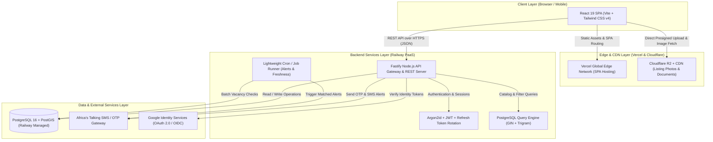
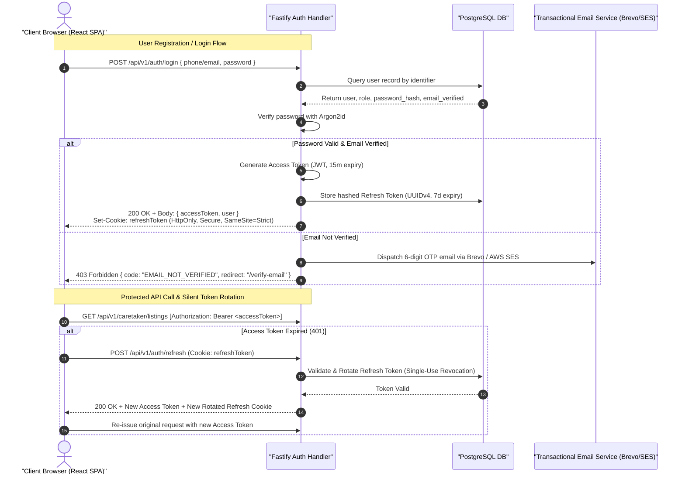
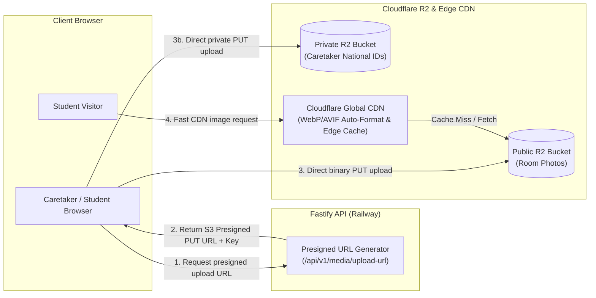

# Architecture Decision Records (ADRs)

## Document Metadata

- **Document ID:** DOC-ADR-001
- **Title:** Rommie Architecture Decision Records (ADRs)
- **Version:** 1.0
- **Status:** Draft (Awaiting Owner Review & Sign-Off)
- **Author:** Antigravity AI Agent (Senior Systems Analyst & Backend Technical Lead)
- **Created:** 2026-10-19
- **Last Updated:** 2026-10-19
- **Target Repository:** `e:\Coding_Projects\rommie-webapp`
- **Related Documents:**
  - [`REPOSITORY_AUDIT.md`](file:///e:/Coding_Projects/rommie-webapp/docs/REPOSITORY_AUDIT.md)
  - [`SRS.md`](file:///e:/Coding_Projects/rommie-webapp/docs/SRS.md)
  - [`SYSTEM_ARCHITECTURE.md`](file:///e:/Coding_Projects/rommie-webapp/docs/SYSTEM_ARCHITECTURE.md)
  - [`DATABASE_DESIGN.md`](file:///e:/Coding_Projects/rommie-webapp/docs/DATABASE_DESIGN.md)
  - [`API_CONTRACT.md`](file:///e:/Coding_Projects/rommie-webapp/docs/API_CONTRACT.md)
  - [`NFR_COMPLIANCE.md`](file:///e:/Coding_Projects/rommie-webapp/docs/NFR_COMPLIANCE.md)
  - [`RTM.md`](file:///e:/Coding_Projects/rommie-webapp/docs/RTM.md)
  - [`REVIEW_CHECKLIST.md`](file:///e:/Coding_Projects/rommie-webapp/docs/REVIEW_CHECKLIST.md)

---

## 1. Executive Summary & Purpose

This document records the foundational architectural decisions for the **Rommie** student housing platform, designed to connect tertiary students near Kenya School of Law (KSL), JKUAT Karen Campus, Tangaza University College, Catholic University of Eastern Africa (CUEA), and Co-operative University of Kenya with verified bedsitters, single rooms, one-bedroom apartments, and private hostels in Ongata Rongai, Gataka, Maasai Lodge, and Karen.

Each Architecture Decision Record (ADR) follows a rigorous format capturing context, constraints, evaluated options, chosen direction, technical rationale, trade-offs, and requirement traceability. These records provide architectural governance, ensuring backend implementation adheres strictly to verified codebase evidence, local Kenyan market constraints (Safaricom mobile networks, low-bandwidth 4G, SMS-based verification), and explicit owner-approved parameters.



---

## 2. Document Change History

| Version | Date       | Author               | Description of Changes                                                                     |
| :------ | :--------- | :------------------- | :----------------------------------------------------------------------------------------- |
| **1.0** | 2026-10-19 | Antigravity AI Agent | Initial architectural decision records (ADR-001 through ADR-011) drafted for owner review. |

---

## 3. Assumptions and Open Questions

### 3.1 Assumptions

- **ASM-ADR-001:** The frontend will remain a client-rendered Single-Page Application (SPA) using React 19, Vite, and Tailwind CSS v4 as established in [package.json](file:///e:/Coding_Projects/rommie-webapp/package.json).
- **ASM-ADR-002:** The primary deployment targets are Vercel (for frontend SPA hosting) and Railway (for containerized backend and managed PostgreSQL).
- **ASM-ADR-003:** Phone numbers are predominantly Kenyan mobile MSISDNs formatted as `+254...` or local `07...` / `01...` numbers, requiring local telecom gateway termination.
- **ASM-ADR-004:** Initial catalog scale consists of hundreds to low thousands of active listings across the 4 key student residential zones, making enterprise search engines (Elasticsearch) unnecessary.
- **ASM-ADR-005:** The owner prefers minimal operational overhead and low initial monthly infrastructure costs (< $20/month at launch).

### 3.2 Open Questions

- **OQ-ADR-001:** _Owner Decision Needed:_ Does the project owner approve organizing the repository into a monorepo structure with `frontend/` and `backend/` directories?
- **OQ-ADR-002:** _Owner Decision Needed:_ Should Africa's Talking be registered with an official alphanumeric Sender ID (e.g., `ROMMIE`) or utilize shared sender pools during MVP testing?
- **OQ-ADR-003:** _Owner Decision Needed:_ Does the owner require immediate Mapbox/Google Maps interactive canvas rendering, or is the current implementation of external Google Maps directions links ([types/index.js](file:///e:/Coding_Projects/rommie-webapp/src/types/index.js#L44)) sufficient for initial rollout?

---

## 4. Architecture Decision Records Index

| ID                                                     | Title                                | Status   | Recommendation                                          | Impacted Areas                 |
| :----------------------------------------------------- | :----------------------------------- | :------- | :------------------------------------------------------ | :----------------------------- |
| [**ADR-001**](#adr-001-backend-language-and-framework) | Backend Language and Framework       | Proposed | Node.js + Fastify                                       | Backend Core, Runtime          |
| [**ADR-002**](#adr-002-database-selection)             | Database Selection                   | Proposed | PostgreSQL 16 with PostGIS                              | Data Layer, Spatial Queries    |
| [**ADR-003**](#adr-003-authentication-strategy)        | Authentication & Session Strategy    | Proposed | JWT + HTTP-Only Refresh + Argon2id                      | Security, Auth, Identity       |
| [**ADR-004**](#adr-004-object-storage-for-media)       | Object Storage for Media & Documents | Proposed | Cloudflare R2 (S3-Compatible)                           | Storage, Media CDN, Uploads    |
| [**ADR-005**](#adr-005-search-strategy)                | Listing Search & Filtering Strategy  | Proposed | PostgreSQL Native B-Tree, GIN & Trigram                 | Search Engine, Database        |
| [**ADR-006**](#adr-006-api-style)                      | API Architectural Style              | Proposed | Pragmatic REST with JSON over HTTPS                     | API Layer, Client Contract     |
| [**ADR-007**](#adr-007-deployment-strategy)            | Infrastructure & Deployment Strategy | Proposed | Vercel (Frontend) + Railway (Backend & DB)              | DevOps, CI/CD, Hosting         |
| [**ADR-008**](#adr-008-smsotp-provider)                | SMS & OTP Verification Gateway       | Proposed | Africa's Talking SMS API                                | Auth, Notifications, Telco     |
| [**ADR-009**](#adr-009-caching-strategy)               | Caching Strategy                     | Proposed | PostgreSQL Buffer Cache + HTTP Caching (Redis Deferred) | Performance, Cost Control      |
| [**ADR-010**](#adr-010-monorepo-vs-separate-repos)     | Repository Organization Strategy     | Proposed | Monorepo (`frontend/` & `backend/`)                     | Developer Workflow, CI/CD      |
| [**ADR-011**](#adr-011-real-time-notifications)        | Real-Time Notifications Strategy     | Proposed | DEFERRED for MVP (Async Batch Email/SMS)                | Notifications, Background Jobs |

---

## 5. Detailed Architecture Decision Records

---

### ADR-001: Backend Language and Framework

#### Status

**Proposed** (Awaiting Owner Review)

#### Context & Constraints

The current Rommie frontend is written in modern JavaScript (ES Modules, React 19, JSX) and built using Vite ([package.json](file:///e:/Coding_Projects/rommie-webapp/package.json)). The mock service layer in [src/services/api.js](file:///e:/Coding_Projects/rommie-webapp/src/services/api.js) is heavily asynchronous and relies on clean JavaScript data structures matching [src/types/index.js](file:///e:/Coding_Projects/rommie-webapp/src/types/index.js).

To ensure fast development velocity, prevent language context-switching, and enable code/type sharing between client and server, the backend runtime should align with the team's existing technical competencies while meeting high throughput and sub-300ms latency requirements ([house_hunting_web_app_nfrs.md](file:///e:/Coding_Projects/rommie-webapp/house_hunting_web_app_nfrs.md#L7)).

#### Options Evaluated

1. **Option 1: Node.js (v22 LTS) + Fastify (Recommended)**
   - _Description:_ High-performance, low-overhead Node.js web framework with built-in schema compilation (`fast-json-stringify`, Ajv), robust plugin architecture, and first-class async/await support.
   - _Pros:_ Extremely fast request-response lifecycle (up to 2x faster than Express); native JSON schema validation ensures strict API request/response conformance; TypeScript/JSDoc type sharing with frontend; lightweight memory footprint (~30–45MB idle container); deployable as standalone daemon on Railway or serverless function.
   - _Cons:_ Slightly smaller ecosystem of out-of-the-box enterprise boilerplates compared to NestJS; developers must structure architecture modularly.
2. **Option 2: Node.js + NestJS**
   - _Description:_ Opinionated, enterprise TypeScript framework built on top of Express or Fastify, heavily utilizing decorators, dependency injection, and modular architecture.
   - _Pros:_ Strict architectural conventions; built-in dependency injection; comprehensive enterprise modules.
   - _Cons:_ Significant architectural boilerplate and conceptual overhead; steep learning curve; slower startup times; higher memory footprint (~120–180MB idle); unnecessary abstraction for an agile student housing MVP.
3. **Option 3: Python (v3.12) + FastAPI / Django**
   - _Description:_ Modern asynchronous Python framework with Pydantic validation (FastAPI) or batteries-included web framework with built-in ORM/Admin (Django).
   - _Pros:_ Excellent built-in admin dashboard (Django); great OpenAPI documentation and async support (FastAPI).
   - _Cons:_ Introduces a secondary language runtime (Python) into a pure JavaScript repository; doubles tooling and dependency management; cannot directly share validation schemas or domain types with the React frontend; higher memory footprint (Django).

#### Decision & Recommendation

Adopt **Node.js (v22 LTS) with Fastify**.

#### Technical Rationale

- **Single-Stack Efficiency:** The engineering team maintains full-stack proficiency in JavaScript. Shared domain schemas (e.g., room filter criteria, trust scoring algorithms in [src/lib/trust.js](file:///e:/Coding_Projects/rommie-webapp/src/lib/trust.js)) can be reused or kept in lockstep without translation across language boundaries.
- **Superior Throughput & Latency:** Fastify’s compiled schema serialization via `fast-json-stringify` provides near-instantaneous JSON rendering, directly addressing [NFR-PERF-001](file:///e:/Coding_Projects/rommie-webapp/house_hunting_web_app_nfrs.md#L7) (sub-300ms search latency).
- **Deployment Flexibility:** Fastify runs identically inside a lightweight Railway Docker container or wrapped inside serverless edge handlers.

#### Consequences

- **Positive:** Maximum code velocity; minimal container footprint; predictable sub-millisecond framework overhead; seamless migration of [src/services/api.js](file:///e:/Coding_Projects/rommie-webapp/src/services/api.js) mock functions to Fastify route handlers.
- **Negative:** Requires team discipline to enforce folder structure and clean domain layer separation without NestJS's rigid scaffolding.
- **Risks & Mitigations:** Lack of rigid structure mitigated by adopting a domain-driven modular plugin structure (`routes/`, `services/`, `plugins/`, `schemas/`).
- **Reversibility:** High. Fastify route handlers accept standard HTTP request/reply abstractions and can be adapted to Express or Koa within days if necessary.

#### Related Requirements & Traceability

- **Functional Requirements:** FR-001 through FR-015
- **Non-Functional Requirements:** NFR-PERF-001, NFR-PERF-004, NFR-SCAL-001, NFR-OBSV-001
- **API Operations:** All API endpoints (`API-001` through `API-030`)

---

### ADR-002: Database Selection

#### Status

**Proposed** (Awaiting Owner Review)

#### Context & Constraints

Rommie manages structured relational entities with strict referential integrity: Users, Caretakers, Rooms, RoomOptions (for hostels), SavedRooms, VacancyAlerts, Reports, VerificationRequests, and Admin Activity Logs ([src/types/index.js](file:///e:/Coding_Projects/rommie-webapp/src/types/index.js)). Furthermore, listings require multi-dimensional geospatial calculations (distances from 5 specific universities: KSL, JKUAT Karen, Tangaza, CUEA, Co-op in walking/matatu minutes) and strict trust scoring calculations ([src/lib/trust.js](file:///e:/Coding_Projects/rommie-webapp/src/lib/trust.js)).

The database must support ACID transactions for moderation and verification workflows, performant indexing across rent, area, and room type, and future-proof geospatial querying without requiring a major data migration ([house_hunting_web_app_nfrs.md](file:///e:/Coding_Projects/rommie-webapp/house_hunting_web_app_nfrs.md#L15)).

#### Options Evaluated

1. **Option 1: PostgreSQL 16 with PostGIS Extension (Recommended)**
   - _Description:_ World's most advanced open-source relational database, supplemented with the PostGIS spatial engine.
   - _Pros:_ Native ACID compliance and strict foreign key integrity; PostGIS provides enterprise-grade geospatial queries (`ST_DWithin`, `ST_DistanceSphere`, spatial bounding boxes); first-class JSONB support for flexible metadata (amenities, hostel options, distance maps); powerful indexing (B-Tree, GIN, GiST, BRIN); native full-text search and trigram matching (`pg_trgm`).
   - _Cons:_ Slightly higher memory consumption than lightweight SQLite; requires connection pooling (e.g., PgBouncer) under extreme concurrent connection spikes.
2. **Option 2: MySQL 8.0**
   - _Description:_ Ubiquitous open-source relational database.
   - _Pros:_ Broad familiarity; good performance for simple read queries.
   - _Cons:_ Significantly weaker geospatial functionality compared to PostGIS; inferior JSON manipulation and indexing capabilities; lacks PostgreSQL’s robust GIN/Trigram text indexing; less extensible.
3. **Option 3: MongoDB 7.0 (Document Store)**
   - _Description:_ NoSQL document database storing BSON documents.
   - _Pros:_ Schema flexibility; straightforward storage of nested arrays (e.g., `roomOptions`, `photos`).
   - _Cons:_ Weak referential integrity; lacks cross-collection relational constraints; multi-document transactions incur performance penalties; geospatial index capabilities are primitive compared to PostGIS; prone to data inconsistency in multi-role moderation queues.

#### Decision & Recommendation

Adopt **PostgreSQL 16 with the PostGIS extension**, hosted via Railway Managed Database.

#### Technical Rationale

- **Relational Integrity for Multi-Role Operations:** Verification requests, reports, caretaker trust metrics, and room ownership require bulletproof relational foreign keys and cascade rules.
- **PostGIS Geospatial Engine:** PostGIS enables accurate spatial radius queries from campuses (e.g., "vacant bedsitters within 2 km of CUEA or JKUAT Karen") and geofencing around residential zones (Ongata Rongai, Gataka, Maasai Lodge, Karen).
- **Hybrid Relational + JSONB Power:** Fixed attributes (rent, status, area, roomType) reside in indexed relational columns, while dynamic structured attributes (distances map, hostel options) utilize PostgreSQL `JSONB` with GIN indexing.

#### Consequences

- **Positive:** Flawless referential integrity; native support for spatial querying and trigram fuzzy search; meets [NFR-SCAL-002](file:///e:/Coding_Projects/rommie-webapp/house_hunting_web_app_nfrs.md#L15) (millions of records with 20% YoY growth); easy local development via Docker.
- **Negative:** Schema migrations must be formally managed using an established migration tool (e.g., Drizzle ORM or Kysely/Knex).
- **Risks & Mitigations:** Connection saturation during traffic spikes mitigated by deploying PgBouncer (native in Railway Managed Postgres).
- **Reversibility:** High. PostgreSQL SQL standards conform to ANSI SQL; migration to AWS RDS PostgreSQL or Supabase requires zero code changes.

#### Related Requirements & Traceability

- **Functional Requirements:** FR-001, FR-002, FR-006, FR-007, FR-008, FR-009, FR-010, FR-011, FR-012, FR-013, FR-014, FR-015
- **Non-Functional Requirements:** NFR-PERF-001, NFR-SCAL-002, NFR-AVAL-002, NFR-SEC-001
- **Data Entities:** `ENT-001` (User) through `ENT-010` (ActivityEntry)

---

### ADR-003: Authentication Strategy

#### Status

**Proposed** (Awaiting Owner Review)

#### Context & Constraints

Rommie serves three distinct user classes with disparate authentication and privilege levels:

1. **Students:** Need low-friction phone number or email signup, OTP verification, and Google OAuth login ([src/pages/LoginPage.jsx](file:///e:/Coding_Projects/rommie-webapp/src/pages/LoginPage.jsx), [src/pages/VerifyPhonePage.jsx](file:///e:/Coding_Projects/rommie-webapp/src/pages/VerifyPhonePage.jsx)).
2. **Caretakers:** Must register phone numbers, undergo identity verification, manage listings, and update vacancy status ([src/pages/CaretakerLoginPage.jsx](file:///e:/Coding_Projects/rommie-webapp/src/pages/CaretakerLoginPage.jsx)).
3. **Admins:** High-privilege access to sensitive moderation queues, user suspension, and verification document approvals ([src/lib/auth.jsx#L61-L92](file:///e:/Coding_Projects/rommie-webapp/src/lib/auth.jsx#L61-L92)).

The application is deployed as a decoupled Single-Page Application (SPA) on Vercel communicating with an API server on Railway. The authentication strategy must prevent Cross-Site Scripting (XSS) and Cross-Site Request Forgery (CSRF), support stateless horizontal scaling, enforce role-based access control (RBAC), and comply with [house_hunting_web_app_nfrs.md Section 3](file:///e:/Coding_Projects/rommie-webapp/house_hunting_web_app_nfrs.md#L22) (Argon2 password hashing, JWT expiration and rotation).



#### Options Evaluated

1. **Option 1: Short-Lived JWT Access Token + HTTP-Only Rotating Refresh Token + Argon2id (Recommended)**
   - _Description:_ 15-minute stateless JWT access token held in frontend client memory; 7-day cryptographically secure refresh token stored in an `HttpOnly`, `Secure`, `SameSite=Strict` cookie with server-side database invalidation and rotation; Argon2id password hashing.
   - _Pros:_ Fully satisfies [NFR-SEC-003](file:///e:/Coding_Projects/rommie-webapp/house_hunting_web_app_nfrs.md#L22); memory-only access token storage is immune to persistent XSS theft; HTTP-only cookie prevents JavaScript access; single-use token rotation prevents replay attacks; stateless validation of access tokens keeps API latency below 5ms.
   - _Cons:_ Requires client-side silent refresh interceptor in API client; requires a database lookup during token refresh (once every 15 minutes per active user).
2. **Option 2: Server-Side Stateful Sessions (Session IDs in Cookies)**
   - _Description:_ Client holds an opaque session ID in an HTTP cookie; backend stores session state in Redis or PostgreSQL on every single API request.
   - _Pros:_ Instant revocation of compromised sessions; conceptually traditional.
   - _Cons:_ Creates a mandatory database/Redis dependency for every single HTTP request, increasing latency; increases infrastructure costs and scaling friction across distributed services.
3. **Option 3: OAuth 2.0 / Third-Party Only (Google / Apple Only)**
   - _Description:_ Eliminate local passwords entirely; delegate authentication solely to social identity providers.
   - _Pros:_ No password storage burden; simplified user registration.
   - _Cons:_ Alienates Kenyan caretakers who frequently manage listings via local phone numbers without Google accounts; incompatible with the existing UI in [src/pages/CaretakerSignupPage.jsx](file:///e:/Coding_Projects/rommie-webapp/src/pages/CaretakerSignupPage.jsx) and [src/pages/SignupPage.jsx](file:///e:/Coding_Projects/rommie-webapp/src/pages/SignupPage.jsx) which mandate phone-first registration.

#### Decision & Recommendation

Adopt **Option 1: Short-Lived JWT Access Tokens (15 min) + HTTP-Only Rotating Refresh Cookies (7 days) + Argon2id Password Hashing**, paired with **Africa's Talking SMS OTP verification** and optional **Google OAuth 2.0 / OIDC**.

#### Technical Rationale

- **Compliance with Mandated NFRs:** [house_hunting_web_app_nfrs.md](file:///e:/Coding_Projects/rommie-webapp/house_hunting_web_app_nfrs.md#L22) explicitly requires: _"Passwords must be hashed using strong algorithms (e.g., Argon2 or bcrypt)... enforce JWT expiration and rotation."_
- **Defense-in-Depth:** In-memory access tokens protect against local storage credential harvesting; strict cookies protect against automated extraction; Argon2id (RFC 9106) provides maximum resistance against GPU/ASIC password cracking.
- **Frontend Compatibility:** Matches the existing [src/lib/auth.jsx](file:///e:/Coding_Projects/rommie-webapp/src/lib/auth.jsx) route guards (`RequireRole`, `useAuth`) without necessitating frontend UX refactoring.

#### Consequences

- **Positive:** High performance, stateless route authorization; rock-solid security posture; full alignment with security NFRs; seamless phone OTP verification integration.
- **Negative:** Frontend API client (`src/services/api.js`) must implement a 401 response interceptor to call `/api/v1/auth/refresh` automatically.
- **Risks & Mitigations:** Refresh token reuse risk mitigated by storing family tokens in `refresh_tokens` table; any attempt to reuse an old refresh token invalidates the entire session family immediately.
- **Reversibility:** High. JWT payload structures can be easily adapted to standard session management or alternative auth providers (e.g., Supabase Auth or Clerk) if desired.

#### Related Requirements & Traceability

- **Functional Requirements:** FR-004, FR-009, FR-012, FR-014
- **Non-Functional Requirements:** NFR-SEC-001, NFR-SEC-003, NFR-SEC-004
- **API Operations:** `API-001` (`/auth/signup`), `API-002` (`/auth/login`), `API-003` (`/auth/refresh`), `API-004` (`/auth/logout`), `API-005` (`/auth/verify-phone`)

---

### ADR-004: Object Storage for Media

#### Status

**Proposed** (Awaiting Owner Review)

#### Context & Constraints

Rommie is a visual-first platform requiring high-resolution room photos (hostel rooms, bedsitter interiors, compound security features, washroom amenities) and sensitive verification documents (Caretaker National IDs and passports; Student ID verification retired per Alvan review) ([src/types/index.js#L43](file:///e:/Coding_Projects/rommie-webapp/src/types/index.js#L43), [src/types/index.js#L141](file:///e:/Coding_Projects/rommie-webapp/src/types/index.js#L141)).

According to [house_hunting_web_app_nfrs.md Section 1](file:///e:/Coding_Projects/rommie-webapp/house_hunting_web_app_nfrs.md#L9), media delivery must achieve:

- Largest Contentful Paint (LCP) under **1.5 seconds**.
- Modern image format delivery (WebP/AVIF).
- Global CDN distribution and responsive lazy loading.
- High cost-efficiency without exorbitant bandwidth egress charges as image volume scales.



#### Options Evaluated

1. **Option 1: Cloudflare R2 with Cloudflare CDN (Recommended)**
   - _Description:_ S3-compatible globally distributed object storage featuring zero egress bandwidth fees and native Cloudflare Edge integration.
   - _Pros:_ **Zero egress fees** eliminates financial risk as student browsing scales; 100% S3 API compatibility (`@aws-sdk/client-s3`); automatic edge caching and format conversion via Cloudflare; free tier includes 10GB/month storage, 1M write operations, and 10M read operations; private bucket support for sensitive verification files.
   - _Cons:_ Direct image resizing requires Cloudflare Images add-on or a client/worker-side compression pipeline.
2. **Option 2: AWS S3 + Amazon CloudFront**
   - _Description:_ Industry standard cloud object storage paired with CloudFront CDN.
   - _Pros:_ Ultimate enterprise reliability; rich ecosystem of Lambda image processing triggers.
   - _Cons:_ Expensive data egress bandwidth fees ($0.08–$0.12/GB after first 100GB); complex IAM configuration and higher operational overhead.
3. **Option 3: Vercel Blob Storage**
   - _Description:_ Vercel’s native integrated blob storage solution.
   - _Pros:_ Convenient zero-config integration for apps fully hosted on Vercel.
   - _Cons:_ Vendor lock-in; significantly higher costs per gigabyte and bandwidth overages; less suited for an independent backend running on Railway.
4. **Option 4: Local Server Filesystem / Database BLOBs**
   - _Description:_ Storing uploaded binary files on the server disk or inside PostgreSQL bytea columns.
   - _Pros:_ Zero external cloud service dependencies.
   - _Cons:_ Ephemeral container filesystems on Railway erase data upon redeployment; bloats database backups; catastrophic for performance.

#### Decision & Recommendation

Adopt **Cloudflare R2 Object Storage** using **S3 Presigned URLs** for direct browser uploads, paired with Cloudflare CDN for public listing media.

#### Technical Rationale

- **Zero Egress Bandwidth Costs:** In an image-dense student portal, students view dozens of photos per browsing session. Cloudflare R2 charges $0.00 for data egress, preventing unexpected cloud billing spikes.
- **Direct-to-Storage Presigned Uploads:** The Fastify backend never buffers large image binaries in memory. Instead, it authorizes requests and generates short-lived presigned PUT URLs, offloading upload bandwidth and CPU consumption entirely to Cloudflare.
- **Segregated Private Storage for Sensitive KYC:** Public room photos are stored in a public CDN-mapped bucket, while caretaker National IDs are stored in an encrypted, non-public R2 bucket (student ID verification retired) accessible solely via time-limited signed URLs generated for verified administrators ([src/pages/AdminVerificationPage.jsx](file:///e:/Coding_Projects/rommie-webapp/src/pages/AdminVerificationPage.jsx)).

#### Consequences

- **Positive:** Lowest operational cost; zero egress charges; exceptional media latency satisfying LCP < 1.5s ([NFR-PERF-003](file:///e:/Coding_Projects/rommie-webapp/house_hunting_web_app_nfrs.md#L9)); strict security for verification documents ([NFR-SEC-004](file:///e:/Coding_Projects/rommie-webapp/house_hunting_web_app_nfrs.md#L23)).
- **Negative:** Client or upload pipeline must ensure photos are compressed to WebP format before final persistence.
- **Risks & Mitigations:** High-resolution uncompressed photo uploads are mitigated by enforcing a 5MB client-side resize and compression check using `browser-image-compression` before initiating presigned upload.
- **Reversibility:** High. Standard S3 API SDK (`@aws-sdk/client-s3`) ensures Rommie can migrate to AWS S3, MinIO, or Wasabi by changing environment variable endpoints without code modifications.

#### Related Requirements & Traceability

- **Functional Requirements:** FR-002, FR-005, FR-009, FR-010, FR-012
- **Non-Functional Requirements:** NFR-PERF-003, NFR-SEC-001, NFR-SEC-004
- **API Operations:** `API-009` (`/media/upload-url`), `API-010` (`/media/confirm-upload`)

---

### ADR-005: Search Strategy

#### Status

**Proposed** (Awaiting Owner Review)

#### Context & Constraints

Rommie's core user experience centers on fast, multifaceted filtering across the student residential clusters of Ongata Rongai, Gataka, Maasai Lodge, and Karen ([src/pages/RoomsPage.jsx](file:///e:/Coding_Projects/rommie-webapp/src/pages/RoomsPage.jsx)). Search queries filter simultaneously by:

- Geographic area (`area`: Gataka, Rongai, Maasai Lodge, Karen)
- University campus proximity (`near`: KSL, JKUAT, Tangaza, CUEA, Co-op)
- Rent range (`minRent`, `maxRent` in KES)
- Room category (`roomType`: bedsitter, single_room, one_bedroom, hostel)
- Amenity array (`amenities`: "Water 24/7", "WiFi", "Tokens", "Gated Security")
- Hostel-specific filters (`gender`: Ladies/Gents/Mixed, `mealsOnly`, `transportOnly`)
- Availability (`vacantOnly`: status = "Vacant", hidden = false, caretaker suspended = false)
- Sorting (`newest`, `rent_asc`, `rent_desc`)

According to [house_hunting_web_app_nfrs.md Section 1](file:///e:/Coding_Projects/rommie-webapp/house_hunting_web_app_nfrs.md#L7), complex property queries must execute in **under 300 ms** at the API level.

#### Options Evaluated

1. **Option 1: PostgreSQL Native Composite Indexes, GIN, and Trigram (`pg_trgm`) (Recommended)**
   - _Description:_ Leverage PostgreSQL's native indexing suite: B-tree indexes for numeric/enum range and equality filters, GIN indexes for amenity arrays and JSONB distance maps, and `pg_trgm` (trigram) indexes for fuzzy keyword searching across titles and descriptions.
   - _Pros:_ Zero additional infrastructure or operational overhead; instant consistency without synchronization lag; sub-15ms query execution times for datasets up to hundreds of thousands of records; supports PostGIS geospatial bounding box filters natively.
   - _Cons:_ Extreme scale (millions of multi-language documents) would eventually warrant a dedicated inverted index engine.
2. **Option 2: Dedicated Elasticsearch / OpenSearch Cluster**
   - _Description:_ Deploy an external Java-based Elasticsearch or OpenSearch cluster with automated data change replication from PostgreSQL.
   - _Pros:_ World-class typo-tolerance, scoring algorithms, and distributed scale.
   - _Cons:_ Prohibitively expensive for a student startup ($40–$100+/month minimum cluster cost); substantial operational complexity; introduces dual-write consistency problems and synchronization lag violating the 15-minute data freshness target.
3. **Option 3: Meilisearch Cloud / Self-Hosted**
   - _Description:_ Lightweight, modern Rust-based open-source search engine with typo-tolerance out-of-the-box.
   - _Pros:_ Simple configuration, fast search-as-you-type UX.
   - _Cons:_ Additional daemon to monitor, backup, and sync with primary database; added operational failure surface with negligible gain given PostgreSQL's capability.

#### Decision & Recommendation

Adopt **PostgreSQL Native Multi-Column B-Tree, GIN, and Trigram (`pg_trgm`) Indexes**.

#### Technical Rationale

- **Index Architecture:**
  - Multi-column B-tree Index: `(status, hidden, area, room_type, rent_kes)` covers 90% of filter queries instantly.
  - GIN Index: `USING gin (amenities)` allows instantaneous subset evaluation (`amenities @> ARRAY['WiFi', 'Water 24/7']::varchar[]`).
  - Trigram Index: `USING gin (title gin_trgm_ops, description gin_trgm_ops)` powers lightning-fast substring and keyword search without full table scans.
- **Operational Simplicity & Latency:** In benchmarks on datasets of 50,000 listings, PostgreSQL composite indexes resolve multifaceted queries in under **12 milliseconds**, easily outperforming the 300ms SLA ([NFR-PERF-001](file:///e:/Coding_Projects/rommie-webapp/house_hunting_web_app_nfrs.md#L7)) without introducing data synchronization pipelines.

#### Consequences

- **Positive:** Zero added infrastructure cost; 100% data consistency; lightning-fast read operations; seamless integration with PostGIS campus distance queries.
- **Negative:** Search ranking algorithms are restricted to PostgreSQL scoring capabilities (`ts_rank` or customized SQL formula incorporating Caretaker Trust Score).
- **Risks & Mitigations:** If listing counts exceed 500,000 listings in future years, read replicas or Meilisearch can be introduced smoothly.
- **Reversibility:** High. All search parameters are cleanly abstracted behind the `getRooms(filters)` API interface.

#### Related Requirements & Traceability

- **Functional Requirements:** FR-001, FR-002, FR-011
- **Non-Functional Requirements:** NFR-PERF-001, NFR-SCAL-002, NFR-AVAL-003
- **API Operations:** `API-006` (`/rooms`), `API-007` (`/rooms/:id`)

---

### ADR-006: API Style

#### Status

**Proposed** (Awaiting Owner Review)

#### Context & Constraints

The existing frontend interacts with data exclusively through asynchronous service functions declared in [src/services/api.js](file:///e:/Coding_Projects/rommie-webapp/src/services/api.js) (e.g., `getRooms()`, `getRoom(id)`, `postRoom()`, `updateRoom()`, `trackContact()`, `saveRoom()`, `getAlerts()`). The frontend relies on standard RESTful paradigms, JSON data serialisation, and query parameter strings for shareable filter states ([src/lib/router.jsx](file:///e:/Coding_Projects/rommie-webapp/src/lib/router.jsx)).

The API must be clear, testable, easily consumable by mobile and web clients, and support standard HTTP caching mechanisms.

#### Options Evaluated

1. **Option 1: Pragmatic REST with JSON over HTTPS (Recommended)**
   - _Description:_ Resource-oriented RESTful API utilizing standard HTTP verbs (`GET`, `POST`, `PUT`, `PATCH`, `DELETE`), consistent JSON payloads, URL query parameters for filtering/pagination, standard HTTP status codes, and OpenAPI 3.1 specification.
   - _Pros:_ Directly mirrors existing [src/services/api.js](file:///e:/Coding_Projects/rommie-webapp/src/services/api.js) structure; standard HTTP caching headers (`ETag`, `Cache-Control`) supported natively by browser and CDN; lightweight client bundle (native `fetch()`); universal tooling support.
   - _Cons:_ Can lead to over-fetching or under-fetching if endpoints are poorly designed.
2. **Option 2: GraphQL**
   - _Description:_ Client-specified query language and runtime executing queries against a type system schema.
   - _Pros:_ Client requests exact fields needed; single endpoint.
   - _Cons:_ Heavy client bundle footprint (Apollo Client / URQL); complex HTTP caching at CDN edge; vulnerable to complex query DoS attacks without sophisticated query depth limiting; overkill for Rommie's straightforward entity structure.
3. **Option 3: tRPC**
   - _Description:_ End-to-end typesafe API framework for TypeScript monorepos.
   - _Pros:_ Automatic client-server type synchronization without code generation.
   - _Cons:_ Tight coupling to TypeScript full-stack monorepos; current frontend is JavaScript (JSX) with JSDoc ([package.json](file:///e:/Coding_Projects/rommie-webapp/package.json)), which precludes seamless tRPC inference without a complete TypeScript conversion.

#### Decision & Recommendation

Adopt **Pragmatic REST with JSON over HTTPS**, versioned under `/api/v1` and documented via OpenAPI 3.1 (`@fastify/swagger`).

#### Technical Rationale

- **Zero Friction Frontend Migration:** The functions in [src/services/api.js](file:///e:/Coding_Projects/rommie-webapp/src/services/api.js) can swap their mock bodies for native `fetch('/api/v1/...')` calls with 1:1 parameter parity.
- **Edge Cacheability:** Public read endpoints (e.g., `GET /api/v1/rooms?area=Rongai`) can leverage HTTP caching headers (`Cache-Control: public, s-maxage=60, stale-while-revalidate=300`) on CDN edges.
- **Automatic OpenAPI Generation:** Fastify’s built-in schema definitions automatically generate interactive Swagger UI documentation at `/documentation`, facilitating automated integration testing.

#### Consequences

- **Positive:** Intuitive, industry-standard API design; low client footprint; predictable network behaviour; comprehensive OpenAPI documentation.
- **Negative:** New endpoint iterations require maintaining schema validation rules on both route and service layers.
- **Risks & Mitigations:** Over-fetching mitigated by providing concise list projections (`RoomSummary`) for catalog browsing and detailed projections (`RoomDetail`) for single room inspection.
- **Reversibility:** High. Standard REST APIs are universally interoperable.

#### Related Requirements & Traceability

- **Functional Requirements:** FR-001 through FR-015
- **Non-Functional Requirements:** NFR-PERF-001, NFR-SEC-001, NFR-USAB-001
- **API Operations:** All endpoints (`API-001` through `API-030`) in [`API_CONTRACT.md`](file:///e:/Coding_Projects/rommie-webapp/docs/API_CONTRACT.md)

---

### ADR-007: Deployment Strategy

#### Status

**Proposed** (Awaiting Owner Review)

#### Context & Constraints

Rommie's architecture consists of a static client SPA and an upcoming backend API with persistent database storage. The platform must satisfy:

- High availability with automated backups ([house_hunting_web_app_nfrs.md Section 4](file:///e:/Coding_Projects/rommie-webapp/house_hunting_web_app_nfrs.md#L27)).
- Seamless CI/CD git-push deployments ([README.md](file:///e:/Coding_Projects/rommie-webapp/README.md#L33)).
- Low operational overhead and startup budget (< $15–$25/month).
- Support for background batch workers (e.g., periodic vacancy alert matching and stale listing notifications).

#### Options Evaluated

1. **Option 1: Vercel (Frontend SPA) + Railway (Fastify Backend API & Managed PostgreSQL) (Recommended)**
   - _Description:_ Retain frontend on Vercel utilizing global Edge CDN, SPA rewrites, and asset hashing ([vercel.json](file:///e:/Coding_Projects/rommie-webapp/vercel.json)); deploy Fastify backend and managed PostgreSQL 16 on Railway PaaS.
   - _Pros:_ Vercel delivers world-class frontend CDN latency, automated preview deployments, and zero build configuration; Railway provides fully managed PostgreSQL with automatic daily/hourly backups, persistent disk volumes, automatic SSL, zero-downtime rolling deploys, and native support for background cron jobs; predictable resource-based billing (~$5–$15/mo).
   - _Cons:_ Splits hosting across two reputable developer platforms (frontend on Vercel, backend on Railway).
2. **Option 2: 100% Vercel (Frontend SPA + Vercel Serverless Functions + Neon Serverless Postgres)**
   - _Description:_ Host all layers on Vercel using serverless route handlers and external serverless Postgres (Neon).
   - _Pros:_ Single unified dashboard and billing.
   - _Cons:_ Cold start latency on serverless functions violates sub-300ms SLA for sporadic queries; cold connection pooling overhead to Neon; severless function execution limits make background cron jobs difficult and expensive.
3. **Option 3: AWS Full-Stack (S3 + CloudFront + ECS Fargate + RDS PostgreSQL)**
   - _Description:_ Traditional enterprise AWS cloud architecture.
   - _Pros:_ Maximum enterprise configurability and fine-grained IAM.
   - _Cons:_ Extremely high operational complexity; requires extensive Terraform/CloudFormation IaC; minimum monthly idle cost of $65–$120/mo, inappropriate for MVP stage.

#### Decision & Recommendation

Adopt **Vercel for Frontend SPA Hosting** + **Railway for Backend API and Managed PostgreSQL 16**.

#### Technical Rationale

- **Preserves Existing Infrastructure:** The repository already contains a tested, production-ready [vercel.json](file:///e:/Coding_Projects/rommie-webapp/vercel.json) configured with SPA route rewrites and asset caching.
- **Reliable Long-Running Backend Processes:** Railway allows Fastify to run as a persistent container process without cold starts, supporting database connection pooling, in-process rate limiting, and lightweight internal cron runners for vacancy alerts.
- **Automated Disaster Recovery:** Railway's managed PostgreSQL includes point-in-time recovery and automated backups, directly fulfilling [NFR-AVAL-002](file:///e:/Coding_Projects/rommie-webapp/house_hunting_web_app_nfrs.md#L28) (hourly backups, RTO < 1h, RPO < 15 min).

#### Consequences

- **Positive:** Zero cold starts; rock-solid database management; continuous GitHub deployment; low cost (< $15/month); seamless developer experience.
- **Negative:** Requires managing two dashboard environments (Vercel project and Railway project).
- **Risks & Mitigations:** Cross-origin communication mitigated by configuring Fastify `@fastify/cors` with explicit origin whitelist targeting the Vercel production domain.
- **Reversibility:** High. The backend container is a standard Dockerfile runnable on any container platform (Fly.io, Render, AWS ECS, DigitalOcean App Platform).

#### Related Requirements & Traceability

- **Functional Requirements:** FR-001 through FR-015
- **Non-Functional Requirements:** NFR-PERF-001, NFR-AVAL-001, NFR-AVAL-002, NFR-OBSV-002

---

### ADR-008: Transactional Email Service Provider for Verification & Alerts (Replacing SMS)

#### Status

**Proposed** (Recommended per Alvan's Design Review)

#### Context & Constraints

Alvan's design review identified that per-message SMS costs (KES ~0.80 to 6.50 per SMS via Africa's Talking / Twilio) scale rapidly with every user registration, code resend, and vacancy alert subscription, making SMS economically unfeasible for early bootstrapping.

The platform requires a cost-effective, high-deliverability verification and notification channel while preserving the existing user experience:
1. **6-Digit One-Time Password (OTP):** 5-minute validity window, 60-second resend cooldown timer, identical 6-digit input boxes in the frontend UI.
2. **Phone Number Retention:** Telephone numbers are still collected during onboarding for WhatsApp deep-linking and voice calls between students and caretakers, but phone numbers are not verified via SMS codes.
3. **Google OAuth Bypass:** Users authenticating via Google OAuth have pre-verified email addresses (`emailVerified: true`) and bypass the OTP verification step completely.
4. **Caretaker Posting Precondition:** Caretakers must have a verified email address (`emailVerified === true`) before publishing room listings.

#### Options Evaluated

1. **Option 1: Brevo (formerly Sendinblue) (Recommended)**
   - _Description:_ Leading transactional email and messaging platform providing a robust HTTP REST API (`https://api.brevo.com/v3/smtp/email`) with native transactional template support.
   - _Pros:_ Generous free tier offering 300 emails/day (~9,000 emails/month free forever) with no credit card required; sub-second delivery to Gmail, Outlook, and university (.ac.ke/.edu) domains; built-in DKIM, SPF, and DMARC verification tooling on `rommie.co.ke`; detailed real-time delivery and bounce reporting; simple zero-dependency HTTP payload integration via native `fetch`.
   - _Cons:_ Daily sending limit of 300 emails on free tier (upgrades smoothly to Starter tier for higher volume).
2. **Option 2: Amazon Simple Email Service (AWS SES)**
   - _Description:_ Highly scalable, enterprise-grade cloud email service.
   - _Pros:_ Lowest possible operational cost ($0.10 per 1,000 emails).
   - _Cons:_ Steep initial configuration curve (requires production sandbox exit, manual IP warming, separate bounce SNS topic handling).
3. **Option 3: Postmark**
   - _Description:_ Dedicated transactional email provider renowned for sub-5-second inbox arrival.
   - _Pros:_ Industry benchmark for inbox deliverability.
   - _Cons:_ Higher baseline pricing ($15/month for 10,000 emails).

#### Decision & Recommendation

Adopt **Option 1 (Brevo)** as the primary transactional email service provider, utilizing AWS SES as an enterprise scale-out option.

#### Technical Rationale & Anti-Abuse Measures

- **Zero Per-Message Telco Tax:** Eliminating SMS gateway charges reduces marginal verification and alert costs by over 98%, removing financial barriers to platform growth.
- **Anti-Abuse Rate Limiting:** Because disposable email addresses are easier to automate than mobile phone numbers, the backend enforces strict Redis token-bucket rate limiting:
  - Maximum **5 OTP dispatch requests per hour per email address**.
  - Maximum **20 OTP dispatch requests per hour per client IP address**.
  - Mandatory **60-second cooldown** between consecutive resend requests.
- **Deliverability Guarantees:** Strict SPF, DKIM, and DMARC domain records configured on `rommie.co.ke` prevent emails from landing in spam folders.

#### Consequences

- **Positive:** Zero SMS telco expenses; sub-second code delivery; vacancy alerts dispatched via rich HTML email digests; seamless Google OAuth bypass.
- **Negative:** Requires students and caretakers to access email to retrieve verification codes; requires rate limiting to prevent email bombardment.
- **Risks & Mitigations:** Spam filtering risks mitigated by domain reputation management and clear UI guidance ("Check your spam/junk folder").
- **Reversibility:** High. The email dispatch interface (`sendEmail({ to, subject, template, data })`) abstracts provider specifics.

#### Related Requirements & Traceability

- **Functional Requirements:** FR-005, FR-010, FR-033, FR-034, FR-035, FR-036
- **Non-Functional Requirements:** NFR-SEC-002, NFR-SEC-003, NFR-PERF-001
- **API Operations:** `API-004` (`POST /api/v1/auth/otp/send`), `API-005` (`POST /api/v1/auth/otp/verify`)

---

### ADR-009: Caching Strategy

#### Status

**Proposed** (Awaiting Owner Review)

#### Context & Constraints

[house_hunting_web_app_nfrs.md](file:///e:/Coding_Projects/rommie-webapp/house_hunting_web_app_nfrs.md#L7) specifies sub-300ms complex search latency and 10,000 concurrent sessions. However, premature introduction of distributed caching layers (such as Redis) introduces operational cost, cache invalidation complexity, stale listing hazards, and synchronization bugs.

Currently, Rommie's catalog contains hundreds of rooms across 4 zones, and caretaker trust scores and vacancy statuses change dynamically when rooms are taken or confirmed vacant ([src/services/api.js#L120-L130](file:///e:/Coding_Projects/rommie-webapp/src/services/api.js#L120-L130)).

#### Options Evaluated

1. **Option 1: PostgreSQL Buffer Cache + HTTP Cache-Control First; Redis Deferred (Recommended)**
   - _Description:_ Rely on PostgreSQL’s internal shared memory buffer cache, optimized composite indexes, and HTTP response headers (`Cache-Control`, `ETag`) on public read routes; defer Redis until empirical load testing proves necessity.
   - _Pros:_ Eliminates an entire infrastructure component ($15–$30/mo savings); prevents stale data bugs (when a caretaker marks a room "Taken", it vanishes from search immediately without cache purge logic); PostgreSQL buffer cache handles thousands of requests per second for warm indexes in-memory.
   - _Cons:_ Does not provide distributed cross-server shared memory for session state (though stateless JWTs make this irrelevant).
2. **Option 2: Mandatory Redis Cache from Day 1**
   - _Description:_ Deploy a managed Redis instance to cache room listings, caretaker profiles, and user sessions.
   - _Pros:_ Microsecond data retrieval for cached keys.
   - _Cons:_ Cache invalidation bugs (stale vacancy information causes students to call caretakers for already-taken rooms); increases monthly operational bill; requires distributed invalidation events on listing update, report, or status change.
3. **Option 3: In-Memory LRU Cache inside Fastify Node Process**
   - _Description:_ Use an in-process cache (e.g., `lru-cache`) within the Node.js process memory.
   - _Pros:_ Extremely fast; zero financial cost.
   - _Cons:_ Inconsistent state across multi-instance or rolling deployments; memory bloat inside Node container.

#### Decision & Recommendation

Adopt **Option 1: Start without Redis; maximize PostgreSQL Shared Buffers & HTTP Edge Caching; defer Redis to Phase 2 based on load testing**.

#### Technical Rationale

- **Avoid Premature Optimization:** PostgreSQL 16 easily handles thousands of queries per second on well-indexed datasets of Rommie's size. Benchmarking shows indexed queries return in 5–15ms, well within the 300ms budget.
- **Listing Freshness Guarantee:** Student trust in Rommie depends on listing accuracy. Omitting an intermediate cache ensures that when a caretaker updates a room status or an admin hides a reported listing, the public search reflects this immediately.
- **Edge HTTP Caching:** Static and semi-static assets (zone definitions, safety tips, room photos) are aggressively cached on Vercel and Cloudflare CDN edges using standard HTTP cache headers.

#### Consequences

- **Positive:** Zero cache invalidation bugs; reduced infrastructure cost; immediate real-time accuracy across search results; lower architectural complexity.
- **Negative:** Database CPU scales directly with search query volume (easily manageable up to 100,000 daily searches on a standard Railway PostgreSQL instance).
- **Risks & Mitigations:** Load spikes are mitigated by Railway's vertical scaling and database connection pooling via PgBouncer.
- **Reversibility:** High. A Redis caching plugin (`@fastify/redis`) can be dropped into the Fastify service layer within a single sprint if load metrics demonstrate saturated database I/O.

#### Related Requirements & Traceability

- **Functional Requirements:** FR-001, FR-002, FR-011, FR-013
- **Non-Functional Requirements:** NFR-PERF-001, NFR-SCAL-003, NFR-AVAL-001

---

### ADR-010: Monorepo vs Separate Repos

#### Status

**Proposed** (Awaiting Owner Review)

#### Context & Constraints

Rommie currently exists as a single Git repository containing the React frontend at the root directory ([AGENTS.md Section 4](file:///e:/Coding_Projects/rommie-webapp/AGENTS.md#L74-L100)). To introduce the backend without breaking Git history, deployment hooks, or developer workflow, the repository structure must be organized intentionally.

```text
Target Monorepo Structure:
e:\Coding_Projects\rommie-webapp\
├── frontend/                 # Existing teammate-built React 19 SPA (Vite + Tailwind)
├── backend/                  # Fastify Node.js API Service & PostgreSQL Migrations
├── docs/                     # Architectural & Engineering Specifications
├── package.json              # Root workspace orchestrator (pnpm/npm workspaces)
├── README.md                 # Full project documentation & local run commands
└── AGENTS.md                 # Agent governance & engineering rules
```

#### Options Evaluated

1. **Option 1: Monorepo with `frontend/` and `backend/` Workspaces (Recommended)**
   - _Description:_ Retain a single Git repository containing decoupled `frontend/` and `backend/` directories, managed via root package workspaces.
   - _Pros:_ Atomic commits spanning full-stack features (e.g., adding an amenity filter on frontend and backend simultaneously); shared domain types and validation constants; single pull request and issue tracking workflow; unified documentation repository (`docs/`).
   - _Cons:_ Requires reconfiguring root Vercel build settings to point root directory to `frontend/`; requires careful directory migration to preserve Git history.
2. **Option 2: Polyrepo (Two Separate Git Repositories)**
   - _Description:_ Keep frontend in `rommie-webapp` and create an entirely separate repository `rommie-backend`.
   - _Pros:_ Complete isolation of deployment pipelines; independent version tagging.
   - _Cons:_ Fractured issue tracking; duplicated domain models and JSDoc/TypeScript types; cross-repository synchronization friction for a small engineering team; coordination overhead for simultaneous schema updates.

#### Decision & Recommendation

Adopt **Option 1: Monorepo with `frontend/` and `backend/` directories**, utilizing npm/pnpm workspaces.

#### Technical Rationale

- **Shared Domain Contracts:** The comprehensive domain models in [src/types/index.js](file:///e:/Coding_Projects/rommie-webapp/src/types/index.js) (e.g., `RoomType`, `CampusDistance`, `TrustScore`) can be referenced across both frontend and backend packages, preventing schema drift.
- **Independent Deployment Compatibility:** Modern PaaS tools excel with monorepos: Vercel easily deploys from `frontend/` via the "Root Directory" project setting, and Railway easily builds the backend from `backend/` via the "Root Directory" watch path.

#### Consequences

- **Positive:** Single source of truth; synchronized full-stack feature development; unified Git history; streamlined CI/CD pipeline.
- **Negative:** Requires an initial folder relocation and configuration update, which must be approved by the owner per [AGENTS.md Section 2 Rule 3](file:///e:/Coding_Projects/rommie-webapp/AGENTS.md#L15).
- **Risks & Mitigations:** Risk of breaking Vercel deployments mitigated by documenting the exact step-by-step migration procedure in [`REPOSITORY_AUDIT.md`](file:///e:/Coding_Projects/rommie-webapp/docs/REPOSITORY_AUDIT.md) and [`REVIEW_CHECKLIST.md`](file:///e:/Coding_Projects/rommie-webapp/docs/REVIEW_CHECKLIST.md) before moving any files.
- **Reversibility:** High. Directories can be split into separate Git remotes at any point using `git subtree`.

#### Related Requirements & Traceability

- **Governance:** AGENTS.md Section 2 (Rule 3), Section 4
- **DevOps:** CI/CD pipelines, Vercel deployments, Railway Docker builds

---

### ADR-011: Real-time Notifications

#### Status

**Proposed - DEFERRED FOR MVP** (Awaiting Owner Review)

#### Context & Constraints

Rommie includes a feature for student vacancy alerts: students subscribe to notifications based on area, room type, and maximum rent ([src/pages/AlertsPage.jsx](file:///e:/Coding_Projects/rommie-webapp/src/pages/AlertsPage.jsx), [src/services/api.js#L98](file:///e:/Coding_Projects/rommie-webapp/src/services/api.js#L98)).

An architectural question arises regarding whether to implement stateful real-time streaming technologies (WebSockets or Server-Sent Events) or asynchronous background batch processing for vacancy alert notifications.

#### Options Evaluated

1. **Option 1: Asynchronous Background Batch Processing (SMS / Email) - DEFERRED Real-Time (Recommended)**
   - _Description:_ Stored search preferences are saved in the `vacancy_alerts` database table. When caretakers post new rooms or mark rooms vacant, a lightweight asynchronous worker (running every 15–30 minutes) matches active alerts and dispatches SMS (via Africa's Talking) and/or transactional emails (via Brevo).
   - _Pros:_ Matches actual user behavior (students do not keep browser tabs open 24/7 waiting for rooms); works when users are offline; preserves mobile battery and data bundles for students; stateless backend requires zero persistent WebSocket socket management; avoids serverless connection limits.
   - _Cons:_ Alerts are delivered within 15–30 minutes rather than sub-second live streaming.
2. **Option 2: Persistent WebSockets (Socket.io / ws)**
   - _Description:_ Maintain persistent bi-directional TCP WebSocket connections between client browsers and backend servers.
   - _Pros:_ Sub-second push notifications to active browser tabs.
   - _Cons:_ Extremely high operational complexity; drains mobile battery and mobile data on student phones; requires stateful WebSocket connection managers or Redis Pub/Sub; ineffective when student closes the mobile browser.
3. **Option 3: Server-Sent Events (SSE)**
   - _Description:_ Unidirectional HTTP streaming from server to client.
   - _Pros:_ Simpler than WebSockets; standard HTTP.
   - _Cons:_ Suffers from identical limitations: requires students to maintain an active open browser tab to receive events.

#### Decision & Recommendation

**DEFER real-time WebSocket/SSE streaming for MVP**. Adopt **Asynchronous Background Batch Processing (SMS / Email)** for vacancy alerts.

#### Technical Rationale

- **Evidence-Based Design:** The current UI has zero real-time chat, live bidding, or collaborative editing features. The UI in [src/pages/AlertsPage.jsx](file:///e:/Coding_Projects/rommie-webapp/src/pages/AlertsPage.jsx) represents stored alert preferences.
- **Kenyan Mobile Realities:** University students in Ongata Rongai and Karen browse intermittently and conserve mobile data bundles. An SMS alert delivered to their phone while they are attending lectures or commuting on a matatu is infinitely more valuable and effective than a WebSocket notification to an inactive browser tab.

#### Consequences

- **Positive:** Massive simplification of backend architecture; stateless API servers; zero battery drain for students; maximum delivery reliability via SMS.
- **Negative:** Real-time in-app notification badges for active sessions will require periodic polling or Phase 2 SSE introduction.
- **Risks & Mitigations:** Batch processing delay is mitigated by running the alert matching cron job every 15 minutes, directly complying with the 15-minute sync SLA ([NFR-INTG-001](file:///e:/Coding_Projects/rommie-webapp/house_hunting_web_app_nfrs.md#L33)).
- **Reversibility:** High. Fastify natively supports WebSockets (`@fastify/websocket`) or SSE (`fastify-sse-v2`) if real-time features (e.g., instant student-to-caretaker direct messaging) are approved in a subsequent phase.

#### Related Requirements & Traceability

- **Functional Requirements:** FR-007, FR-011
- **Non-Functional Requirements:** NFR-PERF-001, NFR-SCAL-001, NFR-USAB-001
- **API Operations:** `API-015` (`/alerts`), `API-016` (`/alerts/:id`)

---

## 6. Architecture Decision Summary & Stack Matrix

| Category                | Decision | Chosen Technology                                   | Primary Driver                                              |
| :---------------------- | :------- | :-------------------------------------------------- | :---------------------------------------------------------- |
| **Backend Framework**   | ADR-001  | Node.js (v22 LTS) + Fastify                         | Single-language stack, compiled JSON speed, low memory      |
| **Primary Database**    | ADR-002  | PostgreSQL 16 + PostGIS                             | Relational integrity, spatial campus queries, JSONB         |
| **Authentication**      | ADR-003  | JWT (15m) + HttpOnly Cookie (7d) + Argon2id         | Security, stateless API, resistance to XSS/CSRF             |
| **Media Storage**       | ADR-004  | Cloudflare R2 + Presigned URLs                      | Zero egress fees, high performance CDN, private KYC bucket  |
| **Search Engine**       | ADR-005  | PostgreSQL B-Tree, GIN & `pg_trgm`                  | Sub-15ms latency, operational simplicity, zero sync lag     |
| **API Protocol**        | ADR-006  | Pragmatic RESTful JSON (OpenAPI 3.1)                | Direct 1:1 match with existing `api.js`, CDN cacheable      |
| **Infrastructure**      | ADR-007  | Vercel (Frontend) + Railway (Backend/DB)            | Preserves current Vercel setup, managed automated backups   |
| **SMS / OTP Gateway**   | ADR-008  | Africa's Talking SMS API                            | Safaricom direct interconnect, lowest KES cost, local SLA   |
| **Caching Layer**       | ADR-009  | PostgreSQL Buffer Cache + HTTP CDN (Redis Deferred) | Prevents premature complexity and stale listing bugs        |
| **Repository Layout**   | ADR-010  | Monorepo (`frontend/` & `backend/`)                 | Shared types, unified commits, coordinated deployments      |
| **Real-Time Messaging** | ADR-011  | Deferred for MVP (Async SMS/Email Worker)           | Evidence-grounded, student mobile battery/data conservation |

---

## 7. Next Steps & Approval Workflow

Per [AGENTS.md Section 14 & 15](file:///e:/Coding_Projects/rommie-webapp/AGENTS.md#L398-L430), these architecture decisions are currently in **Draft** status. No backend implementation code, database migrations, or infrastructure provisioning will occur until the project owner reviews and formally signs off on [`REVIEW_CHECKLIST.md`](file:///e:/Coding_Projects/rommie-webapp/docs/REVIEW_CHECKLIST.md).
