# Level 0 Context Data Flow Diagram (DFD) — Rommie Student Accommodation Platform

## Document Metadata

- **Document ID:** DOC-DFD0-001
- **Title:** Level 0 Context Data Flow Diagram (DFD) — Rommie Student Accommodation Platform
- **Version:** 1.1
- **Status:** Draft
- **Author:** Antigravity AI Agent
- **Created:** 2026-10-19
- **Updated:** 2026-11-06
- **Target Audience:** Systems Architects, Backend Engineers, Frontend Developers, QA Engineers, Product Owners
- **Scope:** Defines the overall system context boundary, external human actors, external services/providers, and all high-level data flows into and out of the core Rommie platform process (`P0`).

---

## 1. Executive Summary & Purpose

The purpose of this Level 0 Context Diagram document is to define the external boundaries of the **Rommie Student Accommodation Platform** (`P0`), identifying all interacting external entities (both human actors and external software services) and the fundamental data flows exchanged across the platform boundary.

Rommie is a specialized web application engineered for university students attending higher-education institutions in the Karen/peri-urban Nairobi corridor (specifically Catholic University of Eastern Africa [CUEA], Kenya School of Law [KSL], JKUAT Karen Campus, Tangaza University, and Co-operative University of Kenya). The platform enables students to discover verified accommodation (bedsitters, single rooms, one-bedrooms, and private hostels), evaluate campus commute times, contact verified caretakers directly via WhatsApp and phone calls, and flag misleading listings. In parallel, it provides caretakers with tools to maintain real-time vacancy statuses and earn platform trust badges, while platform administrators govern content, evaluate verification documents, and monitor platform health metrics.

In strict adherence to conventional Structured Analysis and Design Technique (SADT) and DFD standards (Gane-Sarson / Yourdon-DeMarco):

- The entire system is represented as a single top-level process: **Process 0 (`P0: Rommie Student Accommodation Platform`)**.
- No internal data stores are depicted at Level 0 (data stores remain encapsulated within `P0` until Level 1 decomposition).
- Every data flow crossing the boundary represents discrete data payloads (no control flags or vague labels like "info").
- All external entities are rigorously identified as **Confirmed** (derived from existing frontend implementation and mock services) or **Proposed** (required target production integrations).

---

## 2. System Context Boundary & External Entities

The Rommie system boundary encapsulates all frontend client interfaces, application logic, caching layers, and database engines. External entities represent agents, roles, or third-party services outside the system boundary that originate or receive data.

```
       +-------------------------------------------------------------+
       |                     EXTERNAL ENTITIES                       |
       |                                                             |
       |  [E1: Student]               [E2: Caretaker]                |
       |  [E3: Platform Admin]        [E4: Google OAuth Provider]*   |
       |  [E5: SMS Gateway]*          [E6: Maps Provider]            |
       |  [E7: Object Storage/CDN]*   [E8: Email Notification Serv]* |
       |                                                             |
       |  * Proposed external third-party infrastructure             |
       +-------------------------------------------------------------+
                                     |
                       (Inbound / Outbound Data Flows)
                                     v
       +-------------------------------------------------------------+
       |      PROCESS 0: ROMMIE STUDENT ACCOMMODATION PLATFORM       |
       |                                                             |
       |  - Identity, Verification, Search, Listings, Moderation    |
       |  - Encapsulates Internal Stores (D1 - D12)                  |
       +-------------------------------------------------------------+
```

### 2.1 Inventory of External Entities

| Entity ID | Entity Name                    | Classification | Type                            | Description & Primary Responsibilities                                                                                                                                                                                                                                                                      | Evidence & Implementation Citations                                                                                                                                                                                                                                                                                                                                                                                                                                                                                                                                                                                                                                                                                                                                                                       |
| :-------- | :----------------------------- | :------------- | :------------------------------ | :---------------------------------------------------------------------------------------------------------------------------------------------------------------------------------------------------------------------------------------------------------------------------------------------------------- | :-------------------------------------------------------------------------------------------------------------------------------------------------------------------------------------------------------------------------------------------------------------------------------------------------------------------------------------------------------------------------------------------------------------------------------------------------------------------------------------------------------------------------------------------------------------------------------------------------------------------------------------------------------------------------------------------------------------------------------------------------------------------------------------------------------- |
| **E1**    | **Student**                    | Confirmed      | Human Actor                     | University student or prospective tenant seeking accommodation. Searches/filters listings, inspects commute times, saves favorites, sets vacancy alerts, submits reports on stale/fake listings, and initiates direct WhatsApp/call contacts with property caretakers. | [`src/pages/HomePage.jsx`](file:///e:/Coding_Projects/rommie-webapp/src/pages/HomePage.jsx), [`src/pages/RoomsPage.jsx`](file:///e:/Coding_Projects/rommie-webapp/src/pages/RoomsPage.jsx), [`src/pages/RoomDetailPage.jsx`](file:///e:/Coding_Projects/rommie-webapp/src/pages/RoomDetailPage.jsx), [`src/pages/SavedPage.jsx`](file:///e:/Coding_Projects/rommie-webapp/src/pages/SavedPage.jsx), [`src/pages/AlertsPage.jsx`](file:///e:/Coding_Projects/rommie-webapp/src/pages/AlertsPage.jsx), [`src/pages/VerifyStudentPage.jsx`](file:///e:/Coding_Projects/rommie-webapp/src/pages/VerifyStudentPage.jsx)                                                                                                                                                                                        |
| **E2**    | **Caretaker**                  | Confirmed      | Human Actor                     | Property manager, landlord, or private hostel representative. Posts room listings with exactly 10 required photos (unlimited listings per caretaker), updates rent and amenities, toggles vacancy status, reconfirms listing freshness, uploads property photos, submits national ID documents for verification, and monitors personal Trust Score (0–100).                    | [`src/pages/CaretakerPostPage.jsx`](file:///e:/Coding_Projects/rommie-webapp/src/pages/CaretakerPostPage.jsx), [`src/pages/CaretakerEditPage.jsx`](file:///e:/Coding_Projects/rommie-webapp/src/pages/CaretakerEditPage.jsx), [`src/pages/CaretakerListingsPage.jsx`](file:///e:/Coding_Projects/rommie-webapp/src/pages/CaretakerListingsPage.jsx), [`src/pages/CaretakerProfilePage.jsx`](file:///e:/Coding_Projects/rommie-webapp/src/pages/CaretakerProfilePage.jsx), [`src/components/caretaker/RoomForm.jsx`](file:///e:/Coding_Projects/rommie-webapp/src/components/caretaker/RoomForm.jsx)                                                                                                                                                                                                       |
| **E3**    | **Platform Admin**             | Confirmed      | Human Actor                     | Rommie system administrator and content moderator. Reviews the caretaker ID verification queue (Student ID verification retired), investigates listing reports, hides/restores/edits/deletes listings, suspends delinquent caretakers, edits public contact settings, and monitors operational KPI analytics and audit logs.     | [`src/pages/AdminDashboardPage.jsx`](file:///e:/Coding_Projects/rommie-webapp/src/pages/AdminDashboardPage.jsx), [`src/pages/AdminVerificationPage.jsx`](file:///e:/Coding_Projects/rommie-webapp/src/pages/AdminVerificationPage.jsx), [`src/pages/AdminReportsPage.jsx`](file:///e:/Coding_Projects/rommie-webapp/src/pages/AdminReportsPage.jsx), [`src/pages/AdminListingsPage.jsx`](file:///e:/Coding_Projects/rommie-webapp/src/pages/AdminListingsPage.jsx), [`src/pages/AdminUsersPage.jsx`](file:///e:/Coding_Projects/rommie-webapp/src/pages/AdminUsersPage.jsx), [`src/pages/AdminSettingsPage.jsx`](file:///e:/Coding_Projects/rommie-webapp/src/pages/AdminSettingsPage.jsx), [`src/pages/AdminActivityPage.jsx`](file:///e:/Coding_Projects/rommie-webapp/src/pages/AdminActivityPage.jsx) |
| **E4**    | **Google OAuth Provider**      | Proposed       | External Auth Service           | Third-party identity provider conforming to OAuth 2.0 and OpenID Connect (OIDC). Authenticates users via Google credentials, returning verified name, email address, and Google ID token. Currently mocked via simulated delay in frontend service layer.                                                   | [`src/services/api.js#L743-L762`](file:///e:/Coding_Projects/rommie-webapp/src/services/api.js#L743-L762) (`loginWithGoogle`), [`src/components/auth/GoogleButton.jsx`](file:///e:/Coding_Projects/rommie-webapp/src/components/auth/GoogleButton.jsx)                                                                                                                                                                                                                                                                                                                                                                                                                                                                                                                                                    |
| **E5**    | **Transactional Email Service** | Proposed       | External Messaging API          | High-reputation transactional email transmission service (e.g., Brevo, AWS SES, Postmark) used to deliver 6-digit email verification OTPs and vacancy alert notifications with SPF/DKIM authentication and per-email/per-IP rate limiting. | [`src/services/api.js#L798-L816`](file:///e:/Coding_Projects/rommie-webapp/src/services/api.js#L798-L816) (`sendOtp`, `verifyOtp`), [`src/pages/AlertsPage.jsx`](file:///e:/Coding_Projects/rommie-webapp/src/pages/AlertsPage.jsx)
| **E6**    | **Maps Provider**              | Confirmed      | External Geo Service            | External map service (Google Maps Universal URLs) providing localized navigation, neighborhood exploration, and route planning for accommodation locations.                                                                                                                                                 | [`src/data/mockData.js#L71`](file:///e:/Coding_Projects/rommie-webapp/src/data/mockData.js#L71), [`src/data/hostels.js`](file:///e:/Coding_Projects/rommie-webapp/src/data/hostels.js), [`src/types/index.js#L44`](file:///e:/Coding_Projects/rommie-webapp/src/types/index.js#L44) (`mapLink`)                                                                                                                                                                                                                                                                                                                                                                                                                                                                                                           |
| **E7**    | **Object Storage / CDN**       | Proposed       | External Storage Infrastructure | High-performance binary object store and content delivery network (e.g., AWS S3 + CloudFront or Cloudflare R2) storing room photos and verification document scans (PNG, JPEG, WebP, PDF up to 8 MB). Currently mocked via client-side `URL.createObjectURL` and inline Base64 data URLs.                   | [`src/services/api.js#L269-L284`](file:///e:/Coding_Projects/rommie-webapp/src/services/api.js#L269-L284) (`uploadPhoto`), [`src/services/api.js#L297-L316`](file:///e:/Coding_Projects/rommie-webapp/src/services/api.js#L297-L316) (`submitVerification`), [`src/components/caretaker/PhotoUploader.jsx`](file:///e:/Coding_Projects/rommie-webapp/src/components/caretaker/PhotoUploader.jsx)                                                                                                                                                                                                                                                                                                                                                                                                          |
| **E8**    | **Email Notification Service** | Proposed       | External Messaging Service      | Transactional email transmission service (e.g., Brevo, SendGrid, Amazon SES) delivering vacancy alert digests, account notifications, and verification decision updates.                                                                                                                                   | [`src/pages/AlertsPage.jsx`](file:///e:/Coding_Projects/rommie-webapp/src/pages/AlertsPage.jsx), [`src/lib/site.js#L4`](file:///e:/Coding_Projects/rommie-webapp/src/lib/site.js#L4), [`src/types/index.js#L98-L105`](file:///e:/Coding_Projects/rommie-webapp/src/types/index.js#L98-L105) (`VacancyAlert`)                                                                                                                                                                                                                                                                                                                                                                                                                                                                                              |

---

## 3. Level 0 Context Diagram (Mermaid)

The following Mermaid diagram depicts Process 0 (`P0: Rommie Student Accommodation Platform`) at the center, surrounded by all eight external entities. Notice that every node label is strictly quoted to avoid syntax collisions, and flows are labeled with specific data payload names.

```mermaid
flowchart TD
    %% External Entities (Human Actors)
    E1["E1: Student"]
    E2["E2: Caretaker"]
    E3["E3: Platform Admin"]

    %% External Entities (Third-Party Services)
    E4["E4: Google OAuth Provider (Proposed)"]
    E5["E5: Transactional Email Service (Brevo/SES)"]
    E6["E6: Maps Provider"]
    E7["E7: Object Storage & CDN (Proposed)"]
    E8["E8: Email Service (Proposed)"]

    %% Central Process (Level 0 System Boundary)
    P0["P0: Rommie Student Accommodation Platform"]

    %% Data Flows: E1 (Student) <--> P0
    E1 -->|"Search criteria, area, campus filter, rent range"| P0
    P0 -->|"Filtered listings, room details, commute times, caretaker badge"| E1
    E1 -->|"Saved room toggles, vacancy alert subscription"| P0
    P0 -->|"Saved listings list, active alert notifications"| E1
    E1 -->|"Listing report payload (roomId, reason, note)"| P0
    P0 -->|"Report confirmation & resolution notice"| E1
    %% Student verification retired per Alvan review
    E1 -->|"Contact tap event (WhatsApp / Call click)"| P0
    P0 -->|"Direct WhatsApp link / tel link"| E1

    %% Data Flows: E2 (Caretaker) <--> P0
    E2 -->|"Account credentials, profile details (name, phone, school)"| P0
    P0 -->|"Authenticated caretaker session, account profile"| E2
    E2 -->|"Listing payload (title, type, rent, area, amenities, distances)"| P0
    P0 -->|"Listing confirmation, caretaker inventory"| E2
    E2 -->|"Vacancy status toggle, vacancy reconfirmation timestamp"| P0
    P0 -->|"Freshness timestamp, updated room status"| E2
    E2 -->|"Caretaker national ID document upload"| P0
    P0 -->|"Caretaker verification badge, computed Trust Score (0-100)"| E2

    %% Data Flows: E3 (Platform Admin) <--> P0
    E3 -->|"Admin credentials & authentication request"| P0
    P0 -->|"Admin session, operational KPIs, platform analytics"| E3
    E3 -->|"Verification review decision (approve/reject, reason)"| P0
    P0 -->|"Pending verification requests queue & audit history"| E3
    E3 -->|"Report review decision (dismiss, resolve, hide listing)"| P0
    P0 -->|"Open & handled reports list with flagged room context"| E3
    E3 -->|"Listing moderation command (edit title/rent, hide, delete)"| P0
    P0 -->|"Consolidated listings overview (including hidden)"| E3
    E3 -->|"User management action (suspend/restore caretaker)"| P0
    P0 -->|"User management roster (students & caretakers)"| E3
    E3 -->|"Updated site contact configuration (phone, hours, email)"| P0
    P0 -->|"Current site settings & activity audit log"| E3

    %% Data Flows: E4 (Google OAuth Provider) <--> P0
    P0 -->|"OAuth 2.0 authorization request & client credentials"| E4
    E4 -->|"ID token, user profile payload (email, name, sub)"| P0

    %% Data Flows: E5 (SMS Gateway) <--> P0
    P0 -->|"Outbound email request (email, 6-digit OTP code / vacancy alert)"| E5
    E5 -->|"Email delivery confirmation & bounce report"| P0

    %% Data Flows: E6 (Maps Provider) <--> P0
    P0 -->|"Formatted geocoding query string (title, area, Nairobi)"| E6
    E6 -->|"Universal Google Maps navigation target URL"| P0

    %% Data Flows: E7 (Object Storage & CDN) <--> P0
    P0 -->|"Binary media payload (photo image, PDF document)"| E7
    E7 -->|"Immutable CDN asset URL, upload confirmation"| P0

    %% Data Flows: E8 (Email Service) <--> P0
    P0 -->|"Transactional email payload (recipient, template, alert data)"| E8
    E8 -->|"Email delivery confirmation & bounce status"| P0
```



---

## 4. Comprehensive Inbound and Outbound Data Flows

The table below catalogs every distinct data flow crossing the Process 0 (`P0`) boundary, detailing data items, directions, classifications, and system requirements traceability.

| Flow ID    | Source              | Destination         | Data Payload / Structure                                                                                                                           | Purpose & Business Logic                                                                         | Classification                                                                            | Traceability                                                                                       |
| :--------- | :------------------ | :------------------ | :------------------------------------------------------------------------------------------------------------------------------------------------- | :----------------------------------------------------------------------------------------------- | :---------------------------------------------------------------------------------------- | :------------------------------------------------------------------------------------------------- |
| **DF-001** | E1: Student         | P0: Rommie Platform | `RoomFilters` (`area`, `minRent`, `maxRent`, `roomType`, `near` campus, `amenities`, `gender`, `mealsOnly`, `transportOnly`, `vacantOnly`, `sort`) | Search query submitted from search capsule or filter drawer to discover matching rooms.          | Confirmed                                                                                 | FR-007, UC-004, API-010                                                                            |
| **DF-002** | P0: Rommie Platform | E1: Student         | `RoomWithCaretaker[]` (`id`, `title`, `rentKes`, `photos`, `distances`, `caretaker: { verified, trustScore }`)                                     | Filtered array of accommodation listings with caretaker verification badge and trust score.      | Confirmed                                                                                 | FR-007, FR-009, API-010                                                                            |
| **DF-003** | E1: Student         | P0: Rommie Platform | `SavedRoomToggle` (`roomId`, `action: 'save'                                                                                                       | 'unsave'`)                                                                                       | Toggle favorite status for a listing to store in personal shortlist.                      | Confirmed                                                                                          | FR-018, UC-010, API-020, API-021                                                             |
| **DF-004** | P0: Rommie Platform | E1: Student         | `SavedRoomsList` (`RoomWithCaretaker[]`, `savedIds: string[]`)                                                                                     | User's saved listings retrieved for display on `/saved` page.                                    | Confirmed                                                                                 | FR-019, UC-010, API-022, API-023                                                                   |
| **DF-005** | E1: Student         | P0: Rommie Platform | `VacancyAlertSubscription` (`area`, `maxRentKes`, `roomType`)                                                                                      | Alert parameters specifying desired room criteria for vacancy notifications.                     | Confirmed                                                                                 | FR-020, UC-011, API-024, API-026                                                                   |
| **DF-006** | P0: Rommie Platform | E1: Student         | `AlertList` (`VacancyAlert[]`), In-App Vacancy Notifications                                                                                       | Current active alerts and notifications when matching rooms are posted or marked vacant.         | Confirmed                                                                                 | FR-020, UC-011, API-025                                                                            |
| **DF-007** | E1: Student         | P0: Rommie Platform | `ListingReportPayload` (`roomId`, `reason: ReportReason`, `note: string`)                                                                          | Report submission flagging a listing as fake, already taken, wrong price, or wrong photos.       | Confirmed                                                                                 | FR-027, UC-016, API-037                                                                            |
| **DF-008** | P0: Rommie Platform | E1: Student         | `ReportSubmissionAcknowledgement` (`status: 'open'`, `createdAt`)                                                                                  | Confirmation receipt indicating report was filed and queued for admin review.                    | Confirmed                                                                                 | FR-027, UC-016, API-037                                                                            |
| **DF-009** | E1: Student         | P0: Rommie Platform | `StudentVerificationUpload` (`kind: 'student'`, `file: File [image/pdf <= 8MB]`)                                                                   | Student ID card or university admission letter upload for identity verification.                 | Confirmed                                                                                 | FR-022, UC-013, API-029                                                                            |
| **DF-010** | P0: Rommie Platform | E1: Student         | `VerificationStatusBadge` (`status: 'none'                                                                                                         | 'pending'                                                                                        | 'approved'                                                                                | 'rejected'`, `reason`)                                                                             | Real-time verification badge status indicating whether student is verified.                  | Confirmed               | FR-022, FR-026, API-030                                    |
| **DF-011** | E1: Student         | P0: Rommie Platform | `ContactTapEvent` (`roomId`, `channel: 'whatsapp'                                                                                                  | 'call'`)                                                                                         | Fire-and-forget telemetric event capturing contact intent to measure listing demand.      | Confirmed                                                                                          | FR-021, UC-012, API-028                                                                      |
| **DF-012** | P0: Rommie Platform | E1: Student         | `ContactLink` (`whatsappUrl: 'https://wa.me/...?'`, `callTel: 'tel:...'`)                                                                          | Formatted direct communication links enabling student to engage caretaker without platform fees. | Confirmed                                                                                 | FR-021, UC-012, API-028                                                                            |
| **DF-013** | E2: Caretaker       | P0: Rommie Platform | `CaretakerRegistration` (`name`, `phone`, `email`, `password`, `role: 'caretaker'`)                                                                | New caretaker account registration generating profile with default trust score (50).             | Confirmed                                                                                 | FR-001, UC-001, API-001                                                                            |
| **DF-014** | P0: Rommie Platform | E2: Caretaker       | `CaretakerSession` (`User`, session token, `phoneVerified`)                                                                                        | Authenticated session permitting access to `/caretaker/listings` and `/caretaker/post`.          | Confirmed                                                                                 | FR-002, FR-005, API-002                                                                            |
| **DF-015** | E2: Caretaker       | P0: Rommie Platform | `RoomListingData` (`title`, `description`, `roomType`, `rentKes`, `depositTerms`, `area`, `distances`, `amenities`, `photos`, `buildingId`)        | Form data for creating or editing a rental listing or private hostel.                            | Confirmed                                                                                 | FR-012, FR-013, UC-007, API-014, API-015                                                           |
| **DF-016** | P0: Rommie Platform | E2: Caretaker       | `ListingConfirmation` (`Room`, `status`, `createdAt`, `caretakerListings: Room[]`)                                                                 | Confirmation of listing publication and updated inventory view in "My Listings".                 | Confirmed                                                                                 | FR-012, FR-017, API-014, API-019                                                                   |
| **DF-017** | E2: Caretaker       | P0: Rommie Platform | `VacancyStatusChange` (`roomId`, `status: 'Vacant'                                                                                                 | 'Taken'`)                                                                                        | Status toggle; setting 'Vacant' resets `lastConfirmedVacantAt` timestamp to current time. | Confirmed                                                                                          | FR-014, UC-008, API-016                                                                      |
| **DF-018** | E2: Caretaker       | P0: Rommie Platform | `VacancyReconfirmationRequest` (`roomId`)                                                                                                          | Action confirming room remains vacant; resets freshness clock and clears admin hidden flag.      | Confirmed                                                                                 | FR-015, UC-008, API-017                                                                            |
| **DF-019** | P0: Rommie Platform | E2: Caretaker       | `FreshnessStateUpdate` (`lastConfirmedVacantAt`, `hidden: false`)                                                                                  | Updated room freshness status visible on dashboard and listing cards.                            | Confirmed                                                                                 | FR-015, UC-008, API-017                                                                            |
| **DF-020** | E2: Caretaker       | P0: Rommie Platform | `CaretakerVerificationUpload` (`kind: 'caretaker'`, `file: File [National ID]`)                                                                    | National ID card photo or PDF upload submitted for caretaker background check.                   | Confirmed                                                                                 | FR-022, UC-013, API-029                                                                            |
| **DF-021** | P0: Rommie Platform | E2: Caretaker       | `CaretakerProfileTrust` (`CaretakerProfile: { caretaker, rooms, trust: { score, items }, verification }`)                                          | Breakdown of caretaker trust score (0–100) comprising verification, freshness, reports, and age. | Confirmed                                                                                 | FR-025, UC-015, API-035, API-036                                                                   |
| **DF-022** | E3: Platform Admin  | P0: Rommie Platform | `AdminCredentials` (`email`, `password`)                                                                                                           | Administrative authentication request verifying `role === 'admin'`.                              | Confirmed                                                                                 | FR-002, UC-002, API-002                                                                            |
| **DF-023** | P0: Rommie Platform | E3: Platform Admin  | `AdminDashboardMetrics` (`AdminStats: { totalListings, vacancies, contactsMade, staleListings, openReports, hiddenListings, stale }`)              | Aggregate statistics and critical listings requiring moderation or reconfirmation.               | Confirmed                                                                                 | FR-031, UC-018, API-043                                                                            |
| **DF-024** | E3: Platform Admin  | P0: Rommie Platform | `VerificationReviewDecision` (`requestId`, `decision: 'approved'                                                                                   | 'rejected'`, `reason?: string`)                                                                  | Admin approval or rejection of student/caretaker ID (reason mandatory on rejection).      | Confirmed                                                                                          | FR-023, UC-014, API-032                                                                      |
| **DF-025** | P0: Rommie Platform | E3: Platform Admin  | `VerificationQueueData` (`VerificationRequest[]`, `VerificationHistory[]`)                                                                         | Queued pending ID submissions sorted oldest-first, plus searchable decision history.             | Confirmed                                                                                 | FR-023, UC-014, API-031, API-034                                                                   |
| **DF-026** | E3: Platform Admin  | P0: Rommie Platform | `ReportReviewDecision` (`reportId`, `decision: 'dismissed'                                                                                         | 'resolved'                                                                                       | 'hidden'`)                                                                                | Admin action on open listing report; 'hidden' automatically hides listing and resolves co-reports. | Confirmed                                                                                    | FR-028, UC-017, API-039 |
| **DF-027** | P0: Rommie Platform | E3: Platform Admin  | `ReportsQueue` (`Report[]` with populated `room` and `openOnRoom` counts)                                                                          | Categorized list of open reports sorted by submission timestamp.                                 | Confirmed                                                                                 | FR-028, UC-017, API-038                                                                            |
| **DF-028** | E3: Platform Admin  | P0: Rommie Platform | `ListingModerationAction` (`action: 'hide'                                                                                                         | 'restore'                                                                                        | 'edit'                                                                                    | 'delete'`, `roomId`, `patchData`)                                                                  | Administrative command modifying listing title/price, toggling visibility, or soft-deleting. | Confirmed               | FR-029, FR-030, UC-019, API-040, API-041, API-046, API-047 |
| **DF-029** | P0: Rommie Platform | E3: Platform Admin  | `ConsolidatedListingsView` (`Room[]` with `contactCount`, hidden status, caretaker info)                                                           | Full system listing database for administrative inspection and intervention.                     | Confirmed                                                                                 | FR-029, UC-019, API-045                                                                            |
| **DF-030** | E3: Platform Admin  | P0: Rommie Platform | `UserSuspensionCommand` (`caretakerId`, `suspended: boolean`)                                                                                      | Administrative toggle suspending a caretaker (blocks login, hides all active listings).          | Confirmed                                                                                 | FR-033, UC-020, API-049                                                                            |
| **DF-031** | P0: Rommie Platform | E3: Platform Admin  | `PlatformUserRoster` (`{ caretakers: CaretakerUserRow[], students: StudentUserRow[] }`)                                                            | Listing of registered caretakers and students with suspension, report, and listing counts.       | Confirmed                                                                                 | FR-033, UC-020, API-048                                                                            |
| **DF-032** | E3: Platform Admin  | P0: Rommie Platform | `SiteSettingsUpdate` (`{ whatsapp, phone, email, hours, location }`)                                                                               | Updated site contact and operational details rendered across public footer and help pages.       | Confirmed                                                                                 | FR-034, UC-021, API-050                                                                            |
| **DF-033** | P0: Rommie Platform | E3: Platform Admin  | `SiteSettingsAndAuditLog` (`SiteSettings`, `ActivityEntry[]` limit 200)                                                                            | Current configuration and timestamped system activity log with actor names and summaries.        | Confirmed                                                                                 | FR-034, FR-035, UC-021, API-051                                                                    |
| **DF-034** | P0: Rommie Platform | E4: Google OAuth    | `OAuth2AuthorizationRequest` (`client_id`, `redirect_uri`, `scope: 'email profile'`)                                                               | Outbound redirect initiating Google consent screen.                                              | Proposed                                                                                  | FR-003, UC-003, API-003                                                                            |
| **DF-035** | E4: Google OAuth    | P0: Rommie Platform | `OAuth2TokenResponse` (`id_token`, `access_token`, `profile: { email, name, sub }`)                                                                | Cryptographically signed token from Google validating user identity.                             | Proposed                                                                                  | FR-003, UC-003, API-003                                                                            |
| **DF-036** | P0: Rommie Platform | E5: SMS Gateway     | `SMSDispatchPayload` (`to: '+254...', message: 'Your Rommie code is 123456...'`)                                                                   | Outbound telephony payload instructing SMS gateway to dispatch 6-digit OTP.                      | Proposed                                                                                  | FR-004, UC-001, API-004                                                                            |
| **DF-037** | E5: SMS Gateway     | P0: Rommie Platform | `SMSDeliveryReceipt` (`messageId`, `status: 'delivered'                                                                                            | 'failed'`)                                                                                       | Delivery notification from carrier network confirming SMS dispatch.                       | Proposed                                                                                           | FR-004, UC-001, API-004                                                                      |
| **DF-038** | P0: Rommie Platform | E6: Maps Provider   | `GeocodingQuery` (`query: 'Listing Title, Area, Nairobi'`)                                                                                         | Search query embedded into universal external Google Maps links.                                 | Confirmed                                                                                 | FR-009, UC-006, API-011                                                                            |
| **DF-039** | E6: Maps Provider   | P0: Rommie Platform | `ExternalNavigationTarget` (`https://www.google.com/maps/search/?api=1&...`)                                                                       | Deep-link to open Google Maps on user's device for driving or walking navigation.                | Confirmed                                                                                 | FR-009, UC-006, API-011                                                                            |
| **DF-040** | P0: Rommie Platform | E7: Object Storage  | `BinaryMediaUpload` (`file: Blob`, `contentType: string`, `path: string`)                                                                          | Multipart upload transmitting property images and verification identity documents.               | Proposed                                                                                  | FR-036, UC-022, API-052                                                                            |
| **DF-041** | E7: Object Storage  | P0: Rommie Platform | `MediaAssetMetadata` (`cdnUrl: string`, `etag: string`, `bytes: number`)                                                                           | Immutable URL and metadata referencing stored media on global CDN.                               | Proposed                                                                                  | FR-036, UC-022, API-052                                                                            |
| **DF-042** | P0: Rommie Platform | E8: Email Service   | `TransactionalEmailMessage` (`to`, `subject`, `templateId`, `templateData`)                                                                        | Outbound email payload for vacancy alerts, verification notifications, and password resets.      | Proposed                                                                                  | FR-020, UC-011, API-024                                                                            |
| **DF-043** | E8: Email Service   | P0: Rommie Platform | `EmailDeliveryReceipt` (`messageId`, `accepted: boolean`, `timestamp`)                                                                             | Delivery confirmation from transactional email service.                                          | Proposed                                                                                  | FR-020, UC-011, API-024                                                                            |

---

## 5. Entity-by-Entity Boundary Protocol & Scenarios

### 5.1 Student Interaction Boundary (`E1 <--> P0`)

1. **Unauthenticated Browsing:** A student accesses `/rooms` without authenticating. `P0` accepts search criteria (`DF-001`), executes filtering across non-hidden and non-suspended room listings, and returns public listing objects (`DF-002`) containing calculated campus commute times and caretaker trust scores.
2. **Engagement & Shortlisting:** The student saves listings (`DF-003`), creates vacancy alert rules (`DF-005`), or taps WhatsApp/Call buttons (`DF-011`). `P0` logs the engagement metrics without blocking client navigation (`DF-012`).
3. **Identity Verification:** The student navigates to `/verify/student` and submits their student ID or admission letter (`DF-009`). `P0` receives the binary document, validates size (<= 8 MB) and MIME type (PNG, JPEG, PDF), creates a pending verification request, and returns an updated status badge (`DF-010`).

### 5.2 Caretaker Interaction Boundary (`E2 <--> P0`)

1. **Listing Management:** The caretaker registers (`DF-013`), logs in (`DF-014`), and publishes accommodation listings (`DF-015`). For each listing, `P0` records room attributes, deposit terms, photos, and links to the caretaker's profile (`DF-016`).
2. **Vacancy Freshness Lifecycle:** The caretaker toggles room vacancy (`DF-017`) or clicks "Reconfirm Vacant" (`DF-018`). `P0` updates `lastConfirmedVacantAt` to the current timestamp and recalculates the caretaker's Trust Score (`DF-021`), elevating freshness points (up to 30 points).
3. **National ID Verification:** The caretaker submits a national ID document (`DF-020`). Once approved by an admin, `P0` awards 35 trust score points and displays the verified green badge across all caretaker listings.

### 5.3 Platform Administrator Boundary (`E3 <--> P0`)

1. **Operational Oversight:** An authenticated admin logs in (`DF-022`) and inspects high-level platform health metrics (`DF-023`), including active vacancy counts, stale listings (unconfirmed > 14 days), and contact engagement counts.
2. **Verification Governance:** The admin views pending student and caretaker ID submissions in FIFO order (`DF-025`) and records an approval or rejection (`DF-024`). Rejections enforce a mandatory explanation message to inform the applicant.
3. **Listing & User Moderation:** The admin inspects community reports (`DF-027`), executes moderation actions (`DF-026`, `DF-028`), or suspends delinquent caretakers (`DF-030`), which immediately quarantines all associated listings from student search queries.

### 5.4 Third-Party Integrations Boundary (`E4, E5, E6, E7, E8 <--> P0`)

- **E4 (Google OAuth):** `P0` delegates user authentication to Google via OIDC (`DF-034`). Upon receiving the signed ID token (`DF-035`), `P0` extracts email and profile name, linking existing accounts or generating new student/caretaker records.
- **E5 (SMS Gateway):** `P0` dispatches an API request containing a 6-digit OTP code (`DF-036`) targeting Kenyan MSISDNs (`+254...`). The gateway delivers the SMS and reports carrier status (`DF-037`).
- **E6 (Maps Provider):** `P0` generates deterministic Universal Google Maps search URLs (`DF-038`) incorporating the room title, estate area, and Nairobi municipality, returning deep-links (`DF-039`) for native client navigation.
- **E7 (Object Storage / CDN):** `P0` uploads validated binary images and PDFs (`DF-040`) to a multi-region S3-compatible object store, receiving immutable CDN URLs (`DF-041`) for persistent rendering.
- **E8 (Email Service):** `P0` formats structured JSON email payloads (`DF-042`) containing HTML alert summaries and delivers them through transactional SMTP/REST APIs (`DF-043`).

---

## 6. Trust Boundaries & Security Architecture

At Level 0, the system enforces strict security policies across the perimeter:

```
[Untrusted Client Zone: E1, E2]
            |
            | (TLS 1.3 / HTTPS / Strict CORS)
            v
+=================================================================+
| TRUST BOUNDARY 1: Edge Perimeter & Reverse Proxy                |
| - WAF, DDoS Protection, Rate Limiting (100 req/min/IP)          |
| - Anti-Scraping bot detection (protecting phone numbers)        |
+=================================================================+
            |
            v
+-----------------------------------------------------------------+
| PROCESS 0: Core Application Execution Boundary                  |
| - JWT / Session Token validation & Role-Based Access Control    |
| - Input sanitization & Payload size limits (max 8 MB uploads)   |
+-----------------------------------------------------------------+
            |
            | (Secure Service Connectors / TLS / Private Subnets)
            v
+=================================================================+
| TRUST BOUNDARY 2: Protected Infrastructure & External APIs      |
| - E4 (Google OAuth) via HTTPS OIDC                              |
| - E5 (SMS Gateway) via API Keys in Secrets Vault                |
| - E7 (Object Storage) via Pre-signed S3 URLs & IAM Credentials  |
| - E8 (Email Service) via TLS Authenticated REST API             |
+=================================================================+
```

1. **Edge Perimeter:** All public HTTP traffic is encrypted using **TLS 1.3** and subjected to rate-limiting policies to mitigate scraping of caretaker phone numbers.
2. **Access Control:** Student, Caretaker, and Admin roles are strictly separated. Administrative endpoints (`/admin/*`) reject any request lacking an active session with `role === 'admin'`.
3. **Data Sanitization:** Free-text descriptions and search keywords undergo sanitization to guard against XSS and injection attacks.
4. **Third-Party API Secrets:** API keys for the SMS gateway (E5), Object Storage (E7), and Email service (E8) are stored strictly within backend environment variables, never leaked to frontend client bundles.

---

## 7. Traceability Matrix: Level 0 Processes to System Requirements

| Process / Boundary Flow              | Functional Requirement         | Use Case                       | API Operation                      | Data Entity                     | Test Case Reference                                              |
| :----------------------------------- | :----------------------------- | :----------------------------- | :--------------------------------- | :------------------------------ | :--------------------------------------------------------------- |
| **P0 Context / E1 Search**           | FR-007, FR-008                 | UC-004, UC-006                 | API-010, API-013                   | ENT-002 (`RoomListing`)         | `src/test/hostels.test.js`, `src/test/router.test.js`            |
| **P0 Context / E1 Details**          | FR-009, FR-010                 | UC-005                         | API-011, API-012                   | ENT-002, ENT-003                | `src/test/buildings.test.js`                                     |
| **P0 Context / E1 Engagement**       | FR-018, FR-019, FR-020, FR-021 | UC-010, UC-011, UC-012         | API-020, API-024, API-028          | ENT-004, ENT-005, ENT-009       | `src/test/contacts.test.js`                                      |
| **P0 Context / E1 Verification**     | FR-022, FR-026                 | UC-013                         | API-029, API-030                   | ENT-007 (`VerificationRequest`) | `src/test/student-admin.test.js`                                 |
| **P0 Context / E2 Auth & Post**      | FR-001, FR-002, FR-012, FR-013 | UC-001, UC-007                 | API-001, API-002, API-014          | ENT-001, ENT-002, ENT-003       | `src/test/auth.test.js`                                          |
| **P0 Context / E2 Freshness**        | FR-014, FR-015, FR-025         | UC-008, UC-015                 | API-016, API-017, API-035          | ENT-002, ENT-003                | `src/test/admin-listings.test.js`                                |
| **P0 Context / E3 Admin Governance** | FR-023, FR-028, FR-029, FR-033 | UC-014, UC-017, UC-019, UC-020 | API-032, API-039, API-040, API-049 | ENT-006, ENT-007, ENT-008       | `src/test/admin-reports.test.js`, `src/test/admin-users.test.js` |
| **P0 Context / E3 Settings & KPIs**  | FR-031, FR-034, FR-035         | UC-018, UC-021                 | API-043, API-050, API-051          | ENT-008, ENT-010                | `src/test/admin-settings.test.js`                                |
| **P0 Context / E4 OAuth Provider**   | FR-003                         | UC-003                         | API-003 (`loginWithGoogle`)        | ENT-001 (`UserAccount`)         | `src/test/auth.test.js`                                          |
| **P0 Context / E5 SMS Gateway**      | FR-004                         | UC-001                         | API-004, API-005                   | ENT-001 (`phoneVerified`)       | `src/test/auth.test.js`                                          |
| **P0 Context / E6 Maps Integration** | FR-009                         | UC-006                         | API-011 (`mapLink`)                | ENT-002 (`RoomListing`)         | `src/test/hostels.test.js`                                       |
| **P0 Context / E7 Object Storage**   | FR-036, FR-037                 | UC-022                         | API-052 (`uploadPhoto`)            | ENT-012 (`MediaAsset`)          | `src/components/caretaker/PhotoUploader.jsx`                     |
| **P0 Context / E8 Email Service**    | FR-020                         | UC-011                         | API-024 (`createAlert`)            | ENT-005 (`VacancyAlert`)        | `src/pages/AlertsPage.jsx`                                       |

---

## 8. Assumptions and Open Questions

### 8.1 Assumptions

- **`ASM-001` (Kenyan Mobile Standard):** All human phone numbers are assumed to conform to Kenyan E.164 telecommunications standards (`+254 7XX XXX XXX` or `+254 1XX XXX XXX`), normalized as evidenced by [`src/lib/format.js`](file:///e:/Coding_Projects/rommie-webapp/src/lib/format.js).
- **`ASM-002` (Free Student Access):** Accommodation searching, bookmarking, and contact reveals remain free of platform commission or paywalls for student users.
- **`ASM-003` (Stateless Direct Contact):** Initial communication between students and caretakers transitions outside the platform to native WhatsApp and cellular voice networks; no in-app messaging broker is embedded at this level.
- **`ASM-004` (Single Currency Standard):** All monetary figures (`rentKes`, `matatuFareKes`, `registrationFeeKes`) are quoted in Kenyan Shillings (KES).

### 8.2 Open Questions

- **`OQ-001` (SMS Provider Selection):** Which commercial SMS provider will be contracted for production OTP delivery (Africa's Talking vs. Safaricom direct API vs. Twilio)?
- **`OQ-002` (Automated Image Watermarking):** Should object storage (E7) apply automated cryptographic watermarking to room photos during upload to prevent unauthorized cross-platform reposting by rival brokers?
- **`OQ-003` (Automated Identity Verification):** Will administrative verification of national IDs remain manual by Rommie staff (E3), or will an automated Kenyan National Transport and Safety Authority (NTSA) / IPRS identity lookup service be integrated in Phase 2?

---

## 9. Change History

| Version | Date       | Author / Agent       | Summary of Changes                                                                                                                                                    |
| :------ | :--------- | :------------------- | :-------------------------------------------------------------------------------------------------------------------------------------------------------------------- |
| **1.0** | 2026-10-19 | Antigravity AI Agent | Initial release of Level 0 Context Data Flow Diagram, establishing system boundary, 8 external entities, 43 data flows, security zones, and requirement traceability. |
