# Level 1 System Decomposition Data Flow Diagram (DFD) — Rommie Student Accommodation Platform

## Document Metadata

- **Document ID:** DOC-DFD1-001
- **Title:** Level 1 System Decomposition Data Flow Diagram (DFD) — Rommie Student Accommodation Platform
- **Version:** 1.1
- **Status:** Draft
- **Author:** Antigravity AI Agent
- **Created:** 2026-10-19
- **Updated:** 2026-11-06
- **Target Audience:** Systems Architects, Backend Engineers, Frontend Developers, Database Administrators, Security Leads
- **Scope:** Decomposes the central process `P0` into eight major functional subsystems (`P1` through `P8`), specifies all twelve persistent data stores (`D1` through `D12`), details all intra-system data flows, and demonstrates rigorous parent-child balancing with the Level 0 Context DFD (`DOC-DFD0-001`).

---

## 1. Executive Summary & Purpose

This document provides the **Level 1 System Decomposition Data Flow Diagram (DFD)** for the **Rommie Student Accommodation Platform**. While the Level 0 Context Diagram (`DOC-DFD0-001`) modeled the entire platform as an opaque process (`P0`), this Level 1 specification opens the system boundary to expose the eight primary business processes that execute the platform's core capabilities.

In accordance with structured systems analysis rules:

1. **Parent-Child Balancing:** Every external entity (`E1` through `E8`) and every input/output data flow identified in `DOC-DFD0-001` is strictly preserved and mapped to its respective Level 1 process.
2. **No Direct Entity-to-Store Coupling:** External entities never read from or write directly to internal data stores (`D1` through `D12`). All data access is mediated by a validating, authorized process.
3. **Data Store Encapsulation:** Internal persistent stores are explicitly identified with stable IDs (`D1` to `D12`), structural definitions, and access permissions.
4. **Evidence Grounding:** Every process and data store is cross-referenced with production source files in the repository, primarily [`src/services/api.js`](file:///e:/Coding_Projects/rommie-webapp/src/services/api.js), [`src/types/index.js`](file:///e:/Coding_Projects/rommie-webapp/src/types/index.js), [`src/lib/trust.js`](file:///e:/Coding_Projects/rommie-webapp/src/lib/trust.js), and [`src/lib/settings.js`](file:///e:/Coding_Projects/rommie-webapp/src/lib/settings.js).

---

## 2. Inventory of Data Stores (`D1` – `D12`)

The table below catalogs the twelve persistent data stores encapsulated within the Rommie application architecture.

| Store ID | Store Name                | Entity Reference               | Description & Stored Attributes                                                                                                                                                                                                                                                                                                                                                | Accessing Processes                                                                                                   | Persistence Medium (Mock vs Target)                                                                                                               |
| :------- | :------------------------ | :----------------------------- | :----------------------------------------------------------------------------------------------------------------------------------------------------------------------------------------------------------------------------------------------------------------------------------------------------------------------------------------------------------------------------- | :-------------------------------------------------------------------------------------------------------------------- | :------------------------------------------------------------------------------------------------------------------------------------------------ |
| **D1**   | **Users / Accounts**      | `ENT-001: UserAccount`         | Stores registered account credentials, role classifications (`student`, `caretaker`, `admin`), profile data (`name`, `firstName`, `lastName`, `school`, `email`, `phone`), and security flags (`emailVerified`, `passwordHash`, `google`).                                                                                                                  | `P1`, `P5`, `P7`                                                                                                      | Mock: Memory array `accounts` (`src/services/api.js#L647`) Target: PostgreSQL `users` table                                                    |
| **D2**   | **Rooms / Listings**      | `ENT-002: RoomListing`         | Core listing catalog. Stores room identifiers (`id`, `title`, `description`, `roomType`, `rentKes`, `depositTerms`, `area`, `distances`, `matatuFareKes`, `amenities`, `photos`, `mapLink`, `status`, `lastConfirmedVacantAt`, `whatsappNumber`, `callNumber`, `caretakerId`, `buildingId`, `hidden`, `gender`, `meals`, `transport`, `roomOptions`, `inGuide`, `nearCampus`). | `P2`, `P3`, `P4`, `P5`, `P6`, `P7`                                                                                    | Mock: Memory array `rooms` (`src/services/api.js#L10`) Target: PostgreSQL `rooms` & `room_options` tables                                      |
| **D3**   | **Caretakers**            | `ENT-003: CaretakerProfile`    | Public property manager profiles. Stores caretaker attributes (`id`, `name`, `phone`, `verified`, `trustScore`, `joinedAt`) and suspension state. Note: Hostel caretakers are prefixed with `hc-`.                                                                                                                                                                             | `P1`, `P2`, `P3`, `P5`, `P7`                                                                                          | Mock: Memory array `caretakers` & `rommie.suspended` set in localStorage (`src/services/api.js#L43-L47`) Target: PostgreSQL `caretakers` table |
| **D4**   | **Saved Rooms**           | `ENT-004: SavedRoom`           | Student bookmarks/favorites. Stores associative records (`userId`, `roomId`, `savedAt`) ordered newest first.                                                                                                                                                                                                                                                                  | `P4`                                                                                                                  | Mock: LocalStorage `rommie.saved.${userId}` (`src/services/api.js#L179-L180`) Target: PostgreSQL `saved_rooms` join table                      |
| **D5**   | **Vacancy Alerts**        | `ENT-005: VacancyAlert`        | Automated student vacancy search alerts. Stores criteria (`id`, `userId`, `area`, `maxRentKes`, `roomType`, `active`, `createdAt`).                                                                                                                                                                                                                                            | `P4`                                                                                                                  | Mock: LocalStorage `rommie.alerts.${userId}` (`src/services/api.js#L209-L210`) Target: PostgreSQL `vacancy_alerts` table                       |
| **D6**   | **Reports**               | `ENT-006: ListingReport`       | Community flags against inaccurate/scam listings. Stores report records (`id`, `roomId`, `reason`, `note`, `status: open                                                                                                                                                                                                                                                       | resolved                                                                                                              | dismissed`, `action`, `handledAt`, `handledBy`, `createdAt`).                                                                                     | `P5`, `P6`, `P7`                                                                                                                                  | Mock: Memory array `reports` (`src/services/api.js#L11`) Target: PostgreSQL `listing_reports` table |
| **D7**   | **Verification Requests** | `ENT-007: VerificationRequest` | Identity verification submission queue. Stores records (`id`, `kind: student                                                                                                                                                                                                                                                                                                   | caretaker`, `userId`, `name`, `phone`, `documentUrl`, `documentName`, `documentMime`, `submittedAt`, `status: pending | approved                                                                                                                                          | rejected`, `reason`, `reviewedAt`, `reviewedBy`).                                                                                                 | `P1`, `P5`, `P7`                                                                                       | Mock: LocalStorage `rommie.verification` (`src/services/api.js#L104-L114`) Target: PostgreSQL `verification_requests` table |
| **D8**   | **Activity Log**          | `ENT-008: ActivityLogEntry`    | Immutable audit trail of administrative moderation actions. Stores records (`id`, `at`, `actorId`, `actor`, `action`, `summary`, `target`).                                                                                                                                                                                                                                    | `P5`, `P6`, `P7`                                                                                                      | Mock: LocalStorage `rommie.activity` (max 500 entries) (`src/services/api.js#L81-L91`) Target: PostgreSQL `activity_logs` table                |
| **D9**   | **Contact Events**        | `ENT-009: ContactEvent`        | Telemetric contact taps (WhatsApp/Call). Stores click events (`id`, `roomId`, `channel: whatsapp                                                                                                                                                                                                                                                                               | call`, `at`, `userId`) deduplicated within 30-second windows.                                                         | `P4`, `P7`                                                                                                                                        | Mock: LocalStorage `rommie.contacts` (max 2000 events) (`src/services/api.js#L49-L76`) Target: PostgreSQL / TimescaleDB `contact_events` table |
| **D10**  | **Site Settings**         | `ENT-010: SiteSettings`        | Global platform contact and operating parameters. Stores configuration key-values (`whatsapp`, `phone`, `email`, `hours`, `location`).                                                                                                                                                                                                                                         | `P2`, `P7`                                                                                                            | Mock: LocalStorage `rommie.settings` (`src/lib/settings.js#L13-L26`) Target: PostgreSQL `site_settings` table / Redis cache                    |
| **D11**  | **Sessions**              | `ENT-011: UserSession`         | Active authentication sessions. Stores authenticated user context, token expiration, issued tokens, and user badges.                                                                                                                                                                                                                                                           | `P1`, `P2`, `P3`, `P4`, `P5`, `P6`, `P7`                                                                              | Mock: LocalStorage `rommie.session` (`src/services/api.js#L646-L672`) Target: Redis cache + HttpOnly Secure JWT cookies                        |
| **D12**  | **Photos / Media**        | `ENT-012: MediaAsset`          | Binary file storage and metadata for property images and verification identity scans.                                                                                                                                                                                                                                                                                          | `P5`, `P8`                                                                                                            | Mock: Browser Object URLs `URL.createObjectURL` and Base64 Data URLs (`src/services/api.js#L283, L308`) Target: Cloudflare R2 / AWS S3 + CDN   |

---

## 3. Level 1 System Decomposition Diagram (Mermaid)

The following Mermaid diagram visualizes the decomposition of the Rommie platform into processes `P1` through `P8`, all twelve data stores (`D1` to `D12`), and all eight external entities (`E1` to `E8`).

```mermaid
flowchart TD
    %% External Entities
    subgraph Entities ["External Entities"]
        E1["E1: Student"]
        E2["E2: Caretaker"]
        E3["E3: Platform Admin"]
        E4["E4: Google OAuth Provider (Proposed)"]
        E5["E5: Transactional Email Service (Brevo/SES)"]
        E6["E6: Maps Provider"]
        E7["E7: Object Storage (Proposed)"]
        E8["E8: Email Service (Proposed)"]
    end

    %% Internal Data Stores
    subgraph Stores ["Data Stores (D1 - D12)"]
        D1[("D1: Users / Accounts")]
        D2[("D2: Rooms / Listings")]
        D3[("D3: Caretakers")]
        D4[("D4: Saved Rooms")]
        D5[("D5: Vacancy Alerts")]
        D6[("D6: Reports")]
        D7[("D7: Verification Requests")]
        D8[("D8: Activity Log")]
        D9[("D9: Contact Events")]
        D10[("D10: Site Settings")]
        D11[("D11: Sessions")]
        D12[("D12: Photos / Media")]
    end

    %% Core Business Processes
    subgraph Processes ["Level 1 Core Processes (P1 - P8)"]
        P1["P1: Identity & Account Management"]
        P2["P2: Room Discovery & Search"]
        P3["P3: Listing Management"]
        P4["P4: Student Engagement & Interactions"]
        P5["P5: Verification & Trust System"]
        P6["P6: Content Moderation & Reporting"]
        P7["P7: Platform Administration & Analytics"]
        P8["P8: Media Management & Storage"]
    end

    %% Process 1: Identity & Account Management
    E1 -->|"Registration & login inputs (email, phone, pwd)"| P1
    E2 -->|"Caretaker registration & login credentials"| P1
    E3 -->|"Admin authentication credentials"| P1
    P1 -->|"Session token & user profile"| E1
    P1 -->|"Caretaker session & verification badge"| E2
    P1 -->|"Admin session context"| E3
    P1 <-->|"OAuth 2.0 auth exchange"| E4
    P1 <-->|"Dispatch OTP & verify delivery"| E5
    P1 <-->|"Read / Write user account records"| D1
    P1 -->|"Initialize caretaker record on signup"| D3
    P1 <-->|"Read / Write active session state"| D11
    D7 -.->|"Read student verification state on session refresh"| P1

    %% Process 2: Room Discovery & Search
    E1 -->|"Search parameters (area, campus, rent range, filters)"| P2
    P2 -->|"Filtered room listings with caretaker trust cards"| E1
    P2 <-->|"Embed external geocoding navigation URLs"| E6
    D2 -->|"Read active room listings & options"| P2
    D3 -->|"Read caretaker verification & trust scores"| P2
    D10 -->|"Read site contact details for search context"| P2

    %% Process 3: Listing Management
    E2 -->|"New listing payload & listing edits"| P3
    E2 -->|"Vacancy toggle & reconfirm freshness signal"| P3
    P3 -->|"Listing confirmation & inventory list"| E2
    P3 <-->|"Validate caretaker session"| D11
    P3 <-->|"Create, update, toggle vacancy, reconfirm, delete"| D2
    D3 -->|"Verify caretaker active status"| P3

    %% Process 4: Student Engagement & Interactions
    E1 -->|"Toggle saved room, configure vacancy alert"| P4
    E1 -->|"Tap WhatsApp / Call contact channel"| P4
    P4 -->|"Return saved listings & trigger alerts"| E1
    P4 -->|"Direct communication links (wa.me, tel:)"| E1
    P4 -->|"Dispatch vacancy alert notifications"| E8
    P4 <-->|"Validate student session"| D11
    P4 <-->|"Read / Write user bookmarks"| D4
    P4 <-->|"Read / Write alert subscription rules"| D5
    P4 -->|"Append deduplicated contact tap events"| D9
    D2 -->|"Read room details to resolve saved lists"| P4

    %% Process 5: Verification & Trust System
    E1 -->|"Upload student ID / admission letter"| P5
    E2 -->|"Upload caretaker national ID document"| P5
    E3 -->|"Review decision (approve, reject with reason, undo)"| P5
    P5 -->|"Update student verification badge"| E1
    P5 -->|"Update caretaker verification badge & trust score breakdown"| E2
    P5 -->|"Pending verification queue & audit history"| E3
    P5 <-->|"Validate admin & user sessions"| D11
    P5 <-->|"Queue, retrieve, update verification requests"| D7
    P5 -->|"Update student verification flag"| D1
    P5 <-->|"Update caretaker verified status & trust score"| D3
    D2 -->|"Read room vacancy freshness for trust scoring"| P5
    D6 -->|"Read report counts for trust scoring penalty"| P5
    P5 -->|"Log verification reviews & undo actions"| D8
    P5 -->|"Upload identity verification documents"| P8

    %% Process 6: Content Moderation & Reporting
    E1 -->|"Submit report (fake, taken, wrong price/photos)"| P6
    E3 -->|"Review report (dismiss, resolve, hide listing)"| P6
    P6 -->|"Report submission receipt"| E1
    P6 -->|"Open & handled reports list with room metadata"| E3
    P6 <-->|"Validate session role"| D11
    P6 <-->|"Write / Update report records"| D6
    P6 -->|"Set listing hidden flag or cascade resolve reports"| D2
    P6 -->|"Record moderation audit log entry"| D8

    %% Process 7: Platform Administration & Analytics
    E3 -->|"Admin commands: suspend caretaker, edit listing, update settings"| P7
    P7 -->|"KPI metrics, analytics charts, user roster, activity log"| E3
    P7 <-->|"Validate admin session"| D11
    D1 -->|"Read user roster & account statuses"| P7
    P7 <-->|"Update caretaker suspension flag & roster"| D3
    P7 <-->|"Admin edit title/rent, delete listing, count vacancies"| D2
    D6 -->|"Aggregate open and handled report counts"| P7
    D9 -->|"Aggregate live contact metrics for analytics"| P7
    P7 <-->|"Read / Write global site contact settings"| D10
    P7 <-->|"Read / Write admin activity audit log"| D8

    %% Process 8: Media Management & Storage
    E2 -->|"Upload property photos (PNG, JPEG <= 8MB)"| P8
    P8 -->|"Upload progress (0-100%) and CDN asset URLs"| E2
    P8 <-->|"Upload binary objects & receive immutable CDN URLs"| E7
    P8 <-->|"Record & retrieve media asset metadata"| D12
```

---

## 4. Detailed Specification of Core Processes (`P1` – `P8`)

### 4.1 Process 1: Identity & Account Management (`P1`)

- **Primary Function:** Handles user registration, credential authentication, SMS OTP verification, Google OAuth federated login, session token issuance, session refresh, and logout.
- **Inbound Data Flows:**
  - `E1` / `E2` / `E3`: Registration inputs (`name`, `firstName`, `lastName`, `school`, `email`, `phone`, `password`, `role`).
  - `E1` / `E2` / `E3`: Login inputs (Email/Phone + Password, or Phone + OTP).
  - `E4`: Google ID token and profile payload.
  - `E5`: SMS Gateway delivery status confirmation.
  - `D1`: User account entity records and password hashes.
  - `D7`: Approved verification requests for session badge refresh.
- **Outbound Data Flows:**
  - `E1` / `E2` / `E3`: Session object (`User`: `id`, `name`, `role`, `email`, `phone`, `phoneVerified`, `studentVerified`).
  - `E4`: OAuth 2.0 authorization request.
  - `E5`: Outbound SMS OTP dispatch command.
  - `D1`: Insert new user account; update phone number and `phoneVerified` status.
  - `D3`: Insert new caretaker profile on caretaker signup.
  - `D11`: Store/remove active session token.
- **Business Logic & Error Handling:**
  - Rejects registration if email already exists (`src/services/api.js#L711`) or phone already exists (`src/services/api.js#L713`).
  - If user signs up as a caretaker, creates matching entry in `D3` with default trust score `50` (`src/services/api.js#L722`).
  - Checks caretaker suspension status on login; suspended caretakers are denied login with `SUSPENDED_MESSAGE` (`src/services/api.js#L738, L754, L788`).
  - Refreshes student badge dynamically against `D7` on session reload (`src/services/api.js#L697-L703`).

### 4.2 Process 2: Room Discovery & Search (`P2`)

- **Primary Function:** Ingests student search parameters, queries the room listing catalog (`D2`), filters out hidden or suspended listings, evaluates campus proximity, resolves caretaker profiles with trust scores from `D3`, sorts results, and outputs public room cards.
- **Inbound Data Flows:**
  - `E1`: Filter payload (`area`, `minRent`, `maxRent`, `roomType`, `near`, `amenities`, `gender`, `mealsOnly`, `transportOnly`, `vacantOnly`, `sort`).
  - `D2`: Stored room listing records, hostel room options, and distance records.
  - `D3`: Caretaker verification flags and trust score attributes.
  - `D10`: Public site contact information.
- **Outbound Data Flows:**
  - `E1`: Filtered and sorted `RoomWithCaretaker[]` collection.
  - `E6`: Geocoding query strings to formulate external Google Maps deep-links.
- **Business Logic & Visibility Rules:**
  - Excludes any listing where `r.hidden === true` (`src/services/api.js#L138`).
  - Excludes any listing whose `caretakerId` is present in the suspended caretaker set (`src/services/api.js#L138`).
  - Implements multi-attribute filtering (area, room type, rent range, amenities intersection, gender acceptance, meals, transport, vacancy).
  - Evaluates campus distance matrix (`minutesTo`); keeps rooms within 20 minutes walk/matatu unless designated in Karen Guide (`src/services/api.js#L158`).
  - Prioritizes vacant rooms first (`a.status === 'Vacant' ? -1 : 1`), followed by the chosen sort order (`newest`, `rent_asc`, `rent_desc`) (`src/services/api.js#L164-L171`).

### 4.3 Process 3: Listing Management (`P3`)

- **Primary Function:** Empowers caretakers to create, edit, toggle vacancy status, reconfirm vacancy freshness, and delete rental listings and hostel accommodation records.
- **Inbound Data Flows:**
  - `E2`: Listing payload (`title`, `description`, `roomType`, `rentKes`, `depositTerms`, `area`, `distances`, `amenities`, `photos`, `buildingId`).
  - `E2`: Status toggle (`Vacant` vs. `Taken`), or Reconfirm Vacant command.
  - `D11`: Authenticated session validating that `session.id === room.caretakerId`.
  - `D3`: Verification that caretaker account is active and not suspended.
- **Outbound Data Flows:**
  - `E2`: Confirmation receipt and updated listing inventory.
  - `D2`: Insert newly created listing; update existing listing; update `status` and `lastConfirmedVacantAt`; delete listing.
- **Business Logic & Freshness Rules:**
  - When status changes to `Vacant`, resets `lastConfirmedVacantAt` to current ISO timestamp (`src/services/api.js#L245`).
  - When caretaker clicks "Reconfirm Vacant", sets status to `Vacant`, updates freshness timestamp, and automatically clears any admin `hidden` flag (`src/services/api.js#L248-L250`).
  - Deletion removes the listing from `D2` (`src/services/api.js#L252`).

### 4.4 Process 4: Student Engagement & Interactions (`P4`)

- **Primary Function:** Manages student shortlists (saved rooms), vacancy search alerts, and non-blocking telemetric tracking of direct contact taps (WhatsApp and phone calls).
- **Inbound Data Flows:**
  - `E1`: Save/unsave room toggle command; vacancy alert subscription rules; contact tap events (`roomId`, `channel: 'whatsapp' | 'call'`).
  - `D11`: Session context identifying student user.
  - `D2`: Room records resolved to render full room cards in the saved rooms tab.
  - `D4`: Current saved room IDs for the signed-in student.
  - `D5`: User's active vacancy alerts.
- **Outbound Data Flows:**
  - `E1`: Array of saved `RoomWithCaretaker` objects; active alerts list; direct WhatsApp API URLs (`https://wa.me/...`) and `tel:` links.
  - `E8`: Vacancy notification emails matching active alerts.
  - `D4`: Store or remove room ID from student's saved list.
  - `D5`: Create, toggle, or delete vacancy alert records.
  - `D9`: Append contact event record to telemetric log.
- **Business Logic & Deduplication:**
  - Contact tracking is strictly fire-and-forget; never blocks the external call or WhatsApp action (`src/services/api.js#L55-L77`).
  - Ignores contact taps initiated by platform admins or by the listing's own caretaker (`src/services/api.js#L67-L68`).
  - Enforces a 30-second deduplication window per listing and channel to prevent count inflation from rapid double taps (`src/services/api.js#L51, L71`).

### 4.5 Process 5: Verification & Trust System (`P5`)

- **Primary Function:** Coordinates the multi-tier identity verification lifecycle for students and caretakers, computes deterministic caretaker Trust Scores (0–100), and maintains the administrative verification audit queue.
- **Inbound Data Flows:**
  - `E1`: Student verification document (student ID / admission letter).
  - `E2`: Caretaker verification document (national ID).
  - `E3`: Admin review decision (`approved` or `rejected` with mandatory reason) or undo review command.
  - `D11`: Active session validating applicant or administrator permissions.
  - `D7`: Queued pending requests and historical decision records.
  - `D2`: Caretaker's active listings to calculate vacancy freshness.
  - `D6`: Listing reports filed against caretaker's rooms.
- **Outbound Data Flows:**
  - `E1`: Updated student verification badge.
  - `E2`: Caretaker verification badge and comprehensive Trust Score breakdown (`score`, `items: [verification, freshness, reports, age]`).
  - `E3`: FIFO-ordered verification queue and decision history.
  - `D7`: Insert pending request; update request status, reason, reviewedAt, reviewedBy; restore request to pending on undo.
  - `D1`: Synchronize `studentVerified: true` flag on user account.
  - `D3`: Synchronize `verified: true` flag and updated `trustScore` on caretaker profile.
  - `D8`: Write audit log entries (`verification.approved`, `verification.rejected`, `verification.undone`).
  - `P8`: Forward binary document scans to media storage.
- **Trust Score Formula (0 to 100 points):**
  - Evaluated in [`src/lib/trust.js#L9-L47`](file:///e:/Coding_Projects/rommie-webapp/src/lib/trust.js#L9-L47):
    1. **Verification (35 pts):** `verified ? 35 : 0`.
    2. **Freshness (30 pts):** Based on the proportion of vacant listings confirmed in the last 14 days (`STALE_DAYS`). If no vacant listings, awards default 15 points.
    3. **Reports (25 pts):** `Math.max(0, 25 - 8 * reportCount)`.
    4. **Account Age (10 pts):** 1 point per month since `joinedAt`, capped at 10 points.

### 4.6 Process 6: Content Moderation & Reporting (`P6`)

- **Primary Function:** Receives community reports regarding scam or outdated listings, presents open reports to platform admins, processes review decisions (dismiss, resolve, hide listing), and logs moderation interventions.
- **Inbound Data Flows:**
  - `E1`: Report submission payload (`roomId`, `reason: ReportReason`, `note`).
  - `E3`: Report review decision (`reportId`, `decision: 'dismissed' | 'resolved' | 'hidden'`).
  - `D11`: Session context (admin validation for review).
  - `D6`: Stored report records.
  - `D2`: Target room listing details.
- **Outbound Data Flows:**
  - `E1`: Report filing confirmation.
  - `E3`: Open reports queue enriched with target room metadata and concurrent report counts (`openOnRoom`).
  - `D6`: Insert new report; update report status to `resolved` or `dismissed`.
  - `D2`: Set `r.hidden = true` when report action is `hidden`.
  - `D8`: Write audit log entries (`report.dismissed`, `report.resolved`, `listing.hidden`).
- **Business Logic & Cascading Actions:**
  - When an admin selects `decision === 'hidden'`, the target room is flagged `hidden: true` in `D2`, and _all_ open reports filed against that room are automatically marked `resolved` with action `hidden` (`src/services/api.js#L625-L632`).

### 4.7 Process 7: Platform Administration & Analytics (`P7`)

- **Primary Function:** Ingests platform telemetry, aggregates high-level KPIs, compiles operational analytics breakdowns, enforces caretaker suspensions, permits administrative listing edits/deletions, updates site contact settings, and exposes the audit activity log.
- **Inbound Data Flows:**
  - `E3`: Admin queries and administrative commands (suspend caretaker, edit listing, delete listing, update settings).
  - `D11`: Session context enforcing `requireAdmin()` check (`role === 'admin'`).
  - `D1`: Student and caretaker account records.
  - `D2`: Complete listing database (including hidden listings).
  - `D3`: Caretaker registry and suspension states.
  - `D6`: Open and handled listing reports.
  - `D8`: Activity audit log records.
  - `D9`: Historical contact tap events.
  - `D10`: Current site contact settings.
- **Outbound Data Flows:**
  - `E3`: KPI statistics (`AdminStats`), 14-day contact trends, vacancy rates, top listings, user management roster, site settings, and activity audit entries.
  - `D2`: Admin patch listing title, description, or rent; soft-delete listing.
  - `D3`: Add/remove caretaker ID from suspended set (`rommie.suspended`).
  - `D8`: Write audit entries for admin edits, deletes, suspensions, and settings changes.
  - `D10`: Save validated site settings (`whatsapp`, `phone`, `email`, `hours`, `location`).

### 4.8 Process 8: Media Management & Storage (`P8`)

- **Primary Function:** Validates binary image uploads and document scans, enforces size and MIME boundaries, manages simulated/actual upload progress, interacts with object storage, and provisions immutable CDN asset URLs.
- **Inbound Data Flows:**
  - `E2`: Caretaker property image files (PNG, JPEG up to 8 MB).
  - `P5`: Student and caretaker identity verification document files (PNG, JPEG, PDF up to 8 MB).
  - `E7`: Object storage upload confirmations and CDN asset locators.
- **Outbound Data Flows:**
  - `E2`: Upload progress percentages (0–100%) and CDN asset URLs for form state.
  - `P5`: Resolved document URL for verification request payload.
  - `E7`: Binary multipart file streams.
  - `D12`: Media asset metadata records.
- **Validation Rules:**
  - Rejects non-image files for room listings (`file.type.startsWith('image/')`) (`src/services/api.js#L270`).
  - Enforces strict 8 MB payload ceiling (`src/services/api.js#L272, L301`).
  - Verification documents allow PDF or image MIME types (`src/services/api.js#L299`).

---

## 5. Input-Output Flow Balancing Table (Level 0 vs. Level 1)

This balancing table verifies that every data flow entering or exiting the system boundary in the Level 0 Context Diagram (`DOC-DFD0-001`) corresponds precisely to an input or output flow of a Level 1 process.

| Level 0 Flow ID | Level 0 Boundary Flow Name    | Source Entity / Destination | Level 1 Process | Level 1 Specific Inbound / Outbound Data Flow                                           | Balancing Status |
| :-------------- | :---------------------------- | :-------------------------- | :-------------- | :-------------------------------------------------------------------------------------- | :--------------- |
| **DF-001**      | `RoomFilters`                 | E1 (Student) -> P0          | **P2**          | E1 -> P2: Search criteria, area, campus filter, rent range, amenities, gender           | Balanced         |
| **DF-002**      | `RoomWithCaretaker[]`         | P0 -> E1 (Student)          | **P2**          | P2 -> E1: Filtered room listings with caretaker verification badge & trust score        | Balanced         |
| **DF-003**      | `SavedRoomToggle`             | E1 (Student) -> P0          | **P4**          | E1 -> P4: Save / unsave room toggle command with `roomId`                               | Balanced         |
| **DF-004**      | `SavedRoomsList`              | P0 -> E1 (Student)          | **P4**          | P4 -> E1: Resolved `RoomWithCaretaker[]` list of student's bookmarked properties        | Balanced         |
| **DF-005**      | `VacancyAlertSubscription`    | E1 (Student) -> P0          | **P4**          | E1 -> P4: Vacancy alert parameters (`area`, `maxRentKes`, `roomType`)                   | Balanced         |
| **DF-006**      | `AlertList` & Notifications   | P0 -> E1 (Student)          | **P4**          | P4 -> E1: Active alert rules list and matching vacancy notifications                    | Balanced         |
| **DF-007**      | `ListingReportPayload`        | E1 (Student) -> P0          | **P6**          | E1 -> P6: Community report submission (`roomId`, `reason`, `note`)                      | Balanced         |
| **DF-008**      | `ReportSubmissionAck`         | P0 -> E1 (Student)          | **P6**          | P6 -> E1: Confirmation receipt of filed report                                          | Balanced         |
| **DF-009**      | `StudentVerificationUpload`   | E1 (Student) -> P0          | **N/A**     | RETIRED: Student ID verification removed per design review                               | Balanced         |
| **DF-010**      | `VerificationStatusBadge`     | P0 -> E1 (Student)          | **N/A**     | RETIRED: Student verified badge removed per design review                                 | Balanced         |
| **DF-011**      | `ContactTapEvent`             | E1 (Student) -> P0          | **P4**          | E1 -> P4: Contact click telemetry (`roomId`, `channel: 'whatsapp'                       | 'call'`)         | Balanced |
| **DF-012**      | `ContactLink`                 | P0 -> E1 (Student)          | **P4**          | P4 -> E1: Direct WhatsApp API link (`https://wa.me/...`) and `tel:` voice link          | Balanced         |
| **DF-013**      | `CaretakerRegistration`       | E2 (Caretaker) -> P0        | **P1**          | E2 -> P1: Caretaker account registration payload (`name`, `phone`, `email`, `password`) | Balanced         |
| **DF-014**      | `CaretakerSession`            | P0 -> E2 (Caretaker)        | **P1**          | P1 -> E2: Authenticated caretaker session token and profile                             | Balanced         |
| **DF-015**      | `RoomListingData`             | E2 (Caretaker) -> P0        | **P3**          | E2 -> P3: Accommodation listing payload (rental or private hostel)                      | Balanced         |
| **DF-016**      | `ListingConfirmation`         | P0 -> E2 (Caretaker)        | **P3**          | P3 -> E2: Listing creation/edit confirmation and caretaker inventory view               | Balanced         |
| **DF-017**      | `VacancyStatusChange`         | E2 (Caretaker) -> P0        | **P3**          | E2 -> P3: Vacancy status toggle (`Vacant` vs. `Taken`)                                  | Balanced         |
| **DF-018**      | `VacancyReconfirmation`       | E2 (Caretaker) -> P0        | **P3**          | E2 -> P3: Reconfirm vacant signal resetting freshness clock                             | Balanced         |
| **DF-019**      | `FreshnessStateUpdate`        | P0 -> E2 (Caretaker)        | **P3**          | P3 -> E2: Updated room freshness state and lifted admin hidden flag                     | Balanced         |
| **DF-020**      | `CaretakerVerificationUpload` | E2 (Caretaker) -> P0        | **P5**          | E2 -> P5: Caretaker national ID document upload                                         | Balanced         |
| **DF-021**      | `CaretakerProfileTrust`       | P0 -> E2 (Caretaker)        | **P5**          | P5 -> E2: Profile trust score breakdown (0–100) and verification status                 | Balanced         |
| **DF-022**      | `AdminCredentials`            | E3 (Admin) -> P0            | **P1**          | E3 -> P1: Administrative email and password authentication                              | Balanced         |
| **DF-023**      | `AdminDashboardMetrics`       | P0 -> E3 (Admin)            | **P7**          | P7 -> E3: Aggregate operational KPIs, vacancy counts, stale listing count               | Balanced         |
| **DF-024**      | `VerificationReviewDecision`  | E3 (Admin) -> P0            | **P5**          | E3 -> P5: Decision payload (`requestId`, `approved` / `rejected`, mandatory reason)     | Balanced         |
| **DF-025**      | `VerificationQueueData`       | P0 -> E3 (Admin)            | **P5**          | P5 -> E3: FIFO queue of pending submissions and historical decision log                 | Balanced         |
| **DF-026**      | `ReportReviewDecision`        | E3 (Admin) -> P0            | **P6**          | E3 -> P6: Decision on report (`dismissed`, `resolved`, `hidden`)                        | Balanced         |
| **DF-027**      | `ReportsQueue`                | P0 -> E3 (Admin)            | **P6**          | P6 -> E3: Categorized list of open reports with populated target room context           | Balanced         |
| **DF-028**      | `ListingModerationAction`     | E3 (Admin) -> P0            | **P7**          | E3 -> P7: Administrative edit title/rent, hide, restore, or delete listing              | Balanced         |
| **DF-029**      | `ConsolidatedListingsView`    | P0 -> E3 (Admin)            | **P7**          | P7 -> E3: Complete listings inventory including hidden rooms and contact counts         | Balanced         |
| **DF-030**      | `UserSuspensionCommand`       | E3 (Admin) -> P0            | **P7**          | E3 -> P7: Suspend or restore caretaker command with target `caretakerId`                | Balanced         |
| **DF-031**      | `PlatformUserRoster`          | P0 -> E3 (Admin)            | **P7**          | P7 -> E3: Complete platform roster of students and caretakers                           | Balanced         |
| **DF-032**      | `SiteSettingsUpdate`          | E3 (Admin) -> P0            | **P7**          | E3 -> P7: Validated site contact details update                                         | Balanced         |
| **DF-033**      | `SiteSettingsAndAuditLog`     | P0 -> E3 (Admin)            | **P7**          | P7 -> E3: Active site settings and latest 200 activity audit entries                    | Balanced         |
| **DF-034**      | `OAuth2AuthRequest`           | P0 -> E4 (Google)           | **P1**          | P1 -> E4: OAuth 2.0 authorization redirect and client credentials                       | Balanced         |
| **DF-035**      | `OAuth2TokenResponse`         | E4 (Google) -> P0           | **P1**          | E4 -> P1: ID token and Google profile attributes                                        | Balanced         |
| **DF-036**      | `EmailDispatchPayload`        | P0 -> E5 (Email)            | **P1**      | P1 -> E5: Email address, 6-digit OTP code, and vacancy alerts (rate-limited per email/IP)| Balanced         |
| **DF-037**      | `EmailDeliveryReceipt`        | E5 (Email) -> P0            | **P1**      | E5 -> P1: Transactional email delivery receipt & bounce status                           | Balanced         |
| **DF-038**      | `GeocodingQuery`              | P0 -> E6 (Maps)             | **P2**          | P2 -> E6: Geocoding query containing room title, estate area, and Nairobi               | Balanced         |
| **DF-039**      | `ExternalNavTarget`           | E6 (Maps) -> P0             | **P2**          | E6 -> P2: Resolved Universal Google Maps search URL                                     | Balanced         |
| **DF-040**      | `BinaryMediaUpload`           | P0 -> E7 (Storage)          | **P8**          | P8 -> E7: Binary image or PDF multipart upload                                          | Balanced         |
| **DF-041**      | `MediaAssetMetadata`          | E7 (Storage) -> P0          | **P8**          | E7 -> P8: Immutable CDN asset URL and upload receipt                                    | Balanced         |
| **DF-042**      | `TransactionalEmail`          | P0 -> E8 (Email)            | **P4**          | P4 -> E8: Vacancy alert email payload                                                   | Balanced         |
| **DF-043**      | `EmailDeliveryReceipt`        | E8 (Email) -> P0            | **P4**          | E8 -> P4: Delivery status acknowledgement                                               | Balanced         |

---

## 6. Traceability Matrix: Level 1 Processes to System Specifications

| Process ID | Process Name                        | Functional Requirements                        | Use Cases                      | API Operations                                                                  | Primary Data Stores              | Source Code Citations                                                                                                                                                                                                                                                                                                                         |
| :--------- | :---------------------------------- | :--------------------------------------------- | :----------------------------- | :------------------------------------------------------------------------------ | :------------------------------- | :-------------------------------------------------------------------------------------------------------------------------------------------------------------------------------------------------------------------------------------------------------------------------------------------------------------------------------------------- |
| **P1**     | Identity & Account Management       | FR-001, FR-002, FR-003, FR-004, FR-005, FR-006 | UC-001, UC-002, UC-003         | API-001, API-002, API-003, API-004, API-005, API-006, API-007, API-008, API-009 | D1, D3, D7, D11                  | [`src/services/api.js#L636-L816`](file:///e:/Coding_Projects/rommie-webapp/src/services/api.js#L636-L816), [`src/lib/auth.jsx`](file:///e:/Coding_Projects/rommie-webapp/src/lib/auth.jsx)                                                                                                                                                    |
| **P2**     | Room Discovery & Search             | FR-007, FR-008, FR-009, FR-010, FR-011         | UC-004, UC-005, UC-006         | API-010, API-011, API-012, API-013                                              | D2, D3, D10                      | [`src/services/api.js#L135-L178`](file:///e:/Coding_Projects/rommie-webapp/src/services/api.js#L135-L178), [`src/pages/RoomsPage.jsx`](file:///e:/Coding_Projects/rommie-webapp/src/pages/RoomsPage.jsx), [`src/components/SearchCapsule.jsx`](file:///e:/Coding_Projects/rommie-webapp/src/components/SearchCapsule.jsx)                     |
| **P3**     | Listing Management                  | FR-012, FR-013, FR-014, FR-015, FR-016, FR-017 | UC-007, UC-008, UC-009         | API-014, API-015, API-016, API-017, API-018, API-019                            | D2, D3, D11                      | [`src/services/api.js#L233-L262`](file:///e:/Coding_Projects/rommie-webapp/src/services/api.js#L233-L262), [`src/pages/CaretakerPostPage.jsx`](file:///e:/Coding_Projects/rommie-webapp/src/pages/CaretakerPostPage.jsx), [`src/pages/CaretakerEditPage.jsx`](file:///e:/Coding_Projects/rommie-webapp/src/pages/CaretakerEditPage.jsx)       |
| **P4**     | Student Engagement & Interactions   | FR-018, FR-019, FR-020, FR-021                 | UC-010, UC-011, UC-012         | API-020, API-021, API-022, API-023, API-024, API-025, API-026, API-027, API-028 | D2, D4, D5, D9, D11              | [`src/services/api.js#L48-L79, L179-L232`](file:///e:/Coding_Projects/rommie-webapp/src/services/api.js#L48-L79), [`src/pages/SavedPage.jsx`](file:///e:/Coding_Projects/rommie-webapp/src/pages/SavedPage.jsx), [`src/pages/AlertsPage.jsx`](file:///e:/Coding_Projects/rommie-webapp/src/pages/AlertsPage.jsx)                              |
| **P5**     | Verification & Trust System         | FR-022, FR-023, FR-024, FR-025, FR-026         | UC-013, UC-014, UC-015         | API-029, API-030, API-031, API-032, API-033, API-034, API-035, API-036          | D1, D2, D3, D6, D7, D8, D11      | [`src/services/api.js#L103-L130, L296-L382`](file:///e:/Coding_Projects/rommie-webapp/src/services/api.js#L103-L130), [`src/lib/trust.js`](file:///e:/Coding_Projects/rommie-webapp/src/lib/trust.js), [`src/pages/AdminVerificationPage.jsx`](file:///e:/Coding_Projects/rommie-webapp/src/pages/AdminVerificationPage.jsx)                  |
| **P6**     | Content Moderation & Reporting      | FR-027, FR-028, FR-029, FR-030                 | UC-016, UC-017                 | API-037, API-038, API-039, API-040, API-041, API-042                            | D2, D6, D8, D11                  | [`src/services/api.js#L285-L288, L399-L423, L593-L635`](file:///e:/Coding_Projects/rommie-webapp/src/services/api.js#L285-L288), [`src/pages/ReportPage.jsx`](file:///e:/Coding_Projects/rommie-webapp/src/pages/ReportPage.jsx), [`src/pages/AdminReportsPage.jsx`](file:///e:/Coding_Projects/rommie-webapp/src/pages/AdminReportsPage.jsx) |
| **P7**     | Platform Administration & Analytics | FR-031, FR-032, FR-033, FR-034, FR-035         | UC-018, UC-019, UC-020, UC-021 | API-043, API-044, API-045, API-046, API-047, API-048, API-049, API-050, API-051 | D1, D2, D3, D6, D8, D9, D10, D11 | [`src/services/api.js#L384-L397, L424-L592`](file:///e:/Coding_Projects/rommie-webapp/src/services/api.js#L384-L397), [`src/lib/settings.js`](file:///e:/Coding_Projects/rommie-webapp/src/lib/settings.js), [`src/pages/AdminDashboardPage.jsx`](file:///e:/Coding_Projects/rommie-webapp/src/pages/AdminDashboardPage.jsx)                  |
| **P8**     | Media Management & Storage          | FR-036, FR-037, FR-038                         | UC-022                         | API-052                                                                         | D12                              | [`src/services/api.js#L268-L284`](file:///e:/Coding_Projects/rommie-webapp/src/services/api.js#L268-L284), [`src/components/caretaker/PhotoUploader.jsx`](file:///e:/Coding_Projects/rommie-webapp/src/components/caretaker/PhotoUploader.jsx)                                                                                                |

---

## 7. Assumptions and Open Questions

### 7.1 Assumptions

- **`ASM-005` (Database Concurrency & ACID):** In the target PostgreSQL backend, transactions that affect multiple tables (such as `P6` hiding a room and marking associated reports resolved in `D6` and `D2`) must execute inside an ACID transaction block (`BEGIN ... COMMIT`) to prevent partial state updates.
- **`ASM-006` (Media Storage Decoupling):** Verification documents (`D7`) and property images (`D2`) store only URL references and metadata in the relational database; actual binary streams reside in external object storage (`D12` / `E7`).

### 7.2 Open Questions

- **`OQ-004` (Push Notifications vs. Email):** While vacancy alerts in `P4` are mapped to Email (`E8`), should browser Web Push notifications (via Service Workers) or direct WhatsApp notifications be supported for vacancy alerts in Phase 2?
- **`OQ-005` (Audit Log Retention Policy):** How long should activity log entries in `D8` be retained (currently capped at 500 entries in the mock localStorage layer)? Should production archive entries older than 365 days to cold storage?

---

## 8. Change History

| Version | Date       | Author / Agent       | Summary of Changes                                                                                                                                                                                                     |
| :------ | :--------- | :------------------- | :--------------------------------------------------------------------------------------------------------------------------------------------------------------------------------------------------------------------- |
| **1.0** | 2026-10-19 | Antigravity AI Agent | Initial release of Level 1 System Decomposition DFD, defining processes P1 through P8, data stores D1 through D12, full input-output flow balancing table against Level 0, and comprehensive requirement traceability. |
