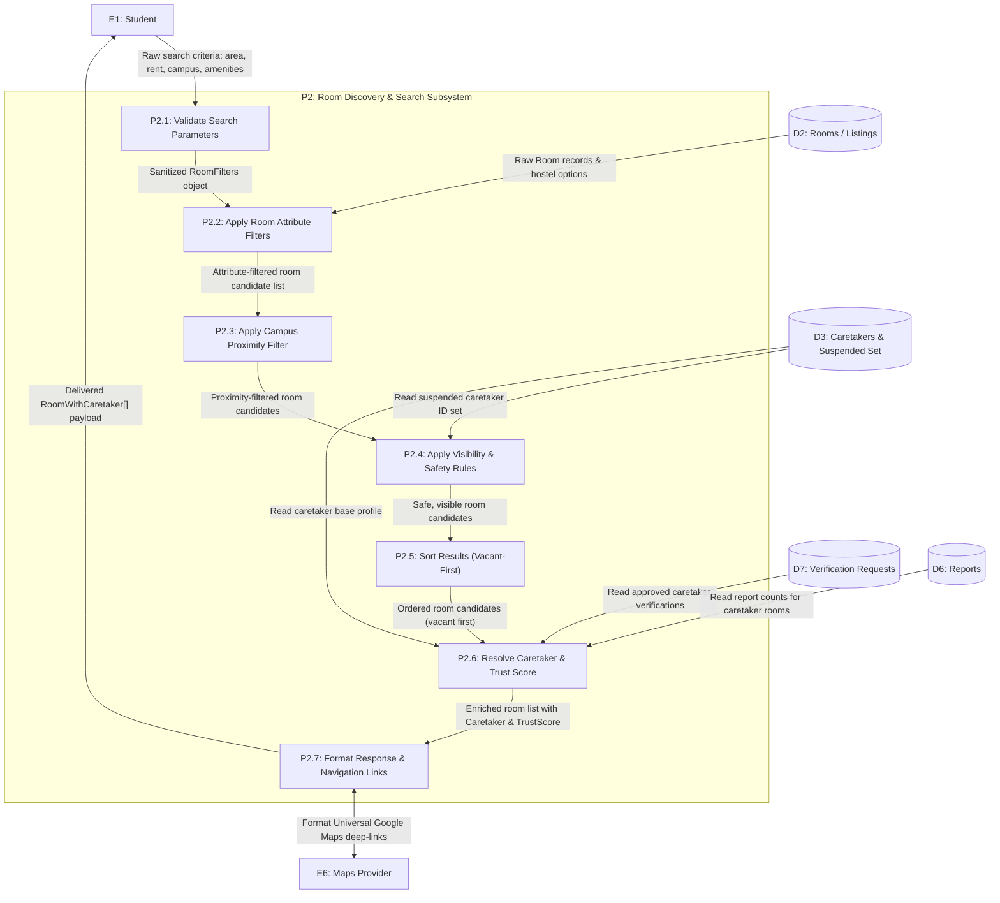
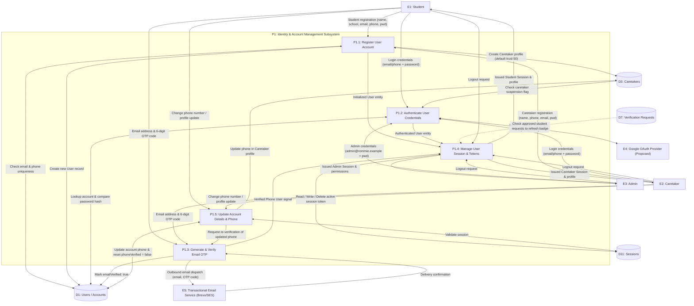
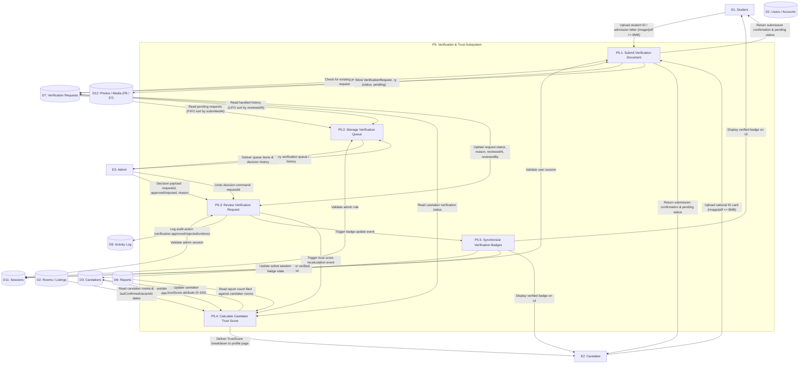

# Level 2 Subsystem Decomposition Data Flow Diagrams (DFD) — Rommie Student Accommodation Platform

## Document Metadata

- **Document ID:** DOC-DFD2-001
- **Title:** Level 2 Subsystem Decomposition Data Flow Diagrams (DFD) — Rommie Student Accommodation Platform
- **Version:** 1.1
- **Status:** Draft
- **Author:** Antigravity AI Agent
- **Created:** 2026-10-19
- **Updated:** 2026-11-06
- **Target Audience:** Systems Architects, Backend Engineers, Frontend Developers, QA Leads, Security Engineers
- **Scope:** Provides granular Level 2 subprocess decompositions for the three most critical and complex subsystems on the platform:
  1. **Process 2 (`P2`): Room Discovery & Search**
  2. **Process 1 (`P1`): Identity & Account Management**
  3. **Process 5 (`P5`): Verification & Trust System**

---

## 1. Executive Summary & Purpose

This document provides the **Level 2 Subsystem Decomposition Data Flow Diagrams (DFD)** for the **Rommie Student Accommodation Platform**. While Level 1 (`DOC-DFD1-001`) partitioned the architecture into eight macro processes (`P1` through `P8`), this document exposes the detailed internal mechanics, sequential transformations, validation checkpoints, data-store interactions, and error branches within the platform's core functional subsystems.

In compliance with structured systems analysis standards:

1. **Scope of Decomposition:** Granular subprocess models are specified for:
   - **`P2` (Room Discovery & Search):** The primary user workflow handling query ingestion, multi-attribute filtering, campus proximity mathematics, visibility governance, dual-criterion sorting, caretaker trust resolution, and response formatting (`P2.1` – `P2.7`).
   - **`P1` (Identity & Account Management):** Multi-channel authentication handling registration, credentials/OAuth validation, SMS OTP life cycle, session token state management, and profile synchronization (`P1.1` – `P1.5`).
   - **`P5` (Verification & Trust System):** Identity document governance handling document intake, FIFO queue management, administrative adjudication, 4-factor Trust Score computation, and badge synchronization (`P5.1` – `P5.5`).
2. **Parent-Child Balancing:** The boundary flows entering and exiting each Level 1 parent process in `DOC-DFD1-001` are preserved with mathematical precision in the corresponding Level 2 child diagrams.
3. **No Direct Entity-to-Store Coupling:** Subprocesses strictly mediate all interactions between external entities (`E1`–`E8`) and internal data stores (`D1`–`D12`).
4. **Code-Level Grounding:** Subprocess operations, validation thresholds, calculations, and error messages cite production logic in [`src/services/api.js`](file:///e:/Coding_Projects/rommie-webapp/src/services/api.js), [`src/lib/trust.js`](file:///e:/Coding_Projects/rommie-webapp/src/lib/trust.js), [`src/lib/format.js`](file:///e:/Coding_Projects/rommie-webapp/src/lib/format.js), and [`src/lib/settings.js`](file:///e:/Coding_Projects/rommie-webapp/src/lib/settings.js).

---

## 2. Process 2 (`P2`) Decomposition: Room Discovery & Search

### 2.1 Overview & Subprocess Inventory

Process 2 encapsulates the core value proposition of Rommie: enabling university students to discover affordable, secure, and physically accessible student housing near their campus.

```
+---------------------------------------------------------------------------------------------------------+
|                                    PROCESS 2 SUBPROCESS INVENTORY                                       |
+--------+------------------------------------+-----------------------------------------------------------+
| Sub-ID | Subprocess Name                    | Primary Transformation & Responsibility                   |
+--------+------------------------------------+-----------------------------------------------------------+
| P2.1   | Validate Search Parameters         | Ingests raw URL query parameters, parses numeric ranges,  |
|        |                                    | validates campus and area enums, returns sanitized filter.|
| P2.2   | Apply Room Attribute Filters       | Queries D2; matches area, roomType, rent min/max,         |
|        |                                    | amenities subset, gender rules, meals, transport, vacancy.|
| P2.3   | Apply Campus Proximity Filter      | Evaluates walk/matatu commute minutes; enforces 20-min    |
|        |                                    | threshold or checks Karen Campus Guide eligibility.       |
| P2.4   | Apply Visibility & Safety Rules    | Filters out hidden listings (`r.hidden`) and checks D3    |
|        |                                    | to exclude listings owned by suspended caretakers.        |
| P2.5   | Sort Results (Vacant-First)        | Applies primary sort (Vacant first) and secondary sort    |
|        |                                    | (`newest`, `rent_asc`, or `rent_desc`).                   |
| P2.6   | Resolve Caretaker & Trust Score    | Joins caretaker profile from D3, evaluates approved ID    |
|        |                                    | from D7, invokes trust calculation (0-100 score).         |
| P2.7   | Format Response & Navigation Links | Attaches Google Maps deep-link (E6), computes price/badge |
|        |                                    | labels, formats payload, and returns `RoomWithCaretaker[]`|
+--------+------------------------------------+-----------------------------------------------------------+
```

### 2.2 Level 2 DFD Diagram for Process 2 (Mermaid)



### 2.3 Detailed Specification of P2 Subprocesses

#### P2.1: Validate Search Parameters

- **Code Citation:** [`src/types/index.js#L195-L207`](file:///e:/Coding_Projects/rommie-webapp/src/types/index.js#L195-L207) (`RoomFilters`), [`src/services/api.js#L135-L161`](file:///e:/Coding_Projects/rommie-webapp/src/services/api.js#L135-L161)
- **Input:** Raw HTTP query params or JSON payload from `E1: Student`.
- **Validation Rules:**
  - `area`: Must be one of `Gataka`, `Rongai`, `Maasai Lodge`, `Karen`, or undefined.
  - `roomType`: Must be one of `bedsitter`, `single_room`, `one_bedroom`, `hostel`, or undefined.
  - `minRent`, `maxRent`: Non-negative integers.
  - `near`: Must be one of the recognized campus enums (`KSL`, `JKUAT`, `Tangaza`, `CUEA`, `Co-op`).
  - `amenities`: Array of strings matching valid amenities (`Water 24/7`, `WiFi`, `Tokens`, `Gated Security`).
  - `gender`: Filter for hostels (`Ladies`, `Gents`, `Mixed`).
  - `sort`: Must be one of `newest`, `rent_asc`, `rent_desc`. Defaults to `newest`.
- **Output:** Sanitized `RoomFilters` object passed to `P2.2`.

#### P2.2: Apply Room Attribute Filters

- **Code Citation:** [`src/services/api.js#L137-L160`](file:///e:/Coding_Projects/rommie-webapp/src/services/api.js#L137-L160)
- **Input:** Sanitized `RoomFilters` from `P2.1`; raw room listings queried from `D2: Rooms/Listings`.
- **Transformation Logic:**
  - Area match: `if (filters.area && r.area !== filters.area) return false;`
  - Room type match: `if (filters.roomType && r.roomType !== filters.roomType) return false;`
  - Price bounds: `if (filters.minRent && r.rentKes < filters.minRent) return false;` and `if (filters.maxRent && r.rentKes > filters.maxRent) return false;`
  - Gender compatibility: Uses helper `genderMatches(r, filters.gender)`. If room specifies a gender (hostels) and filter specifies a gender, allows match if room accepted gender is `Mixed` or matches target.
  - Meals & Transport: If `filters.mealsOnly`, requires `r.meals === 'available'`. If `filters.transportOnly`, requires `r.transport === true`.
  - Vacancy: If `filters.vacantOnly`, requires `r.status === 'Vacant'`.
  - Amenities: Requires `filters.amenities.every(a => r.amenities.includes(a))`.
- **Output:** Filtered candidate array passed to `P2.3`.

#### P2.3: Apply Campus Proximity Filter

- **Code Citation:** [`src/services/api.js#L131-L134, L158-L159`](file:///e:/Coding_Projects/rommie-webapp/src/services/api.js#L131-L134)
- **Input:** Candidate array from `P2.2`.
- **Distance Calculation:**
  ```javascript
  export function minutesTo(r, campus) {
    const d = r.distances?.[campus];
    return d?.walkMin ?? d?.matatuMin ?? 999;
  }
  ```
- **Proximity Rule:**
  - If `filters.near` is specified, a listing is preserved if:
    1. It is featured in the Karen Campus Dean of Students Guide (`r.inGuide === true`) and either lacks a specific campus restriction or matches `r.nearCampus === filters.near`.
    2. OR `minutesTo(r, filters.near) <= 20` (within 20 minutes walk or matatu commute).
- **Output:** Proximity-vetted listing array passed to `P2.4`.

#### P2.4: Apply Visibility & Safety Rules

- **Code Citation:** [`src/services/api.js#L45-L47, L138`](file:///e:/Coding_Projects/rommie-webapp/src/services/api.js#L45-L47)
- **Input:** Proximity-vetted candidates from `P2.3`; active suspended caretaker ID set from `D3: Caretakers`.
- **Safety Enforcement:**
  - Check 1: Exclude hidden listings: `if (r.hidden) return false;` (admin moderated or stale unconfirmed).
  - Check 2: Exclude suspended caretakers: `if (isSuspended(r.caretakerId)) return false;`.
- **Output:** Safe, publicly viewable listings passed to `P2.5`.

#### P2.5: Sort Results (Vacant-First Ordering)

- **Code Citation:** [`src/services/api.js#L162-L171`](file:///e:/Coding_Projects/rommie-webapp/src/services/api.js#L162-L171)
- **Input:** Safe candidate array from `P2.4`.
- **Sorting Algorithm:**
  1. **Primary Partition:** Vacant rooms are strictly partitioned before Taken rooms:
     ```javascript
     if (a.status !== b.status) return a.status === "Vacant" ? -1 : 1;
     ```
  2. **Secondary Ordering:** Within the vacancy groups, applies requested order:
     - `rent_asc`: Sorts ascending by price (`a.rentKes - b.rentKes`).
     - `rent_desc`: Sorts descending by price (`b.rentKes - a.rentKes`).
     - `newest` (Default): Sorts descending by vacancy confirmation timestamp (`+new Date(b.lastConfirmedVacantAt) - +new Date(a.lastConfirmedVacantAt)`).
- **Output:** Sorted listings passed to `P2.6`.

#### P2.6: Resolve Caretaker Details & Trust Score

- **Code Citation:** [`src/services/api.js#L120-L130`](file:///e:/Coding_Projects/rommie-webapp/src/services/api.js#L120-L130), [`src/lib/trust.js#L9-L47`](file:///e:/Coding_Projects/rommie-webapp/src/lib/trust.js#L9-L47)
- **Input:** Sorted listings from `P2.5`; caretaker profiles from `D3`; approved verifications from `D7`; listing reports from `D6`.
- **Transformation Logic:**
  - For each listing, resolves `caretaker`:
    - Reads base caretaker profile from `D3`.
    - Derives `verified = c.verified || hasApproved(c.id, 'caretaker')`.
    - Gathers all listings owned by this caretaker from `D2`.
    - Gathers count of open/handled reports filed against this caretaker's listings from `D6`.
    - Computes 4-component Trust Score (`computeTrust`) returning `score` (0–100) and breakdown items.
    - Assembles enriched `caretaker` object containing `id`, `name`, `phone`, `verified`, `trustScore`, and `joinedAt`.
- **Output:** Enriched room models passed to `P2.7`.

#### P2.7: Format Response & Navigation Links

- **Code Citation:** [`src/data/mockData.js#L60, L71`](file:///e:/Coding_Projects/rommie-webapp/src/data/mockData.js#L60), [`src/types/index.js#L74`](file:///e:/Coding_Projects/rommie-webapp/src/types/index.js#L74)
- **Input:** Enriched room models from `P2.6`.
- **Formatting Actions:**
  - Formats map links referencing `E6: Maps Provider` (`https://www.google.com/maps/search/?api=1&query=...`).
  - Ensures prices, deposit terms, photos, and distance labels conform to `RoomWithCaretaker` typedef.
  - Returns final HTTP response to `E1: Student`.

---

## 3. Process 1 (`P1`) Decomposition: Identity & Account Management

### 3.1 Overview & Subprocess Inventory

Process 1 governs user onboarding, multi-factor credential verification, session token persistence, and role-based permissions for Students, Caretakers, and Administrators.

```
+---------------------------------------------------------------------------------------------------------+
|                                    PROCESS 1 SUBPROCESS INVENTORY                                       |
+--------+------------------------------------+-----------------------------------------------------------+
| Sub-ID | Subprocess Name                    | Primary Transformation & Responsibility                   |
+--------+------------------------------------+-----------------------------------------------------------+
| P1.1   | Register User Account              | Validates email/phone uniqueness, hashes password, creates|
|        |                                    | user account in D1, initializes caretaker record in D3.   |
| P1.2   | Authenticate User Credentials      | Validates email/phone + password or Google OAuth (E4);    |
|        |                                    | checks caretaker suspension status in D3.                 |
| P1.3   | Generate & Verify Email OTP        | Generates 6-digit OTP, dispatches via E5 Email Service,    |
|        |                                    | verifies within 5-min TTL, rate-limits per email/IP,      |
|        |                                    | sets emailVerified: true in D1; Google bypasses OTP.       |
| P1.4   | Manage User Session & Tokens       | Issues/revokes session tokens in D11; refreshes student   |
|        |                                    | verification badge from D7 dynamically on load.           |
| P1.5   | Update Account Details & Phone     | Modifies profile data in D1/D3; resets phoneVerified to   |
|        |                                    | false when phone number is changed.                       |
+--------+------------------------------------+-----------------------------------------------------------+
```

### 3.2 Level 2 DFD Diagram for Process 1 (Mermaid)



### 3.3 Detailed Specification of P1 Subprocesses

#### P1.1: Register User Account

- **Code Citation:** [`src/services/api.js#L706-L727`](file:///e:/Coding_Projects/rommie-webapp/src/services/api.js#L706-L727) (`signUp`, `createAccount`)
- **Inputs:** `name`, `firstName`, `lastName`, `school` (for students), `email`, `phone`, `password`, `role`.
- **Validation Rules:**
  - Validates email format: `EMAIL_RE = /^[^\s@]+@[^\s@]+\.[^\s@]+$/`.
  - Checks duplicate email: `if (accounts.some(a => a.email === email)) throw new AuthError("An account with this email already exists...", "email");`.
  - Checks duplicate phone: `if (accounts.some(a => a.phone && a.phone === data.phone)) throw new AuthError("An account with this number already exists...", "phone");`.
- **Execution & Persistence:**
  - Generates ID prefixed by role: `u-${uid()}` for student, `c-${uid()}` for caretaker.
  - Inserts account record into `D1: Users/Accounts`.
  - If `role === 'caretaker'`, automatically generates an associated profile in `D3: Caretakers` with `verified: false`, `trustScore: 50`, `joinedAt: new Date().toISOString()`.
  - Forwards user entity to `P1.4` to initialize the session.

#### P1.2: Authenticate User Credentials

- **Code Citation:** [`src/services/api.js#L729-L762`](file:///e:/Coding_Projects/rommie-webapp/src/services/api.js#L729-L762) (`login`, `loginWithGoogle`)
- **Authentication Modes:**
  1. **Password Authentication:**
     - Matches user by normalized email or phone number.
     - Compares password against stored password hash in `D1`.
     - Blocks password login if account was registered via Google OAuth (`acct.google && !acct.password`).
  2. **Google OAuth 2.0 / OIDC (`E4`):**
     - Receives ID token and profile.
     - Matches existing account by normalized email.
     - If new user, creates student/caretaker account automatically (`google: true`).
- **Suspension Enforcement:**
  - If user is a caretaker and ID is in the suspended set:
    ```javascript
    if (acct.role === "caretaker" && isSuspended(acct.id))
      throw new AuthError(SUSPENDED_MESSAGE, "password");
    ```
- **Output:** Verified user profile forwarded to `P1.4`.

#### P1.3: Generate & Verify Email OTP

- **Code Citation:** [`src/services/api.js#L779-L816`](file:///e:/Coding_Projects/rommie-webapp/src/services/api.js#L779-L816) (`sendOtp`, `verifyOtp`, `loginWithOtp`)
- **TTL & Security Boundaries:**
  - OTP Validity Window: `OTP_TTL_MS = 5 * 60 * 1000` (5 minutes).
  - Resend cooldown: 60 seconds (`RESEND_COOLDOWN_MS = 60000`).
  - Outbound dispatch sends 6-digit code via `E5: Transactional Email Service` targeting user's registered email address.
  - **Anti-Abuse Safeguards:** Enforces strict rate limits: maximum 5 requests/hour per email address and 20 requests/hour per client IP address.
  - **Google OAuth Bypass:** Accounts registered via Google OAuth have verified emails by default and bypass OTP generation completely.
  - Code Verification:
    - If `Date.now() - sent > OTP_TTL_MS`, returns `{ ok: false, reason: "expired" }`.
    - If code doesn't match, returns `{ ok: false, reason: "wrong" }`.
    - On success, updates `emailVerified: true` in `D1` and updates current session state in `D11`.

---

#### P1.4: Manage User Session & Tokens

- **Code Citation:** [`src/services/api.js#L646-L703`](file:///e:/Coding_Projects/rommie-webapp/src/services/api.js#L646-L703) (`getSession`, `setSession`, `refreshSession`, `logout`)
- **Token Management & Badge Synchronization:**
  - Writes authenticated session context to `D11: Sessions` (`rommie.session`).
  - Broadcasts session changes to active listeners (`sessionListeners.forEach(l => l())`).
  - **Dynamic Badge Refresh:** Student ID verification has been retired per Alvan review; verification badge logic applies strictly to Caretakers and Landlords.
  - `logout()`: Clears active session in `D11` and returns unauthenticated state.

#### P1.5: Update Account Details & Phone

- **Code Citation:** [`src/services/api.js#L764-L778`](file:///e:/Coding_Projects/rommie-webapp/src/services/api.js#L764-L778) (`setMyPhone`)
- **Validation & State Invalidation:**
  - Checks if new phone is already registered to another account in `D1`.
  - Updates phone in `D1: Users/Accounts` and `D3: Caretakers`.
  - **Security Reset:** Automatically resets `phoneVerified: false` on the user account and active session, requiring the user to execute `P1.3` to re-verify the new phone.

---

## 4. Process 5 (`P5`) Decomposition: Verification & Trust System

### 4.1 Overview & Subprocess Inventory

Process 5 governs the identity trust architecture of Rommie. It handles the submission and administrative vetting of student IDs and caretaker national IDs, coordinates the review queue, and calculates the multi-dimensional Caretaker Trust Score.

```
+---------------------------------------------------------------------------------------------------------+
|                                    PROCESS 5 SUBPROCESS INVENTORY                                       |
+--------+------------------------------------+-----------------------------------------------------------+
| Sub-ID | Subprocess Name                    | Primary Transformation & Responsibility                   |
+--------+------------------------------------+-----------------------------------------------------------+
| P5.1   | Submit Verification Document       | Validates MIME (image/pdf) & size (<=8MB); checks for    |
|        |                                    | existing pending requests; stores file in D12 and D7.     |
| P5.2   | Manage Verification Queue          | Retrieves pending submissions in FIFO order; serves       |
|        |                                    | reverse-chronological decision audit history to admin.    |
| P5.3   | Review Verification Request        | Admin decision (approve / reject with mandatory reason);  |
|        |                                    | supports undo action; records audit log entry in D8.      |
| P5.4   | Calculate Caretaker Trust Score    | Computes 0-100 score across 4 weighted pillars: ID badge, |
|        |                                    | vacancy freshness, report penalties, and account age.     |
| P5.5   | Synchronize Verification Badges    | Updates verified in D3 for caretaker, and updates|
|        |                                    | active sessions in D11 dynamically.                       |
+--------+------------------------------------+-----------------------------------------------------------+
```

### 4.2 Level 2 DFD Diagram for Process 5 (Mermaid)



### 4.3 Detailed Specification of P5 Subprocesses

#### P5.1: Submit Verification Document

- **Code Citation:** [`src/services/api.js#L289-L316`](file:///e:/Coding_Projects/rommie-webapp/src/services/api.js#L289-L316) (`submitVerification`)
- **Inputs:** `kind: 'student' | 'caretaker'`, binary `file` (File object).
- **Validation Rules:**
  - MIME check: `if (!(file.type.startsWith("image/") || file.type === "application/pdf")) throw new Error("Upload a photo or a PDF.");`.
  - Size check: `if (file.size > DOC_MAX_BYTES) throw new Error("That file is larger than 8 MB.");` (`DOC_MAX_BYTES = 8 * 1024 * 1024`).
  - Duplicate check: Blocks submission if user already has an active pending request of that kind (`status === 'pending'`).
- **Persistence:**
  - Binary scan is delegated to `D12: Photos/Media` (or converted to Data URL for small previews).
  - Inserts `VerificationRequest` record into `D7: Verification Requests` with `status: 'pending'`, `submittedAt: new Date().toISOString()`.
- **Outputs:** Pending request receipt to `E1` or `E2`.

#### P5.2: Manage Verification Queue

- **Code Citation:** [`src/services/api.js#L334-L358`](file:///e:/Coding_Projects/rommie-webapp/src/services/api.js#L334-L358) (`getVerificationQueue`, `getVerificationHistory`)
- **Queue Sorting Rules:**
  - **Pending Queue (FIFO):** `getQueue().filter(q => q.status === "pending").sort((a, b) => +new Date(a.submittedAt) - +new Date(b.submittedAt));` (Oldest submission first to minimize applicant wait times).
  - **Decision History (LIFO):** `getQueue().filter(q => q.status !== "pending").sort((a, b) => +new Date(b.reviewedAt ?? b.submittedAt) - +new Date(a.reviewedAt ?? a.submittedAt));` (Newest decisions first so mistakes can be quickly inspected and undone).
- **Outputs:** Formatted queue and historical records delivered to `E3: Admin`.

#### P5.3: Review Verification Request

- **Code Citation:** [`src/services/api.js#L341-L369`](file:///e:/Coding_Projects/rommie-webapp/src/services/api.js#L341-L369) (`reviewVerification`, `undoVerificationReview`)
- **Review Logic:**
  - Requires admin authorization (`requireAdmin()`).
  - Enforces rejection rationale: `if (decision === "rejected" && !reason?.trim()) throw new Error("Add a reason so they know what to fix.");`.
  - Updates record in `D7`: `status = decision`, `reason = rejected ? reason.trim() : undefined`, `reviewedAt = new Date().toISOString()`, `reviewedBy = admin.name`.
  - Logs action in `D8: Activity Log`: `logAction(decision === "approved" ? "verification.approved" : "verification.rejected", ...)` with target `userId`.
  - **Undo Capability (`undoVerificationReview`):**
    - Moves request back to `pending`.
    - Clears `reviewedAt`, `reviewedBy`, and `reason`.
    - Automatically strips verified badge until approved again.
    - Logs `verification.undone` in `D8`.
- **Triggers:** Dispatches events to `P5.5` for badge synchronization and `P5.4` for caretaker trust recomputation.

#### P5.4: Calculate Caretaker Trust Score

- **Code Citation:** [`src/lib/trust.js#L1-L49`](file:///e:/Coding_Projects/rommie-webapp/src/lib/trust.js#L1-L49) (`computeTrust`), [`src/services/api.js#L120-L126`](file:///e:/Coding_Projects/rommie-webapp/src/services/api.js#L120-L126)
- **Trust Score Formula (0 to 100 Points Total):**
  1. **Verification (Max 35 pts):**
     - If caretaker has verified ID (`verified === true`): **35 points**.
     - Otherwise: **0 points**.
  2. **Listing Freshness (Max 30 pts):**
     - Vacant listings count: `vacant = rooms.filter(r => r.status === "Vacant")`.
     - Fresh vacant listings: Vacant rooms where `(now - lastConfirmedVacantAt) / 86400000 < 14` days (`STALE_DAYS`).
     - Calculation: If `vacant.length === 0`, awards baseline `15 points` (`TRUST_MAX.freshness / 2`). Otherwise:
       $$\text{freshness} = \text{round}\left(\frac{30 \times \text{fresh}}{\text{vacant.length}}\right)$$
  3. **Community Reports (Max 25 pts):**
     - Evaluates total reports (`reportCount`) filed against all listings owned by this caretaker:
       $$\text{reports} = \max(0, 25 - 8 \times \text{reportCount})$$
     - _Note: 4 reports completely zeroes out the report trust pillar._
  4. **Account Age (Max 10 pts):**
     - Measures months since caretaker registration (`joinedAt`):
       $$\text{age} = \min(10, \lfloor \text{months on platform} \rfloor)$$
- **Score Aggregation:**
  $$\text{Total Score} = \max\left(0, \min\left(100, \text{verification} + \text{freshness} + \text{reports} + \text{age}\right)\right)$$
- **Outputs:** Saves updated `trustScore` to `D3: Caretakers`; returns full `TrustScore` breakdown (`score`, `items: [TrustItem]`) to Caretaker Profile page (`E2`) and search resolvers (`P2.6`).

#### P5.5: Synchronize Verification Badges

- **Code Citation:** [`src/services/api.js#L115-L126, L695-L703`](file:///e:/Coding_Projects/rommie-webapp/src/services/api.js#L115-L126)
- **Synchronization Logic:**
  - **Caretaker Badges:** Caretaker profile in `D3` derives `verified = true`, displaying the green checkmark badge across all listing cards in search and detail views.
  - On undo/rejection, badges are dynamically rescinded across all active sessions and listing resolvers.

---

## 5. Traceability Matrix: Level 2 Subprocesses to Requirements & Code

| Subprocess ID | Subprocess Name                 | Parent Process | Functional Requirement | Use Case       | API Operation             | Data Entity               | Source Code Citation                                                                                                                                                                       |
| :------------ | :------------------------------ | :------------- | :--------------------- | :------------- | :------------------------ | :------------------------ | :----------------------------------------------------------------------------------------------------------------------------------------------------------------------------------------- |
| **P2.1**      | Validate Search Parameters      | P2             | FR-007                 | UC-004         | API-010                   | ENT-002                   | [`src/types/index.js#L195-L207`](file:///e:/Coding_Projects/rommie-webapp/src/types/index.js#L195-L207)                                                                                    |
| **P2.2**      | Apply Room Attribute Filters    | P2             | FR-007                 | UC-004         | API-010                   | ENT-002                   | [`src/services/api.js#L137-L157`](file:///e:/Coding_Projects/rommie-webapp/src/services/api.js#L137-L157)                                                                                  |
| **P2.3**      | Apply Campus Proximity Filter   | P2             | FR-008, FR-011         | UC-004, UC-006 | API-010, API-013          | ENT-002                   | [`src/services/api.js#L131-L134, L158-L159`](file:///e:/Coding_Projects/rommie-webapp/src/services/api.js#L131-L134)                                                                       |
| **P2.4**      | Apply Visibility & Safety Rules | P2             | FR-029, FR-033         | UC-004, UC-019 | API-010                   | ENT-002, ENT-003          | [`src/services/api.js#L47, L138`](file:///e:/Coding_Projects/rommie-webapp/src/services/api.js#L47)                                                                                        |
| **P2.5**      | Sort Results (Vacant-First)     | P2             | FR-007                 | UC-004         | API-010                   | ENT-002                   | [`src/services/api.js#L162-L171`](file:///e:/Coding_Projects/rommie-webapp/src/services/api.js#L162-L171)                                                                                  |
| **P2.6**      | Resolve Caretaker & Trust Score | P2             | FR-025                 | UC-004, UC-015 | API-010, API-035          | ENT-002, ENT-003          | [`src/services/api.js#L120-L130`](file:///e:/Coding_Projects/rommie-webapp/src/services/api.js#L120-L130), [`src/lib/trust.js`](file:///e:/Coding_Projects/rommie-webapp/src/lib/trust.js) |
| **P2.7**      | Format Response & Nav Links     | P2             | FR-007, FR-009         | UC-004, UC-005 | API-010, API-011          | ENT-002                   | [`src/data/mockData.js#L60, L71`](file:///e:/Coding_Projects/rommie-webapp/src/data/mockData.js#L60)                                                                                       |
| **P1.1**      | Register User Account           | P1             | FR-001                 | UC-001         | API-001                   | ENT-001, ENT-003          | [`src/services/api.js#L706-L727`](file:///e:/Coding_Projects/rommie-webapp/src/services/api.js#L706-L727)                                                                                  |
| **P1.2**      | Authenticate User Credentials   | P1             | FR-002, FR-003         | UC-002, UC-003 | API-002, API-003          | ENT-001, ENT-003          | [`src/services/api.js#L729-L762`](file:///e:/Coding_Projects/rommie-webapp/src/services/api.js#L729-L762)                                                                                  |
| **P1.3**      | Generate & Verify SMS OTP       | P1             | FR-004                 | UC-001         | API-004, API-005, API-006 | ENT-001                   | [`src/services/api.js#L779-L816`](file:///e:/Coding_Projects/rommie-webapp/src/services/api.js#L779-L816)                                                                                  |
| **P1.4**      | Manage User Session & Tokens    | P1             | FR-005                 | UC-002         | API-007, API-009          | ENT-011                   | [`src/services/api.js#L646-L703`](file:///e:/Coding_Projects/rommie-webapp/src/services/api.js#L646-L703)                                                                                  |
| **P1.5**      | Update Account Details & Phone  | P1             | FR-006                 | UC-001         | API-008                   | ENT-001, ENT-003          | [`src/services/api.js#L764-L778`](file:///e:/Coding_Projects/rommie-webapp/src/services/api.js#L764-L778)                                                                                  |
| **P5.1**      | Submit Verification Document    | P5             | FR-022                 | UC-013         | API-029                   | ENT-007, ENT-012          | [`src/services/api.js#L289-L316`](file:///e:/Coding_Projects/rommie-webapp/src/services/api.js#L289-L316)                                                                                  |
| **P5.2**      | Manage Verification Queue       | P5             | FR-023                 | UC-014         | API-031, API-034          | ENT-007                   | [`src/services/api.js#L334-L358`](file:///e:/Coding_Projects/rommie-webapp/src/services/api.js#L334-L358)                                                                                  |
| **P5.3**      | Review Verification Request     | P5             | FR-023, FR-024         | UC-014         | API-032, API-033          | ENT-007, ENT-008          | [`src/services/api.js#L341-L369`](file:///e:/Coding_Projects/rommie-webapp/src/services/api.js#L341-L369)                                                                                  |
| **P5.4**      | Calculate Caretaker Trust Score | P5             | FR-025                 | UC-015         | API-035, API-036          | ENT-003                   | [`src/lib/trust.js#L1-L49`](file:///e:/Coding_Projects/rommie-webapp/src/lib/trust.js#L1-L49)                                                                                              |
| **P5.5**      | Synchronize Verification Badges | P5             | FR-026                 | UC-013, UC-014 | API-030                   | ENT-001, ENT-003, ENT-011 | [`src/services/api.js#L115-L126, L695-L703`](file:///e:/Coding_Projects/rommie-webapp/src/services/api.js#L115-L126)                                                                       |

---

## 6. Assumptions and Open Questions

### 6.1 Assumptions

- **`ASM-007` (Sub-300ms Search Latency):** In the production backend, `P2.2`, `P2.3`, `P2.4`, and `P2.5` should be compiled into a single optimized SQL query leveraging composite indexes (e.g., `(status, last_confirmed_vacant_at DESC)`, `(area, room_type, rent_kes)`) and PostGIS distance calculations to comply with `NFR-PERF-001` (sub-300ms response).
- **`ASM-008` (Trust Score Caching):** While `P5.4` computes the trust score on-the-fly during room query resolution in the frontend prototype, the production database should store a denormalized `trust_score` on the `caretakers` table, updated asynchronously via background jobs or database triggers upon report resolution or vacancy confirmation.

### 6.2 Open Questions

- **`OQ-006` (Geographic Radius vs Matrix Lookups):** Currently, campus proximity in `P2.3` relies on a pre-compiled distance matrix (`distances: { KSL: { walkMin: 10 } }`) or the Karen guide. In Phase 2, should this be replaced with real-time PostGIS geospatial bounding box or distance calculations using spatial coordinates (`ST_DWithin`)?
- **`OQ-007` (Automated Stale Marking):** In the prototype, stale listings (unconfirmed > 14 days) are identified on read. Should a recurring cron job automatically set `hidden = true` on listings older than 30 days and alert the caretaker via email?

---

## 7. Change History

| Version | Date       | Author / Agent       | Summary of Changes                                                                                                                                                                                                                                                                                  |
| :------ | :--------- | :------------------- | :-------------------------------------------------------------------------------------------------------------------------------------------------------------------------------------------------------------------------------------------------------------------------------------------------- |
| **1.0** | 2026-10-19 | Antigravity AI Agent | Initial release of Level 2 Subsystem Decomposition DFDs, detailing P2 (Room Discovery & Search, 7 subprocesses), P1 (Identity & Account Management, 5 subprocesses), and P5 (Verification & Trust System, 5 subprocesses), with mathematical parent-child balancing and full source code grounding. |
