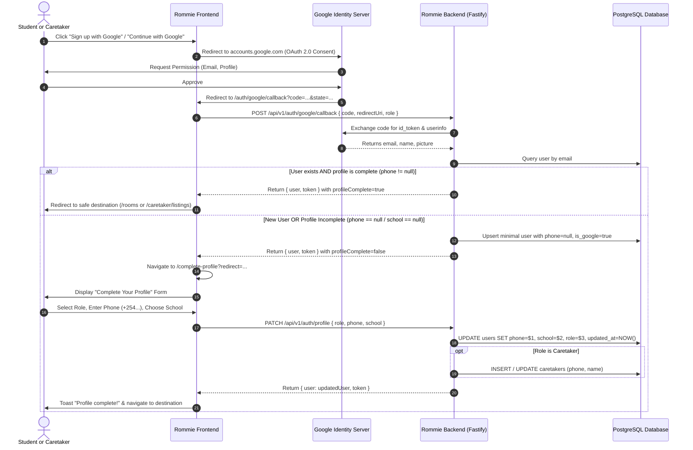

# Google OAuth 2.0 Post-Signup Profile Completion Specification

**Document ID:** `SPEC-OAUTH-ONBOARDING-001`  
**Version:** `1.0`  
**Status:** `Proposed / Pending Approval`  
**Author:** Solution Architect & Backend Tech Lead  
**Date:** `2026-11-10`  
**Traceability:** `FR-035`, `FR-033`, `US-033`, `US-035`, `UC-014`, `UC-033`, `ENT-001`

---

## 1. Executive Summary & Problem Context

Rommie integrates **Google OAuth 2.0** (`FR-035`) as a frictionless authentication method. However, the OpenID Connect identity token from Google provides only:
- Verified Email (`email`)
- Full Name (`name`, `given_name`, `family_name`)
- Profile Photo (`picture`)

In the Kenyan student rental ecosystem, this basic profile is insufficient to operate the platform:
1. **Phone Number Missing (`phone`)**:
   - **Caretakers**: Cannot list properties without a phone number because contact options (WhatsApp and direct phone calls) are the primary conversion channels for prospective student tenants.
   - **Students**: Essential for vacancy alerts, booking communications, and direct landlord/caretaker interactions.
2. **University / Campus Missing (`school`)**:
   - **Students**: Rommie ranks listings and calculates walking/matatu transit times based on student campuses (CUEA, JKUAT, Tangaza, KSL, Co-op University). Without `school`, the student feed cannot personalize commute times or localized hostel alerts.
3. **Role Disambiguation (`role`)**:
   - Users who click a generic "Continue with Google" button must confirm whether they are a **Student** seeking accommodation or a **Caretaker / Landlord** listing properties.

This design introduces a **Profile Completion (Onboarding) Gate** immediately following the first Google OAuth sign-in.

---

## 2. User Journey & Architectural Flow

### 2.1 State Flow Diagram



---

## 3. Detailed Data Model & Field Requirements

### 3.1 Field Matrix by Role

| Field | Type | Student Requirement | Caretaker Requirement | Validation Rules |
| :--- | :--- | :--- | :--- | :--- |
| **Email** | `string` | Pre-filled & Locked (Google) | Pre-filled & Locked (Google) | Valid email, `emailVerified = true` |
| **Full Name** | `string` | Pre-filled from Google | Pre-filled from Google | Min 2 chars; user can adjust if desired |
| **Role** | `enum` | **Required** | **Required** | `'student'` or `'caretaker'` |
| **Phone Number** | `string` | **Required** | **Required** | Kenyan phone: `07...`, `01...`, `+254...`, validated with `normalizeKenyanPhone` |
| **School / Campus** | `string` | **Required** | *N/A (Hidden)* | Predefined list (`CUEA`, `JKUAT`, `Tangaza`, `KSL`, `Co-op`) or `other` with custom name |
| **Hostel / Property Name** | `string` | *N/A (Hidden)* | **Optional** | Free text up to 80 chars |

### 3.2 Database Schema Alignment

The PostgreSQL schema definition in `backend/src/db/schema.sql` already provides the necessary columns:

```sql
-- Existing users table
CREATE TABLE IF NOT EXISTS users (
    id VARCHAR(64) PRIMARY KEY,
    email VARCHAR(255) NOT NULL UNIQUE,
    phone VARCHAR(50) UNIQUE,           -- Nullable for new Google OAuth users
    name VARCHAR(100) NOT NULL,
    first_name VARCHAR(50),
    last_name VARCHAR(50),
    school VARCHAR(100),                -- Populated during profile completion
    role VARCHAR(20) NOT NULL CHECK (role IN ('student', 'caretaker', 'admin')),
    email_verified BOOLEAN NOT NULL DEFAULT FALSE,
    is_google BOOLEAN NOT NULL DEFAULT FALSE,
    is_suspended BOOLEAN NOT NULL DEFAULT FALSE,
    created_at TIMESTAMPTZ NOT NULL DEFAULT CURRENT_TIMESTAMP,
    updated_at TIMESTAMPTZ NOT NULL DEFAULT CURRENT_TIMESTAMP
);

-- Caretakers table
CREATE TABLE IF NOT EXISTS caretakers (
    id VARCHAR(64) PRIMARY KEY REFERENCES users(id) ON DELETE CASCADE,
    name VARCHAR(100) NOT NULL,
    phone VARCHAR(50),
    is_verified BOOLEAN NOT NULL DEFAULT FALSE,
    is_suspended BOOLEAN NOT NULL DEFAULT FALSE,
    joined_at TIMESTAMPTZ NOT NULL DEFAULT CURRENT_TIMESTAMP,
    created_at TIMESTAMPTZ NOT NULL DEFAULT CURRENT_TIMESTAMP,
    updated_at TIMESTAMPTZ NOT NULL DEFAULT CURRENT_TIMESTAMP
);
```

---

## 4. API Contract (`PATCH /api/v1/auth/profile`)

### 4.1 Endpoint Definition

- **Method / Path:** `PATCH /api/v1/auth/profile`
- **Security:** Bearer JWT in `Authorization` header OR `rommie_token` HTTP-only cookie.
- **Purpose:** Updates profile attributes (phone number, school, role, and names) for the authenticated user, resolving incomplete Google registrations.

### 4.2 Request Payload

```json
{
  "role": "student",
  "phone": "0712345678",
  "school": "Catholic University of Eastern Africa (CUEA)",
  "firstName": "Alex",
  "lastName": "Otieno"
}
```

### 4.3 Validation Schema (Zod)

```typescript
const updateProfileSchema = z.object({
  role: z.enum(['student', 'caretaker']).optional(),
  phone: z.string().trim().min(9, "Enter a valid phone number."),
  school: z.string().trim().optional(),
  firstName: z.string().trim().min(2).optional(),
  lastName: z.string().trim().min(2).optional(),
}).superRefine((val, ctx) => {
  if (val.role === 'student' && (!val.school || val.school.length < 2)) {
    ctx.addIssue({
      code: 'custom',
      path: ['school'],
      message: 'Please select your university or campus.'
    });
  }
});
```

### 4.4 Responses

- **200 OK — Profile Completed Successfully:**
  ```json
  {
    "user": {
      "id": "u-mw8ams2s-sz71",
      "email": "ondiekiobwocha@gmail.com",
      "name": "Ondieki Obwocha",
      "firstName": "Ondieki",
      "lastName": "Obwocha",
      "phone": "+254712345678",
      "school": "Catholic University of Eastern Africa (CUEA)",
      "role": "student",
      "emailVerified": true,
      "isGoogle": true,
      "profileComplete": true
    },
    "token": "<new_jwt_with_updated_claims>"
  }
  ```

- **400 Bad Request — Missing / Invalid Input:**
  ```json
  {
    "error": {
      "code": "VALIDATION_FAILED",
      "message": "Enter a valid phone number.",
      "field": "phone"
    }
  }
  ```

- **409 Conflict — Phone Already in Use:**
  ```json
  {
    "error": {
      "code": "PHONE_EXISTS",
      "message": "An account with this phone number already exists.",
      "field": "phone"
    }
  }
  ```

---

## 5. Frontend UI/UX Design

### 5.1 Route & Entry Points

- **Route:** `/complete-profile`
- **Page Component:** `src/pages/CompleteProfilePage.jsx`
- **Trigger Conditions:**
  1. `GoogleCallbackPage.jsx`: Upon successful OAuth code exchange, if `!user.phone` or (`user.role === 'student' && !user.school`), navigate to `/complete-profile?redirect=${encodeURIComponent(redirect)}`.
  2. `GoogleButton.jsx` (local mock fallback): If `!user.phone`, navigates to `/complete-profile`.
  3. Route guard `RequireRole` / `useAuthGate`: If an authenticated user has `profileComplete === false`, prompts to finish profile setup.

### 5.2 Wireframe Layout

```text
+-------------------------------------------------------------+
|                         ROMMIE                              |
+-------------------------------------------------------------+
|                                                             |
|                    [ Google Avatar ]                        |
|             Welcome to Rommie, Alex!                        |
|      Complete your profile to get started with ease.        |
|                                                             |
|      [ ✓ alex.otieno@gmail.com  (Verified by Google) ]       |
|                                                             |
|   -------------------------------------------------------   |
|                                                             |
|   I am a:                                                   |
|   (o) Student (Looking for a room)                          |
|   ( ) Caretaker / Landlord (Listing properties)             |
|                                                             |
|   Phone number (WhatsApp & Calls) *                         |
|   +-----------------------------------------------------+   |
|   | 0712 345 678                                        |   |
|   +-----------------------------------------------------+   |
|   * Used for WhatsApp chats and direct calls with caretakers|
|                                                             |
|   Your University / Campus *  [Visible if Student]          |
|   +-----------------------------------------------------+   |
|   | Catholic University of Eastern Africa (CUEA)      v |   |
|   +-----------------------------------------------------+   |
|   [ If 'Other' selected, shows text field for school name ] |
|                                                             |
|   +-----------------------------------------------------+   |
|   |                 Complete Profile                    |   |
|   +-----------------------------------------------------+   |
|                                                             |
+-------------------------------------------------------------+
```

### 5.3 UX Micro-interactions
- **Auto-formatting:** Phone numbers typed as `0712345678` automatically normalize to Kenyan standard `+254712345678`.
- **Keyboard Navigation:** Fully accessible via tab keys, native `<select>` controls, and ARIA alert roles.
- **Single Completion Guarantee:** Once submitted, `profileComplete: true` is saved into user session store; user is never prompted again on subsequent logins.

---

## 6. Implementation Checklist & Verification

- [ ] **Database & Backend:**
  - Update `db.updateUser` in `backend/src/db/db.js` to support updating `school`, `role`, and `name`.
  - Add `PATCH /api/v1/auth/profile` endpoint in `backend/src/routes/auth.routes.js`.
  - Add `authService.updateProfile` in `backend/src/services/auth.service.js`.
- [ ] **Frontend Services & Routing:**
  - Add `updateProfile(data)` to `src/services/api.js`.
  - Register `/complete-profile` route in `src/routes.jsx`.
  - Implement `src/pages/CompleteProfilePage.jsx`.
  - Update `src/pages/GoogleCallbackPage.jsx` and `src/components/auth/GoogleButton.jsx` to direct incomplete profiles to `/complete-profile`.
- [ ] **Automated Testing:**
  - Add test cases in `src/test/google-auth.test.js` validating Google sign-up onboarding redirection and profile submission.
  - Add backend test in `backend/test/auth.test.js` verifying `PATCH /api/v1/auth/profile`.
