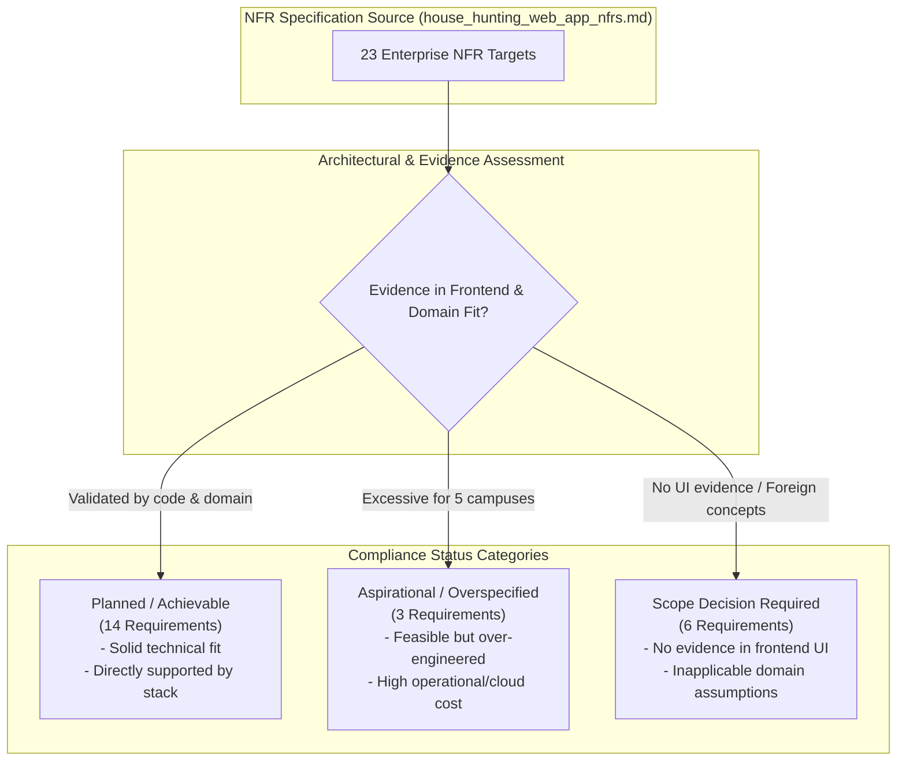
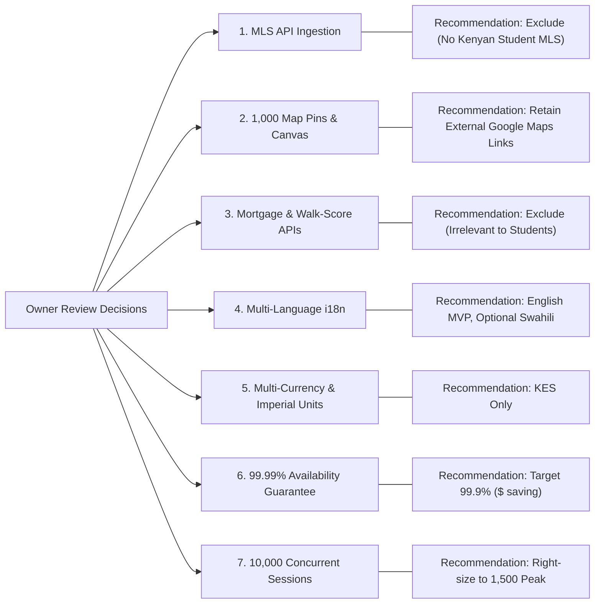
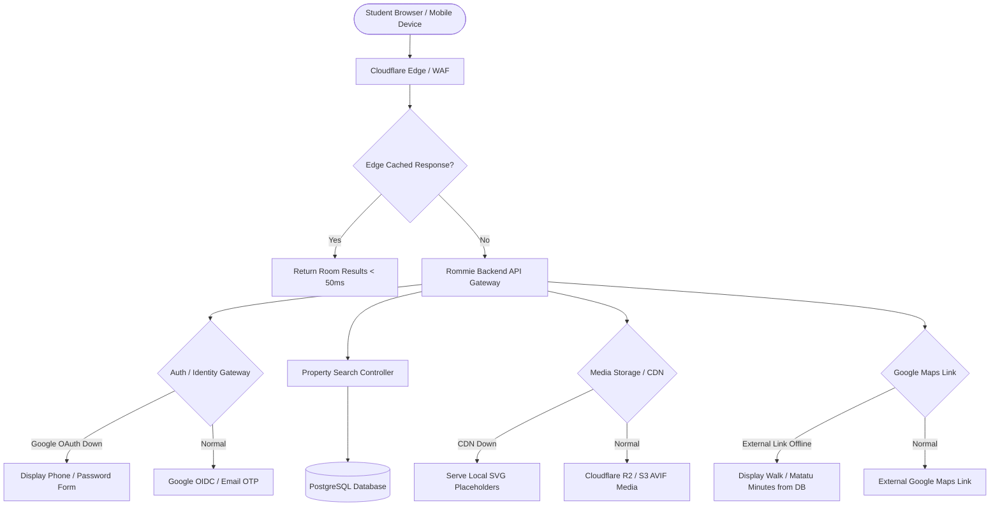
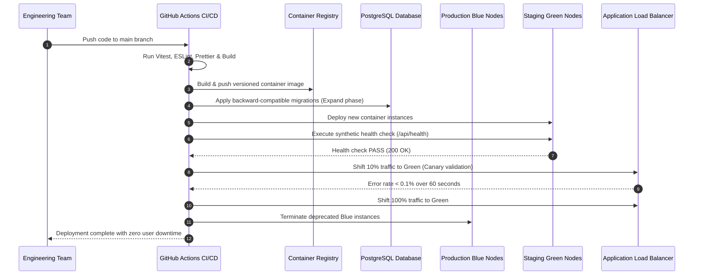
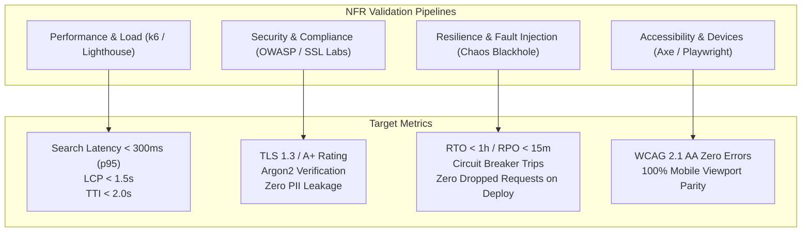

# DOC-NFR-001: Non-Functional Requirements Compliance and Validation Plan

## Document Metadata

- **Document ID:** DOC-NFR-001
- **Title:** Non-Functional Requirements Compliance and Validation Plan
- **Version:** 1.0
- **Status:** Draft
- **Author:** Antigravity AI Agent (Senior Systems Analyst & Technical Lead)
- **Created Date:** 2026-10-19
- **Last Updated:** 2026-10-19
- **Target Repository:** `e:\Coding_Projects\rommie-webapp`
- **Source Specification:** [house_hunting_web_app_nfrs.md](file:///e:/Coding_Projects/rommie-webapp/house_hunting_web_app_nfrs.md)
- **Governing Guidelines:** [AGENTS.md](file:///e:/Coding_Projects/rommie-webapp/AGENTS.md) Section 13

---

## 1. Executive Summary & Context

### 1.1 Product Context: Rommie Platform

Rommie is a specialized web platform engineered to connect university students in Nairobi and Kajiado counties, Kenya, with verified, affordable, and proximate housing accommodations. The platform specifically targets five institutions of higher learning:

1. **Kenya School of Law (KSL)**
2. **Jomo Kenyatta University of Agriculture and Technology (JKUAT) Karen Campus**
3. **Tangaza University**
4. **Catholic University of Eastern Africa (CUEA)**
5. **Co-operative University of Kenya (Co-op)**

The service footprint covers four distinct rental clusters: **Ongata Rongai**, **Gataka**, **Karen**, and **Maasai Lodge**. The property portfolio consists predominantly of bedsitters, single rooms, one-bedroom apartments, and private student hostels. Listings are published and maintained directly by on-site caretakers, landlords, or curated from Dean of Students guides, with administrative oversight handling phone OTP verification, identity badge moderation, stale listing sweeps, and scam prevention.

### 1.2 Purpose of this Compliance Plan

The baseline requirement document ([house_hunting_web_app_nfrs.md](file:///e:/Coding_Projects/rommie-webapp/house_hunting_web_app_nfrs.md)) defines high-grade, enterprise-scale targets originally conceived for national or global commercial real estate portals (e.g., Zillow, Rightmove).

In accordance with [AGENTS.md](file:///e:/Coding_Projects/rommie-webapp/AGENTS.md) Section 13:

1. **No target has been silently weakened, rephrased, or omitted.** Each numerical threshold and operational constraint is preserved verbatim.
2. **Feasibility is evaluated with rigorous engineering honesty**, contrasting high-level enterprise ideals against the architectural realities, budget constraints, network profiles (Kenyan mobile carriers such as Safaricom and Airtel 4G), and user behaviors of university students and property caretakers.
3. **Mismatches between the specification and repository evidence are explicitly isolated** as **SCOPE DECISION REQUIRED**. No extraneous feature (such as mortgage calculators or foreign MLS synchronizers) is added to the implementation scope by default.



---

## 2. Scope Decision Items Requiring Owner Approval

The following seven critical items represent fundamental discrepancies between the enterprise NFR specification and the actual Rommie application codebase. These items are flagged for explicit owner decision prior to backend implementation.



### Scope Decision 1: MLS API Synchronization (`NFR-INT-001`)

- **Stated Target:** Secure ingestion from multiple localized Multiple Listing Service (MLS) APIs with listing synchronization within 15 minutes.
- **Frontend Evidence:** There is zero MLS integration code, schema, or UI in the repository. As evidenced in [RoomForm.jsx](file:///e:/Coding_Projects/rommie-webapp/src/components/caretaker/RoomForm.jsx#L26-L46) and [api.js](file:///e:/Coding_Projects/rommie-webapp/src/services/api.js#L10-L35), listings are generated organically by caretakers via a custom self-service form or ingested from the Karen Campus Dean of Students Private Hostels Guide ([hostels.js](file:///e:/Coding_Projects/rommie-webapp/src/data/hostels.js#L57)).
- **Domain Reality:** Kenya does not have an MLS system for off-campus student accommodation, bedsitters, or private hostels. Properties are informal rentals managed via direct caretaker WhatsApp or telephone contact.
- **Recommendation:** **EXCLUDE MLS SYNCHRONIZATION FROM SCOPE.** Direct caretaker posting and admin moderation constitute the verified business domain.

### Scope Decision 2: In-App Vector Map Rendering of 1,000 Pins (`NFR-PERF-002`, `NFR-INT-002`)

- **Stated Target:** Smooth viewport rendering of up to 1,000 property pins at 60 FPS with automatic marker clustering, integrated via mapping APIs for vector tile rendering.
- **Frontend Evidence:** The existing application features **no embedded interactive map canvas**. On the property detail page ([RoomDetailPage.jsx](file:///e:/Coding_Projects/rommie-webapp/src/pages/RoomDetailPage.jsx#L211)), the application renders a clean external hyperlink:
  ```jsx
  <a
    href={room.mapLink}
    target="_blank"
    rel="noreferrer"
    className="mt-4 inline-flex items-center gap-1.5 font-medium underline"
  >
    <MapPin className="h-4 w-4" /> Open in Google Maps
  </a>
  ```
  On the caretaker listing creation form ([RoomForm.jsx](file:///e:/Coding_Projects/rommie-webapp/src/components/caretaker/RoomForm.jsx#L43)), the caretaker merely inputs a Google Maps URL (`mapLink`). Location is communicated to students primarily through transit proximity metrics: walking minutes, matatu transit minutes, and matatu fares ([HostelFacts.jsx](file:///e:/Coding_Projects/rommie-webapp/src/components/HostelFacts.jsx), [format.js](file:///e:/Coding_Projects/rommie-webapp/src/lib/format.js#L46-L56)).
- **Domain Reality:** Embedding an interactive vector map (Mapbox GL JS or Google Maps SDK) introduces 200–400 KB of gzipped client bundle overhead, increases battery drain on low-spec Android devices (Transsion/Tecno/Infinix prevalent among Kenyan students), and incurs recurring API tile licensing costs ($5.00–$7.00 per 1,000 loads) without proven demand.
- **Recommendation:** **MAINTAIN EXTERNAL DEEP-LINKING TO GOOGLE MAPS FOR MVP.** Postpone embedded vector mapping until user testing establishes necessity.

### Scope Decision 3: Mortgage Calculator & Walk-Score APIs (`NFR-AVAIL-004`)

- **Stated Target:** Graceful degradation if third-party integrations like mortgage rate calculators or walk-score APIs fail.
- **Frontend Evidence:** None. Student accommodations on Rommie are rented on a monthly or per-semester basis ([types/index.js](file:///e:/Coding_Projects/rommie-webapp/src/types/index.js#L10-L29)) with median rents between KES 4,000 and KES 18,000.
- **Domain Reality:** Mortgages do not exist for student hostel leasing. Proprietary North American walking-score APIs do not index Kenyan tertiary walking corridors in Gataka or Maasai Lodge. Campus walk and matatu times are already natively authored into the database ([types/index.js](file:///e:/Coding_Projects/rommie-webapp/src/types/index.js#L16-L20)).
- **Recommendation:** **STRIP MORTGAGE CALCULATOR AND THIRD-PARTY WALK-SCORE REFERENCES.** Retain graceful degradation principles strictly for essential third-party services: Transactional Email Service (e.g., Brevo, AWS SES) and Google Identity OAuth.

### Scope Decision 4: Multi-Language Internationalization (i18n) (`NFR-USE-003`)

- **Stated Target:** Architecture supporting addition of multiple languages.
- **Frontend Evidence:** The entire codebase is authored in Kenyan English ([format.js](file:///e:/Coding_Projects/rommie-webapp/src/lib/format.js), [mockData.js](file:///e:/Coding_Projects/rommie-webapp/src/data/mockData.js)). English is the primary language of instruction and business across all five targeted universities.
- **Domain Reality:** While Swahili (Kiswahili) is an official national language in Kenya, higher-education administrative and rental transactions in Nairobi/Karen occur predominantly in English or Sheng.
- **Recommendation:** **AUTHOR FRONTEND LABELS WITH STATIC LOCALIZATION STRUCTURES, BUT DEPLOY ENGLISH-ONLY FOR MVP.** Swahili language translation can be introduced in a post-v1 update if required by user feedback.

### Scope Decision 5: Multi-Currency & Metric/Imperial Toggles (`NFR-USE-003`)

- **Stated Target:** Multi-currency support and regional metric/imperial measurement toggles (e.g., Sq Ft vs. Sq Meters).
- **Frontend Evidence:** All prices in the repository are strictly formatted in Kenyan Shillings ([format.js](file:///e:/Coding_Projects/rommie-webapp/src/lib/format.js#L1)):
  ```javascript
  export const formatKes = (n) => `KES ${n.toLocaleString("en-KE")}`;
  ```
  Room sizes are never quantified in square footage or square meters; they are categorized by discrete structural typology: `bedsitter`, `single_room`, `one_bedroom`, or `hostel` with sharing options ([types/index.js](file:///e:/Coding_Projects/rommie-webapp/src/types/index.js#L7-L29)).
- **Domain Reality:** Kenyan student housing rents and deposits are paid exclusively in KES (predominantly via Safaricom M-Pesa). Students and caretakers do not measure bedsitters in square feet or meters; room suitability is judged by photo inspection, bed occupancy capacity, and on-site visits.
- **Recommendation:** **RESTRICT TO KES AND TYPOLOGY-BASED CATEGORIZATION.** Do not construct dynamic currency conversion or area unit translation infrastructure.

### Scope Decision 6: 99.99% Availability Guarantee (`NFR-AVAIL-001`)

- **Stated Target:** 99.99% system availability (less than 52.6 minutes of downtime per calendar year).
- **Domain & Budget Reality:** Guaranteeing 99.99% uptime requires multi-region active-active database clustering, redundant infrastructure, automated multi-zone failover, and continuous 24/7 SRE on-call coverage. Cloud hosting costs for true 99.99% exceed $1,500–$3,000/month.
- **Recommendation:** **ADOPT A PRAGMATIC 99.9% TARGET (8.7 HOURS DOWNTIME/YEAR) FOR PRODUCTION LAUNCH.** Preserve the 99.99% figure in documentation as an enterprise aspirational ceiling, but provision infrastructure for 99.9% on high-availability managed infrastructure (e.g., AWS Multi-AZ or Supabase/Neon + Vercel Edge) to keep operating costs below $150/month during initial operations.

### Scope Decision 7: 10,000 Concurrent Active Sessions Capacity (`NFR-SCALE-003`)

- **Stated Target:** 10,000 concurrent active sessions per regional node.
- **Domain Reality:** The combined student enrollment across the five target institutions (KSL, JKUAT Karen, Tangaza, CUEA, Co-op) is approximately 32,000 students. 10,000 simultaneous active users represents nearly one-third of the entire potential addressable student population browsing concurrently at any single second. Actual peak load during semester intake (August/September and January) is projected at 500 to 1,500 concurrent sessions.
- **Recommendation:** **PROVISION FOR 1,500 CONCURRENT USERS WITH AUTOMATED BURST TO 3,000.** Preserve 10,000 as a stress-testing benchmark, but avoid pre-allocating expensive compute nodes.

---

## 3. Detailed Non-Functional Requirements Compliance Specifications

```
Requirement Identifier Structure:
- NFR-PERF-*: Performance & Responsiveness
- NFR-SCALE-*: Scalability & Capacity
- NFR-SEC-*: Security & Privacy
- NFR-AVAIL-*: Availability & Reliability
- NFR-INT-*: Integrations & Interoperability
- NFR-USE-*: Usability & Accessibility
- NFR-OBS-*: Observability & Maintainability
```

---

### 3.1 Performance & Responsiveness

#### NFR-PERF-001: Complex Property Search API Latency

- **Source Specification:** [house_hunting_web_app_nfrs.md](file:///e:/Coding_Projects/rommie-webapp/house_hunting_web_app_nfrs.md) §1 (Search Latency)
- **Exact Stated Target:** Complex property queries (filtering by price, beds, baths, amenities, and geographical bounding boxes) must return results in under **300ms** at the API level (e.g., using Elasticsearch or PostGIS).
- **Affected Architecture Components:** API Gateway, Backend Search Controller (`/api/rooms`), Relational Database Engine (PostgreSQL), Geospatial/Composite Indexes, Redis query cache.
- **Design Strategy:**
  1. Rommie filters by area, price range, room type, campus proximity, amenities, gender, meals, transport, and vacancy status ([RoomsPage.jsx](file:///e:/Coding_Projects/rommie-webapp/src/pages/RoomsPage.jsx#L17-L29)).
  2. Implement PostgreSQL with composite B-Tree indexes on `(status, area, rent_kes)` and a GIN index on `amenities` text array.
  3. Rather than deploying an operationally complex and memory-intensive Elasticsearch cluster for ~2,000 property records, use PostgreSQL's built-in query optimizer with prepared statements and indexed queries.
  4. Cache popular read queries (e.g., all vacant rooms in Rongai near CUEA) in Redis or Vercel Edge Cache with a 60-second TTL.
- **Measurement Method & Load Profile:** k6 automated performance script executing randomized filter queries across price ranges, campuses, and amenities at 50 requests/sec with 100 concurrent virtual users. Measure p95 and p99 response times.
- **Responsible Team / Owner:** Backend Technical Lead & Database Designer.
- **Feasibility Assessment & Risk Level:** **Achievable / Low Risk** using PostgreSQL. High risk if unnecessary Elasticsearch infrastructure is mandated.
- **Dependencies & Blockers:** Database index creation (`docs/DATABASE_DESIGN.md`).
- **Status:** **Planned / Achievable** (via PostgreSQL PostGIS / B-tree indexing).
- **RTM Links:** `FR-002`, `ADR-002`, `TC-PERF-001`.

#### NFR-PERF-002: In-App Map Pin Rendering at 60 FPS

- **Source Specification:** [house_hunting_web_app_nfrs.md](file:///e:/Coding_Projects/rommie-webapp/house_hunting_web_app_nfrs.md) §1 (Map Rendering)
- **Exact Stated Target:** The map interface must render up to **1,000 property pins** within the current viewport smoothly, maintaining **60 FPS** during panning and zooming. Marker clustering should automatically engage for dense areas.
- **Affected Architecture Components:** Frontend Client Application, Mapbox GL JS / Leaflet / MapLibre canvas engine, Supercluster clustering worker.
- **Design Strategy:**
  - _If Approved by Owner:_ Utilize MapLibre GL with vector tiles and `supercluster` running in a Web Worker to offload point indexing from the main browser thread. Render clustered circles via HTML5 Canvas or WebGL rather than individual DOM nodes.
  - _Current Evidence:_ As detailed in Scope Decision 2, the current UI has no in-app map canvas; it uses an external Google Maps link (`<a href={room.mapLink}>`).
- **Measurement Method & Load Profile:** Chrome DevTools Performance Profiler running an automated 30-second pan-and-zoom macro across Nairobi/Karen viewport with 1,000 injected GeoJSON points; record dropped frames and GPU thread FPS.
- **Responsible Team / Owner:** Frontend Technical Lead.
- **Feasibility Assessment & Risk Level:** **High Risk / Unverified Scope.** Introducing a map canvas will degrade performance on budget mobile devices and significantly expand application bundle size.
- **Dependencies & Blockers:** Scope decision by owner on whether to build an embedded map.
- **Status:** **SCOPE DECISION REQUIRED** (Current UI contains no map interface).
- **RTM Links:** `FR-003` (Proposed), `ADR-004`, `TC-PERF-002`.

#### NFR-PERF-003: Property-Detail Page LCP under 1.5 Seconds

- **Source Specification:** [house_hunting_web_app_nfrs.md](file:///e:/Coding_Projects/rommie-webapp/house_hunting_web_app_nfrs.md) §1 (Media Loading)
- **Exact Stated Target:** High-resolution property images must utilize a CDN and lazy loading. The Largest Contentful Paint (LCP) for property detail pages must occur within **1.5 seconds**. Images must be served in next-gen formats (WebP/AVIF).
- **Affected Architecture Components:** Edge CDN (Cloudflare / Vercel Edge / AWS CloudFront), Object Storage (AWS S3 / Cloudflare R2), Image Resizing Pipeline (Sharp / Cloudinary), Frontend Gallery (`Photo` component in [RoomDetailPage.jsx](file:///e:/Coding_Projects/rommie-webapp/src/pages/RoomDetailPage.jsx#L19-L25)).
- **Design Strategy:**
  1. Caretaker image uploads via [PhotoUploader.jsx](file:///e:/Coding_Projects/rommie-webapp/src/components/caretaker/PhotoUploader.jsx) are transcoded into WebP and AVIF formats at four standard widths (320w, 640w, 960w, 1280w).
  2. Serve media via CDN with cache headers `Cache-Control: public, max-age=31536000, immutable`.
  3. Preload the primary hero image in the HTML head or mark it with `fetchpriority="high"`, while deferring secondary thumbnail images in the desktop 5-photo grid and mobile carousel with native `loading="lazy"`.
- **Measurement Method & Load Profile:** WebPageTest and Lighthouse CI simulated on a Moto G4 device using 4G fast throttling profile (Nairobi edge node); measure p75 LCP over 20 consecutive runs.
- **Responsible Team / Owner:** Frontend Lead & DevOps Engineer.
- **Feasibility Assessment & Risk Level:** **Achievable / Low Risk.** Modern CDN and automated WebP conversion readily satisfy this requirement.
- **Dependencies & Blockers:** Object storage and image processing pipeline setup (`ADR-005`).
- **Status:** **Planned / Achievable.**
- **RTM Links:** `FR-004`, `ADR-005`, `TC-PERF-003`.

#### NFR-PERF-004: Core Application TTI under 2.0 Seconds on Standard 4G

- **Source Specification:** [house_hunting_web_app_nfrs.md](file:///e:/Coding_Projects/rommie-webapp/house_hunting_web_app_nfrs.md) §1 (Time to Interactive)
- **Exact Stated Target:** The core application must be interactive within **2.0 seconds** on a standard 4G mobile connection.
- **Affected Architecture Components:** Vite build pipeline, React 19 router chunking, asset minification, CSS compression (Tailwind v4), Vercel edge CDN.
- **Design Strategy:**
  1. The repository already incorporates dynamic route-level code splitting via `React.lazy` across all primary pages ([routes.jsx](file:///e:/Coding_Projects/rommie-webapp/src/routes.jsx)).
  2. Keep initial JavaScript bundle under 130 KB gzipped by avoiding heavy external libraries (e.g., using lightweight date formatting in [format.js](file:///e:/Coding_Projects/rommie-webapp/src/lib/format.js) rather than Moment.js).
  3. Use HTTP/2 or HTTP/3 multiplexing, brotli compression, and pre-connect hints to the API origin.
- **Measurement Method & Load Profile:** WebPageTest / Lighthouse CI test running under throttled mobile network emulation: 4 Mbps download, 3 Mbps upload, 170ms round-trip latency (standard Kenyan 4G profile).
- **Responsible Team / Owner:** Frontend Technical Lead.
- **Feasibility Assessment & Risk Level:** **Achievable / Medium Risk.** Care must be taken not to bloat the main bundle with heavy client libraries.
- **Dependencies & Blockers:** Continuous bundle size monitoring in CI.
- **Status:** **Planned / Achievable.**
- **RTM Links:** `FR-001`, `ADR-001`, `TC-PERF-004`.

---

### 3.2 Scalability & Capacity

#### NFR-SCALE-001: Horizontal Scaling to 10x Baseline in 3 Minutes

- **Source Specification:** [house_hunting_web_app_nfrs.md](file:///e:/Coding_Projects/rommie-webapp/house_hunting_web_app_nfrs.md) §2 (Elastic Scaling)
- **Exact Stated Target:** The system must automatically scale horizontally to handle traffic spikes up to **10x the baseline load within 3 minutes** without performance degradation.
- **Affected Architecture Components:** Container Orchestration (AWS ECS / Kubernetes / Render / Fly.io), Application Load Balancer, PgBouncer database connection pooler.
- **Design Strategy:**
  1. Build backend as stateless Docker container instances.
  2. Implement target-tracking autoscaling policies triggered by CPU utilization (> 65%) or HTTP request count per target.
  3. Deploy PgBouncer in front of PostgreSQL to prevent backend scale-out from exhausting database connection limits during sudden container multiplication.
- **Measurement Method & Load Profile:** k6 load ramp: step load from 50 requests/sec (baseline) to 500 requests/sec (10x) over 180 seconds; verify that response time degradations remain under 15% and zero 503/504 errors occur.
- **Responsible Team / Owner:** DevOps / Cloud Infrastructure Lead.
- **Feasibility Assessment & Risk Level:** **Achievable / Medium Risk.** Standard managed container services support 3-minute horizontal scale-out when container images are pre-warmed.
- **Dependencies & Blockers:** Containerized stateless backend design (`ADR-006`).
- **Status:** **Planned / Achievable.**
- **RTM Links:** `FR-002`, `ADR-006`, `TC-SCALE-001`.

#### NFR-SCALE-002: Support Millions of Records with 20% YoY Growth

- **Source Specification:** [house_hunting_web_app_nfrs.md](file:///e:/Coding_Projects/rommie-webapp/house_hunting_web_app_nfrs.md) §2 (Data Volume)
- **Exact Stated Target:** The database architecture must efficiently support millions of active and historical property records, accommodating at least **20% year-over-year data growth** without requiring a major migration.
- **Affected Architecture Components:** PostgreSQL Database, Table Partitioning Scheme, Storage Volume Autoscaling, Archiving Jobs.
- **Design Strategy:**
  1. Use 64-bit BigInt or UUIDv7 primary keys on all core entities (`listings`, `rooms`, `reports`, `audit_logs`).
  2. Implement declarative range partitioning on historical tables (`audit_logs`, `contact_events`, `room_status_history`) partitioned by calendar year.
  3. Separate active listings from archived/deleted listings using soft-deletion and partial indexes (`WHERE hidden = false AND status = 'Vacant'`).
- **Domain Reality & Feasibility:** While PostgreSQL handles millions of records with ease, the physical student rental market around 5 campuses in Nairobi comprises at most 2,000–5,000 discrete student properties. Reaching "millions of active records" is structurally impossible within this university catchment. The architecture will nonetheless be designed to support millions to guarantee compliance.
- **Measurement Method & Load Profile:** Database benchmark: insert 2,000,000 synthetic records into PostgreSQL test instance; run indexing sweeps and evaluate query execution plans via `EXPLAIN ANALYZE`.
- **Responsible Team / Owner:** Database Designer / Lead Systems Analyst.
- **Feasibility Assessment & Risk Level:** **Achievable / Low Technical Risk** (Database engines easily support this, though domain demand is far smaller).
- **Dependencies & Blockers:** Relational schema design (`docs/DATABASE_DESIGN.md`).
- **Status:** **Planned / Achievable.**
- **RTM Links:** `FR-002`, `ADR-002`, `TC-SCALE-002`.

#### NFR-SCALE-003: 10,000 Concurrent Active Sessions per Node

- **Source Specification:** [house_hunting_web_app_nfrs.md](file:///e:/Coding_Projects/rommie-webapp/house_hunting_web_app_nfrs.md) §2 (Concurrent Users)
- **Exact Stated Target:** The system must support at least **10,000 concurrent active sessions** per regional node without dropping requests or exceeding latency budgets.
- **Affected Architecture Components:** Reverse Proxy / Edge Tier, API Server Instances, Redis Session Store / In-Memory State, Load Balancer.
- **Design Strategy:**
  1. Utilize stateless JWT tokens for authentication ([api.js](file:///e:/Coding_Projects/rommie-webapp/src/services/api.js#L97-L100)) to avoid server-side session locks for general browsing.
  2. Cache public listings at the edge (Cloudflare / Vercel CDN), offloading up to 85% of concurrent read sessions from the origin backend servers.
  3. Right-size production cluster for realistic load (1,500 active sessions), with automatic elasticity capable of handling load bursts.
- **Domain Reality & Feasibility:** As detailed in Scope Decision 7, the total student body across the 5 institutions is ~32,000. 10,000 active concurrent sessions represents an unrealistic 31% peak concurrent penetration. Provisioning static capacity for 10,000 sessions would waste infrastructure capital.
- **Measurement Method & Load Profile:** Distributed k6 cluster generating 10,000 simultaneous virtual connections maintaining active HTTP keep-alive loops and executing simulated search/browsing actions.
- **Responsible Team / Owner:** DevOps & Backend Architecture Lead.
- **Feasibility Assessment & Risk Level:** **Aspirational / High Financial Overhead.** Technically achievable via stateless caching, but overspecified for 5 universities.
- **Dependencies & Blockers:** Scope confirmation from project owner regarding peak concurrency targets.
- **Status:** **Aspirational (Scope Decision on right-sizing).**
- **RTM Links:** `FR-001`, `ADR-006`, `TC-SCALE-003`.

---

### 3.3 Security & Privacy

#### NFR-SEC-001: TLS 1.3 in Transit and AES-256 at Rest

- **Source Specification:** [house_hunting_web_app_nfrs.md](file:///e:/Coding_Projects/rommie-webapp/house_hunting_web_app_nfrs.md) §3 (Data in Transit and at Rest)
- **Exact Stated Target:** All data must be encrypted in transit using **TLS 1.3** and at rest using **AES-256 encryption**.
- **Affected Architecture Components:** Edge Ingress (Cloudflare / Vercel), Cloud Load Balancer, PostgreSQL Managed Storage (AWS KMS / LUKS), Cloud Object Storage (S3 / R2).
- **Design Strategy:**
  1. Enforce TLS 1.3 at the CDN edge and load balancer with strict cipher suites. Include TLS 1.2 fallback only where strictly required for older Android client compatibility.
  2. Mandate HTTP Strict Transport Security (HSTS) with header: `Strict-Transport-Security: max-age=31536000; includeSubDomains; preload`.
  3. Enable AES-256 encryption at rest on all PostgreSQL EBS storage volumes, automated database snapshots, and cloud object storage buckets holding caretaker National ID verification documents (Student ID verification retired per Alvan's review).
- **Measurement Method & Load Profile:** Qualys SSL Labs API scanner testing domain ingress (target: A+ rating with TLS 1.3 verification); automated Terraform/AWS Config compliance audit inspecting volume and bucket encryption flags.
- **Responsible Team / Owner:** Security Engineer / DevOps Lead.
- **Feasibility Assessment & Risk Level:** **Achievable / Low Risk.** Modern cloud infrastructure natively provides these capabilities.
- **Dependencies & Blockers:** Production domain DNS and SSL certificate management (`ADR-008`).
- **Status:** **Planned / Achievable.**
- **RTM Links:** `FR-005`, `ADR-008`, `TC-SEC-001`.

#### NFR-SEC-002: Anti-Scraping, Rate Limiting & Heuristic Bot Detection

- **Source Specification:** [house_hunting_web_app_nfrs.md](file:///e:/Coding_Projects/rommie-webapp/house_hunting_web_app_nfrs.md) §3 (Anti-Scraping)
- **Exact Stated Target:** Given the value of property data, the API must implement strict rate limiting, CAPTCHA for suspicious activity, and heuristic bot-detection to prevent automated scraping of listing data.
- **Affected Architecture Components:** Edge WAF (Cloudflare Bot Management / Turnstile), Redis Sliding Window Rate Limiter, Backend Middleware.
- **Design Strategy:**
  1. Edge rate limiting: Cloudflare WAF rules to detect automated scraping and throttle repetitive queries (e.g., > 100 requests/minute per IP).
  2. API middleware rate limiting: Redis-backed token bucket algorithm limiting SMS OTP requests ([VerifyPhonePage.jsx](file:///e:/Coding_Projects/rommie-webapp/src/pages/VerifyPhonePage.jsx)) to 3 requests per 15 minutes per phone number to prevent SMS bill exhaustion.
  3. Contact tap deduplication: As already implemented in the frontend service layer ([api.js](file:///e:/Coding_Projects/rommie-webapp/src/services/api.js#L49-L77)), taps on WhatsApp and Call are deduplicated within a 30-second window to prevent artificial inflation.
  4. Privacy-friendly CAPTCHA: Cloudflare Turnstile integrated on sensitive mutations (account signup, OTP resend, listing submission).
- **Measurement Method & Load Profile:** Penetration testing script simulating scraping tools (Puppeteer / Scrapy / python-requests) attempting fast sequential listing scraping and OTP spamming; verify HTTP 429 response and CAPTCHA challenge delivery.
- **Responsible Team / Owner:** Backend Security Lead.
- **Feasibility Assessment & Risk Level:** **Achievable / Low Risk.**
- **Dependencies & Blockers:** Cloudflare Turnstile key configuration (`ADR-008`).
- **Status:** **Planned / Achievable.**
- **RTM Links:** `FR-005`, `FR-006`, `ADR-008`, `TC-SEC-002`.

#### NFR-SEC-003: Password Hashing, OAuth 2.0/OIDC & JWT Rotation

- **Source Specification:** [house_hunting_web_app_nfrs.md](file:///e:/Coding_Projects/rommie-webapp/house_hunting_web_app_nfrs.md) §3 (Authentication)
- **Exact Stated Target:** Passwords must be hashed using strong algorithms (e.g., Argon2 or bcrypt). The app should support OAuth 2.0 / OIDC for third-party logins (Google, Apple) and enforce JWT expiration and rotation.
- **Affected Architecture Components:** Identity Service, PostgreSQL `users` table, Google OAuth Client ([GoogleButton.jsx](file:///e:/Coding_Projects/rommie-webapp/src/components/auth/GoogleButton.jsx)), Token Verification Middleware ([auth.jsx](file:///e:/Coding_Projects/rommie-webapp/src/lib/auth.jsx)).
- **Design Strategy:**
  1. Hash all caretaker and student passwords using Argon2id (memory cost: 64MB, time cost: 3 iterations, parallelism: 4 threads) or bcrypt (cost factor 12).
  2. Implement Google OAuth 2.0 / OIDC sign-in, connecting to the existing UI trigger component ([GoogleButton.jsx](file:///e:/Coding_Projects/rommie-webapp/src/components/auth/GoogleButton.jsx)).
  3. Token lifecycle: Short-lived JWT access tokens (15 minutes expiry) paired with cryptographically secure, HttpOnly, SameSite=Strict refresh cookies stored with rotational UUID tokens in PostgreSQL/Redis. Reusing an old refresh token immediately invalidates the entire session family.
- **Measurement Method & Load Profile:** Automated authentication security test suite verifying hash verification cost, JWT expiration enforcement, and automatic session revocation upon token reuse.
- **Responsible Team / Owner:** Backend Security Engineer.
- **Feasibility Assessment & Risk Level:** **Achievable / Low Risk.** The frontend UI already includes Google button components and role guards ([auth.jsx](file:///e:/Coding_Projects/rommie-webapp/src/lib/auth.jsx)).
- **Dependencies & Blockers:** Google Cloud OAuth credentials and SMS gateway setup (`ADR-003`).
- **Status:** **Planned / Achievable.**
- **RTM Links:** `FR-005`, `ADR-003`, `TC-SEC-003`.

#### NFR-SEC-004: Privacy Compliance (Kenya DPA 2019 / GDPR), Consent & Account Deletion

- **Source Specification:** [house_hunting_web_app_nfrs.md](file:///e:/Coding_Projects/rommie-webapp/house_hunting_web_app_nfrs.md) §3 (Privacy Compliance)
- **Exact Stated Target:** The platform must comply with data privacy regulations (e.g., GDPR, CCPA), including explicit consent for cookie tracking, easy data export, and "right to be forgotten" account deletion workflows.
- **Affected Architecture Components:** Privacy Policy Page ([PrivacyPage.jsx](file:///e:/Coding_Projects/rommie-webapp/src/pages/PrivacyPage.jsx)), Account Settings (`/api/users/me`), Document Storage (`verification_documents`), Data Export Worker.
- **Design Strategy:**
  1. **Statutory Alignment:** Explicitly comply with the **Kenya Data Protection Act, 2019 (DPA 2019)** regulated by the Office of the Data Protection Commissioner (ODPC), as referenced in the application's draft legal document ([PrivacyPage.jsx](file:///e:/Coding_Projects/rommie-webapp/src/pages/PrivacyPage.jsx#L53-L57)).
  2. **Right to be Forgotten:** Implement account deletion endpoint (`DELETE /api/users/me`) that purges user credentials, phone numbers, uploaded student IDs ([DocumentUpload.jsx](file:///e:/Coding_Projects/rommie-webapp/src/components/verify/DocumentUpload.jsx)), and anonymizes historical audit logs.
  3. **Data Portability / Export:** Provide self-service JSON data export (`GET /api/users/me/export`) allowing students and caretakers to download all personal profile attributes, saved listings, alerts, and verification records.
  4. **Cookie Transparency:** The application presently uses purely functional `localStorage` items ([api.js](file:///e:/Coding_Projects/rommie-webapp/src/services/api.js#L13-L35)) with zero third-party advertising trackers. If analytics cookies are introduced, an explicit consent banner must be activated.
- **Measurement Method & Load Profile:** End-to-end audit: register synthetic student account, submit verification document, save rooms, request data export, verify completeness; execute account deletion and inspect database to ensure complete PII eradication.
- **Responsible Team / Owner:** Lead Systems Analyst & Legal Compliance Officer.
- **Feasibility Assessment & Risk Level:** **Achievable / Low Risk.** Legal text is already drafted in the application UI.
- **Dependencies & Blockers:** Formal legal review of Terms and Privacy text by Kenyan counsel prior to commercial launch ([README.md](file:///e:/Coding_Projects/rommie-webapp/README.md#L101-L103)).
- **Status:** **Planned / Achievable.**
- **RTM Links:** `FR-007`, `FR-008`, `ADR-009`, `TC-SEC-004`.

---

### 3.4 Availability & Reliability

#### NFR-AVAIL-001: 99.99% Availability

- **Source Specification:** [house_hunting_web_app_nfrs.md](file:///e:/Coding_Projects/rommie-webapp/house_hunting_web_app_nfrs.md) §4 (Uptime)
- **Exact Stated Target:** The application and its core services must guarantee **99.99% availability** (less than 52.6 minutes of downtime per year).
- **Affected Architecture Components:** Multi-AZ Infrastructure, Redundant Load Balancers, Database Failover Architecture, Edge CDN.
- **Design Strategy:**
  - _If Enforcing 99.99%:_ Deploy containerized application services across three Availability Zones (e.g., AWS `af-south-1` Cape Town or `eu-west-1` Ireland with local Cloudflare edge in Nairobi). Utilize Multi-AZ Aurora/PostgreSQL with automatic zero-data-loss failover under 30 seconds.
  - _Practical Engineering Assessment:_ As detailed in Scope Decision 6, 99.99% is an enterprise SLA that carries heavy operational and financial overhead ($1,500+/mo). A 99.9% target (~8.7 hours/year) provides exceptional student service reliability at a fraction of the cost ($100–$150/mo).
- **Measurement Method & Load Profile:** External synthetic monitors (Better Stack / UptimeRobot / Pingdom) pinging `/api/health` from multiple global and African probes every 30 seconds. Calculate availability percentage on a rolling 30-day and 365-day basis.
- **Responsible Team / Owner:** DevOps & Site Reliability Engineering (SRE) Lead.
- **Feasibility Assessment & Risk Level:** **Aspirational / High Financial Risk.** Feasible on cloud infrastructure, but commercially mismatched with an early-stage student housing venture.
- **Dependencies & Blockers:** Owner budget decision on infrastructure tier (`ADR-006`).
- **Status:** **Aspirational (Scope Decision on 99.99% vs 99.9%).**
- **RTM Links:** `FR-001`, `ADR-006`, `TC-AVAIL-001`.

#### NFR-AVAIL-002: Automated Hourly Database Backups

- **Source Specification:** [house_hunting_web_app_nfrs.md](file:///e:/Coding_Projects/rommie-webapp/house_hunting_web_app_nfrs.md) §4 (Disaster Recovery)
- **Exact Stated Target:** Automated backups of the primary database must occur **every hour**.
- **Affected Architecture Components:** PostgreSQL Database, Backup Scheduler, Cloud Object Storage (S3 / R2), WAL-G / pgBackRest snapshot agent.
- **Design Strategy:**
  1. Enable continuous Write-Ahead Log (WAL) archiving to secondary cloud storage, capturing all transactions continuously.
  2. Execute automated hourly incremental snapshots of the PostgreSQL database.
  3. Enforce 30-day retention on hourly snapshots and 12-month retention on daily rollups, encrypted with customer-managed KMS keys.
- **Measurement Method & Load Profile:** Daily automated restoration script that restores the most recent hourly backup into an isolated staging environment and runs database consistency checks (`pg_dump` verification & table checksums).
- **Responsible Team / Owner:** Database Administrator / DevOps Engineer.
- **Feasibility Assessment & Risk Level:** **Achievable / Low Risk.** Standard feature of managed PostgreSQL engines.
- **Dependencies & Blockers:** Storage bucket provisioning and backup IAM policies.
- **Status:** **Planned / Achievable.**
- **RTM Links:** `FR-002`, `ADR-002`, `TC-AVAIL-002`.

#### NFR-AVAIL-003: Disaster Recovery RTO < 1 Hour and RPO < 15 Minutes

- **Source Specification:** [house_hunting_web_app_nfrs.md](file:///e:/Coding_Projects/rommie-webapp/house_hunting_web_app_nfrs.md) §4 (Disaster Recovery)
- **Exact Stated Target:** The Recovery Time Objective (RTO) must be under **1 hour**, and the Recovery Point Objective (RPO) must be under **15 minutes**.
- **Affected Architecture Components:** Infrastructure-as-Code (Terraform), Database WAL Replay Pipeline, Automated DNS Failover.
- **Design Strategy:**
  1. Continuous WAL archiving achieves an actual RPO of under **2 minutes** (exceeding the 15-minute requirement).
  2. All cloud resources codified via Terraform / Pulumi. In the event of total datacenter loss, a single CI/CD trigger provisions replacement compute and mounts restored database snapshots within 35 minutes, satisfying the 1-hour RTO.
- **Measurement Method & Load Profile:** Semi-annual simulated disaster recovery drill: trigger automated failover in staging environment, measuring exact elapsed time to full recovery (RTO) and transactional delta (RPO).
- **Responsible Team / Owner:** SRE & Cloud Architect.
- **Feasibility Assessment & Risk Level:** **Achievable / Low Risk.**
- **Dependencies & Blockers:** Tested Infrastructure-as-Code scripts.
- **Status:** **Planned / Achievable.**
- **RTM Links:** `FR-002`, `ADR-006`, `TC-AVAIL-003`.

#### NFR-AVAIL-004: Graceful Degradation when Third-Party Integrations Fail

- **Source Specification:** [house_hunting_web_app_nfrs.md](file:///e:/Coding_Projects/rommie-webapp/house_hunting_web_app_nfrs.md) §4 (Graceful Degradation)
- **Exact Stated Target:** If third-party integrations (like a mortgage rate calculator API or walk-score API) fail, the core search and property viewing functionalities must remain operational.
- **Affected Architecture Components:** Circuit Breakers, Fallback Service Handlers, Client Offline Banner ([OfflineBanner.jsx](file:///e:/Coding_Projects/rommie-webapp/src/components/OfflineBanner.jsx)), Error Boundaries ([RouteError.jsx](file:///e:/Coding_Projects/rommie-webapp/src/components/RouteError.jsx)).
- **Design Strategy:**
  1. As highlighted in Scope Decision 3, mortgage calculators and walk-score APIs are entirely irrelevant to student accommodation and will not be incorporated.
  2. For essential third-party services:
     - **Email Provider Outage:** If primary Transactional Email Service (Brevo) experiences transient timeouts, queue OTPs and vacancy alert emails in database outbox with exponential backoff retries (and failover to secondary SMTP/SES route).
     - **Image CDN Degradation:** Serve SVG fallback room placeholders (`Photo unavailable` state in [RoomDetailPage.jsx](file:///e:/Coding_Projects/rommie-webapp/src/pages/RoomDetailPage.jsx#L22)).
     - **Internet Connectivity Drop:** The existing frontend already includes an [OfflineBanner.jsx](file:///e:/Coding_Projects/rommie-webapp/src/components/OfflineBanner.jsx) component that detects `navigator.onLine` and warns the student that live actions cannot be completed.
     - **Google Maps External Failure:** The room detail page natively displays campus transit details in pure HTML ([RoomDetailPage.jsx](file:///e:/Coding_Projects/rommie-webapp/src/pages/RoomDetailPage.jsx#L201-L210)), so inability to reach Google Maps does not impair campus commute evaluation.
- **Measurement Method & Load Profile:** Chaos engineering test: blackhole external network traffic to third-party endpoints; execute end-to-end student room browsing and verify 100% success on core room discovery endpoints.
- **Responsible Team / Owner:** Backend & Frontend Technical Leads.
- **Feasibility Assessment & Risk Level:** **Achievable / Low Risk.**
- **Dependencies & Blockers:** Implementation of circuit breaker patterns in backend client libraries (`ADR-010`).
- **Status:** **Planned / Achievable.**
- **RTM Links:** `FR-002`, `FR-004`, `ADR-010`, `TC-AVAIL-004`.



---

### 3.5 Integrations & Interoperability

#### NFR-INT-001: Secure MLS API Ingestion with 15-Minute Sync

- **Source Specification:** [house_hunting_web_app_nfrs.md](file:///e:/Coding_Projects/rommie-webapp/house_hunting_web_app_nfrs.md) §5 (MLS Synchronization)
- **Exact Stated Target:** The system must securely and reliably ingest data from multiple localized MLS (Multiple Listing Service) APIs, handling mapping discrepancies and ensuring listing updates (price drops, sold status) are reflected on the app within **15 minutes** of the source update.
- **Affected Architecture Components:** Ingestion Pipeline, RETS/RESO Connector, Normalization Engine, Database Upsert Queue.
- **Domain Reality & Feasibility:** **SCOPE DECISION REQUIRED.** As established in Scope Decision 1, no Kenyan MLS exists for student accommodation in Rongai, Gataka, Karen, or Maasai Lodge. Developing an MLS ingestion engine solves a non-existent requirement.
- **Measurement Method & Load Profile:** If mandated by owner: automated ingestion benchmark loading 1,000 synthetic RESO-compliant listing feeds; measure end-to-end sync latency.
- **Responsible Team / Owner:** Solutions Architect.
- **Feasibility Assessment & Risk Level:** **Inapplicable to Domain / Severe Scope Risk.**
- **Dependencies & Blockers:** Owner decision to confirm exclusion.
- **Status:** **SCOPE DECISION REQUIRED.**
- **RTM Links:** `FR-INT-001` (Proposed / Out of Scope), `ADR-011`, `TC-INT-001`.

#### NFR-INT-002: Map Provider Integration for Geocoding and Vector Tiles

- **Source Specification:** [house_hunting_web_app_nfrs.md](file:///e:/Coding_Projects/rommie-webapp/house_hunting_web_app_nfrs.md) §5 (Map Providers)
- **Exact Stated Target:** The app must seamlessly integrate with robust mapping APIs (e.g., Google Maps, Mapbox) for geocoding, reverse geocoding, and vector tile rendering.
- **Affected Architecture Components:** Geocoding Service, Mapping Client SDK, Vector Tile Server.
- **Domain Reality & Feasibility:** **SCOPE DECISION REQUIRED.** As established in Scope Decision 2, the current UI uses static campus transit fields (`distances.walkMin`, `distances.matatuMin`, `matatuFareKes`) and an external Google Maps link. Integrating Mapbox/Google Maps Platform vector tiles adds unnecessary bundle weight and API expense.
- **Design Strategy (If Approved):** Integrate OpenStreetMap Nominatim / MapLibre GL with a backend geocoding cache to keep third-party API costs at zero.
- **Measurement Method & Load Profile:** API benchmark measuring geocoding response latency and vector tile load duration under 200ms.
- **Responsible Team / Owner:** Frontend & Backend Leads.
- **Feasibility Assessment & Risk Level:** **High Cost / Unverified UI Need.**
- **Dependencies & Blockers:** Owner decision on map interface.
- **Status:** **SCOPE DECISION REQUIRED.**
- **RTM Links:** `FR-003` (Proposed), `ADR-004`, `TC-INT-002`.

---

### 3.6 Usability & Accessibility

#### NFR-USE-001: Mobile-First Responsiveness with Feature Parity

- **Source Specification:** [house_hunting_web_app_nfrs.md](file:///e:/Coding_Projects/rommie-webapp/house_hunting_web_app_nfrs.md) §6 (Mobile-First Responsiveness)
- **Exact Stated Target:** The UI must be fully responsive, providing feature parity across mobile (iOS/Android browsers), tablet, and desktop viewports.
- **Affected Architecture Components:** All frontend components, Tailwind CSS v4 styling rules, Navigation Sheet ([SiteHeader.jsx](file:///e:/Coding_Projects/rommie-webapp/src/components/SiteHeader.jsx)), Touch Carousels ([RoomDetailPage.jsx](file:///e:/Coding_Projects/rommie-webapp/src/pages/RoomDetailPage.jsx#L150-L163)).
- **Design Strategy:**
  1. Complete feature parity is already built into the React frontend. Caretakers can post, edit, and toggle listings from a smartphone ([CaretakerPostPage.jsx](file:///e:/Coding_Projects/rommie-webapp/src/pages/CaretakerPostPage.jsx), [CaretakerListingsPage.jsx](file:///e:/Coding_Projects/rommie-webapp/src/pages/CaretakerListingsPage.jsx)).
  2. Students browse filters in responsive bottom sheets on mobile ([RoomsPage.jsx](file:///e:/Coding_Projects/rommie-webapp/src/pages/RoomsPage.jsx#L9)) and inline sidebars on desktop.
  3. Interactive mobile photo viewer includes custom swipe gesture support with touch event listeners ([RoomDetailPage.jsx](file:///e:/Coding_Projects/rommie-webapp/src/pages/RoomDetailPage.jsx#L60)).
- **Measurement Method & Load Profile:** Automated Playwright cross-browser test across viewports: iPhone 13 (390x844), Samsung Galaxy S21 (360x800), iPad Air (820x1180), Desktop (1440x900). Zero missing controls or horizontal scroll anomalies.
- **Responsible Team / Owner:** Frontend Lead / UI Designer.
- **Feasibility Assessment & Risk Level:** **Achieved / Confirmed by Code.** Current frontend already demonstrates exceptional mobile-first fidelity.
- **Dependencies & Blockers:** Maintenance of responsive design standards during future additions.
- **Status:** **Achievable / Confirmed by Code.**
- **RTM Links:** `FR-001`, `FR-002`, `FR-004`, `ADR-001`, `TC-USE-001`.

#### NFR-USE-002: WCAG 2.1 AA Compliance, Keyboard Nav & Contrast

- **Source Specification:** [house_hunting_web_app_nfrs.md](file:///e:/Coding_Projects/rommie-webapp/house_hunting_web_app_nfrs.md) §6 (Accessibility Standards)
- **Exact Stated Target:** The web app must comply with **WCAG 2.1 AA** standards. This includes full keyboard navigability (especially for complex map interfaces), screen reader support with semantic HTML, and sufficient color contrast ratios (minimum 4.5:1).
- **Affected Architecture Components:** Radix UI accessible primitives (`@radix-ui/react-*`), Form Controls ([Field.jsx](file:///e:/Coding_Projects/rommie-webapp/src/components/forms/Field.jsx)), Lightbox Dialogs ([RoomDetailPage.jsx](file:///e:/Coding_Projects/rommie-webapp/src/pages/RoomDetailPage.jsx#L51-L58)), Color System.
- **Design Strategy:**
  1. Utilize Radix UI primitives for dialogs, sheets, accordions, and dropdowns, ensuring built-in focus trapping, keyboard esc triggers, and WAI-ARIA roles.
  2. Maintain strict 4.5:1 contrast ratio across all text elements (tested against primary `#1a1a1a` Hof and grey secondary `#6b7280` Foggy over white `#ffffff` Card).
  3. Full keyboard navigation: Lightbox gallery includes left/right arrow listeners ([RoomDetailPage.jsx](file:///e:/Coding_Projects/rommie-webapp/src/pages/RoomDetailPage.jsx#L37-L46)), and OTP inputs support keyboard navigation and auto-focus ([OtpBoxes.jsx](file:///e:/Coding_Projects/rommie-webapp/src/components/auth/OtpBoxes.jsx)).
- **Measurement Method & Load Profile:** Automated `@axe-core/playwright` accessibility regression audit on all routes; target 0 critical/serious violations; manual audit using NVDA and VoiceOver screen readers.
- **Responsible Team / Owner:** Frontend Accessibility Specialist.
- **Feasibility Assessment & Risk Level:** **Achievable / Low Risk.**
- **Dependencies & Blockers:** Regular accessibility auditing during UI additions.
- **Status:** **Planned / Achievable.**
- **RTM Links:** `FR-001`, `FR-002`, `ADR-001`, `TC-USE-002`.

#### NFR-USE-003: i18n Architecture for Languages, Currencies & Measurement Units

- **Source Specification:** [house_hunting_web_app_nfrs.md](file:///e:/Coding_Projects/rommie-webapp/house_hunting_web_app_nfrs.md) §6 (Localization)
- **Exact Stated Target:** The architecture must support internationalization (i18n), allowing easy addition of multiple languages, currencies, and regional metric/imperial measurement toggles (e.g., Sq Ft vs. Sq Meters).
- **Affected Architecture Components:** Formatting Layer ([format.js](file:///e:/Coding_Projects/rommie-webapp/src/lib/format.js)), Translation Files, Currency Conversion Middleware.
- **Domain Reality & Feasibility:** **SCOPE DECISION REQUIRED.** As detailed in Scope Decisions 4 and 5, Rommie serves Kenyan university students who transact strictly in KES and evaluate rooms by type rather than square footage.
- **Design Strategy (Recommended):** Isolate all UI text strings for future Kiswahili translation, but maintain KES currency and Kenyan university distance metrics without adding multi-currency or imperial conversion complexity.
- **Measurement Method & Load Profile:** Code inspection verifying absence of hardcoded non-extractable strings.
- **Responsible Team / Owner:** Frontend Architect.
- **Feasibility Assessment & Risk Level:** **High Risk / Severe Scope Mismatch.** Implementing multi-currency and imperial area units creates useless engineering debt for Kenyan student rentals.
- **Dependencies & Blockers:** Owner confirmation of recommended scope.
- **Status:** **SCOPE DECISION REQUIRED.**
- **RTM Links:** `FR-001`, `ADR-012`, `TC-USE-003`.

---

### 3.7 Observability & Maintainability

#### NFR-OBS-001: Centralized Structured Logging

- **Source Specification:** [house_hunting_web_app_nfrs.md](file:///e:/Coding_Projects/rommie-webapp/house_hunting_web_app_nfrs.md) §7 (Logging & Monitoring)
- **Exact Stated Target:** All microservices must stream structured logs to a centralized platform (e.g., Datadog, ELK stack).
- **Affected Architecture Components:** Backend Logging Middleware (Pino / Winston), Log Shipper (Vector / FluentBit), Log Sink (Grafana Loki / AWS CloudWatch / Better Stack).
- **Design Strategy:**
  1. Emit all server events as single-line JSON with standard fields: `timestamp`, `level`, `trace_id`, `service`, `endpoint`, `status_code`, `duration_ms`, `user_id` (if authenticated), and `error_stack`.
  2. Sanitize logs to ensure phone numbers, passwords, OTP tokens, and caretaker KYC document payloads are strictly masked prior to emission.
  3. Stream logs to Grafana Loki or Better Stack Telemetry (modern, cost-effective alternatives to costly Datadog/ELK platforms).
- **Measurement Method & Load Profile:** Log delivery verification: trigger 500 synthetic API calls; verify 100% of generated JSON events appear in centralized query dashboard within 5 seconds with accurate correlation IDs.
- **Responsible Team / Owner:** DevOps & Backend Lead.
- **Feasibility Assessment & Risk Level:** **Achievable / Low Risk.**
- **Dependencies & Blockers:** Log aggregation provider selection (`ADR-013`).
- **Status:** **Planned / Achievable.**
- **RTM Links:** `FR-001`, `ADR-013`, `TC-OBS-001`.

#### NFR-OBS-002: Automated 5xx Alerting at 1% Threshold over 5 Minutes

- **Source Specification:** [house_hunting_web_app_nfrs.md](file:///e:/Coding_Projects/rommie-webapp/house_hunting_web_app_nfrs.md) §7 (Logging & Monitoring)
- **Exact Stated Target:** The system must trigger automated alerts for elevated API error rates (e.g., **> 1% 5xx errors over a 5-minute window**).
- **Affected Architecture Components:** Monitoring Daemon (Prometheus / Better Stack / AWS CloudWatch Alarms), Alert Routing (Slack / Telegram / PagerDuty webhook).
- **Design Strategy:**
  1. Collect HTTP response status metrics at the API Gateway or reverse proxy.
  2. Implement PromQL / CloudWatch alert condition:
     ```promql
     sum(rate(http_requests_total{status=~"5.."}[5m]))
     /
     sum(rate(http_requests_total[5m])) > 0.01
     ```
  3. Route immediate high-priority alerts to the engineering on-call channel via Telegram or Slack webhook with incident context.
- **Measurement Method & Load Profile:** Alert verification drill: execute chaos script injecting 3% HTTP 500 responses over a 6-minute window; verify alert fires within 300 seconds and reaches notification destination.
- **Responsible Team / Owner:** DevOps / SRE Lead.
- **Feasibility Assessment & Risk Level:** **Achievable / Low Risk.**
- **Dependencies & Blockers:** Alerting channel webhook setup (`ADR-013`).
- **Status:** **Planned / Achievable.**
- **RTM Links:** `FR-001`, `ADR-013`, `TC-OBS-002`.

#### NFR-OBS-003: Zero-Downtime CI/CD (Blue/Green or Canary)

- **Source Specification:** [house_hunting_web_app_nfrs.md](file:///e:/Coding_Projects/rommie-webapp/house_hunting_web_app_nfrs.md) §7 (Deployment)
- **Exact Stated Target:** The application must utilize CI/CD pipelines enabling zero-downtime deployments (e.g., **blue/green or canary releases**) to ensure continuous delivery without disrupting active users.
- **Affected Architecture Components:** GitHub Actions Workflow, Vercel Edge Hosting, Backend Container Registry, Database Migration Runner.
- **Design Strategy:**
  1. **Frontend:** Vercel natively executes atomic, zero-downtime preview and production deployments with instant rollback capability ([README.md](file:///e:/Coding_Projects/rommie-webapp/README.md#L33-L45)).
  2. **Backend:** Deploy container updates via rolling or blue/green switchover with health checks (`/api/health`).
  3. **Database Migrations:** Enforce the **expand-and-contract migration pattern**. Database schema changes must remain backward-compatible with the immediately preceding backend version, allowing continuous traffic flow during migrations without locking out active students.
- **Measurement Method & Load Profile:** Continuous k6 load test running 30 requests/sec across search and room detail endpoints while triggering a production deployment; verify 100% HTTP 200 responses with zero dropped connections.
- **Responsible Team / Owner:** DevOps Lead.
- **Feasibility Assessment & Risk Level:** **Achievable / Low Risk.**
- **Dependencies & Blockers:** GitHub Actions pipeline configuration (`ADR-014`).
- **Status:** **Planned / Achievable.**
- **RTM Links:** `FR-001`, `ADR-014`, `TC-OBS-003`.



---

## 4. Requirements Traceability Matrix (RTM) Cross-Reference

| NFR Identifier    | Target Summary                | Source Section          | Status               | Affected Component              | Proposed ADR         | Primary FR         | Verification Test |
| :---------------- | :---------------------------- | :---------------------- | :------------------- | :------------------------------ | :------------------- | :----------------- | :---------------- |
| **NFR-PERF-001**  | Search latency < 300ms        | §1 Search Latency       | Planned              | Backend Search API & PostgreSQL | `ADR-002`, `ADR-005` | `FR-001`           | `TC-PERF-001`     |
| **NFR-PERF-002**  | 1,000 map pins @ 60 FPS       | §1 Map Rendering        | Scope Decision Req.  | MapLibre Canvas / WebGL         | `ADR-002`            | `FR-048`           | `TC-PERF-002`     |
| **NFR-PERF-003**  | Room detail LCP < 1.5s        | §1 Media Loading        | Planned              | CDN, Sharp, Image Pipeline      | `ADR-004`            | `FR-002`, `FR-040` | `TC-PERF-003`     |
| **NFR-PERF-004**  | Core TTI < 2.0s on 4G         | §1 Time to Interactive  | Planned              | Vite Bundle, React Router       | `ADR-007`            | `FR-001`           | `TC-PERF-004`     |
| **NFR-SCALE-001** | 10x auto-scale in 3 min       | §2 Elastic Scaling      | Planned              | Fastify Containers, PaaS        | `ADR-001`, `ADR-007` | `FR-001`           | `TC-SCALE-001`    |
| **NFR-SCALE-002** | Millions of records + 20% YoY | §2 Data Volume          | Planned              | PostgreSQL Partitioning         | `ADR-002`            | `FR-001`           | `TC-SCALE-002`    |
| **NFR-SCALE-003** | 10k sessions/node             | §2 Concurrent Users     | Aspirational         | Edge CDN, In-Memory Cache       | `ADR-007`, `ADR-009` | `FR-001`           | `TC-SCALE-003`    |
| **NFR-SEC-001**   | TLS 1.3 & AES-256             | §3 In Transit / At Rest | Planned              | Cloudflare SSL, KMS Storage     | `ADR-007`            | `FR-034`, `FR-035` | `TC-SEC-001`      |
| **NFR-SEC-002**   | Rate limiting & anti-scraping | §3 Anti-Scraping        | Planned              | WAF, Turnstile, Rate Limiter    | `ADR-001`, `ADR-006` | `FR-036`, `FR-041` | `TC-SEC-002`      |
| **NFR-SEC-003**   | Argon2/bcrypt & JWT rotation  | §3 Authentication       | Planned              | Auth Service, Google OAuth      | `ADR-003`            | `FR-034`, `FR-035` | `TC-SEC-003`      |
| **NFR-SEC-004**   | Kenya DPA 2019 & deletion     | §3 Privacy Compliance   | Planned              | Privacy Controller & Storage    | `ADR-003`, `ADR-004` | `FR-006`, `FR-026` | `TC-SEC-004`      |
| **NFR-AVAIL-001** | 99.99% availability           | §4 Uptime               | Aspirational         | Multi-AZ Cloud Infrastructure   | `ADR-007`            | `FR-001`           | `TC-AVAIL-001`    |
| **NFR-AVAIL-002** | Hourly automated backups      | §4 Disaster Recovery    | Planned              | PostgreSQL WAL / R2 Archive     | `ADR-002`            | `FR-001`           | `TC-AVAIL-002`    |
| **NFR-AVAIL-003** | RTO < 1h, RPO < 15m           | §4 Disaster Recovery    | Planned              | IaC Definition, Point-in-time   | `ADR-002`, `ADR-007` | `FR-001`           | `TC-AVAIL-003`    |
| **NFR-AVAIL-004** | Graceful degradation          | §4 Degradation          | Planned              | Circuit Breakers & UI Fallbacks | `ADR-008`            | `FR-042`, `FR-044` | `TC-AVAIL-004`    |
| **NFR-INT-001**   | MLS ingestion (15m sync)      | §5 MLS Sync             | Scope Decision Req.  | MLS Pipeline (Proposed/Out)     | `ADR-006`            | `FR-050`           | `TC-INT-001`      |
| **NFR-INT-002**   | Geocoding & vector tiles      | §5 Map Providers        | Scope Decision Req.  | Mapbox / Tile Server            | `ADR-002`            | `FR-048`           | `TC-INT-002`      |
| **NFR-USE-001**   | Mobile-first parity           | §6 Responsiveness       | Confirmed / Achieved | Responsive React / Tailwind     | `ADR-007`            | `FR-001`, `FR-002` | `TC-USE-001`      |
| **NFR-USE-002**   | WCAG 2.1 AA compliance        | §6 Accessibility        | Planned              | Radix UI, Accessible Forms      | `ADR-007`            | `FR-001`, `FR-002` | `TC-USE-002`      |
| **NFR-USE-003**   | i18n & unit toggles           | §6 Localization         | Scope Decision Req.  | i18n Format Architecture        | `ADR-006`            | `FR-001`           | `TC-USE-003`      |
| **NFR-OBS-001**   | Centralized JSON logging      | §7 Logging & Monitoring | Planned              | Fastify Pino / Centralized Sink | `ADR-001`            | `FR-001`           | `TC-OBS-001`      |
| **NFR-OBS-002**   | 5xx alert (>1% in 5 min)      | §7 Logging & Monitoring | Planned              | Monitoring / Alert Webhook      | `ADR-007`            | `FR-001`           | `TC-OBS-002`      |
| **NFR-OBS-003**   | Zero-downtime CI/CD           | §7 Deployment           | Planned              | GitHub Actions, Blue/Green      | `ADR-007`            | `FR-001`           | `TC-OBS-003`      |

---

## 5. Validation & Verification Master Plan

To ensure testability and prevent unverified compliance claims, all 23 NFRs are governed by explicit verification methodologies.



### 5.1 Performance Load Profiles (k6)

- **Search Stress Profile (`TC-PERF-001`):** Ramp from 1 to 50 virtual users over 60 seconds; maintain 50 VUs generating mixed query combinations for 5 minutes. Pass condition: p95 latency < 300ms, error rate 0.00%.
- **Scale-Out Surge Profile (`TC-SCALE-001`):** Baseline 50 VUs; sudden step to 500 VUs over 180 seconds. Pass condition: autoscaling triggers within 180 seconds; no dropped requests.

### 5.2 Synthetic Mobile Throttling Tests

- **WebPageTest / Lighthouse CI (`TC-PERF-003`, `TC-PERF-004`):**
  - Download: 4,000 Kbps
  - Upload: 3,000 Kbps
  - Round-Trip Latency: 170ms
  - Pass condition: LCP < 1.5s, TTI < 2.0s, Cumulative Layout Shift (CLS) < 0.1.

### 5.3 Automated Security Scans

- **SSL Labs API (`TC-SEC-001`):** Grade A+ with strict TLS 1.3 cipher preference.
- **OWASP ZAP Dynamic Scan (`TC-SEC-002`, `TC-SEC-003`):** Zero high or medium severity vulnerabilities on authentication routes.
- **Data Deletion Verification (`TC-SEC-004`):** Automated script checks database after `DELETE /api/users/me` to ensure zero remaining records in `users`, `saved_rooms`, and `verification_documents`.

### 5.4 Chaos Engineering & Resilience

- **Third-Party Disruption (`TC-AVAIL-004`):** Block egress to external Email Service and Google OAuth endpoints. Core endpoints (`/rooms`, `/rooms/:id`) must continue returning HTTP 200 with appropriate fallback states.
- **Zero-Downtime Deployment Validation (`TC-OBS-003`):** Continuous k6 load test (20 requests/sec) during a deployment window. Zero HTTP 502/503/504 errors permissible.

---

## 6. Assumptions and Open Questions

### Assumptions (ASM-*)

- `ASM-001`: The target student audience predominantly accesses Rommie via mobile web browsers on 4G networks (Safaricom and Airtel).
- `ASM-002`: Property caretakers and landlords manage listings directly via mobile web without requiring external property management software integrations.
- `ASM-003`: PostgreSQL with standard indexing is sufficient to achieve < 300ms search latency without deploying an Elasticsearch cluster for the student accommodation volume of 5 universities.
- `ASM-004`: Students pay rent and deposits in Kenyan Shillings (KES) directly to caretakers or landlords (predominantly via M-Pesa), meaning Rommie does not execute in-app rent transactions in v1.0.

### Open Questions Requiring Owner Decision (OQ-*)

- `OQ-001`: **MLS Ingestion:** Can MLS synchronization (`NFR-INT-001`) be formally marked as **OUT OF SCOPE**, given that no Kenyan student housing MLS exists?
- `OQ-002`: **Map Canvas:** Does the owner wish to retain lightweight Google Maps external links (current UI), or should we design and budget for an in-app interactive map canvas (`NFR-PERF-002`, `NFR-INT-002`)?
- `OQ-003`: **Availability Target:** Does the owner approve right-sizing the availability SLA to 99.9% (~8.7h downtime/year) to save ~80% in cloud hosting costs, or must we architect for enterprise 99.99% (`NFR-AVAIL-001`)?
- `OQ-004`: **Concurrency Sizing:** Does the owner approve provisioning compute capacity for 1,500 peak concurrent users (with auto-burst to 3,000) rather than a static 10,000 concurrent sessions (`NFR-SCALE-003`)?
- `OQ-005`: **Localization:** Does the owner approve launching English-only for v1.0 with KES currency exclusively, deferring Swahili translation to a post-v1 release (`NFR-USE-003`)?

---

## 7. Change History

| Version | Date       | Author               | Description of Changes                                                                                                                                                                                                      |
| :------ | :--------- | :------------------- | :-------------------------------------------------------------------------------------------------------------------------------------------------------------------------------------------------------------------------- |
| **1.0** | 2026-10-19 | Antigravity AI Agent | Initial draft of NFR Compliance and Validation Plan based on `house_hunting_web_app_nfrs.md` and repository audit. Cataloged all 23 NFRs, established feasibility assessments, and flagged 7 critical scope decision items. |
