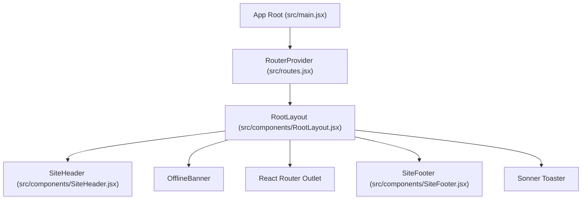
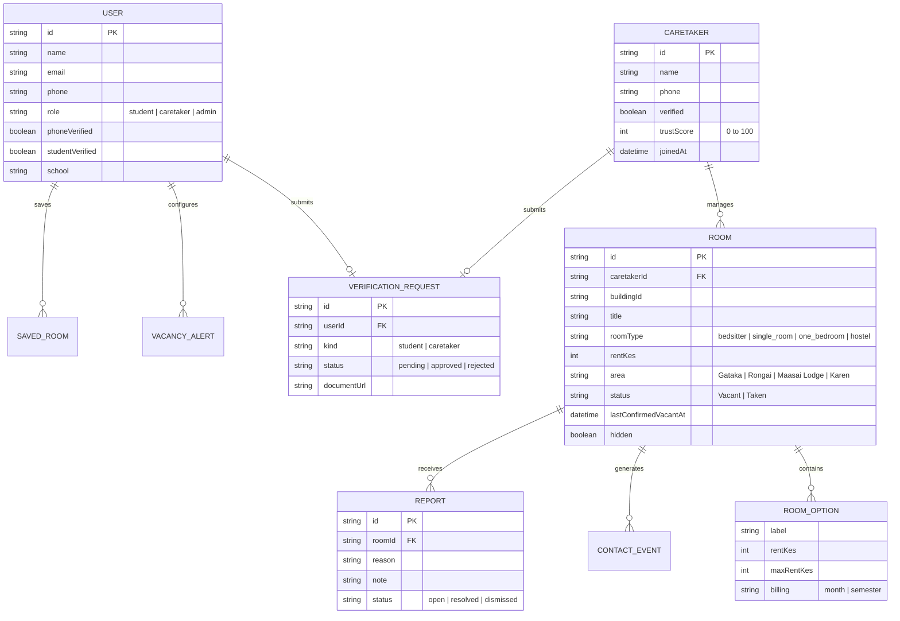

# Repository Reconnaissance & System Audit

## Document Control & Metadata

| Field                 | Value                                                                                                                                                                                                                                       |
| --------------------- | ------------------------------------------------------------------------------------------------------------------------------------------------------------------------------------------------------------------------------------------- |
| **Document ID**       | DOC-AUDIT-001                                                                                                                                                                                                                               |
| **Version**           | 1.0                                                                                                                                                                                                                                         |
| **Status**            | Draft                                                                                                                                                                                                                                       |
| **Author**            | Antigravity AI Agent (Senior Systems Analyst)                                                                                                                                                                                               |
| **Created Date**      | 2026-10-19                                                                                                                                                                                                                                  |
| **Last Updated**      | 2026-10-19                                                                                                                                                                                                                                  |
| **Purpose**           | Complete repository reconnaissance, technical stack audit, and capability inventory for the Rommie student accommodation web application.                                                                                                   |
| **Scope**             | Source code, build configuration, UI components, client service layers, mock data, tests, and deployment artifacts at `e:\Coding_Projects\rommie-webapp`.                                                                                   |
| **Related Documents** | [AGENTS.md](file:///e:/Coding_Projects/rommie-webapp/AGENTS.md), [house_hunting_web_app_nfrs.md](file:///e:/Coding_Projects/rommie-webapp/house_hunting_web_app_nfrs.md), [roadmap.md](file:///e:/Coding_Projects/rommie-webapp/roadmap.md) |

### Document Change History

| Version | Date       | Author               | Description of Changes                                                                                                                                      |
| ------- | ---------- | -------------------- | ----------------------------------------------------------------------------------------------------------------------------------------------------------- |
| 1.0     | 2026-10-19 | Antigravity AI Agent | Initial Phase 0 repository audit, including 31-route capability inventory, 56-function mock API analysis, component breakdown, and frontend migration plan. |

---

## 1. Executive Summary

### 1.1 Platform Overview

**Rommie** is a niche, hyperlocal student accommodation discovery and vacancy verification web application designed specifically for post-secondary students attending campuses in the **Karen region of Nairobi, Kenya** (principally **CUEA, KSL, JKUAT Karen, Tangaza University, and Co-operative University**). The platform bridges the trust deficit in off-campus housing by providing:

1. **Curated & Verified Listings**: Bedsitters, single rooms, one-bedroom apartments, and accredited private hostels in **Gataka, Rongai, Maasai Lodge, and Karen**.
2. **Dynamic Trust Scoring**: Objective 0–100 credibility ratings for caretakers based on national ID verification, vacancy freshness, report history, and platform longevity.
3. **Hyperlocal Transit Intelligence**: Explicit walking and matatu transit times to key university gates, including fare breakdowns.
4. **Fraud Mitigation & Moderation**: Student reporting mechanisms, national/student ID verification workflows, and an administrative moderation panel for delisting bad actors and stale vacancies.

### 1.2 Current Architecture State

The current codebase is a **client-only Single Page Application (SPA)** built with **React 19.2.0**, **Vite 8.1.5**, **Tailwind CSS 4.2.1**, and **React Router DOM 7.1.0**.

> [!IMPORTANT]
> **Zero backend code, server actions, API handlers, or database connections currently exist.**
> The entire backend and database are simulated client-side inside [src/services/api.js](file:///e:/Coding_Projects/rommie-webapp/src/services/api.js) (56 functions, 37,690 bytes) using in-memory arrays seeded from [src/data/mockData.js](file:///e:/Coding_Projects/rommie-webapp/src/data/mockData.js) and [src/data/hostels.js](file:///e:/Coding_Projects/rommie-webapp/src/data/hostels.js), with persistence polyfilled via browser `localStorage`.

### 1.3 Audit Findings & Readiness

- **Frontend Quality**: Exceptional UI completeness. The frontend exhibits thoughtful UI/UX states, complete form validation schemas via **Zod**, robust route guards, responsive layouts, Radix UI accessibility primitives, and simulated network delays.
- **Backend Readiness**: The UI architecture establishes clear, explicit API requirements. The mock service layer provides a near 1-to-1 operational blueprint for the target backend API contract.
- **NFR Reconciliation**: A critical divergence exists between the generic enterprise real-estate requirements in [house_hunting_web_app_nfrs.md](file:///e:/Coding_Projects/rommie-webapp/house_hunting_web_app_nfrs.md) (e.g., MLS API synchronization, nationwide 10,000 concurrent sessions, spatial polygon queries) and the actual hyperlocal Kenyan student housing domain.

```mermaid
graph TD
    Client["Browser / Client SPA (React 19 + Vite)"]
    Router["React Router DOM 7 (src/lib/router.jsx)"]
    ServiceLayer["Mock Service Layer (src/services/api.js)"]
    MemoryState["In-Memory State (rooms, reports, accounts)"]
    LocalStorage["Browser LocalStorage (rommie.* keys)"]
    BackendTarget["Proposed Backend API (Reserved: backend/)"]

    Client --> Router
    Router --> ServiceLayer
    ServiceLayer -->|Current State| MemoryState
    ServiceLayer -->|Current State| LocalStorage
    ServiceLayer -.->|Target State (Post-Approval)| BackendTarget

    classDef current fill:#e1f5fe,stroke:#0288d1,stroke-width:2px;
    classDef target fill:#fff3e0,stroke:#f57c00,stroke-width:2px,stroke-dasharray: 5 5;
    class Client,Router,ServiceLayer,MemoryState,LocalStorage current;
    class BackendTarget target;
```

---

## 2. Repository Root & Git Status Summary

- **Repository Root**: `e:\Coding_Projects\rommie-webapp`
- **Active Git Branch**: `main`
- **Remote Tracking**: `origin/main` (up to date)
- **Working Tree State**:
  - No modified or uncommitted changes to tracked files (`git status` clean for tracked assets).
  - Untracked files detected:
    - `AGENTS.md` (Workflow and engineering governance specification)
    - `house_hunting_web_app_nfrs.md` (Supplied non-functional requirements source)
    - `pnpm-lock.yaml` (Package manager artifact; package-lock.json is tracked)
- **Commit History Summary**:
  - 10 merge commits integrated from branch `phase-2-accounts-posting`.
  - Development history reflects iterative frontend delivery: baseline UI -> student search -> caretaker onboarding/posting -> admin portal -> trust scoring and verification.

---

## 3. Technology Stack & Build Configuration

| Architectural Layer     | Technology / Tool            | Version                   | Evidence File                                                                                                                                                             | Details & Notes                                                     |
| ----------------------- | ---------------------------- | ------------------------- | ------------------------------------------------------------------------------------------------------------------------------------------------------------------------- | ------------------------------------------------------------------- |
| **Runtime Environment** | Node.js                      | `^20.19.0 \|\| >=22.12.0` | [.nvmrc](file:///e:/Coding_Projects/rommie-webapp/.nvmrc), [package.json](file:///e:/Coding_Projects/rommie-webapp/package.json#L6-L8)                                    | Node 22 specified in `.nvmrc`                                       |
| **Module System**       | ECMAScript Modules (ESM)     | Native                    | [package.json](file:///e:/Coding_Projects/rommie-webapp/package.json#L5)                                                                                                  | `"type": "module"` configured                                       |
| **Frontend Framework**  | React                        | 19.2.0                    | [package.json](file:///e:/Coding_Projects/rommie-webapp/package.json#L34-L35)                                                                                             | Full React 19 compatibility (`react`, `react-dom`)                  |
| **Build Bundler**       | Vite                         | 8.1.5                     | [vite.config.js](file:///e:/Coding_Projects/rommie-webapp/vite.config.js), [package.json](file:///e:/Coding_Projects/rommie-webapp/package.json#L57)                      | Fast HMR, ESM bundling, chunk splitting                             |
| **CSS / Styling**       | Tailwind CSS v4              | 4.2.1                     | [vite.config.js](file:///e:/Coding_Projects/rommie-webapp/vite.config.js#L5), [package.json](file:///e:/Coding_Projects/rommie-webapp/package.json#L44)                   | Native `@tailwindcss/vite` plugin (no `postcss.config.js` needed)   |
| **CSS Animations**      | tw-animate-css               | 1.3.4                     | [package.json](file:///e:/Coding_Projects/rommie-webapp/package.json#L56)                                                                                                 | Tailwind animation helpers                                          |
| **Language & Typing**   | JavaScript + JSDoc           | ES2023                    | [src/types/index.js](file:///e:/Coding_Projects/rommie-webapp/src/types/index.js), [jsconfig.json](file:///e:/Coding_Projects/rommie-webapp/jsconfig.json)                | JSDoc typedefs with strict IDE autocomplete; no TypeScript compiler |
| **Path Alias**          | `@` -> `./src`               | N/A                       | [vite.config.js](file:///e:/Coding_Projects/rommie-webapp/vite.config.js#L12), [jsconfig.json](file:///e:/Coding_Projects/rommie-webapp/jsconfig.json)                    | Resolved uniformly across dev, test, and build                      |
| **Client Routing**      | React Router DOM             | 7.1.0                     | [src/routes.jsx](file:///e:/Coding_Projects/rommie-webapp/src/routes.jsx), [src/lib/router.jsx](file:///e:/Coding_Projects/rommie-webapp/src/lib/router.jsx)              | Dynamic lazy route chunks; custom URL query serializer              |
| **Server State Cache**  | TanStack React Query         | 5.101.1                   | [package.json](file:///e:/Coding_Projects/rommie-webapp/package.json#L29)                                                                                                 | Query caching, optimistic UI updates, query invalidation            |
| **Local Store / Sync**  | React `useSyncExternalStore` | React 19 Core             | [src/lib/auth.jsx](file:///e:/Coding_Projects/rommie-webapp/src/lib/auth.jsx#L9), [src/lib/settings.js](file:///e:/Coding_Projects/rommie-webapp/src/lib/settings.js#L63) | Teardown-safe cross-tab event synchronization for auth & settings   |
| **Form Management**     | React Hook Form              | 7.71.2                    | [package.json](file:///e:/Coding_Projects/rommie-webapp/package.json#L36)                                                                                                 | Uncontrolled form state with controlled error rendering             |
| **Schema Validation**   | Zod + HookForm Resolvers     | 3.25.76 / 5.2.2           | [src/lib/validation.js](file:///e:/Coding_Projects/rommie-webapp/src/lib/validation.js), [package.json](file:///e:/Coding_Projects/rommie-webapp/package.json#L20)        | Shared schemas for auth, listing posting, and settings              |
| **UI Primitives**       | Radix UI                     | Various                   | [package.json](file:///e:/Coding_Projects/rommie-webapp/package.json#L21-L28)                                                                                             | Accessible dialogs, sheets, tabs, alerts, switches, accordions      |
| **Icons**               | Lucide React                 | 0.575.0                   | [package.json](file:///e:/Coding_Projects/rommie-webapp/package.json#L33)                                                                                                 | Vector icon set                                                     |
| **Notifications**       | Sonner                       | 2.0.7                     | [package.json](file:///e:/Coding_Projects/rommie-webapp/package.json#L38)                                                                                                 | Toast notifications with action/undo callbacks                      |
| **Test Runner**         | Vitest                       | 4.1.10                    | [vitest.config.js](file:///e:/Coding_Projects/rommie-webapp/vitest.config.js), [package.json](file:///e:/Coding_Projects/rommie-webapp/package.json#L58)                  | Fast in-memory testing with JSDOM environment                       |
| **DOM Assertion**       | @testing-library/jest-dom    | 6.6.0                     | [src/test/setup.js](file:///e:/Coding_Projects/rommie-webapp/src/test/setup.js)                                                                                           | Custom matchers for DOM node inspection                             |
| **Code Quality / Lint** | ESLint + Prettier            | 9.32.0 / 3.7.3            | [eslint.config.js](file:///e:/Coding_Projects/rommie-webapp/eslint.config.js), [.prettierrc](file:///e:/Coding_Projects/rommie-webapp/.prettierrc)                        | Flat config with react-hooks and react-refresh rules                |
| **Deployment Target**   | Vercel Static Hosting        | SPA Config                | [vercel.json](file:///e:/Coding_Projects/rommie-webapp/vercel.json)                                                                                                       | Route rewrite `/(.*)` -> `/index.html`, 1-year asset cache          |
| **PWA Support**         | Web App Manifest             | W3C Standard              | [public/manifest.webmanifest](file:///e:/Coding_Projects/rommie-webapp/public/manifest.webmanifest)                                                                       | Standalone display mode with 192px/512px icon definitions           |

---

## 4. Directory Tree

```text
e:\Coding_Projects\rommie-webapp\
├── .gitignore
├── .nvmrc
├── .prettierignore
├── .prettierrc
├── AGENTS.md
├── eslint.config.js
├── house_hunting_web_app_nfrs.md
├── index.html
├── jsconfig.json
├── package.json
├── package-lock.json
├── pnpm-lock.yaml
├── README.md
├── roadmap.md
├── update.bat
├── vercel.json
├── vite.config.js
├── vitest.config.js
├── public/
│   ├── favicon.ico
│   ├── favicon.svg
│   ├── icon.svg
│   ├── icon-192.png
│   ├── icon-512.png
│   ├── manifest.webmanifest
│   └── robots.txt
└── src/
    ├── main.jsx
    ├── routes.jsx
    ├── styles.css
    ├── assets/
    │   ├── room-1.jpg
    │   ├── room-2.jpg
    │   ├── room-3.jpg
    │   └── room-4.jpg
    ├── components/
    │   ├── AdminNav.jsx
    │   ├── ComingSoon.jsx
    │   ├── HostelFacts.jsx
    │   ├── LegalPage.jsx
    │   ├── Logo.jsx
    │   ├── OfflineBanner.jsx
    │   ├── ReportModal.jsx
    │   ├── RoomCard.jsx
    │   ├── RootLayout.jsx
    │   ├── RouteError.jsx
    │   ├── SearchCapsule.jsx
    │   ├── SiteFooter.jsx
    │   ├── SiteHeader.jsx
    │   ├── SocialIcons.jsx
    │   ├── StateCard.jsx
    │   ├── auth/
    │   │   ├── AuthShell.jsx
    │   │   ├── GoogleButton.jsx
    │   │   ├── LoginForm.jsx
    │   │   ├── OtpBoxes.jsx
    │   │   ├── ResendCode.jsx
    │   │   ├── SignupForm.jsx
    │   │   └── WrongRoleNotice.jsx
    │   ├── caretaker/
    │   │   ├── PhotoUploader.jsx
    │   │   ├── RoomForm.jsx
    │   │   └── TrustScoreCard.jsx
    │   ├── forms/
    │   │   └── Field.jsx
    │   ├── ui/
    │   │   ├── accordion.jsx
    │   │   ├── alert-dialog.jsx
    │   │   ├── button.jsx
    │   │   ├── dialog.jsx
    │   │   ├── dropdown-menu.jsx
    │   │   ├── input-otp.jsx
    │   │   ├── popover.jsx
    │   │   ├── sheet.jsx
    │   │   ├── sonner.jsx
    │   │   ├── switch.jsx
    │   │   ├── table.jsx
    │   │   ├── tabs.jsx
    │   │   └── textarea.jsx
    │   └── verify/
    │       ├── DocumentUpload.jsx
    │       └── VerificationStatus.jsx
    ├── data/
    │   ├── hostels.js
    │   └── mockData.js
    ├── lib/
    │   ├── adminFilters.js
    │   ├── auth.jsx
    │   ├── format.js
    │   ├── image.js
    │   ├── router.jsx
    │   ├── saved.js
    │   ├── settings.js
    │   ├── site.js
    │   ├── trust.js
    │   ├── useCountdown.js
    │   ├── usePageMeta.js
    │   ├── utils.js
    │   └── validation.js
    ├── pages/
    │   ├── AdminActivityPage.jsx
    │   ├── AdminAnalyticsPage.jsx
    │   ├── AdminDashboardPage.jsx
    │   ├── AdminListingsPage.jsx
    │   ├── AdminReportsPage.jsx
    │   ├── AdminSettingsPage.jsx
    │   ├── AdminUsersPage.jsx
    │   ├── AdminVerificationPage.jsx
    │   ├── AlertsPage.jsx
    │   ├── CaretakerEditPage.jsx
    │   ├── CaretakerListingsPage.jsx
    │   ├── CaretakerLoginPage.jsx
    │   ├── CaretakerPostPage.jsx
    │   ├── CaretakerProfilePage.jsx
    │   ├── CaretakerSignupPage.jsx
    │   ├── ForCaretakersPage.jsx
    │   ├── HomePage.jsx
    │   ├── HowVerificationWorksPage.jsx
    │   ├── LoginPage.jsx
    │   ├── NotFoundPage.jsx
    │   ├── PrivacyPage.jsx
    │   ├── ReportPage.jsx
    │   ├── RoomDetailPage.jsx
    │   ├── RoomsPage.jsx
    │   ├── SafetyTipsPage.jsx
    │   ├── SavedPage.jsx
    │   ├── SignupPage.jsx
    │   ├── TermsPage.jsx
    │   ├── VerifyPhonePage.jsx
    │   ├── VerifyStudentPage.jsx
    │   └── ZonesPage.jsx
    ├── services/
    │   └── api.js
    ├── test/
    │   ├── admin-listings.test.js
    │   ├── admin-reports.test.js
    │   ├── admin-settings.test.js
    │   ├── admin-users.test.js
    │   ├── app-routing.test.jsx
    │   ├── auth.test.js
    │   ├── buildings.test.js
    │   ├── contacts.test.js
    │   ├── format.test.js
    │   ├── hostels.test.js
    │   ├── router.test.js
    │   ├── setup.js
    │   └── student-admin.test.js
    └── types/
        └── index.js
```

---

## 5. Page & Route Inventory (Summary Matrix)

The application defines **31 routes** (30 explicit endpoints + 1 catch-all 404 handler) organized hierarchically under a pathless error-boundary wrapper inside [src/routes.jsx](file:///e:/Coding_Projects/rommie-webapp/src/routes.jsx#L19-L65).

| #   | Route Path                | Component File                                                                                                  | Role / Auth Level     | Primary Purpose & Capabilities                                                          |
| --- | ------------------------- | --------------------------------------------------------------------------------------------------------------- | --------------------- | --------------------------------------------------------------------------------------- |
| 1   | `/`                       | [HomePage.jsx](file:///e:/Coding_Projects/rommie-webapp/src/pages/HomePage.jsx)                                 | Public (Visitor)      | Discovery landing, hero search capsule, value props, popular zone cards.                |
| 2   | `/rooms`                  | [RoomsPage.jsx](file:///e:/Coding_Projects/rommie-webapp/src/pages/RoomsPage.jsx)                               | Public (Alerts gated) | Search listings with multi-faceted filtering (area, rent, type, campus) and sorting.    |
| 3   | `/rooms/:id`              | [RoomDetailPage.jsx](file:///e:/Coding_Projects/rommie-webapp/src/pages/RoomDetailPage.jsx)                     | Public (Save gated)   | Room details, photo lightbox, pricing, transit times, direct contact tapping.           |
| 4   | `/zones`                  | [ZonesPage.jsx](file:///e:/Coding_Projects/rommie-webapp/src/pages/ZonesPage.jsx)                               | Public (Visitor)      | Commute zone guide (Gataka, Rongai, Karen, Maasai Lodge) with vacancy metrics.          |
| 5   | `/login`                  | [LoginPage.jsx](file:///e:/Coding_Projects/rommie-webapp/src/pages/LoginPage.jsx)                               | Visitor Only          | Student email/password & Google login; redirects if signed in.                          |
| 6   | `/signup`                 | [SignupPage.jsx](file:///e:/Coding_Projects/rommie-webapp/src/pages/SignupPage.jsx)                             | Visitor Only          | Student account registration with university selection and phone capture.               |
| 7   | `/verify-phone`           | [VerifyPhonePage.jsx](file:///e:/Coding_Projects/rommie-webapp/src/pages/VerifyPhonePage.jsx)                   | Session Required      | 6-digit SMS OTP phone verification with resend countdown timer.                         |
| 8   | `/saved`                  | [SavedPage.jsx](file:///e:/Coding_Projects/rommie-webapp/src/pages/SavedPage.jsx)                               | Student Only          | Bookmarked rooms management with quick removal and direct detail navigation.            |
| 9   | `/alerts`                 | [AlertsPage.jsx](file:///e:/Coding_Projects/rommie-webapp/src/pages/AlertsPage.jsx)                             | Student Only          | Vacancy SMS/text alert subscriptions filtered by area, type, and budget.                |
| 10  | `/verify-student`         | [VerifyStudentPage.jsx](file:///e:/Coding_Projects/rommie-webapp/src/pages/VerifyStudentPage.jsx)               | Student Only          | Student ID / admission letter document upload for verified student badge.               |
| 11  | `/report`                 | [ReportPage.jsx](file:///e:/Coding_Projects/rommie-webapp/src/pages/ReportPage.jsx)                             | Public (Visitor)      | Guide on listing fraud reporting and community moderation policies.                     |
| 12  | `/safety-tips`            | [SafetyTipsPage.jsx](file:///e:/Coding_Projects/rommie-webapp/src/pages/SafetyTipsPage.jsx)                     | Public (Visitor)      | Rental fraud prevention checklist and scam awareness guidance.                          |
| 13  | `/for-caretakers`         | [ForCaretakersPage.jsx](file:///e:/Coding_Projects/rommie-webapp/src/pages/ForCaretakersPage.jsx)               | Public (Visitor)      | Landlord/caretaker onboarding landing page highlighting zero fees and student reach.    |
| 14  | `/how-verification-works` | [HowVerificationWorksPage.jsx](file:///e:/Coding_Projects/rommie-webapp/src/pages/HowVerificationWorksPage.jsx) | Public (Visitor)      | Trust score explainer (verification, freshness, reports, age weighting).                |
| 15  | `/privacy`                | [PrivacyPage.jsx](file:///e:/Coding_Projects/rommie-webapp/src/pages/PrivacyPage.jsx)                           | Public (Visitor)      | Statutory privacy policy adhering to the Kenya Data Protection Act 2019.                |
| 16  | `/terms`                  | [TermsPage.jsx](file:///e:/Coding_Projects/rommie-webapp/src/pages/TermsPage.jsx)                               | Public (Visitor)      | Platform terms of service, listing truthfulness rules, and liability disclaimers.       |
| 17  | `/caretaker/login`        | [CaretakerLoginPage.jsx](file:///e:/Coding_Projects/rommie-webapp/src/pages/CaretakerLoginPage.jsx)             | Visitor Only          | Caretaker portal authentication with password and Google sign-in.                       |
| 18  | `/caretaker/signup`       | [CaretakerSignupPage.jsx](file:///e:/Coding_Projects/rommie-webapp/src/pages/CaretakerSignupPage.jsx)           | Visitor Only          | Landlord/caretaker registration creating associated caretaker domain record.            |
| 19  | `/caretaker/post`         | [CaretakerPostPage.jsx](file:///e:/Coding_Projects/rommie-webapp/src/pages/CaretakerPostPage.jsx)               | Caretaker Only        | 20+ field room creation form with photo uploader and transit times.                     |
| 20  | `/caretaker/listings`     | [CaretakerListingsPage.jsx](file:///e:/Coding_Projects/rommie-webapp/src/pages/CaretakerListingsPage.jsx)       | Caretaker Only        | Listing management table with instant vacancy toggle, reconfirm, and delete.            |
| 21  | `/caretaker/edit/:id`     | [CaretakerEditPage.jsx](file:///e:/Coding_Projects/rommie-webapp/src/pages/CaretakerEditPage.jsx)               | Caretaker Only        | Listing editor with strict ownership checks ensuring caretakers edit only their units.  |
| 22  | `/caretaker/profile`      | [CaretakerProfilePage.jsx](file:///e:/Coding_Projects/rommie-webapp/src/pages/CaretakerProfilePage.jsx)         | Caretaker Only        | Public-facing preview, national ID document submission, and trust score card.           |
| 23  | `/admin`                  | [AdminDashboardPage.jsx](file:///e:/Coding_Projects/rommie-webapp/src/pages/AdminDashboardPage.jsx)             | Admin Only            | Overview dashboard with listing counters, contact metrics, and stale room review.       |
| 24  | `/admin/verification`     | [AdminVerificationPage.jsx](file:///e:/Coding_Projects/rommie-webapp/src/pages/AdminVerificationPage.jsx)       | Admin Only            | Verification review queue for students and caretakers with approve/reject actions.      |
| 25  | `/admin/listings`         | [AdminListingsPage.jsx](file:///e:/Coding_Projects/rommie-webapp/src/pages/AdminListingsPage.jsx)               | Admin Only            | Master inventory table with text search, area filtering, inline edits, and hide/delete. |
| 26  | `/admin/reports`          | [AdminReportsPage.jsx](file:///e:/Coding_Projects/rommie-webapp/src/pages/AdminReportsPage.jsx)                 | Admin Only            | User report moderation panel (dismiss, resolve, or delist reported rooms).              |
| 27  | `/admin/activity`         | [AdminActivityPage.jsx](file:///e:/Coding_Projects/rommie-webapp/src/pages/AdminActivityPage.jsx)               | Admin Only            | Audit log of administrative actions (hiding, edits, verifications, suspensions).        |
| 28  | `/admin/analytics`        | [AdminAnalyticsPage.jsx](file:///e:/Coding_Projects/rommie-webapp/src/pages/AdminAnalyticsPage.jsx)             | Admin Only            | Platform business intelligence (area breakdowns, 14-day contact trends).                |
| 29  | `/admin/settings`         | [AdminSettingsPage.jsx](file:///e:/Coding_Projects/rommie-webapp/src/pages/AdminSettingsPage.jsx)               | Admin Only            | Global site contact details configuration (WhatsApp, phone, support email).             |
| 30  | `/admin/users`            | [AdminUsersPage.jsx](file:///e:/Coding_Projects/rommie-webapp/src/pages/AdminUsersPage.jsx)                     | Admin Only            | User directory with role inspection and one-click caretaker account suspension.         |
| 31  | `*`                       | [NotFoundPage.jsx](file:///e:/Coding_Projects/rommie-webapp/src/pages/NotFoundPage.jsx)                         | Public (Visitor)      | Graceful 404 error page with navigation redirect back to the home view.                 |

---

## 6. Comprehensive Route-to-Capability Inventory (AGENTS.md Section 3.3)

This section provides the rigorous, evidentiary audit of every route and capability in the application as required by Section 3.3 of AGENTS.md.

### Route 1: `/` — HomePage

- **Path**: `/`
- **Page Component**: [src/pages/HomePage.jsx](file:///e:/Coding_Projects/rommie-webapp/src/pages/HomePage.jsx)
- **User-Visible Capability**: Discovery landing page. Displays hero section with [SearchCapsule.jsx](file:///e:/Coding_Projects/rommie-webapp/src/components/SearchCapsule.jsx), value proposition banners (verified vacancies, direct caretaker contacts), campus quick-links, popular zone cards with vacancy counts, hostel feature promo, and a bottom CTA to post a room.
- **Inputs & Validation**: Inline dropdown selections inside `SearchCapsule` (Area, Max Rent, Room Type, Campus). Validated on submit via URL query string construction.
- **Data Displayed or Changed**: Reads total vacancy metrics and area counts via `getRooms()`. Does not mutate state.
- **Expected Backend Operation**: `GET /api/rooms/summary` or `GET /api/zones/metrics` (cached aggregation of active vacancies by area and campus).
- **Auth / Authz Implications**: None (Public visitor).
- **UI States**:
  - _Loading_: Skeleton pulses for zone vacancy chips.
  - _Empty_: Fallback counters show "0 rooms" if no listings exist.
  - _Error_: Caught by `RouteError` in [src/components/RouteError.jsx](file:///e:/Coding_Projects/rommie-webapp/src/components/RouteError.jsx).
  - _Success_: Rendered discovery landing layout.
- **Evidence Files**: [HomePage.jsx](file:///e:/Coding_Projects/rommie-webapp/src/pages/HomePage.jsx), [SearchCapsule.jsx](file:///e:/Coding_Projects/rommie-webapp/src/components/SearchCapsule.jsx)
- **Confidence Level**: Confirmed (Code Verified)

### Route 2: `/rooms` — RoomsPage

- **Path**: `/rooms`
- **Page Component**: [src/pages/RoomsPage.jsx](file:///e:/Coding_Projects/rommie-webapp/src/pages/RoomsPage.jsx)
- **User-Visible Capability**: Multi-criteria accommodation search. Displays a sticky desktop filter sidebar / mobile drawer ([Sheet](file:///e:/Coding_Projects/rommie-webapp/src/components/ui/sheet.jsx)), sorting dropdown (newest confirmed, lowest rent, highest rent), vacancy toggle, and responsive listing grid ([RoomCard.jsx](file:///e:/Coding_Projects/rommie-webapp/src/components/RoomCard.jsx)).
- **Inputs & Validation**: URL search params parsed via `parseSearch()` in [src/lib/router.jsx](file:///e:/Coding_Projects/rommie-webapp/src/lib/router.jsx#L14). Validates `area` in `AREAS`, `roomType` in `roomTypeLabel`, `near` in `CAMPUS_IDS`, `minRent`/`maxRent` as positive integers, `amenities` as subset of `["Water 24/7", "WiFi", "Tokens", "Gated Security"]`, and `gender` in `["Ladies", "Gents", "Mixed"]`.
- **Data Displayed or Changed**: Renders list of `RoomWithCaretaker` objects matching query. Allows bookmarking via `useSaved()`.
- **Expected Backend Operation**: `GET /api/rooms?area=&roomType=&minRent=&maxRent=&near=&amenities=&gender=&mealsOnly=&transportOnly=&vacantOnly=&sort=` with SQL/indexing optimization.
- **Auth / Authz Implications**: Publicly browseable. Creating a vacancy alert from empty search requires student auth via `useAuthGate()`.
- **UI States**:
  - _Loading_: 8 `RoomCardSkeleton` placeholders inside a responsive grid.
  - _Empty_: Friendly empty state with "No rooms match yet" card offering a direct button to create a vacancy alert.
  - _Error_: Error card with a "Retry" button that invokes TanStack `refetch()`.
  - _Success_: Rendered list of cards with opacity fading during refetching (`isFetching && "opacity-60"`).
- **Evidence Files**: [RoomsPage.jsx](file:///e:/Coding_Projects/rommie-webapp/src/pages/RoomsPage.jsx#L17-L147), [api.js](file:///e:/Coding_Projects/rommie-webapp/src/services/api.js#L135-L173)
- **Confidence Level**: Confirmed (Code Verified)

### Route 3: `/rooms/:id` — RoomDetailPage

- **Path**: `/rooms/:id`
- **Page Component**: [src/pages/RoomDetailPage.jsx](file:///e:/Coding_Projects/rommie-webapp/src/pages/RoomDetailPage.jsx)
- **User-Visible Capability**: Exhaustive room detail presentation. Displays photo carousel / thumbnail strip, full-screen interactive lightbox with keyboard & swipe navigation, price and deposit terms, walking & matatu transit times to all 5 Karen campuses, matatu fares, amenity badges, hostel options table (if applicable), caretaker trust score card, external Google Maps link, "Other rooms in this building" cross-promotions, and room reporting modal.
- **Inputs & Validation**: Route parameter `:id` (string). Lightbox index tracking. Report modal form inputs.
- **Data Displayed or Changed**: Displays single `Room` with resolved `Caretaker`. Contact taps on "WhatsApp" or "Call" trigger fire-and-forget logging via `trackContact(roomId, channel)`. Bookmark heart toggles `saveRoom()` / `unsaveRoom()`.
- **Expected Backend Operation**: `GET /api/rooms/:id`, `GET /api/rooms?buildingId=:buildingId`, `POST /api/rooms/:id/contacts`, and `POST /api/reports`.
- **Auth / Authz Implications**: Browsing is public. Contact taps are debounced per session. Saving a listing requires student login. Reporting can be submitted by visitors.
- **UI States**:
  - _Loading_: Skeleton loading pulse.
  - _Empty / Not Found_: 404 state if room does not exist, is hidden, or belongs to a suspended caretaker.
  - _Error_: Error fallback card with retry option.
  - _Success_: Interactive listing page with dynamic OpenGraph meta tags via `usePageMeta()`.
- **Evidence Files**: [RoomDetailPage.jsx](file:///e:/Coding_Projects/rommie-webapp/src/pages/RoomDetailPage.jsx#L84-L292), [ReportModal.jsx](file:///e:/Coding_Projects/rommie-webapp/src/components/ReportModal.jsx)
- **Confidence Level**: Confirmed (Code Verified)

### Route 4: `/zones` — ZonesPage

- **Path**: `/zones`
- **Page Component**: [src/pages/ZonesPage.jsx](file:///e:/Coding_Projects/rommie-webapp/src/pages/ZonesPage.jsx)
- **User-Visible Capability**: Karen student commute guide. Breaks down the 4 key residential zones (**Gataka**, **Rongai**, **Maasai Lodge**, and **Karen**) with average rent bands, transit times to KSL, CUEA, JKUAT, Tangaza, and Co-op, student demographic descriptions, and direct links to filtered room searches.
- **Inputs & Validation**: None.
- **Data Displayed or Changed**: Reads live vacancy counts per area via `getRooms()`.
- **Expected Backend Operation**: `GET /api/zones/metrics` (pre-aggregated zone statistics).
- **Auth / Authz Implications**: None (Public visitor).
- **UI States**:
  - _Loading_: Pulsing zone stat cards.
  - _Error_: Standard route error handling.
  - _Success_: Formatted cards with campus distance matrices and live vacancy counts.
- **Evidence Files**: [ZonesPage.jsx](file:///e:/Coding_Projects/rommie-webapp/src/pages/ZonesPage.jsx)
- **Confidence Level**: Confirmed (Code Verified)

### Route 5: `/login` — LoginPage

- **Path**: `/login`
- **Page Component**: [src/pages/LoginPage.jsx](file:///e:/Coding_Projects/rommie-webapp/src/pages/LoginPage.jsx)
- **User-Visible Capability**: Student authentication portal. Allows logging in with email and password or mock "Continue with Google". Provides link to signup, switch to caretaker login, and preserves post-auth redirect destinations via `?redirect=/...`.
- **Inputs & Validation**: Email (`emailField` - valid email regex) and password (`passwordField` - min 8 chars). Validated via React Hook Form and Zod schema.
- **Data Displayed or Changed**: Authenticates user, establishes session in `localStorage` (`rommie.session`), notifies session listeners via `useSyncExternalStore`.
- **Expected Backend Operation**: `POST /api/auth/login` returning session token / JWT and user profile.
- **Auth / Authz Implications**: Visitor only. Signed-in users are automatically redirected to their role home via `useRedirectIfSignedIn()`.
- **UI States**:
  - _Loading_: Disabled buttons and spinner indicator (`Loader2`) during submission.
  - _Error_: In-line form validation errors, toast notifications on credential mismatch or suspended account.
  - _Success_: Redirects to intended destination or `/rooms`.
- **Evidence Files**: [LoginPage.jsx](file:///e:/Coding_Projects/rommie-webapp/src/pages/LoginPage.jsx), [LoginForm.jsx](file:///e:/Coding_Projects/rommie-webapp/src/components/auth/LoginForm.jsx)
- **Confidence Level**: Confirmed (Code Verified)

### Route 6: `/signup` — SignupPage

- **Path**: `/signup`
- **Page Component**: [src/pages/SignupPage.jsx](file:///e:/Coding_Projects/rommie-webapp/src/pages/SignupPage.jsx)
- **User-Visible Capability**: Student registration screen. Collects full name, email, Kenyan phone number, university selection dropdown (CUEA, KSL, JKUAT, Tangaza, Co-op, Other), and password.
- **Inputs & Validation**: `phoneField` (Kenyan format normalized to `+254...`), `emailField`, `passwordField`, name (min 2 chars), school (optional).
- **Data Displayed or Changed**: Creates account record in `accounts` array, generates initial session with `phoneVerified: false`.
- **Expected Backend Operation**: `POST /api/auth/signup` creating student record and triggering SMS OTP.
- **Auth / Authz Implications**: Visitor only. Immediately navigates to `/verify-phone` upon creation.
- **UI States**:
  - _Loading_: Spinner on submit button.
  - _Error_: Field errors for duplicate email/phone or weak password.
  - _Success_: Transitions to OTP verification.
- **Evidence Files**: [SignupPage.jsx](file:///e:/Coding_Projects/rommie-webapp/src/pages/SignupPage.jsx), [SignupForm.jsx](file:///e:/Coding_Projects/rommie-webapp/src/components/auth/SignupForm.jsx)
- **Confidence Level**: Confirmed (Code Verified)

### Route 7: `/verify-phone` — VerifyPhonePage

- **Path**: `/verify-phone`
- **Page Component**: [src/pages/VerifyPhonePage.jsx](file:///e:/Coding_Projects/rommie-webapp/src/pages/VerifyPhonePage.jsx)
- **User-Visible Capability**: SMS OTP verification screen. Displays 6 auto-advancing digit input boxes ([OtpBoxes.jsx](file:///e:/Coding_Projects/rommie-webapp/src/components/auth/OtpBoxes.jsx)), change phone number dialog, and countdown resend code timer ([ResendCode.jsx](file:///e:/Coding_Projects/rommie-webapp/src/components/auth/ResendCode.jsx)).
- **Inputs & Validation**: 6-digit numeric string. Mock accepts hardcoded OTP `123456` within a 5-minute TTL window.
- **Data Displayed or Changed**: Mutates `phoneVerified: true` on user account and session.
- **Expected Backend Operation**: `POST /api/auth/otp/verify` and `POST /api/auth/otp/send`.
- **Auth / Authz Implications**: Requires active session. Redirects to `/login` if unauthenticated.
- **UI States**:
  - _Loading_: Auto-submits on completion of 6th digit with loading spinner.
  - _Error_: Red border on OTP boxes, shake animation, and error message ("That code isn't right" or "That code has expired").
  - _Success_: Success toast ("Phone number verified") and redirect to post-login destination.
- **Evidence Files**: [VerifyPhonePage.jsx](file:///e:/Coding_Projects/rommie-webapp/src/pages/VerifyPhonePage.jsx), [api.js](file:///e:/Coding_Projects/rommie-webapp/src/services/api.js#L780-L816)
- **Confidence Level**: Confirmed (Code Verified)

### Route 8: `/saved` — SavedPage

- **Path**: `/saved`
- **Page Component**: [src/pages/SavedPage.jsx](file:///e:/Coding_Projects/rommie-webapp/src/pages/SavedPage.jsx)
- **User-Visible Capability**: Student bookmark manager. Lists all rooms saved by the student with thumbnail, pricing, vacancy status, quick remove button, and direct navigation to room details.
- **Inputs & Validation**: None.
- **Data Displayed or Changed**: Fetches rooms whose IDs exist in `rommie.saved.<userId>` via `getSavedRooms()`. Unsaving removes the ID from the user's saved list.
- **Expected Backend Operation**: `GET /api/users/me/saved` and `DELETE /api/users/me/saved/:roomId`.
- **Auth / Authz Implications**: Gated by `RequireRole roles={["student"]}`. Caretakers/admins see an explanation banner; visitors are sent to login.
- **UI States**:
  - _Loading_: 3 animated skeleton room rows.
  - _Empty_: Empty state with bookmark icon: "No saved rooms yet. Browse rooms near campus and tap the heart to save them here." with a "Browse rooms" CTA button.
  - _Error_: Retry error card.
  - _Success_: Grid of bookmarked listings with optimistic unsave removal.
- **Evidence Files**: [SavedPage.jsx](file:///e:/Coding_Projects/rommie-webapp/src/pages/SavedPage.jsx), [saved.js](file:///e:/Coding_Projects/rommie-webapp/src/lib/saved.js)
- **Confidence Level**: Confirmed (Code Verified)

### Route 9: `/alerts` — AlertsPage

- **Path**: `/alerts`
- **Page Component**: [src/pages/AlertsPage.jsx](file:///e:/Coding_Projects/rommie-webapp/src/pages/AlertsPage.jsx)
- **User-Visible Capability**: Vacancy alert manager. Students configure SMS/text notifications for specific criteria: preferred area (Gataka, Rongai, Karen, Maasai Lodge), maximum monthly rent, and room type. Displays existing alerts with active/pause toggle switch and delete button.
- **Inputs & Validation**: Form fields for `area`, `maxRent` (whole positive number up to 500k), and `roomType`. Accepts prefilled parameters from `/rooms` empty-state queries.
- **Data Displayed or Changed**: Fetches and creates `VacancyAlert` records stored under `rommie.alerts.<userId>`.
- **Expected Backend Operation**: `GET /api/users/me/alerts`, `POST /api/users/me/alerts`, `PATCH /api/users/me/alerts/:id`, `DELETE /api/users/me/alerts/:id`.
- **Auth / Authz Implications**: Protected by `RequireRole roles={["student"]}`.
- **UI States**:
  - _Loading_: Skeleton cards.
  - _Empty_: "No vacancy alerts yet. Create an alert to get notified when rooms open up."
  - _Error_: Standard retry card.
  - _Success_: Active alert cards with live toggle switches and toast notifications.
- **Evidence Files**: [AlertsPage.jsx](file:///e:/Coding_Projects/rommie-webapp/src/pages/AlertsPage.jsx), [api.js](file:///e:/Coding_Projects/rommie-webapp/src/services/api.js#L209-L232)
- **Confidence Level**: Confirmed (Code Verified)

### Route 10: `/verify-student` — VerifyStudentPage

- **Path**: `/verify-student`
- **Page Component**: [src/pages/VerifyStudentPage.jsx](file:///e:/Coding_Projects/rommie-webapp/src/pages/VerifyStudentPage.jsx)
- **User-Visible Capability**: Student ID verification onboarding. Explains verification benefits (verified badge, trust when contacting caretakers). File uploader for student ID card or university admission letter (image or PDF, <=8MB). Shows pending verification status, approved badge, or rejection reason with resubmission form.
- **Inputs & Validation**: File input restricted to `image/*` and `application/pdf`, max size 8MB. Rejects submission if another request is already `pending`.
- **Data Displayed or Changed**: Submits `VerificationRequest` with `kind: "student"`. Small files (<=1.5MB) converted to data URLs; larger files use `URL.createObjectURL`. Admin approval updates `studentVerified: true`.
- **Expected Backend Operation**: `POST /api/verifications/student` (multipart upload to S3/Cloudinary + DB record) and `GET /api/verifications/student/me`.
- **Auth / Authz Implications**: Gated by `RequireRole roles={["student"]}`.
- **UI States**:
  - _Loading_: Upload progress indicator.
  - _Pending_: Status pill "Under review" with informative waiting message.
  - _Approved_: Green pill "Verified Student" with school and checkmark icon.
  - _Rejected_: Red pill "Needs attention" with admin-provided reason and option to upload a new document.
- **Evidence Files**: [VerifyStudentPage.jsx](file:///e:/Coding_Projects/rommie-webapp/src/pages/VerifyStudentPage.jsx), [DocumentUpload.jsx](file:///e:/Coding_Projects/rommie-webapp/src/components/verify/DocumentUpload.jsx), [VerificationStatus.jsx](file:///e:/Coding_Projects/rommie-webapp/src/components/verify/VerificationStatus.jsx)
- **Confidence Level**: Confirmed (Code Verified)

### Route 11: `/report` — ReportPage

- **Path**: `/report`
- **Page Component**: [src/pages/ReportPage.jsx](file:///e:/Coding_Projects/rommie-webapp/src/pages/ReportPage.jsx)
- **User-Visible Capability**: Informational guide detailing how the Rommie reporting system works, reasons to flag listings (fake photos, inflated prices, taken vacancies, unresponsive numbers), investigation procedures, and emergency contact channels.
- **Inputs & Validation**: None (Informational page).
- **Data Displayed or Changed**: Contact information rendered from live site settings via `useSiteSettings()`.
- **Expected Backend Operation**: None (Static content).
- **Auth / Authz Implications**: None (Public visitor).
- **UI States**: Static presentation layout.
- **Evidence Files**: [ReportPage.jsx](file:///e:/Coding_Projects/rommie-webapp/src/pages/ReportPage.jsx)
- **Confidence Level**: Confirmed (Code Verified)

### Route 12: `/safety-tips` — SafetyTipsPage

- **Path**: `/safety-tips`
- **Page Component**: [src/pages/SafetyTipsPage.jsx](file:///e:/Coding_Projects/rommie-webapp/src/pages/SafetyTipsPage.jsx)
- **User-Visible Capability**: Rental safety guide for students. Covers red flags (requests for viewing fees, M-Pesa payments before physical inspection, below-market prices), viewing safety protocols, and caretaker trust badge verification.
- **Inputs & Validation**: None.
- **Data Displayed or Changed**: Static safety guidelines and FAQ accordion.
- **Expected Backend Operation**: None (Static content).
- **Auth / Authz Implications**: None (Public visitor).
- **UI States**: Static presentation layout.
- **Evidence Files**: [SafetyTipsPage.jsx](file:///e:/Coding_Projects/rommie-webapp/src/pages/SafetyTipsPage.jsx)
- **Confidence Level**: Confirmed (Code Verified)

### Route 13: `/for-caretakers` — ForCaretakersPage

- **Path**: `/for-caretakers`
- **Page Component**: [src/pages/ForCaretakersPage.jsx](file:///e:/Coding_Projects/rommie-webapp/src/pages/ForCaretakersPage.jsx)
- **User-Visible Capability**: Caretaker marketing and onboarding landing page. Highlights key benefits: 100% free listing, direct student enquiries via WhatsApp/call (no broker middlemen), verified badge credibility, and simple vacancy management. Includes CTA button linking to `/caretaker/signup`.
- **Inputs & Validation**: None.
- **Data Displayed or Changed**: Static marketing copy.
- **Expected Backend Operation**: None (Static content).
- **Auth / Authz Implications**: None (Public visitor).
- **UI States**: Static presentation layout.
- **Evidence Files**: [ForCaretakersPage.jsx](file:///e:/Coding_Projects/rommie-webapp/src/pages/ForCaretakersPage.jsx)
- **Confidence Level**: Confirmed (Code Verified)

### Route 14: `/how-verification-works` — HowVerificationWorksPage

- **Path**: `/how-verification-works`
- **Page Component**: [src/pages/HowVerificationWorksPage.jsx](file:///e:/Coding_Projects/rommie-webapp/src/pages/HowVerificationWorksPage.jsx)
- **User-Visible Capability**: Trust score transparency explainer. Provides detailed breakdowns of the 4 scoring pillars:
  1. _National ID Verification_ (35 points)
  2. _Vacancy Freshness_ (30 points - reconfirmed within 14 days)
  3. _Clean Report History_ (25 points - penalty of -8 pts per report)
  4. _Platform Longevity / Age_ (10 points - 1 pt per active month)
     Also explains student ID verification benefits and anti-fraud safeguards.
- **Inputs & Validation**: None.
- **Data Displayed or Changed**: Renders visual representation of trust scoring algorithm defined in [src/lib/trust.js](file:///e:/Coding_Projects/rommie-webapp/src/lib/trust.js).
- **Expected Backend Operation**: None (Static content).
- **Auth / Authz Implications**: None (Public visitor).
- **UI States**: Static presentation layout.
- **Evidence Files**: [HowVerificationWorksPage.jsx](file:///e:/Coding_Projects/rommie-webapp/src/pages/HowVerificationWorksPage.jsx), [trust.js](file:///e:/Coding_Projects/rommie-webapp/src/lib/trust.js)
- **Confidence Level**: Confirmed (Code Verified)

### Route 15: `/privacy` — PrivacyPage

- **Path**: `/privacy`
- **Page Component**: [src/pages/PrivacyPage.jsx](file:///e:/Coding_Projects/rommie-webapp/src/pages/PrivacyPage.jsx)
- **User-Visible Capability**: Formal Privacy Policy tailored to the **Kenya Data Protection Act (DPA) 2019**. Covers data collected (names, phone numbers, student/national ID scans), lawful basis for processing, retention policies, data subject rights (access, rectification, erasure), third-party sharing disclaimers, and contact info for the data protection officer.
- **Inputs & Validation**: None.
- **Data Displayed or Changed**: Dynamic support email and phone rendered from site settings.
- **Expected Backend Operation**: None (Static legal document).
- **Auth / Authz Implications**: None (Public visitor).
- **UI States**: Static legal presentation layout via [LegalPage.jsx](file:///e:/Coding_Projects/rommie-webapp/src/components/LegalPage.jsx).
- **Evidence Files**: [PrivacyPage.jsx](file:///e:/Coding_Projects/rommie-webapp/src/pages/PrivacyPage.jsx), [LegalPage.jsx](file:///e:/Coding_Projects/rommie-webapp/src/components/LegalPage.jsx)
- **Confidence Level**: Confirmed (Code Verified)

### Route 16: `/terms` — TermsPage

- **Path**: `/terms`
- **Page Component**: [src/pages/TermsPage.jsx](file:///e:/Coding_Projects/rommie-webapp/src/pages/TermsPage.jsx)
- **User-Visible Capability**: Platform Terms of Service. Establishes user covenants, caretaker listing accuracy obligations, prohibition of illegal viewing fees, content ownership rights, account suspension grounds, limitation of liability, and Kenyan governing law.
- **Inputs & Validation**: None.
- **Data Displayed or Changed**: Static legal terms.
- **Expected Backend Operation**: None (Static legal document).
- **Auth / Authz Implications**: None (Public visitor).
- **UI States**: Static legal presentation layout.
- **Evidence Files**: [TermsPage.jsx](file:///e:/Coding_Projects/rommie-webapp/src/pages/TermsPage.jsx)
- **Confidence Level**: Confirmed (Code Verified)

### Route 17: `/caretaker/login` — CaretakerLoginPage

- **Path**: `/caretaker/login`
- **Page Component**: [src/pages/CaretakerLoginPage.jsx](file:///e:/Coding_Projects/rommie-webapp/src/pages/CaretakerLoginPage.jsx)
- **User-Visible Capability**: Caretaker-specific authentication portal. Clean login form with email/password and mock "Continue with Google".
- **Inputs & Validation**: Email and password via `LoginForm`. Validates suspended account status.
- **Data Displayed or Changed**: Authenticates user session as role `caretaker`.
- **Expected Backend Operation**: `POST /api/auth/login` (checks caretaker role and suspension).
- **Auth / Authz Implications**: Visitor only. Signed-in caretakers automatically redirect to `/caretaker/listings`.
- **UI States**: Loading, error, and success states identical to standard login.
- **Evidence Files**: [CaretakerLoginPage.jsx](file:///e:/Coding_Projects/rommie-webapp/src/pages/CaretakerLoginPage.jsx)
- **Confidence Level**: Confirmed (Code Verified)

### Route 18: `/caretaker/signup` — CaretakerSignupPage

- **Path**: `/caretaker/signup`
- **Page Component**: [src/pages/CaretakerSignupPage.jsx](file:///e:/Coding_Projects/rommie-webapp/src/pages/CaretakerSignupPage.jsx)
- **User-Visible Capability**: Caretaker registration. Captures caretaker full name, email, phone number, and password. Auto-provisions associated Caretaker profile entity with initial trust score of 50.
- **Inputs & Validation**: `name` (min 2 chars), `emailField`, `phoneField`, `passwordField`.
- **Data Displayed or Changed**: Creates account record in `accounts` and corresponding record in `caretakers` array.
- **Expected Backend Operation**: `POST /api/auth/signup` with role `caretaker`.
- **Auth / Authz Implications**: Visitor only. Navigates to `/verify-phone` upon completion.
- **UI States**: Standard form validation and loading spinners.
- **Evidence Files**: [CaretakerSignupPage.jsx](file:///e:/Coding_Projects/rommie-webapp/src/pages/CaretakerSignupPage.jsx)
- **Confidence Level**: Confirmed (Code Verified)

### Route 19: `/caretaker/post` — CaretakerPostPage

- **Path**: `/caretaker/post`
- **Page Component**: [src/pages/CaretakerPostPage.jsx](file:///e:/Coding_Projects/rommie-webapp/src/pages/CaretakerPostPage.jsx)
- **User-Visible Capability**: Comprehensive room posting interface. Contains 20+ fields organized into logical sections:
  1. _Room Basics_: Room type, area, listing title, description.
  2. _Pricing & Terms_: Monthly rent (or dynamic hostel options), deposit terms.
  3. _Hostel Details_ (Conditional): Target gender (Ladies, Gents, Mixed), meals available, shuttle transport, distance label, one-off registration fee, and dynamic room options array (room label, rent, maxRent, billing cycle).
  4. _Photos_: Multi-image drag-and-drop uploader (1 to 10 photos) with real-time simulated progress and retry capability.
  5. _Campus Transit_: Walking and matatu commute minutes to KSL, JKUAT, Tangaza, CUEA, and Co-op, plus one-way matatu fare.
  6. _Amenities_: Checkboxes for 24/7 Water, WiFi, Tokens, and Gated Security.
  7. _Location & Contact_: Google Maps link, WhatsApp contact phone, voice call phone.
- **Inputs & Validation**: Complex Zod schema with `.superRefine()` in [src/components/caretaker/RoomForm.jsx](file:///e:/Coding_Projects/rommie-webapp/src/components/caretaker/RoomForm.jsx#L26-L77). Enforces at least 1 photo, at least 1 campus transit time, valid Kenyan phone numbers, rent <= 500,000 KES, title 5-80 chars, description <= 600 chars.
- **Data Displayed or Changed**: Invokes `createListing(data)`. Prepend new `Room` object into `rooms` state.
- **Expected Backend Operation**: `POST /api/rooms` (multipart image upload + relational record persistence).
- **Auth / Authz Implications**: Protected by `RequireRole roles={["caretaker"]}`.
- **UI States**:
  - _Loading_: Progress bar per photo upload; disabled submission with spinner on submit button.
  - _Error_: In-line red validation warnings anchored to invalid fields; toast notifications on network or upload failure.
  - _Success_: Success toast ("Room posted") and navigation to `/caretaker/listings`.
- **Evidence Files**: [CaretakerPostPage.jsx](file:///e:/Coding_Projects/rommie-webapp/src/pages/CaretakerPostPage.jsx), [RoomForm.jsx](file:///e:/Coding_Projects/rommie-webapp/src/components/caretaker/RoomForm.jsx), [PhotoUploader.jsx](file:///e:/Coding_Projects/rommie-webapp/src/components/caretaker/PhotoUploader.jsx)
- **Confidence Level**: Confirmed (Code Verified)

### Route 20: `/caretaker/listings` — CaretakerListingsPage

- **Path**: `/caretaker/listings`
- **Page Component**: [src/pages/CaretakerListingsPage.jsx](file:///e:/Coding_Projects/rommie-webapp/src/pages/CaretakerListingsPage.jsx)
- **User-Visible Capability**: Caretaker listing management console. Lists all units owned by the caretaker. Features:
  - Instant Vacant/Taken toggle switch with optimistic UI updates and Sonner Undo action toast.
  - Stale listing badge ("Needs reconfirming" if vacant > 14 days) with one-click "Confirm Vacant Today" button.
  - "Edit" button linking to `/caretaker/edit/:id`.
  - "Delete" button opening confirmation [AlertDialog](file:///e:/Coding_Projects/rommie-webapp/src/components/ui/alert-dialog.jsx).
  - Admin "Hidden by admin" indicator if listing was delisted for moderation or staleness.
- **Inputs & Validation**: Status toggle (boolean), delete confirmation dialog action.
- **Data Displayed or Changed**: Reads `getMyListings(userId)`. Updates `status`, `lastConfirmedVacantAt`, or deletes listing.
- **Expected Backend Operation**: `GET /api/caretakers/me/rooms`, `PATCH /api/rooms/:id/status`, `POST /api/rooms/:id/reconfirm`, `DELETE /api/rooms/:id`.
- **Auth / Authz Implications**: Protected by `RequireRole roles={["caretaker"]}`.
- **UI States**:
  - _Loading_: 3 animated pulse cards.
  - _Empty_: "You haven't posted a room yet" with prominent "Post a Room" CTA.
  - _Error_: Retry error card.
  - _Success_: Responsive list of listing rows with instant optimistic toggling.
- **Evidence Files**: [CaretakerListingsPage.jsx](file:///e:/Coding_Projects/rommie-webapp/src/pages/CaretakerListingsPage.jsx#L22-L154), [api.js](file:///e:/Coding_Projects/rommie-webapp/src/services/api.js#L243-L262)
- **Confidence Level**: Confirmed (Code Verified)

### Route 21: `/caretaker/edit/:id` — CaretakerEditPage

- **Path**: `/caretaker/edit/:id`
- **Page Component**: [src/pages/CaretakerEditPage.jsx](file:///e:/Coding_Projects/rommie-webapp/src/pages/CaretakerEditPage.jsx)
- **User-Visible Capability**: Listing edit form. Prepopulates [RoomForm.jsx](file:///e:/Coding_Projects/rommie-webapp/src/components/caretaker/RoomForm.jsx) with current listing attributes. Enforces strict ownership verification before rendering.
- **Inputs & Validation**: Identical validation schema as `CaretakerPostPage`.
- **Data Displayed or Changed**: Mutates existing listing via `updateListing(id, data)` and invalidates relevant React Query caches.
- **Expected Backend Operation**: `GET /api/rooms/:id` and `PUT /api/rooms/:id` (with caretaker authorization check).
- **Auth / Authz Implications**: Protected by `RequireRole roles={["caretaker"]}`. Furthermore, verifies `room.caretakerId === user.id`. If another user's room is requested, displays an error: "Room not found. It may have been removed, or it belongs to another account."
- **UI States**:
  - _Loading_: Large form skeleton pulse.
  - _Forbidden / Not Found_: Access denial error card.
  - _Error_: Submission error notification.
  - _Success_: Toast notification ("Changes saved") and navigation back to `/caretaker/listings`.
- **Evidence Files**: [CaretakerEditPage.jsx](file:///e:/Coding_Projects/rommie-webapp/src/pages/CaretakerEditPage.jsx#L18-L56)
- **Confidence Level**: Confirmed (Code Verified)

### Route 22: `/caretaker/profile` — CaretakerProfilePage

- **Path**: `/caretaker/profile`
- **Page Component**: [src/pages/CaretakerProfilePage.jsx](file:///e:/Coding_Projects/rommie-webapp/src/pages/CaretakerProfilePage.jsx)
- **User-Visible Capability**: Caretaker trust profile and identity verification console. Features:
  - Header with caretaker avatar initial, name, phone, and verified badge.
  - Dynamic [TrustScoreCard.jsx](file:///e:/Coding_Projects/rommie-webapp/src/components/caretaker/TrustScoreCard.jsx) with circular SVG score gauge (0-100) and point breakdowns (verification, freshness, reports, age).
  - National ID document upload card ([DocumentUpload.jsx](file:///e:/Coding_Projects/rommie-webapp/src/components/verify/DocumentUpload.jsx)) supporting image/PDF upload, status pill, and rejection feedback.
  - Active listings summary with vacancy counts.
- **Inputs & Validation**: Document file input (`image/*`, `application/pdf`, <=8MB).
- **Data Displayed or Changed**: Reads profile via `getCaretakerProfile(user.id)`. Submits national ID verification via `submitVerification("caretaker", file)`.
- **Expected Backend Operation**: `GET /api/caretakers/me/profile` and `POST /api/verifications/caretaker`.
- **Auth / Authz Implications**: Protected by `RequireRole roles={["caretaker"]}`.
- **UI States**:
  - _Loading_: Dual-card skeleton pulse.
  - _Error_: Retry error card.
  - _Success_: Rendered profile dashboard with real-time score computation.
- **Evidence Files**: [CaretakerProfilePage.jsx](file:///e:/Coding_Projects/rommie-webapp/src/pages/CaretakerProfilePage.jsx), [TrustScoreCard.jsx](file:///e:/Coding_Projects/rommie-webapp/src/components/caretaker/TrustScoreCard.jsx), [trust.js](file:///e:/Coding_Projects/rommie-webapp/src/lib/trust.js)
- **Confidence Level**: Confirmed (Code Verified)

### Route 23: `/admin` — AdminDashboardPage

- **Path**: `/admin`
- **Page Component**: [src/pages/AdminDashboardPage.jsx](file:///e:/Coding_Projects/rommie-webapp/src/pages/AdminDashboardPage.jsx)
- **User-Visible Capability**: Operations overview console for platform administrators. Displays:
  - Primary metric tiles: Total live listings, Vacancies, Student contact taps (WhatsApp/calls), Stale listings (>14 days), Open user reports, Hidden listings.
  - Stale vacancies management table listing rooms not reconfirmed in >14 days with caretaker contact phone, "Reconfirm" button (resets freshness timer), and "Hide" button (takes unit off public site).
- **Inputs & Validation**: Reconfirm and Hide action triggers.
- **Data Displayed or Changed**: Reads metrics via `getAdminStats()`. Updates room status via `reconfirmRoom()` or `hideListing()`. All actions logged to admin audit trail via `logAction()`.
- **Expected Backend Operation**: `GET /api/admin/stats`, `POST /api/rooms/:id/reconfirm`, `POST /api/rooms/:id/hide`.
- **Auth / Authz Implications**: Protected by `RequireRole roles={["admin"]}`. Non-admin users see an unauthorized account banner.
- **UI States**:
  - _Loading_: Metric card and table row skeletons.
  - _Empty_: "No stale listings right now" celebration state.
  - _Error_: Retry error card.
  - _Success_: Formatted metrics grid and actionable stale listings table.
- **Evidence Files**: [AdminDashboardPage.jsx](file:///e:/Coding_Projects/rommie-webapp/src/pages/AdminDashboardPage.jsx), [AdminNav.jsx](file:///e:/Coding_Projects/rommie-webapp/src/components/AdminNav.jsx), [api.js](file:///e:/Coding_Projects/rommie-webapp/src/services/api.js#L384-L423)
- **Confidence Level**: Confirmed (Code Verified)

### Route 24: `/admin/verification` — AdminVerificationPage

- **Path**: `/admin/verification`
- **Page Component**: [src/pages/AdminVerificationPage.jsx](file:///e:/Coding_Projects/rommie-webapp/src/pages/AdminVerificationPage.jsx)
- **User-Visible Capability**: Identity document moderation console. Displays:
  - Pending review queue (oldest submission first) with applicant name, role (student/caretaker), phone, submission date, and clickable document preview modal.
  - Review actions: "Approve" (instantly grants verified badge) and "Reject" (opens dialog requiring mandatory feedback reason).
  - Decision History tab: Log of all past reviews with reviewer name, timestamp, and an "Undo" button to revert accidental decisions back to pending.
- **Inputs & Validation**: Rejection reason modal requires non-empty string.
- **Data Displayed or Changed**: Reads queue via `getVerificationQueue()` and history via `getVerificationHistory()`. Mutates state via `reviewVerification(id, decision, reason)` and `undoVerificationReview(id)`.
- **Expected Backend Operation**: `GET /api/admin/verifications?status=pending`, `GET /api/admin/verifications?status=resolved`, `POST /api/admin/verifications/:id/review`, `POST /api/admin/verifications/:id/undo`.
- **Auth / Authz Implications**: Protected by `RequireRole roles={["admin"]}`.
- **UI States**:
  - _Loading_: Table skeleton placeholders.
  - _Empty_: "No verifications waiting for review."
  - _Error_: Retry error card.
  - _Success_: Actionable table with document modal popovers and undo capability.
- **Evidence Files**: [AdminVerificationPage.jsx](file:///e:/Coding_Projects/rommie-webapp/src/pages/AdminVerificationPage.jsx), [api.js](file:///e:/Coding_Projects/rommie-webapp/src/services/api.js#L334-L369)
- **Confidence Level**: Confirmed (Code Verified)

### Route 25: `/admin/listings` — AdminListingsPage

- **Path**: `/admin/listings`
- **Page Component**: [src/pages/AdminListingsPage.jsx](file:///e:/Coding_Projects/rommie-webapp/src/pages/AdminListingsPage.jsx)
- **User-Visible Capability**: Master listing inventory manager. Displays all listings on the platform (active and hidden). Includes:
  - Multi-attribute search and filtering (keyword search across title/caretaker, area filter, room type filter, status filter, hidden-only filter).
  - Student interest metric: Total contact taps (WhatsApp/call) displayed per listing.
  - Administrative Quick Edit dialog: Allows correcting listing title (5-80 chars), description (<=600 chars), or monthly rent (hostels excluded as rent is derived from room options).
  - Hide / Restore toggle: Soft-delists bad or reported rooms from the public site without deleting them.
  - Permanent Delete: AlertDialog action that purges the listing and automatically resolves any open user reports against it.
- **Inputs & Validation**: Search text, filter selects, and inline edit dialog form fields.
- **Data Displayed or Changed**: Reads `getAdminListings()`. Mutates listings via `adminUpdateListing()`, `hideListing()`, `restoreListing()`, and `adminDeleteListing()`.
- **Expected Backend Operation**: `GET /api/admin/rooms`, `PATCH /api/admin/rooms/:id`, `DELETE /api/admin/rooms/:id`.
- **Auth / Authz Implications**: Protected by `RequireRole roles={["admin"]}`.
- **UI States**:
  - _Loading_: Inventory table skeletons.
  - _Empty_: "No listings match your filters."
  - _Success_: Full listing management data table with modal edit dialogs.
- **Evidence Files**: [AdminListingsPage.jsx](file:///e:/Coding_Projects/rommie-webapp/src/pages/AdminListingsPage.jsx), [adminFilters.js](file:///e:/Coding_Projects/rommie-webapp/src/lib/adminFilters.js), [api.js](file:///e:/Coding_Projects/rommie-webapp/src/services/api.js#L426-L486)
- **Confidence Level**: Confirmed (Code Verified)

### Route 26: `/admin/reports` — AdminReportsPage

- **Path**: `/admin/reports`
- **Page Component**: [src/pages/AdminReportsPage.jsx](file:///e:/Coding_Projects/rommie-webapp/src/pages/AdminReportsPage.jsx)
- **User-Visible Capability**: User report and listing moderation panel. Organized into "Open reports" and "Handled reports" tabs. Displays flagged listing title, reported reason (Fake listing, Already taken, Wrong price, Wrong photos, Other), student note, submission timestamp, and caretaker contact. Actions include:
  - "Dismiss": Closes report as unfounded.
  - "Mark Resolved": Closes report as resolved (e.g., caretaker fixed price).
  - "Hide Listing": Delists the room from public view and closes all associated reports on that unit simultaneously.
- **Inputs & Validation**: Tab selection, decision selection.
- **Data Displayed or Changed**: Reads reports via `getReports(which)`. Mutates report and room state via `reviewReport(id, decision)`.
- **Expected Backend Operation**: `GET /api/admin/reports?status=open|handled` and `POST /api/admin/reports/:id/review`.
- **Auth / Authz Implications**: Protected by `RequireRole roles={["admin"]}`.
- **UI States**:
  - _Loading_: Report card skeletons.
  - _Empty_: "No open reports right now. When students flag a listing, it shows up here."
  - _Success_: Actionable moderation feed.
- **Evidence Files**: [AdminReportsPage.jsx](file:///e:/Coding_Projects/rommie-webapp/src/pages/AdminReportsPage.jsx), [api.js](file:///e:/Coding_Projects/rommie-webapp/src/services/api.js#L593-L635)
- **Confidence Level**: Confirmed (Code Verified)

### Route 27: `/admin/activity` — AdminActivityPage

- **Path**: `/admin/activity`
- **Page Component**: [src/pages/AdminActivityPage.jsx](file:///e:/Coding_Projects/rommie-webapp/src/pages/AdminActivityPage.jsx)
- **User-Visible Capability**: Platform audit log. Displays an immutable chronological timeline (newest first, capped at 500 events in mock) of administrative and moderation actions: timestamps, actor identity, action type (`listing.hidden`, `verification.approved`, `caretaker.suspended`, `settings.updated`, etc.), human-readable summary, and direct link to target listing/user.
- **Inputs & Validation**: None.
- **Data Displayed or Changed**: Reads audit log via `getActivity(limit)`. Read-only presentation.
- **Expected Backend Operation**: `GET /api/admin/activity?limit=200`.
- **Auth / Authz Implications**: Protected by `RequireRole roles={["admin"]}`.
- **UI States**:
  - _Loading_: Timeline skeletons.
  - _Empty_: "No admin activity recorded yet."
  - _Success_: Formatted audit log with action category badges.
- **Evidence Files**: [AdminActivityPage.jsx](file:///e:/Coding_Projects/rommie-webapp/src/pages/AdminActivityPage.jsx), [api.js](file:///e:/Coding_Projects/rommie-webapp/src/services/api.js#L80-L96)
- **Confidence Level**: Confirmed (Code Verified)

### Route 28: `/admin/analytics` — AdminAnalyticsPage

- **Path**: `/admin/analytics`
- **Page Component**: [src/pages/AdminAnalyticsPage.jsx](file:///e:/Coding_Projects/rommie-webapp/src/pages/AdminAnalyticsPage.jsx)
- **User-Visible Capability**: Business intelligence and supply/demand analytics. Features:
  - Overall vacancy rate percentage gauge.
  - Breakdown by Area: Total listings vs. vacant listings across Gataka, Rongai, Karen, Maasai Lodge.
  - Breakdown by Room Type: Bed-sitters, single rooms, one bedrooms, and hostels.
  - 14-Day Student Contact Activity: Bar chart showing daily WhatsApp and call click-throughs.
  - Top 5 Most In-Demand Listings by contact clicks.
  - 8-Week Caretaker Onboarding Trend.
- **Inputs & Validation**: None.
- **Data Displayed or Changed**: Reads aggregated metrics via `getAdminAnalytics()`.
- **Expected Backend Operation**: `GET /api/admin/analytics` (aggregating `rooms`, `contacts`, and `caretakers` tables).
- **Auth / Authz Implications**: Protected by `RequireRole roles={["admin"]}`.
- **UI States**:
  - _Loading_: Chart and table skeleton pulses.
  - _Success_: Data visualizations with percentage bars and data cards.
- **Evidence Files**: [AdminAnalyticsPage.jsx](file:///e:/Coding_Projects/rommie-webapp/src/pages/AdminAnalyticsPage.jsx), [api.js](file:///e:/Coding_Projects/rommie-webapp/src/services/api.js#L549-L592)
- **Confidence Level**: Confirmed (Code Verified)

### Route 29: `/admin/settings` — AdminSettingsPage

- **Path**: `/admin/settings`
- **Page Component**: [src/pages/AdminSettingsPage.jsx](file:///e:/Coding_Projects/rommie-webapp/src/pages/AdminSettingsPage.jsx)
- **User-Visible Capability**: Global site settings editor. Allows administrators to update platform contact info displayed in the footer, help pages, and WhatsApp direct links:
  - Official WhatsApp support number (Kenyan format normalized to `+254...`)
  - Voice telephone number
  - Support email address
  - Operating hours string (e.g., "Mon – Sat: 8:00 AM – 6:00 PM")
  - Physical office location string
- **Inputs & Validation**: Form validation via `validateSettings()` in [src/lib/settings.js](file:///e:/Coding_Projects/rommie-webapp/src/lib/settings.js#L65-L91). Checks valid Kenyan phone numbers, valid email pattern, and field length <= 80 characters.
- **Data Displayed or Changed**: Mutates `rommie.settings` in `localStorage`, notifies all components subscribed via `useSiteSettings()`, and records an audit log entry.
- **Expected Backend Operation**: `GET /api/settings` (public) and `PUT /api/admin/settings` (admin only).
- **Auth / Authz Implications**: Protected by `RequireRole roles={["admin"]}`.
- **UI States**:
  - _Loading_: Form loading state during mutation.
  - _Error_: In-line field validation error labels.
  - _Success_: Success toast ("Contact details updated") and instant cross-component updates.
- **Evidence Files**: [AdminSettingsPage.jsx](file:///e:/Coding_Projects/rommie-webapp/src/pages/AdminSettingsPage.jsx), [settings.js](file:///e:/Coding_Projects/rommie-webapp/src/lib/settings.js), [api.js](file:///e:/Coding_Projects/rommie-webapp/src/services/api.js#L527-L545)
- **Confidence Level**: Confirmed (Code Verified)

### Route 30: `/admin/users` — AdminUsersPage

- **Path**: `/admin/users`
- **Page Component**: [src/pages/AdminUsersPage.jsx](file:///e:/Coding_Projects/rommie-webapp/src/pages/AdminUsersPage.jsx)
- **User-Visible Capability**: User directory and account suspension panel. Organized into "Caretakers" and "Students" tabs:
  - _Caretakers Tab_: Name, phone, verified badge, trust score, total listings posted, open reports count, and "Suspend" / "Restore" toggle button.
  - _Students Tab_: Name, phone, verified student badge, registration method.
- **Inputs & Validation**: Suspension toggle confirmation.
- **Data Displayed or Changed**: Reads user records via `getAdminUsers()`. Mutating suspension via `setCaretakerSuspended(id, bool)` adds/removes caretaker ID from `rommie.suspended` set.
- **Expected Backend Operation**: `GET /api/admin/users`, `POST /api/admin/users/:id/suspend`, `POST /api/admin/users/:id/restore`.
- **Auth / Authz Implications**: Protected by `RequireRole roles={["admin"]}`.
- **Effect of Suspension**: Suspended caretakers cannot log in (blocked at auth layer) and their listings are completely suppressed from the public search and detail views.
- **UI States**:
  - _Loading_: User directory skeleton rows.
  - _Success_: Searchable, filterable user tables with status pills.
- **Evidence Files**: [AdminUsersPage.jsx](file:///e:/Coding_Projects/rommie-webapp/src/pages/AdminUsersPage.jsx), [api.js](file:///e:/Coding_Projects/rommie-webapp/src/services/api.js#L490-L525)
- **Confidence Level**: Confirmed (Code Verified)

### Route 31: `*` — NotFoundPage (Catch-All)

- **Path**: `*` (Catch-all)
- **Page Component**: [src/pages/NotFoundPage.jsx](file:///e:/Coding_Projects/rommie-webapp/src/pages/NotFoundPage.jsx)
- **User-Visible Capability**: Graceful 404 error page. Displays friendly error headline ("Page not found"), explanatory subtext, and a prominent button to return home (`/`).
- **Inputs & Validation**: None.
- **Data Displayed or Changed**: None.
- **Expected Backend Operation**: None (Client-side routing fallback).
- **Auth / Authz Implications**: Publicly visible.
- **UI States**: Static error card presentation.
- **Evidence Files**: [NotFoundPage.jsx](file:///e:/Coding_Projects/rommie-webapp/src/pages/NotFoundPage.jsx), [routes.jsx](file:///e:/Coding_Projects/rommie-webapp/src/routes.jsx#L60)
- **Confidence Level**: Confirmed (Code Verified)

---

## 7. Component Architecture & UI Inventory



### 7.1 Layout & Navigation Components

- **`RootLayout`** ([src/components/RootLayout.jsx](file:///e:/Coding_Projects/rommie-webapp/src/components/RootLayout.jsx)): Global shell wrapping all pages. Includes `SiteHeader`, child `Outlet`, dynamic `SiteFooter`, toast container (`<Toaster />`), and `OfflineBanner`.
- **`SiteHeader`** ([src/components/SiteHeader.jsx](file:///e:/Coding_Projects/rommie-webapp/src/components/SiteHeader.jsx)): Responsive header. Displays Rommie logo, navigation links (`/rooms`, `/zones`, `/for-caretakers`), role-based menu (Student: Saved, Alerts, Verify; Caretaker: Listings, Post, Profile; Admin: Dashboard), and mobile navigation drawer.
- **`SiteFooter`** ([src/components/SiteFooter.jsx](file:///e:/Coding_Projects/rommie-webapp/src/components/SiteFooter.jsx)): Responsive footer consuming dynamic contact settings via `useSiteSettings()`. Renders official phone, WhatsApp help link, operating hours, campus links, legal links (`/privacy`, `/terms`), and `SocialIcons`.
- **`AdminNav`** ([src/components/AdminNav.jsx](file:///e:/Coding_Projects/rommie-webapp/src/components/AdminNav.jsx)): Sticky administrative navigation sidebar with active link styling and notification counter pills (e.g., pending verification queue count).

### 7.2 Search & Listing Discovery Components

- **`SearchCapsule`** ([src/components/SearchCapsule.jsx](file:///e:/Coding_Projects/rommie-webapp/src/components/SearchCapsule.jsx)): Compact, high-efficiency discovery bar. Offers dropdowns for Area, Maximum Rent, Room Type, and Campus, serializing choices directly into URL search parameters.
- **`RoomCard` & `RoomCardSkeleton`** ([src/components/RoomCard.jsx](file:///e:/Coding_Projects/rommie-webapp/src/components/RoomCard.jsx)): Core property card. Displays optimized image, price in KES/month, room type badge, area, campus walking time, verified caretaker pill, and interactive bookmark heart button.
- **`HostelFacts`** ([src/components/HostelFacts.jsx](file:///e:/Coding_Projects/rommie-webapp/src/components/HostelFacts.jsx)): Badges and spec lists for private hostels (gender policy, catering options, shuttle transport, registration fee).
- **`StateCard` & `ErrorCard`** ([src/components/StateCard.jsx](file:///e:/Coding_Projects/rommie-webapp/src/components/StateCard.jsx)): Standardized empty states and error recovery cards with retry buttons.

### 7.3 Authentication & Authorization Components

- **`AuthShell`** ([src/components/auth/AuthShell.jsx](file:///e:/Coding_Projects/rommie-webapp/src/components/auth/AuthShell.jsx)): Unified layout for login and signup pages with branding and trust badges.
- **`LoginForm`** ([src/components/auth/LoginForm.jsx](file:///e:/Coding_Projects/rommie-webapp/src/components/auth/LoginForm.jsx)): Form with email/phone, password, submit button, and role-based redirect resolution.
- **`SignupForm`** ([src/components/auth/SignupForm.jsx](file:///e:/Coding_Projects/rommie-webapp/src/components/auth/SignupForm.jsx)): Student registration form with school dropdown and phone validation.
- **`GoogleButton`** ([src/components/auth/GoogleButton.jsx](file:///e:/Coding_Projects/rommie-webapp/src/components/auth/GoogleButton.jsx)): Mock OAuth button triggering simulated Google profile creation.
- **`OtpBoxes`** ([src/components/auth/OtpBoxes.jsx](file:///e:/Coding_Projects/rommie-webapp/src/components/auth/OtpBoxes.jsx)): 6-cell auto-focusing numeric OTP input with clipboard paste support.
- **`ResendCode`** ([src/components/auth/ResendCode.jsx](file:///e:/Coding_Projects/rommie-webapp/src/components/auth/ResendCode.jsx)): Timer component providing a 60-second cooldown before allowing an OTP resend.
- **`WrongRoleNotice`** ([src/components/auth/WrongRoleNotice.jsx](file:///e:/Coding_Projects/rommie-webapp/src/components/auth/WrongRoleNotice.jsx)): Informative message rendered when an authenticated user attempts to access a page restricted to a different role.

### 7.4 Caretaker & Listing Management Components

- **`RoomForm`** ([src/components/caretaker/RoomForm.jsx](file:///e:/Coding_Projects/rommie-webapp/src/components/caretaker/RoomForm.jsx)): Massive 340-line form component handling listing creation and updates. Contains dynamic field arrays for hostel room options, campus commute inputs, amenity toggles, and photo integration.
- **`PhotoUploader`** ([src/components/caretaker/PhotoUploader.jsx](file:///e:/Coding_Projects/rommie-webapp/src/components/caretaker/PhotoUploader.jsx)): Drag-and-drop multi-file uploader (up to 10 photos) with per-image upload progress rings, failure simulation retry buttons, and drag-to-reorder thumbnail controls.
- **`TrustScoreCard`** ([src/components/caretaker/TrustScoreCard.jsx](file:///e:/Coding_Projects/rommie-webapp/src/components/caretaker/TrustScoreCard.jsx)): Visual 0–100 circular SVG gauge illustrating caretaker trustworthiness with an interactive itemized breakdown.

### 7.5 Verification & Moderation Components

- **`DocumentUpload`** ([src/components/verify/DocumentUpload.jsx](file:///e:/Coding_Projects/rommie-webapp/src/components/verify/DocumentUpload.jsx)): Drag-and-drop file uploader for national identity cards and student admission letters.
- **`VerificationStatus`** ([src/components/verify/VerificationStatus.jsx](file:///e:/Coding_Projects/rommie-webapp/src/components/verify/VerificationStatus.jsx)): Step-by-step progress indicator, status pills (`pending`, `approved`, `rejected`), and rejection reason callouts.
- **`ReportModal`** ([src/components/ReportModal.jsx](file:///e:/Coding_Projects/rommie-webapp/src/components/ReportModal.jsx)): Accessible modal dialog allowing users to submit flags against a room for fake listings, incorrect pricing, or already-occupied rooms.

### 7.6 Radix UI Primitives Suite

Located in [src/components/ui/](file:///e:/Coding_Projects/rommie-webapp/src/components/ui/):

- `accordion.jsx`: Accessible collapsible FAQ sections.
- `alert-dialog.jsx`: Destructive action confirmation dialogs (deletion, cancellation).
- `button.jsx`: Styled button component with variance authority (brand, outline, destructive, ghost).
- `dialog.jsx`: Modal overlays (photo lightbox, edit modals).
- `dropdown-menu.jsx`: Header user profile and mobile actions dropdown.
- `input-otp.jsx`: Accessible OTP primitives.
- `popover.jsx`: Floating popover panels.
- `sheet.jsx`: Mobile slide-out drawers for filters and mobile navigation.
- `sonner.jsx`: Global toast notification host.
- `switch.jsx`: Accessible toggle switch for boolean settings.
- `table.jsx`: Data table primitives used across the admin and caretaker portals.
- `tabs.jsx`: Accessible tabbed interfaces for admin moderation and user queues.
- `textarea.jsx`: Textarea form primitive with focus styling.

---

## 8. Data Architecture, Domain Types & Schemas

Domain types are formalized via **17 JSDoc typedefs** in [src/types/index.js](file:///e:/Coding_Projects/rommie-webapp/src/types/index.js).

### 8.1 Domain Entities



#### Detailed Entity Specifications

1. **`Room`** ([src/types/index.js#L32-L63](file:///e:/Coding_Projects/rommie-webapp/src/types/index.js#L32-L63)):
   - `id`: Unique identifier (string).
   - `title`: Short descriptive headline (5–80 chars).
   - `description`: Detailed listing information (up to 600 chars).
   - `roomType`: `"bedsitter" | "single_room" | "one_bedroom" | "hostel"`.
   - `rentKes`: Monthly rent in whole Kenya Shillings (integer up to 500,000). For hostels, represents lowest available monthly rate.
   - `depositTerms`: Text description of deposit rules (e.g., "1 month deposit, refundable").
   - `area`: Hyperlocal neighborhood (`"Gataka" | "Rongai" | "Maasai Lodge" | "Karen"`).
   - `distances`: Map of `Campus` keys (`"KSL" | "JKUAT" | "Tangaza" | "CUEA" | "Co-op"`) to `CampusDistance` (`{ walkMin?: number, matatuMin?: number }`).
   - `matatuFareKes`: Typical one-way fare to nearest campus/stage (number).
   - `amenities`: Array of strings (`"Water 24/7" | "WiFi" | "Tokens" | "Gated Security"`).
   - `photos`: Array of photo URL strings (1 to 10 items).
   - `mapLink`: Google Maps external URL.
   - `status`: `"Vacant" | "Taken"`.
   - `lastConfirmedVacantAt`: ISO 8601 timestamp representing vacancy freshness.
   - `whatsappNumber`: E.164 phone string for direct chat.
   - `callNumber`: E.164 phone string for voice calls.
   - `caretakerId`: Foreign key to `Caretaker`.
   - `buildingId`: Optional grouping identifier for multiple listings in the same property.
   - `hidden`: Boolean flag set by admin to suppress listing from public discovery.
   - _Hostel Specific Attributes_:
     - `gender`: `"Ladies" | "Gents" | "Mixed"`.
     - `meals`: `"none" | "available"`.
     - `transport`: Boolean indicating campus shuttle availability.
     - `distanceLabel`: Formatted distance string (e.g. "2.5 km to campus").
     - `registrationFeeKes`: Non-refundable initial registration fee.
     - `roomOptions`: Array of bookable sub-units (`RoomOption`: label, rentKes, maxKes, billing, photos).
     - `inGuide`: Appears in Karen Campus Dean of Students Private Hostels Guide 2025.
     - `nearCampus`: Target campus named in official guide.

2. **`Caretaker`** ([src/types/index.js#L65-L72](file:///e:/Coding_Projects/rommie-webapp/src/types/index.js#L65-L72)):
   - `id`: Caretaker identifier.
   - `name`: Caretaker full name.
   - `phone`: Contact telephone.
   - `verified`: Boolean (national ID reviewed & approved).
   - `trustScore`: Derived integer from 0 to 100.
   - `joinedAt`: ISO 8601 timestamp.

3. **`User`** ([src/types/index.js#L77-L89](file:///e:/Coding_Projects/rommie-webapp/src/types/index.js#L77-L89)):
   - `id`: Unique user identifier (`u-...` for students, `c-...` for caretakers).
   - `name`: Full name.
   - `email`: Normalized lowercase email address.
   - `phone`: Normalized Kenyan phone number (`+254...`).
   - `role`: `"student" | "caretaker" | "admin"`.
   - `emailVerified`: Boolean indicating email OTP completion (replaces phoneVerified; studentVerified removed per review).
   - `school`: Optional educational institution name.

4. **`SavedRoom`** ([src/types/index.js#L91-L95](file:///e:/Coding_Projects/rommie-webapp/src/types/index.js#L91-L95)):
   - `userId`: Foreign key to `User`.
   - `roomId`: Foreign key to `Room`.
   - `savedAt`: ISO 8601 timestamp.

5. **`VacancyAlert`** ([src/types/index.js#L98-L105](file:///e:/Coding_Projects/rommie-webapp/src/types/index.js#L98-L105)):
   - `id`: Alert identifier.
   - `area`: Filter criteria (`Area`).
   - `maxRentKes`: Upper budget limit.
   - `roomType`: Filter criteria (`RoomType`).
   - `active`: Boolean toggle.
   - `createdAt`: ISO 8601 timestamp.

6. **`Report`** ([src/types/index.js#L123-L134](file:///e:/Coding_Projects/rommie-webapp/src/types/index.js#L123-L134)):
   - `id`: Report identifier.
   - `roomId`: Foreign key to flagged `Room`.
   - `reason`: `"Fake listing" | "Already taken" | "Wrong price" | "Wrong photos" | "Other"`.
   - `note`: User explanatory text.
   - `status`: `"open" | "resolved" | "dismissed"`.
   - `action`: Moderation outcome (`"hidden" | "resolved" | "dismissed" | "deleted"`).
   - `handledAt`: ISO 8601 timestamp.
   - `handledBy`: Admin user name.

7. **`VerificationRequest`** ([src/types/index.js#L136-L149](file:///e:/Coding_Projects/rommie-webapp/src/types/index.js#L136-L149)):
   - `id`: Request identifier.
   - `kind`: `"student" | "caretaker"`.
   - `userId`: Submitting user ID.
   - `name`: Applicant name.
   - `phone`: Contact phone.
   - `documentUrl`: Base64 data URL or blob URL.
   - `documentName`: Original filename.
   - `documentMime`: MIME type string.
   - `submittedAt`: ISO 8601 timestamp.
   - `status`: `"pending" | "approved" | "rejected"`.
   - `reason`: Admin explanation if rejected.
   - `reviewedAt`: ISO 8601 timestamp.
   - `reviewedBy`: Admin reviewer name.

8. **`ActivityEntry`** ([src/types/index.js#L112-L121](file:///e:/Coding_Projects/rommie-webapp/src/types/index.js#L112-L121)):
   - `id`: Entry ID.
   - `at`: ISO 8601 timestamp.
   - `actorId`: Performing user ID.
   - `actor`: Display name.
   - `action`: Verb action string (`"listing.hidden"`, `"report.dismissed"`, etc.).
   - `summary`: Sentence description of action.
   - `target`: Metadata object containing `roomId`, `userId`, or `reportId`.

### 8.2 LocalStorage Registry & Schema

The mock backend utilizes browser `localStorage` as its pseudo-persistence layer:

| Key Name                 | Type / Structure                | Cap / Eviction        | Purpose                                    |
| ------------------------ | ------------------------------- | --------------------- | ------------------------------------------ |
| `rommie.session`         | Object (`User`)                 | None                  | Current active user session                |
| `rommie.contacts`        | Array of `ContactEvent`         | Capped at 2,000 items | Student WhatsApp and Call tap logs         |
| `rommie.activity`        | Array of `ActivityEntry`        | Capped at 500 items   | Admin audit action log                     |
| `rommie.verification`    | Array of `VerificationRequest`  | None                  | Student & caretaker ID review queue        |
| `rommie.saved.<userId>`  | Array of string (`roomId`)      | None                  | Student bookmarked room IDs                |
| `rommie.alerts.<userId>` | Array of `VacancyAlert`         | None                  | Student vacancy notification subscriptions |
| `rommie.suspended`       | Array of string (`caretakerId`) | None                  | Set of suspended caretaker user IDs        |
| `rommie.settings`        | Object (`SiteSettings`)         | None                  | Dynamic platform contact settings          |

---

## 9. Mock API Service Layer Analysis (`src/services/api.js`)

The service module [src/services/api.js](file:///e:/Coding_Projects/rommie-webapp/src/services/api.js) contains **56 exported functions** simulating an entire backend client layer with built-in latency (`delay()`, defaulting to 350ms):

### 9.1 Authentication & Session Management (10 Functions)

1. `getSession()`: Synchronous read of current signed-in user from memory/localStorage.
2. `subscribeSession(listener)`: Subscribes to cross-tab storage and local session changes via `useSyncExternalStore`.
3. `refreshSession()`: Re-evaluates student verification status against the verification queue.
4. `signUp(data)`: Validates email uniqueness and phone number; creates user record.
5. `login(data)`: Plaintext password comparison; returns authenticated user profile.
6. `loginWithGoogle({ email, name, role })`: Simulates OAuth exchange; matches existing accounts by email or creates a new one.
7. `setMyPhone(phone)`: Updates current user phone number and resets `phoneVerified: false`.
8. `loginWithOtp(phone, code)`: Logs in directly using 6-digit SMS code.
9. `logout()`: Clears active session.
10. `sendOtp(phone)`: Generates simulated SMS OTP timestamp.
11. `verifyOtp(phone, code)`: Validates hardcoded code `123456` with 5-minute TTL.

### 9.2 Room Discovery & Listing CRUD (9 Functions)

12. `getRooms(filters)`: Comprehensive listing query engine supporting area, roomType, rent range, campus distance, gender, meals, transport, and sorting (`newest`, `rent_asc`, `rent_desc`). Excludes hidden listings and listings from suspended caretakers.
13. `getRoom(id)`: Fetches single listing with resolved caretaker profile.
14. `createListing(data)`: Adds a new room record with generated ID.
15. `updateListing(id, data)`: Updates listing fields.
16. `setRoomStatus(id, status)`: Sets room to `"Vacant"` or `"Taken"`. Sets `lastConfirmedVacantAt` to current timestamp when marked vacant.
17. `reconfirmRoom(id)`: Marks room as vacant, refreshes freshness timestamp to now, and lifts any admin `hidden` flag.
18. `deleteListing(id)`: Removes room from memory array.
19. `getBuildingRooms(buildingId, excludeId)`: Fetches other visible rooms sharing the same building ID.
20. `getMyListings(caretakerId)`: Returns all listings posted by the specified caretaker.

### 9.3 Student Tools: Saved Rooms & Alerts (8 Functions)

21. `getSavedIds()`: Fetches array of saved room IDs for current student.
22. `saveRoom(id)`: Adds room ID to student's saved list.
23. `unsaveRoom(id)`: Removes room ID from student's saved list.
24. `getSavedRooms()`: Returns full `RoomWithCaretaker` objects for all saved IDs.
25. `createAlert(data)`: Provisions new vacancy notification filter.
26. `getAlerts()`: Returns active alerts for the current student.
27. `updateAlert(id, data)`: Modifies alert parameters or toggles active status.
28. `deleteAlert(id)`: Permanently deletes an alert subscription.

### 9.4 Media Upload & Verification Management (7 Functions)

29. `uploadPhoto(file, onProgress)`: Simulates multipart image upload with progress callbacks, enforces 8MB limit, and rejects non-image files. Simulates transient network errors for files with "fail" in the name.
30. `submitVerification(kind, file)`: Submits student or caretaker ID document. Converts small files (<=1.5MB) to base64 Data URLs for persistence.
31. `getMyVerification(kind)`: Returns current user's latest verification status.
32. `getVerificationQueue()`: Admin function; returns all pending verification requests (oldest first).
33. `reviewVerification(id, decision, reason)`: Admin function; sets request to `approved` or `rejected` with mandatory reason.
34. `getVerificationHistory()`: Admin function; returns resolved verification decisions.
35. `undoVerificationReview(id)`: Admin function; reverts a resolved verification back to `pending`.

### 9.5 Moderation & User Reporting (3 Functions)

36. `submitReport(roomId, reason, note)`: Flags a listing for review.
37. `getReports(which)`: Admin function; fetches open or handled reports with attached room and caretaker objects.
38. `reviewReport(id, decision)`: Admin function; decides report with `dismissed`, `resolved`, or `hidden` (which delists the room and closes all other reports against it).

### 9.6 Administrative Operations & Analytics (10 Functions)

39. `getAdminStats()`: Aggregates metrics: total listings, vacancies, contact taps, stale rooms, open reports, hidden rooms.
40. `hideListing(id)`: Soft-delists a room from the public search while keeping it in the caretaker portal.
41. `getHiddenListings()`: Fetches all delisted rooms.
42. `restoreListing(id)`: Restores a hidden room back to the public site.
43. `getAdminListings()`: Master inventory query returning all rooms annotated with contact tap counts.
44. `adminUpdateListing(id, data)`: Administrative edit tool to fix bad titles, descriptions, or prices.
45. `adminDeleteListing(id)`: Hard-deletes a listing and closes associated open reports.
46. `getAdminUsers()`: Returns platform user directories for caretakers and students.
47. `setCaretakerSuspended(id, suspended)`: Toggles suspension state for a caretaker account.
48. `getAdminAnalytics()`: Computes analytics: area distribution, room type breakdown, vacancy rates, 14-day contact tap trends, top listings, and caretaker acquisition cohorts.

### 9.7 Utility, Settings & Domain Intelligence (9 Functions)

49. `trackContact(roomId, channel)`: Deduplicates (30s window) and records student WhatsApp/call taps.
50. `liveContacts()`: Helper filtering contact events for rooms that still exist.
51. `getActivity(limit)`: Retrieves admin audit trail.
52. `logAction(action, summary, target)`: Helper writing immutable events to the admin audit log.
53. `updateSiteSettings(input)`: Validates and updates platform contact details.
54. `daysSince(iso)`: Computes elapsed days since a given timestamp.
55. `minutesTo(room, campus)`: Calculates transit time to a specific campus.
56. `computeTrust({ verified, rooms, reportCount, joinedAt })`: Standalone trust algorithm calculating 0–100 score based on verification (35 pts), freshness (30 pts), reports (25 pts), and age (10 pts).

---

## 10. Environment & Configuration Requirements

Currently, **no environment variables are required** to run or build the client application because all services are mocked in memory.

### Required Backend Environment Variables (Proposed)

When connecting to a real backend, the frontend will require:

- `VITE_API_BASE_URL`: Base URL for the production REST API (e.g. `https://api.rommie.co.ke/v1` or `http://localhost:8000/v1`).
- `VITE_GOOGLE_CLIENT_ID`: OAuth 2.0 Web Client ID for Google Identity Services.

### Security & Deployment Configuration ([vercel.json](file:///e:/Coding_Projects/rommie-webapp/vercel.json))

- **SPA Rewrites**: All routes `/(.*)` rewrite to `/index.html`.
- **Static Asset Caching**: 1-year immutable cache header (`Cache-Control: public, max-age=31536000, immutable`) for `/assets/(.*)`.
- **Security Headers**:
  - `X-Content-Type-Options: nosniff`
  - `X-Frame-Options: SAMEORIGIN`
  - `Referrer-Policy: strict-origin-when-cross-origin`

> [!WARNING]
> **Missing Security Headers**:
> [vercel.json](file:///e:/Coding_Projects/rommie-webapp/vercel.json) currently lacks a **Content Security Policy (CSP)** and **Strict-Transport-Security (HSTS)** header.

---

## 11. Test Suite & Verification Tooling

The application uses **Vitest 4.1.10** with **JSDOM 20.0.3** and **@testing-library/jest-dom 6.6.0**.

### Test Suite Execution

- Single run: `npm test` (executes `vitest run`)
- Interactive watch mode: `npm run test:watch` (executes `vitest`)
- Linting: `npm run lint` (`eslint .`)
- Code formatting check: `npm run format:check` (`prettier --check .`)

### Test Suite Inventory (12 Test Files in `src/test/`)

1. **[app-routing.test.jsx](file:///e:/Coding_Projects/rommie-webapp/src/test/app-routing.test.jsx)**: Verifies route rendering, error boundaries, and dynamic chunk lazy loading.
2. **[auth.test.js](file:///e:/Coding_Projects/rommie-webapp/src/test/auth.test.js)**: Tests authentication lifecycle: login, signup, phone normalization, session subscription, and role enforcement.
3. **[admin-listings.test.js](file:///e:/Coding_Projects/rommie-webapp/src/test/admin-listings.test.js)**: Verifies admin master listing operations: hide, restore, inline title/rent edits, and delete.
4. **[admin-reports.test.js](file:///e:/Coding_Projects/rommie-webapp/src/test/admin-reports.test.js)**: Tests report handling: dismiss, resolve, and hide listing cascading.
5. **[admin-settings.test.js](file:///e:/Coding_Projects/rommie-webapp/src/test/admin-settings.test.js)**: Verifies site settings validation and cross-component updates.
6. **[admin-users.test.js](file:///e:/Coding_Projects/rommie-webapp/src/test/admin-users.test.js)**: Tests user directory aggregation and caretaker suspension enforcement.
7. **[buildings.test.js](file:///e:/Coding_Projects/rommie-webapp/src/test/buildings.test.js)**: Tests unit grouping by `buildingId`.
8. **[contacts.test.js](file:///e:/Coding_Projects/rommie-webapp/src/test/contacts.test.js)**: Tests WhatsApp/call contact tap tracking and 30-second deduplication logic.
9. **[format.test.js](file:///e:/Coding_Projects/rommie-webapp/src/test/format.test.js)**: Unit tests for Kenyan phone normalization, currency formatting, and transit labels.
10. **[hostels.test.js](file:///e:/Coding_Projects/rommie-webapp/src/test/hostels.test.js)**: Verifies hostel data parsing and compatibility with Karen Campus Guide seeds.
11. **[router.test.js](file:///e:/Coding_Projects/rommie-webapp/src/test/router.test.js)**: Tests custom search param encoding, decoding, and route generation.
12. **[student-admin.test.js](file:///e:/Coding_Projects/rommie-webapp/src/test/student-admin.test.js)**: Tests student ID verification and badge assignment.

---

## 12. Existing Backend Assessment

### Explicit Finding: Zero Backend Implementation

**There is zero existing backend implementation in this repository.**

- No backend code (Node.js/Express, Python/FastAPI, Go, Ruby, etc.).
- No serverless functions, Vercel Server Actions, or API route handlers.
- No database connections, SQL scripts, Prisma/Drizzle/TypeORM schemas, or migration files.
- No third-party API SDKs (e.g. AWS S3, Twilio, Africa's Talking, Google Maps API, SendGrid).
- The mock service layer in [src/services/api.js](file:///e:/Coding_Projects/rommie-webapp/src/services/api.js) is 100% simulated client-side.

---

## 13. Risks, Gaps, Dead Ends & Open Questions

### 13.1 Technical Debt & Architectural Gaps

1. **Mock Security Deficits**:
   - Authentication performs plaintext string comparison against mock accounts.
   - SMS OTP accepts hardcoded code `123456` with zero SMS delivery infrastructure.
   - File uploads larger than 1.5MB create transient `blob:` URLs that fail across browser sessions.
2. **Untracked Package Manager**:
   - `pnpm-lock.yaml` is present in the root directory but untracked, while `package-lock.json` is tracked. This creates package manager ambiguity.
3. **Robots.txt Exposure**:
   - [public/robots.txt](file:///e:/Coding_Projects/rommie-webapp/public/robots.txt) allows all crawlers (`Allow: /`), allowing search engines to index administrative routes (`/admin/*`) and private caretaker dashboards (`/caretaker/*`).
4. **No Real-Time Push Mechanism**:
   - Vacancy alerts (`/alerts`) are stored as static preferences with zero backend push, SMS, or email dispatch infrastructure.
5. **No Embedded Map Integration**:
   - Despite `mapLink` fields, the application only links out to Google Maps in a new tab. There is no embedded Leaflet/Mapbox/Google Maps canvas.

### 13.2 NFR Mismatches vs. `house_hunting_web_app_nfrs.md`

The attached [house_hunting_web_app_nfrs.md](file:///e:/Coding_Projects/rommie-webapp/house_hunting_web_app_nfrs.md) establishes enterprise-scale requirements designed for nationwide real-estate portals. Comparing them with the actual Rommie application reveals key divergences:

| NFR Requirement (Supplied)  | Supplied Target                                     | Rommie Codebase Reality                                                                                                         | Status / Recommendation                                                                  |
| --------------------------- | --------------------------------------------------- | ------------------------------------------------------------------------------------------------------------------------------- | ---------------------------------------------------------------------------------------- |
| **MLS Synchronization**     | Ingest multiple localized MLS APIs within 15 min    | No MLS systems exist for off-campus Kenyan student housing; listings are posted directly by local caretakers.                   | **SCOPE DECISION REQUIRED**: Recommend marking MLS ingestion Out of Scope.               |
| **Map Pin Rendering**       | Render 1,000 pins at 60 FPS with clustering         | No map canvas exists in the UI; rooms are rendered as responsive cards. `mapLink` is an external URL.                           | **SCOPE DECISION REQUIRED**: Clarify if interactive map pins are planned.                |
| **Concurrent Sessions**     | 10,000 concurrent active sessions per regional node | Target demographic is ~15,000 students total across 5 Karen campuses. Peak concurrent load will rarely exceed 200–500 sessions. | **FEASIBILITY GAP**: Architecture should design for 1,000 concurrent sessions initially. |
| **Complex Spatial Latency** | Spatial bounding box query under 300ms              | Searches use discrete area names (Gataka, Rongai) and campus transit times, not geospatial bounding polygons.                   | Can be fulfilled with indexed PostgreSQL / PostGIS.                                      |
| **Third-Party Failures**    | Graceful degradation on mortgage/walk-score failure | Rommie has no mortgage calculator or walk-score API; transit times are entered directly by caretakers.                          | Confirmed aligned (no external dependencies).                                            |

---

## 14. Target Repository Structure & Frontend Migration Plan

### 14.1 Target Monorepo Architecture

To support the future approved backend while preserving all existing frontend code, git history, and tooling, the target repository structure specified by AGENTS.md Section 4 is:

```text
/
├── AGENTS.md
├── README.md
├── house_hunting_web_app_nfrs.md
├── frontend/                       # Existing client application moved here
│   ├── .gitignore
│   ├── .nvmrc
│   ├── .prettierrc
│   ├── eslint.config.js
│   ├── index.html
│   ├── jsconfig.json
│   ├── package.json
│   ├── package-lock.json
│   ├── vercel.json
│   ├── vite.config.js
│   ├── vitest.config.js
│   ├── public/
│   └── src/
├── backend/                        # RESERVED for approved backend implementation
│   └── (Empty during Phase 0 & Phase B)
└── docs/                           # Documentation package
    ├── REPOSITORY_AUDIT.md         # (This document)
    ├── SRS.md
    ├── USE_CASES_AND_USER_STORIES.md
    ├── SYSTEM_ARCHITECTURE.md
    ├── DFD/
    │   ├── DFD_LEVEL_0_CONTEXT.md
    │   ├── DFD_LEVEL_1.md
    │   └── DFD_LEVEL_2.md
    ├── DATABASE_DESIGN.md
    ├── RTM.md
    ├── API_CONTRACT.md
    ├── NFR_COMPLIANCE.md
    ├── ARCHITECTURE_DECISIONS.md
    └── REVIEW_CHECKLIST.md
```

### 14.2 Frontend Move Impact Analysis & Recommendation

> [!IMPORTANT]
> **Recommendation on Frontend Relocation**:
> Moving the root-level frontend into a `frontend/` subdirectory requires modifying Vercel deployment settings, updating relative path resolutions, and altering the daily development workflow (`npm run dev`).
> Per **AGENTS.md Rule 3 and Section 4**, **this move is deferred pending explicit owner approval**. No files will be moved during Phase 0.

#### Detailed Move Plan (For Post-Approval Execution)

When the repository owner authorizes the directory reorganization, execute the following steps:

1. **Directory Creation**: Create `frontend/` directory.
2. **File Migration**: Move all frontend source code, configs, and assets using `git mv` to preserve commit history:
   - Move `src/`, `public/`, `index.html`, `vite.config.js`, `vitest.config.js`, `eslint.config.js`, `jsconfig.json`, `.prettierrc`, `.prettierignore`, `.nvmrc`, `package.json`, `package-lock.json`.
3. **Configuration Updates**:
   - Update [vercel.json](file:///e:/Coding_Projects/rommie-webapp/vercel.json):
     ```json
     {
       "framework": "vite",
       "rootDirectory": "frontend",
       "buildCommand": "npm run build",
       "outputDirectory": "dist"
     }
     ```
   - Update root `.gitignore` to track both `frontend/node_modules` and `backend/` dependencies.
4. **Tooling Verification**: Run `npm install`, `npm run build`, and `npm test` inside `frontend/` to confirm zero broken imports or alias failures.

---

## 15. Audit Sign-Off & Verification Checklist

- [x] Repository root and Git status thoroughly audited.
- [x] Complete directory tree mapped without dependency bloat.
- [x] Framework, build, language, and styling dependencies audited with evidence.
- [x] Full page and route inventory created for all 31 routes.
- [x] Detailed Route-to-Capability matrix completed with inputs, states, auth, and backend requirements.
- [x] Component architecture cataloged (Layout, Search, Auth, Caretaker, Admin, Radix UI).
- [x] Domain types and data entities documented from `src/types/index.js`.
- [x] Mock service layer (`src/services/api.js`, 56 functions) analyzed.
- [x] Test suite inventory and test execution commands verified.
- [x] Confirmation of zero backend code documented.
- [x] Discrepancies between supplied NFRs and student housing domain identified.
- [x] Safe frontend directory separation plan formulated and deferred pending approval.
