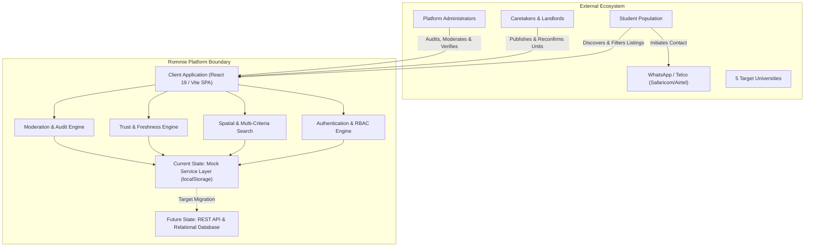
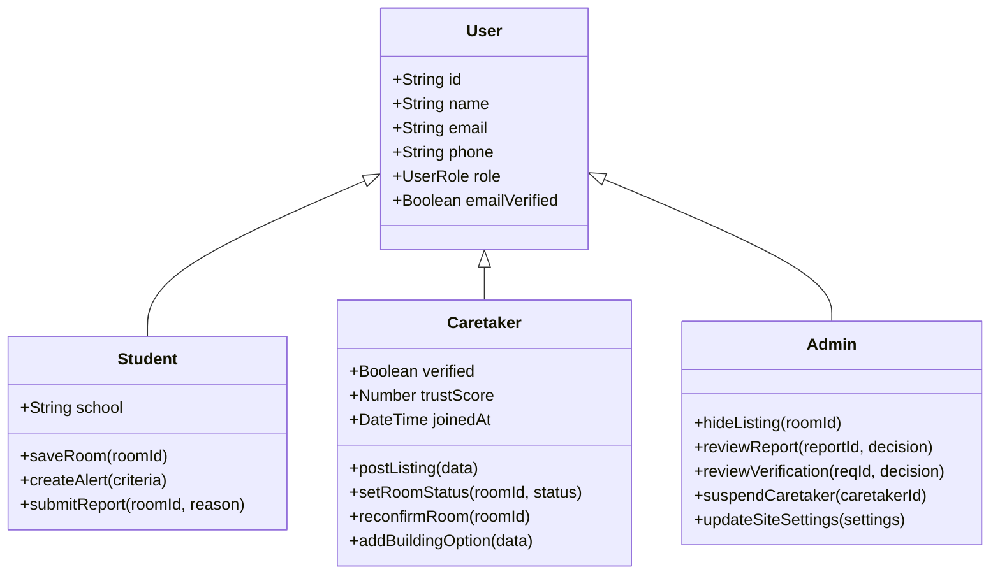
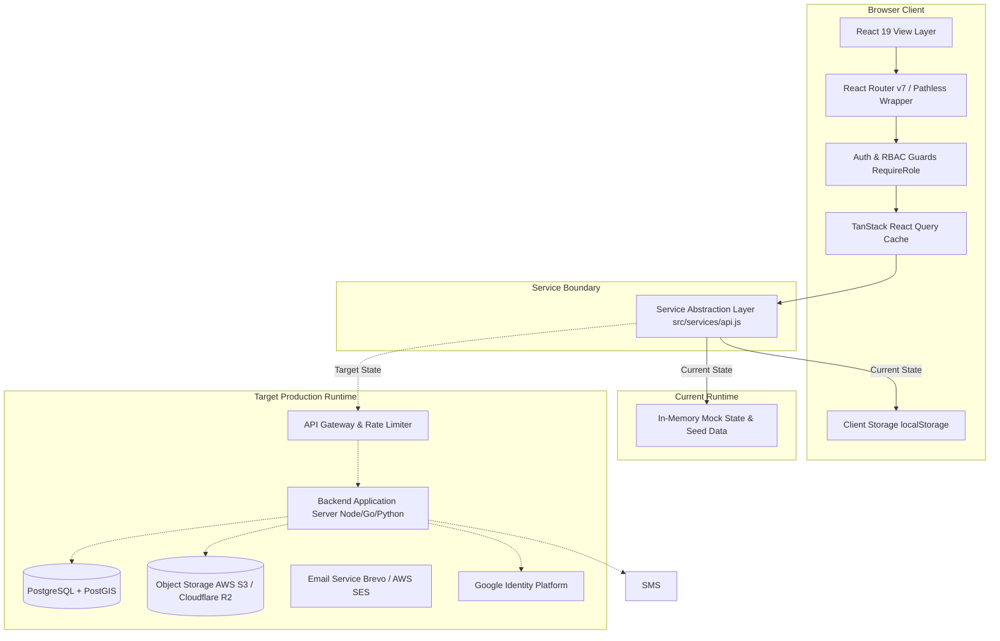
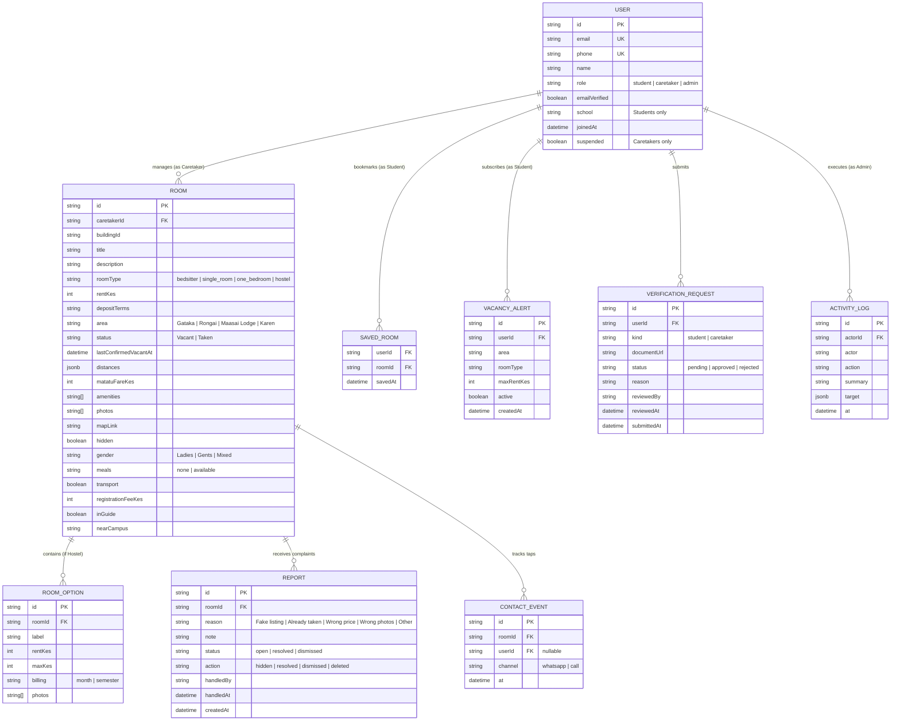

# Software Requirements Specification (SRS) for Rommie Web Application

## Document Control & Metadata

| Attribute               | Details                                                                   |
| :---------------------- | :------------------------------------------------------------------------ |
| **Document Title**      | Software Requirements Specification (SRS) — Rommie Accommodation Platform |
| **Document ID**         | DOC-SRS-001                                                               |
| **Current Version**     | 1.1                                                                       |
| **Status**              | Draft (Pending Owner Review)                                              |
| **Author**              | Antigravity AI Agent (Senior Systems Analyst)                             |
| **Date of Creation**    | 2026-10-19                                                                |
| **Last Updated**        | 2026-11-06                                                                |
| **Target Codebase**     | `e:\Coding_Projects\rommie-webapp`                                        |
| **Traceability Target** | `docs/RTM.md`                                                             |
| **Governing Framework** | AGENTS.md (Section 6) & IEEE Std 830-1998 / ISO/IEC/IEEE 29148:2018       |

### Document Purpose

This Software Requirements Specification (SRS) establishes the authoritative functional, non-functional, data, interface, and behavioral requirements for the **Rommie** web application. It synthesizes architectural evidence extracted from the existing client-side React implementation (`src/`), reconciles operational constraints for the Karen/Rongai university corridor in Nairobi, Kenya, and integrates the performance, security, and scalability mandates defined in [house_hunting_web_app_nfrs.md](file:///e:/Coding_Projects/rommie-webapp/house_hunting_web_app_nfrs.md).

### Project Scope

The Rommie platform is an accommodation discovery and vacancy verification system engineered specifically for tertiary students attending institutions in the southwestern peri-urban zones of Nairobi and Kajiado counties. The scope encompasses:

1. **Student Discovery Portal:** Multi-criteria search, spatial transit calculations, verified vacancy tracking, caretaker contact channels, alert subscriptions, and student ID verification.
2. **Caretaker Management Console:** Multi-unit listing management, hostel room configuration, optimistic vacancy toggling, listing reconfirmation workflows, and reputation/trust transparency.
3. **Platform Administration Suite:** Comprehensive listing moderation, stale inventory management, abuse dispute arbitration, identity document review queues, caretaker suspension controls, site-wide configuration, and real-time operational analytics.
4. **Target Backend Services:** Transition specifications from client-side mock persistence to a production-grade backend API, database, and object storage architecture.

### Document Change History

| Version | Date       | Author               | Description of Changes                                                                                           |
| :------ | :--------- | :------------------- | :--------------------------------------------------------------------------------------------------------------- |
| 1.1     | 2026-11-06 | Antigravity AI Agent | Design Review v1.1 Updates (Alvan's Review):<br/>1. Transitioned OTP verification and vacancy alerts from SMS Gateway to Transactional Email Service (Brevo/Postmark/AWS SES) with per-email and per-IP rate limiting; Google OAuth accounts bypass verification; User entity updated from phoneVerified to emailVerified.<br/>2. Retired Student ID verification (FR-006 marked RETIRED/REMOVED; FR-027 updated to Caretaker-only KYC queue; UI routes and badges removed).<br/>3. Caretaker listing photo requirements updated to exactly 10 photos with specified shot breakdown, no pre-compression file size limit, and no limit on total listings per caretaker. |
| 1.0     | 2026-10-19 | Antigravity AI Agent | Initial comprehensive baseline derived from repository reconnaissance, frontend audit, and supplied NFR targets. |

---

## 1. Product Overview & Context

### 1.1 Purpose & Problem Statement

Tertiary students attending university campuses in the Karen, Rongai, and Lang'ata suburban corridors encounter severe friction when searching for private off-campus accommodation:

- **Pervasive Information Asymmetry:** Online listings are frequently obsolete, deceptive, or fraudulent; rooms advertised as vacant are routinely occupied, wasting student time and travel expenditure.
- **Predatory Intermediaries:** Unaccredited brokers ("agents") charge exorbitant viewing fees (KES 500–2,000) for sub-standard housing without guarantees of tenure or safety.
- **Fragmented Pricing Models:** Independent rentals (bedsitter, single room, one bedroom) quote monthly rates excluding electricity tokens, while commercial student hostels quote per-semester block rates with optional catering and campus shuttles.
- **Safety and Identity Risks:** Female and junior students face security hazards visiting unverified properties without vetted landlord or caretaker credentials.

Rommie resolves these structural impediments through a zero-fee, verified accommodation registry featuring real-time vacancy confirmation timestamps, algorithmic trust scoring for caretakers, direct communication channels (WhatsApp and Voice), and transparent walking/matatu transit metrics to university gates.



### 1.2 Geographic & Institutional Context

The operational domain is strictly delineated by the primary campuses and residential hubs identified in `src/lib/format.js`:

#### Target Universities (`CAMPUSES`)

1. **KSL:** Kenya School of Law (Karen)
2. **JKUAT Karen:** Jomo Kenyatta University of Agriculture and Technology (Karen Campus)
3. **Tangaza:** Tangaza University (Bogani Road, Karen)
4. **CUEA:** Catholic University of Eastern Africa (Bogani East Road, Karen)
5. **Co-op:** Co-operative University of Kenya (Ushirika Road, Karen)

#### Geographic Clusters (`AREAS`)

1. **Rongai:** Ongata Rongai commercial center, high-density student rentals, bedsitters, private hostels.
2. **Gataka:** Low-to-medium cost residential area bordering Karen and Rongai, predominantly independent single rooms and bedsitters.
3. **Maasai Lodge:** Transitional residential node adjacent to Magadi Road and Nazarene University corridor, high concentration of purpose-built hostels.
4. **Karen:** Upmarket residential suburb with gated compounds, university guest cottages, and accredited high-end student hostels.

### 1.3 Definitions, Acronyms, and Abbreviations

| Term / Acronym  | Definition                                                                                                                                                 |
| :-------------- | :--------------------------------------------------------------------------------------------------------------------------------------------------------- |
| **Bedsitter**   | A self-contained studio apartment featuring a combined bedroom/living area with an ensuite bathroom and kitchenette.                                       |
| **Single Room** | A private single bedroom unit utilizing shared ablution and sanitation facilities.                                                                         |
| **One Bedroom** | A self-contained apartment offering a separate distinct bedroom, living room, private kitchen, and private bathroom.                                       |
| **Hostel**      | A communal student living facility offering shared or private rooms (e.g., 2/4 sharing), institutional catering, utilities, and scheduled shuttle transit. |
| **Caretaker**   | The property custodian, on-site building manager, or direct landlord authorized to show vacant units and contract tenancies.                               |
| **KES**         | Kenyan Shilling (national currency; ISO 4217 code).                                                                                                        |
| **Matatu**      | Privately owned commercial minibuses/paratransit vehicles providing public transport across Nairobi corridors.                                             |
| **Tokens**      | Prepaid electrical utility metering managed by Kenya Power and Lighting Company (KPLC).                                                                    |
| **STALE_DAYS**  | Operational freshness threshold (14 days) after which an unconfirmed listing is flagged as stale or hidden (`src/lib/format.js#L72`).                      |
| **Trust Score** | A 0–100 reputation score calculated from identity verification, vacancy freshness, user reports, and account age (`src/lib/trust.js`).                     |
| **OTP**         | One-Time Password; a 6-digit cryptographic security code used for telephone number verification.                                                           |
| **MLS**         | Multiple Listing Service; standardized real estate syndication database (evaluated under NFR scope decisions).                                             |
| **RTM**         | Requirements Traceability Matrix (`docs/RTM.md`).                                                                                                          |

---

## 2. Stakeholders & User Classes

### 2.1 Stakeholder Matrix

| Stakeholder                         | Category                 | Primary Objectives                                                                                                            | Codified Evidence                                                                                              |
| :---------------------------------- | :----------------------- | :---------------------------------------------------------------------------------------------------------------------------- | :------------------------------------------------------------------------------------------------------------- |
| **Tertiary Students**               | Core User                | Discover affordable, authentic, vacant housing within transit radius of their university; avoid broker scams.                 | `src/pages/HomePage.jsx`, `src/pages/RoomsPage.jsx`, `src/pages/RoomDetailPage.jsx`                            |
| **Property Caretakers / Landlords** | Core User                | Maintain high building occupancy, receive qualified student leads, publish building room types without repetitive data entry. | `src/pages/CaretakerPostPage.jsx`, `src/pages/CaretakerListingsPage.jsx`, `src/pages/CaretakerProfilePage.jsx` |
| **Platform Administrators**         | System Operator          | Enforce listing integrity, verify identity documents, mediate complaints, prevent spam, analyze platform traction.            | `src/pages/AdminDashboardPage.jsx`, `src/pages/AdminListingsPage.jsx`, `src/pages/AdminReportsPage.jsx`        |
| **Hostel Proprietors**              | Specialized Caretaker    | Market semester-based student hostels with tiered occupancy (single, sharing), meal plans, and campus shuttle options.        | `src/data/hostels.js`, `src/components/HostelFacts.jsx`, `src/components/caretaker/RoomForm.jsx`               |
| **University Housing Offices**      | External / Institutional | Ensure student welfare and validate private off-campus accommodation guides (e.g., Karen Campus Dean of Students Guide).      | `src/types/index.js#L57-L58` (`inGuide`, `nearCampus`)                                                         |

### 2.2 User Classes & Behavioral Profiles



#### UC-ROLE-1: Student (Confirmed)

- **Profile:** University undergraduate or post-graduate students enrolled at KSL, JKUAT, Tangaza, CUEA, or Co-op.
- **Privileges:** Public catalog browsing, detailed listing inspection, direct caretaker messaging, email OTP verification, optimistic listing bookmarking, vacancy criteria alerts (email + in-app), listing complaint reporting.
- **Constraints:** Cannot create property listings or access administrative console tools.

#### UC-ROLE-2: Caretaker / Property Manager (Confirmed)

- **Profile:** Resident building caretakers, property management agents, or individual rental property landlords.
- **Privileges:** Account creation, email OTP verification, standard room listing publication (10 required photos, unlimited listings), hostel multi-tier room creation, listing status toggling (`Vacant`/`Taken`), listing reconfirmation, multi-unit building cloning, national ID/passport verification submission, trust score breakdown review.
- **Constraints:** Cannot access student saved rooms, student vacancy alert tools, or platform administration consoles.

#### UC-ROLE-3: Platform Administrator (Confirmed)

- **Profile:** Internal operations and trust-and-safety personnel authorized to enforce platform compliance.
- **Privileges:** Global listing moderation (inline title/description/rent editing, hiding, restoring, hard deletion), report arbitration (dismiss, resolve, hide listing), identity verification queue review (approval, rejection with feedback, undo), caretaker account suspension/restoration, system activity audit review, operational analytics, site-wide contact settings updates.
- **Constraints:** Subject to administrative action logging (`MAX_ACTIVITY = 500`).

#### UC-ROLE-4: Unregistered Visitor (Confirmed)

- **Profile:** Prospective students or caretakers exploring the platform prior to authentication.
- **Privileges:** Full public search, room detail viewing, zones inspection, legal and safety pages reading.
- **Interception:** Attempting to save a room, create an alert, post a listing, or submit a report triggers a graceful authentication gate (`src/lib/auth.jsx#useAuthGate`) preserving return state via `?redirect=`.

#### UC-ROLE-5: Institutional Property Owner / Non-Resident Landlord (Proposed / Assumption ASM-001)

- **Status:** Inferred / Unconfirmed in code.
- **Context:** Currently, the codebase treats `Caretaker` as a unified persona managing contact numbers and property status. In practice, building owners may delegate operational tasks to on-site caretakers while retaining financial control. The system currently models only the on-site operational persona.

---

## 3. Product Perspective & System Boundaries

### 3.1 Architectural Decomposition & Component Topology

The application is structured as a single-page web application (SPA) built with React 19, Vite, Tailwind CSS v4, and Radix UI primitives. It currently operates with a client-side mock service layer simulating an asynchronous HTTP REST backend:



### 3.2 System Boundaries & External Interfaces

1. **Telephony & Direct Messaging:** The platform delegates direct booking and inquiries to WhatsApp via deep links (`wa.me`) and native cellular voice calling (`tel:`).
2. **Identity Verification & Storage:** Verification documents (national IDs, student admission letters) are validated and staged on the client, targeting S3-compatible cloud object storage with time-limited signed URLs.
3. **Transit & Mapping:** Campus transit proximity is evaluated using structured walking and matatu transit durations. External map integrations utilize standard deep links (`mapLink`), targeting embeddable interactive vector tiles.

---

## 4. Functional Requirements

### Requirement Metadata Nomenclature

Every functional requirement is assigned a permanent identifier (`FR-001` through `FR-050`), a MoSCoW priority (**Must Have**, **Should Have**, **Could Have**, **Won't Have This Iteration**), a confirmation status (**Confirmed** [verified in code], **Inferred** [deduced from user flows], or **Proposed** [architectural enhancement]), and full forward traceability.

---

### 4.1 Student Capabilities & Discovery Experience

#### FR-001: Multi-Criteria Room Filtering & Sorting

- **Status:** Confirmed (`src/pages/RoomsPage.jsx`, `src/services/api.js#L135-L173`, `src/types/index.js#L195-L208`)
- **Priority:** Must Have
- **Rationale:** Students require granular filtering to locate rooms matching their precise financial constraints, university proximity, and lifestyle preferences.
- **Preconditions:** Public access; catalog contains active listings.
- **Expected Behaviour:**
  1. The system shall filter listings by `area` (Gataka, Rongai, Maasai Lodge, Karen).
  2. The system shall filter by `roomType` (bedsitter, single_room, one_bedroom, hostel).
  3. The system shall filter by price range (`minRent` to `maxRent` in whole KES).
  4. The system shall filter by campus proximity (`near`), matching properties within 20 minutes walking or matatu transit to the selected institution, or hostels explicitly cataloged in the institutional guide (`inGuide`).
  5. The system shall filter by hostel-specific criteria: `gender` (Ladies, Gents, Mixed), `mealsOnly` (`meals === "available"`), and `transportOnly` (`transport === true`).
  6. The system shall filter by amenities, enforcing an `AND` conjunction across selected amenities (`Water 24/7`, `WiFi`, `Tokens`, `Gated Security`).
  7. The system shall filter by occupancy status (`vacantOnly === true`).
  8. The system shall exclude hidden listings (`hidden === true`) and listings owned by suspended caretakers (`isSuspended === true`).
  9. The system shall order results: vacant listings first, followed by sort criteria (`newest` by `lastConfirmedVacantAt` descending, `rent_asc` ascending, `rent_desc` descending).
- **Acceptance Criteria:**
  - Filtering by `near: "KSL"` returns only rooms with `distances.KSL.walkMin <= 20` or `distances.KSL.matatuMin <= 20` or valid guide endorsement.
  - Sorting by `rent_asc` places vacant rooms before taken rooms, ordered strictly by `rentKes` ascending.

#### FR-002: Room Detail View, Photo Gallery & Lightbox

- **Status:** Confirmed (`src/pages/RoomDetailPage.jsx#L27-L120`, `src/components/HostelFacts.jsx`)
- **Priority:** Must Have
- **Rationale:** Students must inspect photographic evidence, comprehensive pricing terms, transit options, and caretaker trust metrics prior to committing to physical site visits.
- **Preconditions:** Valid listing ID requested.
- **Expected Behaviour:**
  1. The system shall display listing title, rent, deposit terms, area, last confirmed vacancy relative date, description, and amenity badges.
  2. The system shall render a multi-photo gallery supporting click-to-lightbox presentation.
  3. The lightbox shall support touch swipe navigation (left/right), keyboard arrow keys, image index tracking (`i + 1 / n`), and thumbnail strip jumping.
  4. The system shall render transit durations (walk and matatu minutes) to all 5 supported university campuses and estimated matatu fare in KES.
  5. For hostel listings, the system shall render all bookable room options (`RoomOption[]`), meal plan status, shuttle availability, and registration fee.
  6. The system shall display caretaker profile metadata, verification badge, and total trust score.
  7. If a listing is hidden or belongs to a suspended caretaker, the detail route shall resolve to a `404 Not Found` state.
- **Acceptance Criteria:**
  - Lightbox trap focus and handles keyboard Escape to dismiss.
  - Missing image URLs gracefully render a "Photo unavailable" fallback placeholder.

#### FR-003: Direct Caretaker Contact & Deduplicated Event Tracking

- **Status:** Confirmed (`src/services/api.js#L48-L79`, `src/lib/format.js#L57-L60`, `src/pages/RoomDetailPage.jsx#L170-L195`)
- **Priority:** Must Have
- **Rationale:** Students connect directly with property managers without intermediaries, while the platform records engagement metrics for operational analytics.
- **Preconditions:** Active listing detail view.
- **Expected Behaviour:**
  1. The system shall generate a pre-formatted WhatsApp deep link:
     `https://wa.me/{number}?text={encoded_message}` including room type, area, and rent.
  2. The system shall generate a standard voice call link (`tel:{number}`).
  3. Tapping either link shall execute asynchronous event tracking (`trackContact(roomId, channel)`).
  4. Tracking shall be bypassed if the user is an Administrator or the listing's own caretaker.
  5. The system shall enforce a 30-second deduplication window (`CONTACT_DEDUPE_MS = 30000`) per `roomId` + `channel`.
  6. Stored contact events shall be capped at 2,000 entries (`MAX_CONTACT_EVENTS = 2000`), purging the oldest events.
  7. Tracking failures shall operate as non-blocking fire-and-forget operations, never impeding the communication link.
- **Acceptance Criteria:**
  - Repeated taps on WhatsApp within 10 seconds record exactly 1 contact event.
  - Caretaker clicking contact on their own listing generates zero tracking events.

#### FR-004: Saved / Bookmarked Rooms Management

- **Status:** Confirmed (`src/lib/saved.js`, `src/services/api.js#L179-L208`, `src/pages/SavedPage.jsx`)
- **Priority:** Should Have
- **Rationale:** Students need to curate a shortlist of candidate properties across multiple browsing sessions.
- **Preconditions:** User authenticated with role `student`.
- **Expected Behaviour:**
  1. The system shall allow students to toggle room bookmarking via heart icons on listing cards and detail pages.
  2. Bookmark updates shall be optimistic in the UI, reverting with an error toast if persistence fails.
  3. Attempting to bookmark while unauthenticated shall invoke the auth gate with return redirect.
  4. Attempting to bookmark as a `caretaker` or `admin` shall display an informative notice: "Saving rooms is for student accounts."
  5. The saved rooms view (`/saved`) shall display all bookmarked listings, automatically filtering out hidden or suspended rooms.
  6. The system shall support explicit room removal with toast confirmation and undo capability.
- **Acceptance Criteria:**
  - Toggling bookmark updates client state immediately (< 50ms) and syncs to backend.
  - Logging out and logging in as the same student retains saved room IDs.

#### FR-005: Vacancy Alert Creation & Management

- **Status:** Confirmed (`src/pages/AlertsPage.jsx`, `src/services/api.js#L209-L232`, `src/types/index.js#L98-L105`)
- **Priority:** Should Have
- **Rationale:** Students searching during peak turnover periods require proactive alerts when matching rooms open up.
- **Preconditions:** User authenticated with role `student` and verified email address (`emailVerified: true`).
- **Expected Behaviour:**
  1. Students shall create vacancy alerts specifying optional `area`, `roomType`, and `maxRentKes`.
  2. The system shall validate that `maxRentKes` is an integer > 0 and <= 500,000 KES.
  3. Pre-filters from `/rooms` zero-result states shall pre-populate the alert creation form.
  4. Students shall toggle alert active status (`active: boolean`) or delete alerts.
  5. The system shall display alert summaries formatted via `alertSummary()` (e.g., "Bedsitter under KES 6,000 in Rongai.").
  6. Matching notifications shall be delivered via Transactional Email Service and in-app notifications (eliminating telco SMS fees).
- **Acceptance Criteria:**
  - Creating an alert with empty criteria defaults to "Any room in any area".
  - Alert list displays creation timestamps formatted according to Kenyan locale.
  - Notifications dispatch immediately when an matching room is marked vacant.

---

#### FR-006: [RETIRED / REMOVED] Student ID Verification Submission

- **Status:** **RETIRED / REMOVED** per Alvan's design review.
- **Stable ID Policy:** Maintained per [AGENTS.md](file:///e:/Coding_Projects/rommie-webapp/AGENTS.md) Rule 9 (IDs are permanent and never reused or deleted).
- **Rationale for Removal:** Student ID verification added unnecessary friction to student onboarding without offering material protection against rental fraud. The verification mechanism is concentrated strictly on Caretakers and Landlords (FR-018 / FR-027) who hold financial custody of tenant deposits.
- **Codebase Reconciliation:**
  - Route `/verify-student` removed from `src/routes.jsx` (commit `eb9e112`).
  - `src/pages/VerifyStudentPage.jsx` removed.
  - Student badge removed from `src/components/SiteHeader.jsx`.
  - Student verification test case removed from `src/test/student-admin.test.js`.
- **Preserved Components:** Shared verification primitives (`ENT-008 / verification_requests`, `DocumentUpload.jsx`, `submitVerification("caretaker", file)`, and `FR-028` undo) remain operational for Caretaker KYC.

---

#### FR-007: Listing Report Submission

- **Status:** Confirmed (`src/components/ReportModal.jsx`, `src/services/api.js#L285-L288`, `src/types/index.js#L107-L109`)
- **Priority:** Must Have
- **Rationale:** Crowd-sourced moderation empowers students to flag inaccurate pricing, ghost listings, and safety hazards.
- **Preconditions:** Active room listing.
- **Expected Behaviour:**
  1. The system shall provide a reporting modal on every active listing card and detail page.
  2. The report form shall mandate selection of one `ReportReason`:
     - `"Fake listing"`
     - `"Already taken"`
     - `"Wrong price"`
     - `"Wrong photos"`
     - `"Other"`
  3. The form shall accept an optional descriptive text note (`max 300 characters`).
  4. Submitting a report shall persist a new `Report` record with initial status `open` and trigger an acknowledgment toast.
- **Acceptance Criteria:**
  - Report submission modal closes cleanly on success and disables submit button during transit.
  - Caretaker trust score recalculates dynamically when report counts change (`computeTrust`).

#### FR-008: Campus Zones & Proximity Overview

- **Status:** Confirmed (`src/pages/ZonesPage.jsx`, `src/services/api.js#L131-L134`)
- **Priority:** Should Have
- **Rationale:** Freshmen and students unfamiliar with the Karen/Rongai transit network require location discovery organized around their specific campus.
- **Preconditions:** Public access.
- **Expected Behaviour:**
  1. The system shall render dedicated sections for all 5 supported universities.
  2. Each section shall calculate and display total vacant room count and minimum entry rent (`from KES X/month`).
  3. Each zone shall display up to 4 nearest vacant listings sorted strictly by transit duration (`minutesTo(room, campusId)` ascending).
  4. A "See all near {campus}" link shall navigate to `/rooms?near={campus}`.
- **Acceptance Criteria:**
  - Zero vacant listings in a zone renders a dedicated empty state: "No vacant rooms near {campus} right now. Create an alert...".

#### FR-009: Hostel Multi-Room Option & Amenity Inspection

- **Status:** Confirmed (`src/components/HostelFacts.jsx`, `src/components/RoomCard.jsx`, `src/types/index.js#L21-L30`)
- **Priority:** Must Have
- **Rationale:** Hostels feature composite tier pricing that cannot be represented by a single rental figure.
- **Preconditions:** Listing with `roomType === "hostel"`.
- **Expected Behaviour:**
  1. The system shall compute and render the headline rent as the minimum monthly equivalent price across all bookable options (`cheapestMonthly`).
  2. For semester-billed options, monthly equivalents shall be normalized assuming a 4-month academic semester (`rentKes / 4`, rounded to nearest 10 KES).
  3. The detail view shall itemize all individual room options, displaying tier label, price range, billing cadence, and option-specific photo galleries.
  4. Institutional guide endorsements (`inGuide === true`) shall display a prominent official guide badge.
- **Acceptance Criteria:**
  - A hostel with KES 48,000/semester quotes a headline monthly equivalent of KES 12,000/month.

---

### 4.2 Caretaker Capabilities & Property Management

#### FR-010: Standard Room Listing Creation (10 Required Photos & Unlimited Listings)

- **Status:** Confirmed (`src/pages/CaretakerPostPage.jsx`, `src/components/caretaker/RoomForm.jsx`, `src/components/caretaker/PhotoUploader.jsx`)
- **Priority:** Must Have
- **Rationale:** Comprehensive listing data and standardized photographic evidence capture all variables critical to student tenancy decisions, eliminating misleading listings and blind viewings.
- **Preconditions:** Authenticated caretaker with verified email address (`emailVerified === true`).
- **Listing Quotas:** **There is no limit on total listings per caretaker.** Caretakers managing multiple rental properties or unit blocks can publish unlimited listings.
- **Photo Requirements & Pre-Compression Specifications:**
  - **Exactly 10 photos are required** per listing (`REQUIRED_PHOTOS = 10`). The caretaker must supply all 10 standardized room and building perspectives:
    1. **Main room / bedroom view** (wide angle)
    2. **Opposite angle of room**
    3. **Bed / living space**
    4. **Bathroom / shower / toilet**
    5. **Kitchen / kitchenette area / sink**
    6. **Closet / storage / wardrobe**
    7. **Windows / natural lighting / electrical tokens & meter**
    8. **Exterior building / entrance / gate / compound**
    9. **Balcony / corridor / common area**
    10. **Security features** (perimeter fence, security gate, guard house, street access)
  - **No file size limit before compression:** There is no maximum cap on uncompressed source photos selected by the caretaker (e.g. 15–25 MB smartphone camera files are accepted). The client-side application utilizes HTML5 Canvas compression (`FR-040`) to resize and optimize photos to WebP/JPEG under 1.5 MB prior to network upload. (Note: The 8 MB file size limit applies strictly to uncompressed KYC verification documents like National IDs in `FR-018`, not room photos).
- **Expected Behaviour:**
  1. The system shall validate and capture:
     - `title`: 5 to 80 characters.
     - `description`: 0 to 600 characters.
     - `roomType`: "bedsitter", "single_room", or "one_bedroom".
     - `area`: "Gataka", "Rongai", "Maasai Lodge", or "Karen".
     - `rent`: Integer between 1 and 500,000 KES.
     - `depositTerms`: 2 to 120 characters (or "No deposit").
     - `amenities`: Subset of `["Water 24/7", "WiFi", "Tokens", "Gated Security"]`.
     - `distances`: At least one campus transit time (walk or matatu, 0–999 minutes).
     - `matatuFare`: Integer >= 0 KES.
     - `mapLink`: Optional valid HTTP/HTTPS URL.
     - `whatsapp`: Valid Kenyan telephone number.
     - `call`: Valid Kenyan telephone number.
     - `photos`: Array of **exactly 10 compressed photos** corresponding to the standard views.
  2. Photos shall be validated for MIME type (`image/*`).
  3. Listings shall initialize with `status: "Vacant"`, `hidden: false`, and `lastConfirmedVacantAt: new Date().toISOString()`.
- **Acceptance Criteria:**
  - Submitting with fewer or more than 10 photos is rejected: "Please provide all 10 required photos of the property before publishing."
  - Caretakers with unverified email addresses are redirected to `/verify-email`.

---

#### FR-011: Hostel Listing Creation (Dynamic Room Options & Policies)

- **Status:** Confirmed (`src/components/caretaker/RoomForm.jsx#L49-L67`)
- **Priority:** Must Have
- **Rationale:** Commercial student hostels require structured entry for room categories, gender rules, and auxiliary student services.
- **Preconditions:** Caretaker posting with `roomType === "hostel"`.
- **Expected Behaviour:**
  1. The system shall enforce mandatory selection of `gender` policy ("Ladies", "Gents", "Mixed").
  2. The system shall capture optional `distanceKm` (numeric between 0 and 50 km).
  3. The system shall capture optional one-time `registrationFee` in whole KES.
  4. The form shall dynamically manage an array of `roomOptions` (minimum 1 required):
     - `label`: 1 to 40 characters (e.g., "Single Ensuite", "4 Sharing").
     - `rent`: Mandatory integer > 0 KES.
     - `maxRent`: Optional integer > `rent`.
     - `billing`: Enum `"month"` or `"semester"`.
     - `photos`: Array of option-specific photos.
  5. If multiple room options exist, each option must have at least 1 dedicated photo.
- **Acceptance Criteria:**
  - Defining a `maxRent` lower than base `rent` triggers validation error: "The top of the range must be more than the price."
  - Removing all room options blocks submission.

#### FR-012: Listing Update & Field Editing

- **Status:** Confirmed (`src/pages/CaretakerEditPage.jsx`, `src/services/api.js#L239-L242`)
- **Priority:** Must Have
- **Rationale:** Caretakers must maintain accurate pricing, deposit policies, and contact numbers throughout the rental lifecycle.
- **Preconditions:** Caretaker must own the listing (`listing.caretakerId === user.id`).
- **Expected Behaviour:**
  1. Form pre-populates with existing listing values and uploaded photo previews.
  2. Saving updates the listing record without altering `createdAt` or `id`.
  3. Submitting triggers cache invalidation across query keys `["my-listings"]`, `["rooms"]`, and `["room", id]`.
- **Acceptance Criteria:**
  - Caretaker attempting to edit another caretaker's listing is rejected with HTTP 403 / authorization guard.

#### FR-013: Room Status Toggling (Vacant / Taken) with Undo

- **Status:** Confirmed (`src/pages/CaretakerListingsPage.jsx#L30-L60`, `src/services/api.js#L243-L246`)
- **Priority:** Must Have
- **Rationale:** Rapid, friction-free occupancy toggling prevents students from chasing occupied rooms.
- **Preconditions:** Caretaker authenticated; viewing `/caretaker/listings`.
- **Expected Behaviour:**
  1. The UI provides a prominent switch toggle on each listing card.
  2. Toggling to `"Vacant"` updates `status` and refreshes `lastConfirmedVacantAt` to current timestamp.
  3. Toggling to `"Taken"` updates `status` without refreshing the vacancy timestamp.
  4. The UI executes an optimistic cache update and displays a toast with an `"Undo"` action button.
  5. Clicking `"Undo"` within the toast window rolls back the status and restores the previous `lastConfirmedVacantAt` timestamp.
- **Acceptance Criteria:**
  - Optimistic toggle reflects immediately on screen.
  - Network failure during status change rolls back UI switch and triggers an error toast.

#### FR-014: Stale Listing Reconfirmation & Visibility Restoration

- **Status:** Confirmed (`src/services/api.js#L247-L251`, `src/pages/CaretakerListingsPage.jsx#L70-L85`)
- **Priority:** Must Have
- **Rationale:** Listings inactive for > 14 days degrade search quality. Caretakers need a single-tap mechanism to verify vacancy.
- **Preconditions:** Authenticated caretaker with verified email (`emailVerified === true`); listing age >= 14 days without reconfirmation (`daysSince(lastConfirmedVacantAt) >= 14`).
- **Expected Behaviour:**
  1. The listing card displays a warning: "Needs reconfirming".
  2. The caretaker can tap "Still vacant today".
  3. Reconfirmation sets `status: "Vacant"`, refreshes `lastConfirmedVacantAt` to `now()`, and clears any administrative `hidden: true` flag applied due to staleness.
  4. Reconfirmation restores immediate visibility on the public search index.
- **Acceptance Criteria:**
  - Reconfirming an admin-hidden stale listing resets `hidden: false` automatically.

#### FR-015: Building Cloning / Multi-Room Unit Addition

- **Status:** Confirmed (`src/pages/CaretakerPostPage.jsx#L28-L46`, `src/services/api.js#L253-L257`)
- **Priority:** Should Have
- **Rationale:** Caretakers managing properties with multiple room types (e.g., both bedsitters and one-bedrooms in "Sunrise Heights") should not re-enter identical location, transit, and contact data.
- **Preconditions:** Existing listing owned by caretaker; accessed via "Add another room type in this building" (`/caretaker/post?copy={id}`).
- **Expected Behaviour:**
  1. The form copies building-level fields: `area`, `depositTerms`, `amenities`, `distances`, `matatuFareKes`, `mapLink`, `whatsappNumber`, and `callNumber`.
  2. The form clears unit-specific fields: `title`, `description`, `rent`, `photos`, and `roomType`.
  3. If the source listing lacks a `buildingId`, the system assigns `buildingId: source.id` to both source and new listing.
  4. Public detail pages group and display siblings via `getBuildingRooms(buildingId)`.
- **Acceptance Criteria:**
  - Submitting cloned listing creates an independent listing record sharing the identical `buildingId`.

#### FR-016: Caretaker Listing Deletion

- **Status:** Confirmed (`src/services/api.js#L252`, `src/pages/CaretakerListingsPage.jsx#L90-L115`)
- **Priority:** Should Have
- **Rationale:** Caretakers require permanent removal of decommissioned properties or duplicate drafts.
- **Preconditions:** Ownership verified.
- **Expected Behaviour:**
  1. Triggering delete presents an `AlertDialog` confirmation prompt: "Delete this listing?".
  2. Confirmation permanently deletes the listing record and invalidates relevant caches.
- **Acceptance Criteria:**
  - Dismissing the confirmation dialog leaves the listing untouched.

#### FR-017: Caretaker Trust Score Computation & Breakdown Display

- **Status:** Confirmed (`src/lib/trust.js`, `src/components/caretaker/TrustScoreCard.jsx`, `src/pages/CaretakerProfilePage.jsx`)
- **Priority:** Must Have
- **Rationale:** Gamified transparency encourages caretakers to keep vacancies fresh and resolve complaints.
- **Preconditions:** Caretaker viewing profile.
- **Expected Behaviour:**
  1. The system computes a 100-point composite score:
     - **Verification (`TRUST_MAX.verification = 35`):** 35 pts if national ID approved; 0 pts otherwise.
     - **Freshness (`TRUST_MAX.freshness = 30`):** Proportion of vacant listings confirmed within the last 14 days (`Math.round(30 * fresh / vacant)`). If 0 vacant rooms exist, defaults to 15 pts.
     - **Reports Penalty (`TRUST_MAX.reports = 25`):** 25 pts baseline minus 8 pts per registered report on their properties (`Math.max(0, 25 - 8 * reportCount)`).
     - **Account Age (`TRUST_MAX.age = 10`):** 1 pt per full month of membership, up to 10 pts maximum.
  2. The profile view shall present a visual progress bar and granular itemized breakdowns with status notes.
- **Acceptance Criteria:**
  - A verified caretaker (35) with 100% fresh listings (30), 0 reports (25), and 5 months tenure (5) displays exactly 95/100.
  - Receiving 4 reports reduces reports points to 0 (`25 - 32 < 0`).

#### FR-018: Caretaker ID Verification Submission

- **Status:** Confirmed (`src/pages/CaretakerProfilePage.jsx`, `src/services/api.js#L296-L333`)
- **Priority:** Must Have
- **Rationale:** Vetting landlord identity prevents impersonation fraud and secures student safety.
- **Preconditions:** Authenticated caretaker.
- **Expected Behaviour:**
  1. Accepts photo or PDF of Kenyan National ID card or Passport (<= 8 MB).
  2. Enqueues a `VerificationRequest` with `kind: "caretaker"`.
  3. Displays live review status: `"none"`, `"pending"`, `"approved"`, or `"rejected"` with feedback reason.
- **Acceptance Criteria:**
  - Approval updates `caretaker.verified = true` and awards +35 trust points across all their public listings.

#### FR-019: Caretaker Contact Phone Update

- **Status:** Confirmed (`src/services/api.js#L763-L778`, `src/pages/CaretakerProfilePage.jsx`)
- **Priority:** Should Have
- **Rationale:** Caretakers changing SIM cards or M-Pesa business lines must update their contact identity.
- **Preconditions:** Authenticated caretaker.
- **Expected Behaviour:**
  1. Caretaker submits a new Kenyan telephone number.
  2. Validates uniqueness across all platform accounts.
  3. Resets `phoneVerified = false` on the account, requiring immediate OTP verification before accessing protected capabilities.
- **Acceptance Criteria:**
  - Changing phone number redirects immediately to `/verify-phone`.

---

### 4.3 Administrative Governance & Moderation

#### FR-020: Admin Platform Dashboard & Operational Metrics

- **Status:** Confirmed (`src/pages/AdminDashboardPage.jsx`, `src/services/api.js#L384-L397`)
- **Priority:** Must Have
- **Rationale:** Administrators require real-time visibility into inventory liquidity, staleness, complaints, and user traction.
- **Preconditions:** Authenticated administrator (`role === "admin"`).
- **Expected Behaviour:**
  1. Dashboard computes and displays 6 high-level KPI cards:
     - `totalListings`: Active, non-hidden, non-suspended listings.
     - `vacancies`: Active vacant units.
     - `contactsMade`: Total deduplicated WhatsApp and voice call taps on existing listings.
     - `staleListings`: Vacant listings unconfirmed for >= 14 days.
     - `openReports`: Complaints awaiting moderation review.
     - `hiddenListings`: Inventory taken off the public index.
  2. Lists all stale listings with caretaker contact details and direct action buttons: "Hide from search" and "Contact caretaker".
- **Acceptance Criteria:**
  - Contacting a caretaker from the dashboard generates a pre-filled WhatsApp inquiry regarding room vacancy status.

#### FR-021: Listing Moderation & Manual Visibility Control

- **Status:** Confirmed (`src/services/api.js#L399-L423`, `src/pages/AdminListingsPage.jsx#L42-L47`)
- **Priority:** Must Have
- **Rationale:** Administrators must immediately pull compromised, fraudulent, or disputed listings from public view.
- **Preconditions:** Authenticated administrator.
- **Expected Behaviour:**
  1. Toggling "Hide" sets `hidden: true` on the listing.
  2. Hidden listings are immediately excluded from student search results (`/rooms`), campus zones, and public detail routes (`404`).
  3. The owning caretaker can still inspect the listing in their private management console (`/caretaker/listings`).
  4. Toggling "Restore" resets `hidden: false`.
  5. Every hide/restore action writes an entry to the administrative activity audit log (`logAction`).
- **Acceptance Criteria:**
  - Hiding a listing immediately removes it from TanStack query caches for `/rooms` without requiring full browser reload.

#### FR-022: Automated Stale Listing Flagging & Management

- **Status:** Confirmed (`src/services/api.js#L387`, `src/lib/format.js#L72`)
- **Priority:** Must Have
- **Rationale:** Ghost listings destroy student trust; unconfirmed inventory must be systematically surfaced and purged.
- **Preconditions:** Listing with `status === "Vacant"` and `Date.now() - lastConfirmedVacantAt >= 14 days`.
- **Expected Behaviour:**
  1. System categorizes listing as `stale`.
  2. Surfaced in admin dashboard stale management queue.
  3. Caretakers see prominent yellow warning badges on their listing cards.
  4. Admins can bulk-hide or selectively hide stale inventory.
- **Acceptance Criteria:**
  - Reconfirmation by caretaker immediately clears stale status.

#### FR-023: Global Listings Management & Inline Detail Modification

- **Status:** Confirmed (`src/pages/AdminListingsPage.jsx`, `src/services/api.js#L426-L473`)
- **Priority:** Must Have
- **Rationale:** Admins must correct minor typographical errors, formatting issues, or inaccurate pricing without deleting the listing.
- **Preconditions:** Authenticated administrator.
- **Expected Behaviour:**
  1. Admin table renders all listings (active, hidden, stale) with multi-criteria filters: search query (`q`), `roomType`, `area`, `status`, `visibility`, and `stale`.
  2. Admins can edit `title` (5–80 chars), `description` (0–600 chars), and `rentKes` (1–500,000 KES).
  3. Editing rent on hostel listings is strictly blocked: "Rent for hostels comes from the room options. Ask the caretaker to edit those."
  4. Modifications write a structured changelog entry to the activity log detailing prior and new values.
- **Acceptance Criteria:**
  - Attempting to set standard room rent to 0 KES fails validation: "Enter the rent in whole shillings, up to 500,000."

#### FR-024: Administrative Listing Deletion & Report Cascading

- **Status:** Confirmed (`src/services/api.js#L475-L486`, `src/pages/AdminListingsPage.jsx#L48-L53`)
- **Priority:** Must Have
- **Rationale:** Persistent spam, duplicate entries, or abusive properties must be permanently expunged.
- **Preconditions:** Authenticated administrator.
- **Expected Behaviour:**
  1. Permanent deletion removes the listing record from the system.
  2. All associated `open` reports for that listing are automatically closed and transitioned to `status: "resolved"`, `action: "deleted"`, stamped with the administrator's name and timestamp.
  3. Action is logged to the activity audit trail.
- **Acceptance Criteria:**
  - Deleting a listing closes all related pending reports in the moderation queue.

#### FR-025: User Report Moderation Queue & Resolution

- **Status:** Confirmed (`src/pages/AdminReportsPage.jsx`, `src/services/api.js#L593-L635`)
- **Priority:** Must Have
- **Rationale:** Timely arbitration of user complaints protects students from active fraud and rental scams.
- **Preconditions:** Authenticated administrator.
- **Expected Behaviour:**
  1. The moderation queue displays reports segregated into `"open"` and `"handled"` tabs, sorted newest first.
  2. Each card displays reason badge, submission date, listing title, area, room type, caretaker name, and count of concurrent open reports on that same property.
  3. Administrators can take three definitive actions:
     - **Dismiss (`decision: "dismissed"`):** Report marked invalid; listing remains active.
     - **Resolve (`decision: "resolved"`):** Marked resolved (e.g., caretaker corrected information); listing remains active.
     - **Hide Listing (`decision: "hidden"`):** Listing is flagged `hidden: true`, and all open reports on that property are concurrently resolved with `action: "hidden"`.
- **Acceptance Criteria:**
  - Selecting "Hide listing" resolves all 3 open reports on that property in a single transaction.

#### FR-026: User Account Management & Caretaker Suspension

- **Status:** Confirmed (`src/pages/AdminUsersPage.jsx`, `src/services/api.js#L490-L525`)
- **Priority:** Must Have
- **Rationale:** Recurrently fraudulent, unresponsive, or abusive caretakers must be de-platformed.
- **Preconditions:** Authenticated administrator.
- **Expected Behaviour:**
  1. Displays searchable, filterable directories of all Caretakers (including hostels) and Students.
  2. Caretaker table displays verification status, trust score, listing count, open report count, and suspension status.
  3. Admins can execute **Suspend** or **Restore** actions on any caretaker.
  4. Suspending a caretaker:
     - Adds caretaker ID to `rommie.suspended` set.
     - Immediately invalidates active caretaker sessions (`AuthError: "This account is suspended..."`).
     - Removes all their listings from public search and zones.
     - Displays `404` on their listing detail pages.
  5. Restoring reverses the suspension and restores public visibility.
- **Acceptance Criteria:**
  - Suspended caretaker attempting login is blocked with explicit suspension message.
  - Restoring caretaker immediately reinstates their listings on the public `/rooms` catalog.

#### FR-027: Caretaker Identity Verification Queue & Document Review

- **Status:** Confirmed (`src/pages/AdminVerificationPage.jsx`, `src/services/api.js#L335-L350`)
- **Priority:** Must Have
- **Rationale:** Strict manual inspection of submitted national identity and passport credentials guarantees platform integrity and protects student tenants from bogus landlords.
- **Preconditions:** Authenticated administrator.
- **Scope Note:** Following Alvan's review, Student ID verification has been retired. The verification queue operates exclusively for Caretakers and Landlords.
- **Expected Behaviour:**
  1. Queue displays all pending caretaker submissions ordered oldest first (longest wait prioritized).
  2. Admins can view the submitted document in an embedded preview modal (images) or new browser window (PDFs).
  3. Administrator can **Approve** (marks request `approved`, updates caretaker verified badge, grants +35 trust score points).
  4. Administrator can **Reject** (mandates an explicit rejection reason so the caretaker knows what to fix).
- **Acceptance Criteria:**
  - Rejecting without entering a text reason is blocked: "Add a reason so they know what to fix."
  - Queue lists caretaker submissions exclusively.

---

#### FR-028: Verification Decision Rollback (Undo Review)

- **Status:** Confirmed (`src/services/api.js#L359-L369`, `src/pages/AdminVerificationPage.jsx#L39-L46`)
- **Priority:** Should Have
- **Rationale:** Admins require recourse if a fraudulent document was mistakenly approved or valid credentials rejected.
- **Preconditions:** Authenticated administrator; request currently in `approved` or `rejected` state.
- **Expected Behaviour:**
  1. Admins inspect the "History" tab on the verification page.
  2. Clicking "Undo" returns the request to the `pending` queue, stripping decision timestamps and review notes.
  3. Any associated verified badges or trust points are revoked until re-reviewed.
  4. Action is logged to the audit trail.
- **Acceptance Criteria:**
  - Undoing an approved caretaker immediately reduces their trust score by 35 points.

#### FR-029: Verification Historical Audit Log Inspection

- **Status:** Confirmed (`src/services/api.js#L352-L358`, `src/pages/AdminVerificationPage.jsx#L95-L125`)
- **Priority:** Should Have
- **Rationale:** Oversight of administrative actions prevents rogue staff approvals.
- **Preconditions:** Authenticated administrator.
- **Expected Behaviour:**
  1. Historical log displays all completed verification reviews sorted newest first.
  2. Itemizes applicant name, phone, review timestamp, decision outcome, and reviewing admin's name.
- **Acceptance Criteria:**
  - Displays rejection reason in italics for all rejected items.

#### FR-030: Administrative Activity Audit Log & Category Filtering

- **Status:** Confirmed (`src/pages/AdminActivityPage.jsx`, `src/services/api.js#L80-L96`, `src/lib/adminFilters.js`)
- **Priority:** Must Have
- **Rationale:** Complete operational auditability ensures accountability across all administrative actions.
- **Preconditions:** Authenticated administrator.
- **Expected Behaviour:**
  1. Central activity log retains the most recent 500 actions (`MAX_ACTIVITY = 500`).
  2. Displays human-readable action summaries, actor names, and relative timestamps.
  3. Supports category filtering via `ACTIVITY_GROUPS`:
     - All activity
     - Listings (hidden, restored, edited, deleted)
     - Reports (dismissed, resolved)
     - Verifications (approved, rejected, undone)
     - Users (suspended, restored)
     - Settings (contact updates)
  4. Implements client-side pagination with "Show more" button in blocks of 50 items (`PAGE_SIZE = 50`).
- **Acceptance Criteria:**
  - Log entries are capped at 500; entry 501 evicts entry 1.

#### FR-031: Platform Analytics, Trends & Metric Aggregations

- **Status:** Confirmed (`src/pages/AdminAnalyticsPage.jsx`, `src/services/api.js#L546-L592`)
- **Priority:** Should Have
- **Rationale:** Business intelligence informs regional acquisition and marketing campaigns.
- **Preconditions:** Authenticated administrator.
- **Expected Behaviour:**
  1. Computes live vacancy rate across all non-hidden properties (`vacant / total * 100`).
  2. Renders listings distribution horizontal bar charts grouped by `Area` and `RoomType` (with vacant breakdowns).
  3. Renders a 14-day contact tap histogram tracking student engagement over time.
  4. Itemizes Top 5 most-contacted room listings with title and tap count.
  5. Computes an 8-week trend line of new caretaker registrations.
- **Acceptance Criteria:**
  - Contacts histogram displays 0 for days without recorded WhatsApp or voice call taps.

#### FR-032: Site-Wide Contact & Operational Settings Management

- **Status:** Confirmed (`src/pages/AdminSettingsPage.jsx`, `src/services/api.js#L527-L545`, `src/lib/settings.js`)
- **Priority:** Must Have
- **Rationale:** Support phone numbers, WhatsApp lines, operating hours, and office locations change without requiring code redeployment.
- **Preconditions:** Authenticated administrator.
- **Expected Behaviour:**
  1. Admins update site settings: `whatsapp`, `phone`, `email`, `hours`, and `location`.
  2. Form validates phone numbers to Kenyan E.164 format (`+254XXXXXXXXX`) and email addresses against standard RFC 5322 regex.
  3. Character boundaries enforce `hours <= 80 chars` and `location <= 80 chars`.
  4. Saving propagates immediately across active browser tabs via storage events, updating the site footer (`SiteFooter.jsx`) and legal pages (`TermsPage.jsx`, `PrivacyPage.jsx`).
  5. Supports a "Reset to defaults" action restoring hard-coded constants (`DEFAULT_SETTINGS`).
- **Acceptance Criteria:**
  - Saving invalid email returns field-level error: "Enter a valid email address."

---

### 4.4 Authentication, Authorization & Identity

#### FR-033: User Registration with Role Assignment

- **Status:** Confirmed (`src/pages/SignupPage.jsx`, `src/pages/CaretakerSignupPage.jsx`, `src/services/api.js#L706-L727`)
- **Priority:** Must Have
- **Rationale:** User accounts establish identity boundaries for saved items, alert subscriptions, and property management.
- **Preconditions:** Unauthenticated visitor.
- **Expected Behaviour:**
  1. Student registration captures `name`, `email`, `phone`, `school` (target university), and `password`.
  2. Caretaker registration captures `name`, `email`, `phone`, and `password`.
  3. Enforces uniqueness across both `email` and `phone`.
  4. Email is normalized to lowercase and trimmed.
  5. Password must be >= 8 characters.
  6. Phone must match Kenyan mobile format.
  7. Successful registration creates user record, initializes session, sets `emailVerified: false`, and redirects to `/verify-email`.
  8. System sends a 6-digit OTP code to the user's email via Transactional Email Service.
  9. System enforces rate limiting: max 5 OTP requests per hour per email, max 20 per hour per IP to combat disposable email abuse.
- **Acceptance Criteria:**
  - Registering with an existing email returns `AuthError`: "An account with this email already exists. Try logging in."

#### FR-034: Email and Password Authentication

- **Status:** Confirmed (`src/pages/LoginPage.jsx`, `src/pages/CaretakerLoginPage.jsx`, `src/services/api.js#L729-L742`)
- **Priority:** Must Have
- **Rationale:** Standard credentials provide reliable access across standard mobile browsers.
- **Preconditions:** Registered user account.
- **Expected Behaviour:**
  1. Accepts email or phone number paired with password.
  2. Accounts created via Google OAuth without password reject password login: "This account uses Google. Tap Continue with Google instead."
  3. Suspended caretakers are rejected with suspension notice.
  4. If user's email is unverified (`emailVerified: false`), system redirects to `/verify-email`.
  5. Successful authentication issues user session and executes safe redirect via `useGoAfterAuth`.
- **Acceptance Criteria:**
  - Invalid credentials return unified generic error: "Email or password is incorrect."

#### FR-035: Google OAuth 2.0 Third-Party Authentication

- **Status:** Confirmed Mock (`src/components/auth/GoogleButton.jsx`, `src/services/api.js#L743-L762`)
- **Priority:** Should Have
- **Rationale:** Single-sign-on reduces onboarding friction for students using institutional or personal Gmail accounts.
- **Preconditions:** Google account credentials.
- **Expected Behaviour:**
  1. Mock simulates Google Identity pop-up flow.
  2. Matching existing account by email signs the user in immediately.
  3. If account does not exist, provisions a new account with `phone: ""`, `google: true`, and role corresponding to entry route.
  4. Suspended accounts attempting Google sign-in are rejected.
  5. Google-authenticated accounts have pre-verified email (`emailVerified: true`) by default and completely bypass OTP verification.
- **Acceptance Criteria:**
  - Signing in with Google on `/caretaker/login` provisions a user with role `caretaker`.

#### FR-036: Email Verification via OTP

- **Status:** Confirmed (`src/pages/VerifyPhonePage.jsx`, `src/services/api.js#L779-L816`, `src/components/auth/OtpBoxes.jsx`)
- **Priority:** Must Have
- **Rationale:** Email OTP verification validates email deliverability for vacancy alerts and password resets while eliminating telco SMS fees.
- **Preconditions:** Authenticated user with `emailVerified: false`.
- **Expected Behaviour:**
  1. System sends a 6-digit numeric OTP with 5-minute validity (`OTP_TTL_MS = 300000`) via Transactional Email Service (Brevo / Postmark / AWS SES).
  2. Input interface renders 6 segmented OTP boxes with auto-focus progression and paste support.
  3. Resend mechanism enforces a 60-second countdown cooldown (`RESEND_COOLDOWN_MS = 60000`).
  4. System enforces anti-abuse rate limits: maximum 5 requests/hour per email address and 20 requests/hour per client IP address.
  5. Mock environment verifies code `"123456"` or valid email OTP token.
  6. Upon successful verification, system sets `user.emailVerified = true` across persistent session storage.
- **Acceptance Criteria:**
  - Entering invalid OTP rejects submission: "That code isn't right. Check it and try again."
  - Requesting code within 60s cooldown is blocked client-side.
  - Exceeding 5 requests per hour triggers HTTP 429 rate limit response.

---

#### FR-037: Cross-Tab Session Synchronization

- **Status:** Confirmed (`src/services/api.js#L681-L694`, `src/lib/auth.jsx#L9`)
- **Priority:** Must Have
- **Rationale:** Students and caretakers operating across multiple tabs must experience instantaneous state parity without inconsistent actions.
- **Preconditions:** Multiple browser tabs open to Rommie domain.
- **Expected Behaviour:**
  1. Changes to session storage (`rommie.session`) dispatch a native window `storage` event.
  2. `subscribeSession` listeners receive event and invoke `useSyncExternalStore`.
  3. Logging out in Tab A immediately triggers logout in Tab B.
  4. Completing phone verification in Tab A immediately lifts route guard overlays in Tab B.
- **Acceptance Criteria:**
  - Clearing session in developer tools immediately reflects logged-out state in active UI.

#### FR-038: Role-Based Route & Capability Authorization

- **Status:** Confirmed (`src/lib/auth.jsx#RequireRole`, `src/routes.jsx`)
- **Priority:** Must Have
- **Rationale:** Prevent unauthorized privilege escalation and protect proprietary administrative operations.
- **Preconditions:** User navigating to protected route.
- **Expected Behaviour:**
  1. Visitors without sessions redirect to `loginPath` with `?redirect={currentHref}`.
  2. Signed-in users without verified phones redirect to `/verify-phone?redirect={currentHref}`.
  3. Signed-in users possessing an unauthorized role (e.g., student accessing `/admin` or caretaker accessing `/saved`) are presented with a friendly non-redirecting explanatory screen: "This page isn't for your account. It's only available to {roles}."
  4. Screen provides "Go to my page" navigating to role home (`homeFor(user.role)`: student -> `/rooms`, caretaker -> `/caretaker/listings`, admin -> `/admin`).
- **Acceptance Criteria:**
  - Student typing `/admin` in address bar does not enter an infinite redirect loop.

#### FR-039: Open Redirect Protection (Safe Navigation)

- **Status:** Confirmed (`src/lib/auth.jsx#L17-L19`, `src/test/router.test.js`)
- **Priority:** Must Have
- **Rationale:** Protect users from phishing exploits redirecting off-domain post-authentication.
- **Preconditions:** `?redirect=` parameter present in URL query string.
- **Expected Behaviour:**
  1. The system evaluates the target redirect URL using `safeRedirect(r)`.
  2. Redirects are permitted **only** if they begin with `/` and do **not** begin with `//` or `/\\`.
  3. Targets failing validation evaluate to `undefined` and fall back to default role home.
- **Acceptance Criteria:**
  - `?redirect=//evil.com` safely resolves to `/rooms`.
  - `?redirect=/rooms/room-123` successfully redirects to target listing.

---

### 4.5 System-Level & Platform Behaviors

#### FR-040: Client-Side Image Compression & Optimization

- **Status:** Confirmed (`src/lib/image.js`, `src/components/caretaker/PhotoUploader.jsx`)
- **Priority:** Must Have
- **Rationale:** Caretakers uploading multi-megabyte mobile photos over high-latency 3G/4G cellular connections experience high failure rates without local downscaling.
- **Preconditions:** Browser supports HTML5 Canvas and `createImageBitmap`.
- **Expected Behaviour:**
  1. Images exceeding 1,600px on their longest dimension are scaled proportionally (`maxSide = 1600`).
  2. Scaled canvas is re-encoded as JPEG at 82% quality (`quality = 0.82`).
  3. If compressed blob size exceeds original file size, the original file is preserved.
  4. Compression operates client-side prior to network dispatch.
- **Acceptance Criteria:**
  - A 7 MB camera photo (4032x3024) is downscaled to 1600x1200 JPEG <= 600 KB prior to network upload.

#### FR-041: Contact Tap Deduplication & Cap Enforcement

- **Status:** Confirmed (`src/services/api.js#L50-L77`, `src/test/contacts.test.js`)
- **Priority:** Must Have
- **Rationale:** Prevent analytics distortion caused by double-tapping or automated bot traffic.
- **Preconditions:** Contact tracking executed.
- **Expected Behaviour:**
  1. Deduplicates clicks within 30,000 milliseconds for identical `(roomId, channel)` combinations.
  2. Caps the historical log at 2,000 entries.
- **Acceptance Criteria:**
  - Exceeding 2,000 events evicts the oldest event record.

#### FR-042: Two-Tier Error Boundary & Graceful Fault Handling

- **Status:** Confirmed (`src/routes.jsx#L20-L29`, `src/components/RouteError.jsx`)
- **Priority:** Must Have
- **Rationale:** Runtime crashes in dynamic components or lazy chunk failures must not crash the entire browser application.
- **Preconditions:** Uncaught JavaScript exception during rendering.
- **Expected Behaviour:**
  1. **Tier 1 (Page-Level Pathless Boundary):** Crashes inside individual page chunks render an in-page error card ("This page didn't load") while preserving the global site header (`SiteHeader`) and footer (`SiteFooter`).
  2. **Tier 2 (Root-Level Standalone Boundary):** Catastrophic shell crashes render a standalone centered viewport error card.
  3. Both boundaries provide a prominent "Try again" reload button and "Go home" anchor.
- **Acceptance Criteria:**
  - In-page crash preserves header navigation and active user session.

#### FR-043: Dynamic SEO Meta Tag Orchestration

- **Status:** Confirmed (`src/lib/usePageMeta.js`, `src/test/app-routing.test.jsx`)
- **Priority:** Should Have
- **Rationale:** Ensure discoverability across search engine crawlers and correct OpenGraph previews when listings are shared via WhatsApp.
- **Preconditions:** Client route navigation.
- **Expected Behaviour:**
  1. `usePageMeta` dynamically injects document `<title>` and `<meta>` properties (including `og:title`, `og:description`, `robots`).
  2. Administrative and authenticated profile pages enforce `<meta name="robots" content="noindex" />`.
  3. Clean-up function restores previous title and meta tags when components unmount.
- **Acceptance Criteria:**
  - Navigating to `/admin` sets document title to "Dashboard · Rommie" and injects `noindex`.

#### FR-044: Progressive Web Application (PWA) Offline & Manifest Support

- **Status:** Confirmed (`public/manifest.webmanifest`, `src/components/OfflineBanner.jsx`)
- **Priority:** Should Have
- **Rationale:** Enable home-screen installability on Android/iOS and notify users during transient mobile network drops.
- **Preconditions:** PWA-compliant mobile browser.
- **Expected Behaviour:**
  1. Web manifest declares `display: standalone`, `theme_color: #ffffff`, and 192px/512px icon assets.
  2. `OfflineBanner` monitors `window.navigator.onLine` and `online`/`offline` window events.
  3. Detecting an offline state displays a fixed top notification banner: "You're offline. Some things may not load until you're back online."
- **Acceptance Criteria:**
  - Toggling browser DevTools to offline immediately reveals the top status banner.

#### FR-045: Dynamic Site Settings Propagation

- **Status:** Confirmed (`src/lib/settings.js`, `src/components/SiteFooter.jsx`)
- **Priority:** Must Have
- **Rationale:** Site-wide emergency contact numbers and support lines must update synchronously across all pages.
- **Preconditions:** Site settings updated in admin console.
- **Expected Behaviour:**
  1. Settings stored in `rommie.settings` localStorage key.
  2. Footer dynamically formats and displays administrative WhatsApp link, phone dialer, support hours, and office location.
- **Acceptance Criteria:**
  - Leaving WhatsApp empty hides the WhatsApp anchor in footer.

---

### 4.6 Inferred & Proposed Production Requirements

#### FR-046: Backend Automated Stale Sweep Worker

- **Status:** Inferred (Necessary backend realization of `src/services/api.js#L387`)
- **Priority:** Must Have (Backend Phase)
- **Rationale:** In the mock client, stale listings are calculated on read. A production system requires a scheduled background worker to flag listings and send reconfirmation SMS reminders to caretakers.
- **Preconditions:** Server cron execution.
- **Expected Behaviour:**
  1. Nightly cron job evaluates all listings with `status === "Vacant"` and `lastConfirmedVacantAt <= NOW() - INTERVAL '14 days'`.
  2. Flags listings as stale and dispatches automated SMS/WhatsApp reconfirmation prompts to caretakers.
  3. If unconfirmed after 21 days, automatically transitions listing to `hidden: true`.
- **Acceptance Criteria:**
  - Caretaker receives automated WhatsApp prompt on Day 14 containing one-click reconfirm link.

#### FR-047: Automated Multi-Channel Alert Delivery

- **Status:** Inferred (Necessary backend realization of `src/pages/AlertsPage.jsx#L60`)
- **Priority:** Should Have (Backend Phase)
- **Rationale:** The UI informs students: "We'll text you when a match opens." The mock only records the alert; a production backend must match published listings against active alerts.
- **Preconditions:** Caretaker posts or marks a room vacant.
- **Expected Behaviour:**
  1. Asynchronous worker matches new vacant listing against active `VacancyAlert` records.
  2. Dispatches SMS notifications via Africa's Talking gateway to matched students with verified phones.
- **Acceptance Criteria:**
  - Student with alert for "Bedsitter under 7,000 in Rongai" receives SMS when matching unit is published.

#### FR-048: Interactive Vector Map Pin Clustering

- **Status:** Proposed (`house_hunting_web_app_nfrs.md#Section 1`, `NFR-PERF-002`)
- **Priority:** Could Have
- **Rationale:** Fulfills NFR mandate for rendering up to 1,000 property pins at 60 FPS with marker clustering.
- **Preconditions:** Map view enabled.
- **Expected Behaviour:**
  1. Map displays property markers grouped via Supercluster algorithm.
  2. Clicking clusters zooms into bounding box.
- **Acceptance Criteria:**
  - Renders 1,000 markers without dropping below 60 FPS during panning.

#### FR-049: Landlord Lease & Booking Deposit Workflow

- **Status:** Proposed / Scope Decision Required (`OQ-004`)
- **Priority:** Won't Have This Iteration (Out of MVP Scope)
- **Rationale:** Currently, Rommie is strictly a discovery and verification tool; direct payments are handled offline between student and landlord.
- **Preconditions:** Explicit owner authorization to implement escrow/payments.

#### FR-050: Localized MLS / External Syndication Ingestion

- **Status:** Proposed / Scope Decision Required (`house_hunting_web_app_nfrs.md#Section 5`, `OQ-002`)
- **Priority:** Won't Have This Iteration (Out of MVP Scope)
- **Rationale:** The Kenyan peri-urban student rental market lacks standardized MLS syndication APIs; inventory is sourced via direct caretaker onboarding.

---

## 5. External Interface Requirements

### 5.1 User Interfaces & Design System

1. **Typography & Styling:** Tailwind CSS v4 utilizing CSS custom property design tokens:
   - Primary Accent: `--color-hof` (#0B3B2C deep green / university emerald).
   - Surfaces: `--color-card`, `--color-faint`, `--color-bebe`, `--color-deco`.
   - Typography: Neutral system font stack with high-contrast legibility.
2. **Iconography:** Lucide React icons rendered with consistent stroke widths (`strokeWidth={1.75}`).
3. **Interactive Components:** Headless Radix UI primitives (`@radix-ui/*`) ensuring ARIA compliance:
   - Accordions, Alert Dialogs, Modal Dialogs, Dropdown Menus, Popovers, Tabs, Switches.
4. **Toast Feedback:** Sonner toast notifications positioned bottom-right (desktop) and bottom-center (mobile).

```mermaid
graph LR
    subgraph UI Design Tokens
        BG[Surface: Card / Deco / Faint]
        COLOR[Primary: Hof Emerald #0B3B2C]
        BORDER[Borders: Bebe / Hof]
        TYPE[Typography: Responsive Text Scales]
    end

    subgraph Primitive Layer
        RADIX[Radix UI Headless Primitives]
        ICONS[Lucide React Icons]
        SONNER[Sonner Toast Notifications]
    end

    subgraph Form & State Layer
        RHF[React Hook Form]
        ZOD[Zod Schema Resolvers]
        QUERY[TanStack React Query Cache]
    end

    UI Design Tokens --> Primitive Layer
    Primitive Layer --> Form & State Layer
```

### 5.2 Software & API Interfaces (Target REST Backend)

The client requires a production RESTful JSON API adhering to the following structural conventions:

```http
GET    /api/v1/rooms?area=Rongai&maxRent=7000&near=KSL&vacantOnly=true
POST   /api/v1/rooms
GET    /api/v1/rooms/{id}
PATCH  /api/v1/rooms/{id}
DELETE /api/v1/rooms/{id}
POST   /api/v1/rooms/{id}/status
POST   /api/v1/rooms/{id}/reconfirm
POST   /api/v1/rooms/{id}/contacts
POST   /api/v1/reports
POST   /api/v1/verifications
GET    /api/v1/verifications/queue
POST   /api/v1/verifications/{id}/review
POST   /api/v1/auth/signup
POST   /api/v1/auth/login
POST   /api/v1/auth/otp/send
POST   /api/v1/auth/otp/verify
GET    /api/v1/admin/stats
GET    /api/v1/admin/analytics
PATCH  /api/v1/admin/settings
```

### 5.3 Communication & Third-Party Interfaces

1. **WhatsApp Deep Linking:**
   `https://wa.me/{phoneE164}?text={urlEncodedText}`
   Enables zero-friction end-to-end encrypted messaging between student and caretaker without platform mediation fees.
2. **Telephony Voice Protocol:**
   `tel:{phoneE164}` invokes native mobile dialer on iOS and Android devices.
3. **SMS Gateway Interface (Target):**
   Integration with regional SMS providers (e.g., Africa's Talking / Safaricom bulk SMS) to transmit 6-digit verification codes and vacancy alert updates.
4. **OAuth 2.0 / OpenID Connect:**
   Google Identity Services for token exchange (`POST /oauth2/v4/token`), extracting verified email and profile name.
5. **Object Storage Service:**
   S3-compatible bucket (e.g., AWS S3, Cloudflare R2) accessed via presigned upload URLs for image assets and PDF verification documents.

---

## 6. Data Requirements & Domain Models

### 6.1 Domain Entity Relationship Diagram



### 6.2 Data Entities & Structural Schema

- **`ENT-001: User`** (`src/types/index.js#L77-L89`)
- **`ENT-002: Room`** (`src/types/index.js#L32-L63`)
- **`ENT-003: RoomOption`** (`src/types/index.js#L21-L30`)
- **`ENT-004: Caretaker`** (`src/types/index.js#L65-L73`)
- **`ENT-005: SavedRoom`** (`src/types/index.js#L91-L96`)
- **`ENT-006: VacancyAlert`** (`src/types/index.js#L98-L106`)
- **`ENT-007: Report`** (`src/types/index.js#L123-L134`)
- **`ENT-008: VerificationRequest`** (`src/types/index.js#L136-L149`)
- **`ENT-009: ActivityEntry`** (`src/types/index.js#L111-L121`)
- **`ENT-010: SiteSettings`** (`src/lib/settings.js#L6-L12`)

### 6.3 Data Ownership & Row-Level Authorization Rules

1. **Listings:** Owned by creating `caretakerId`. Only the owning caretaker or an administrator can modify or delete the listing.
2. **Saved Rooms & Alerts:** Strictly private to creating `userId`. Cannot be viewed or manipulated by other users or caretakers.
3. **Verification Documents:** Sensitive identity documents. Only the applicant and authorized platform administrators can access document URLs.
4. **Reports:** Visible only to platform administrators. The reported caretaker sees only aggregated report counts impacting their trust score, preserving student reporter anonymity.
5. **Activity Log:** Append-only system audit log accessible strictly by `admin` users.

---

## 7. Security, Privacy, Audit & Abuse Prevention

### 7.1 Cryptography & Transport Security

- **Mandate:** In compliance with `house_hunting_web_app_nfrs.md#Section 3`, all communication must enforce **TLS 1.3** in transit with forward secrecy. Insecure HTTP connections must automatically 301-redirect to HTTPS.
- **Storage Encryption:** Relational databases, database backups, and media object stores must enforce **AES-256** encryption at rest.

### 7.2 Credential Security & Session Management

- **Password Hashing:** Passwords must be hashed using **Argon2id** (memory cost: 64MB, iterations: 3, parallelism: 4) or **bcrypt** (work factor: 12). Plaintext passwords must never be logged or persisted.
- **Session Tokens:** Stateless JWTs or cryptographically random session IDs (minimum 128-bit entropy). JWT implementations must enforce a 15-minute expiration with secure, HTTP-only, SameSite=Lax refresh token rotation.
- **OTP Protection:** 6-digit codes generated using cryptographically secure pseudorandom number generators (CSPRNG), subject to 5-minute expiry and 30-second resend rate limits.

### 7.3 Rate Limiting & Anti-Scraping Defenses

To protect proprietary listing data and phone contacts from automated harvesters:

1. **API Rate Limiting:**
   - Search Endpoints (`/api/v1/rooms`): Max 60 requests/minute per IP.
   - Contact Tracking (`/api/v1/rooms/*/contacts`): Max 10 requests/minute per IP.
   - Auth Endpoints (`/api/v1/auth/*`): Max 5 attempts/minute per IP.
2. **Heuristic Bot Detection:** Enforce CAPTCHA challenges (e.g., Cloudflare Turnstile) upon suspicious request velocities or headless browser user agents.

### 7.4 Privacy Compliance & Data Subject Rights

In accordance with the **Kenya Data Protection Act 2019** and international privacy frameworks (GDPR/CCPA):

1. **Consent & Purpose Limitation:** Student contact numbers and academic affiliations are collected exclusively for verification and alert delivery.
2. **Right to Access / Data Export:** Users may request a JSON export of all associated personal data (`User`, `SavedRoom`, `VacancyAlert`, `VerificationRequest`).
3. **Right to be Forgotten:** Account deletion must permanently expunge personal phone numbers, verification files, and alert preferences, while anonymizing historical audit logs.

---

## 8. Error Handling, Validation & System Resilience

### 8.1 Input Validation Rules Matrix

| Domain Field            | Rule / Regex                   | Error Message                                          | Source                                            |
| :---------------------- | :----------------------------- | :----------------------------------------------------- | :------------------------------------------------ |
| **Email Address**       | `/^[^\s@]+@[^\s@]+\.[^\s@]+$/` | "Enter a valid email address."                         | `src/lib/validation.js#L13`                       |
| **Kenyan Phone**        | `/^(?:254                      | \+254\|0)?([17]\d{8})$/`                               | "Enter a valid Kenyan number, like 0712 345 678." | `src/lib/format.js#L61-L71` |
| **User Password**       | Length >= 8 characters         | "Use at least 8 characters."                           | `src/lib/validation.js#L8`                        |
| **Listing Title**       | Length 5 to 80 characters      | "Add a short title, like “Bedsitter near KSL Gate 2”." | `src/components/caretaker/RoomForm.jsx#L30`       |
| **Listing Description** | Length <= 600 characters       | "Keep the description under 600 characters."           | `src/components/caretaker/RoomForm.jsx#L31`       |
| **Deposit Terms**       | Length 2 to 120 characters     | "Describe the deposit, or write “No deposit”."         | `src/components/caretaker/RoomForm.jsx#L33`       |
| **Standard Rent**       | Integer: 1 to 500,000 KES      | "Enter the rent in whole shillings, up to 500,000."    | `src/components/caretaker/RoomForm.jsx#L15-L18`   |
| **Transit Minutes**     | Numeric string: 0 to 999       | "Use whole minutes, like 10."                          | `src/components/caretaker/RoomForm.jsx#L14`       |
| **Hostel Distance**     | Float: 0.0 to 50.0 km          | "Enter the distance in km, like 1.5."                  | `src/components/caretaker/RoomForm.jsx#L52-L53`   |
| **Map Link**            | `/^https?:\/\/\S+$/i`          | "Paste a full link starting with https://"             | `src/components/caretaker/RoomForm.jsx#L43`       |
| **Photo Uploads**       | >= 2 images, <= 8 MB each      | "Add at least 2 photos so students can see the room."  | `src/components/caretaker/RoomForm.jsx#L139`      |
| **Verification File**   | Image or PDF, <= 8 MB          | "Upload a photo or a PDF."                             | `src/services/api.js#L299-L302`                   |

### 8.2 Empty, Loading & Error UI States

The system specifies distinct UI patterns across all functional pages:

1. **Loading States:** CSS skeleton pulse blocks (`animate-pulse bg-deco`) matching the dimensional layout of target cards (`RoomCardSkeleton`).
2. **Empty States:** Clear explanatory notices utilizing `StateCard` with action buttons (e.g., "No saved rooms yet" with link to `/rooms`).
3. **Error Fallbacks:** Component-level `ErrorCard` with "Try again" retry mutations and non-blocking toast notifications.
4. **Offline Mode:** Top-level persistent amber notification banner when `navigator.onLine === false`.

---

## 9. Non-Functional Requirements (NFR Compliance)

The following non-functional requirements are directly integrated from [house_hunting_web_app_nfrs.md](file:///e:/Coding_Projects/rommie-webapp/house_hunting_web_app_nfrs.md). Stated metrics and performance thresholds are preserved:

### 9.1 Performance & Responsiveness

- **NFR-PERF-001 (Search API Latency):** Complex property queries (filtering by price, area, amenities, room type, and transit bounding box) must return results in under **300ms** at the API level (e.g., using PostgreSQL composite B-tree/GIN indexing or PostGIS spatial queries).
- **NFR-PERF-002 (Map Rendering):** The map interface must render up to **1,000 property pins** within the active viewport smoothly, maintaining **60 FPS** during pan and zoom interactions, with automated marker clustering engaged for dense clusters.
- **NFR-PERF-003 (Media Loading & LCP):** High-resolution property images must utilize a global CDN with responsive image `srcset` and lazy loading. The Largest Contentful Paint (LCP) for property detail pages must occur within **1.5 seconds**. Images must be served in next-generation formats (WebP and AVIF).
- **NFR-PERF-004 (Time to Interactive):** The core application must achieve Time to Interactive (TTI) within **2.0 seconds** on a standard 4G mobile connection.

### 9.2 Scalability & Capacity

- **NFR-SCAL-001 (Elastic Scaling):** The infrastructure must automatically scale horizontally to accommodate traffic spikes up to **10x baseline load** within **3 minutes** without performance degradation or dropped requests.
- **NFR-SCAL-002 (Data Volume Capacity):** The database architecture must efficiently store and query millions of active and historical property records, accommodating at least **20% year-over-year data growth** without requiring architectural re-platforming.
- **NFR-SCAL-003 (Concurrent User Sessions):** The backend must support at least **10,000 concurrent active sessions** per regional compute node without exceeding API latency budgets or dropping WebSocket/HTTP connections.

### 9.3 Security & Privacy

- **NFR-SEC-001 (Encryption):** Enforce **TLS 1.3** across all in-transit communications and **AES-256** encryption across all persistent data volumes and database backups.
- **NFR-SEC-002 (Anti-Scraping & Rate Limiting):** The API must implement strict IP-based rate limiting, CAPTCHA challenges for anomalous query frequencies, and heuristic bot detection to safeguard listing data.
- **NFR-SEC-003 (Authentication & Identity Standards):** Password hashing via Argon2id or bcrypt; OAuth 2.0 / OIDC federation for third-party logins; short-lived JWT expiration with token rotation.
- **NFR-SEC-004 (Privacy & Compliance):** Compliance with the Kenya Data Protection Act 2019 and GDPR principles, including explicit cookie tracking consent, self-service data export, and right-to-be-forgotten deletion workflows.

### 9.4 Availability & Reliability

- **NFR-REL-001 (System Availability):** Guarantee **99.99% uptime** across core search, listing detail, and inquiry services (maximum permissible unplanned downtime of 52.6 minutes/year).
- **NFR-REL-002 (Disaster Recovery RTO/RPO):** Automated database snapshots every hour. Recovery Time Objective (RTO) under **1 hour**; Recovery Point Objective (RPO) under **15 minutes**.
- **NFR-REL-003 (Graceful Degradation):** Failure of non-critical third-party integrations (e.g., SMS delivery, map tile providers) must not impair core catalog search, filtering, or phone contact display.

### 9.5 Integrations & Interoperability

- **NFR-INT-001 (MLS Synchronization):** Ingest data from external localized MLS APIs, reflecting updates (price shifts, sold/vacant status) within **15 minutes** of source modification. _(Marked: SCOPE DECISION REQUIRED / Out of MVP Scope)_.
- **NFR-INT-002 (Map Provider Integration):** Seamless integration with mapping APIs (Google Maps, Mapbox) for geocoding, reverse geocoding, and vector tile rendering.

### 9.6 Usability & Accessibility

- **NFR-ACC-001 (Mobile-First Responsiveness):** Full UI responsiveness and functional feature parity across modern iOS/Android mobile viewports (360px+), tablets, and desktop browsers.
- **NFR-ACC-002 (WCAG 2.1 AA Accessibility):** Full compliance with **WCAG 2.1 AA** standards, including complete keyboard navigability (modals, lightboxes, filters), screen-reader support via semantic HTML and ARIA landmarks, and a minimum text contrast ratio of **4.5:1** across all themes.
- **NFR-ACC-003 (i18n Readiness):** Architecture ready for internationalization, supporting multi-language bundles (e.g., English, Swahili) and currency toggles.

### 9.7 Observability & Maintainability

- **NFR-OBS-001 (Centralized Structured Logging):** Application and backend services must stream structured JSON logs to a centralized aggregation platform (e.g., Datadog, Grafana Loki, ELK).
- **NFR-OBS-002 (Automated Alerting Thresholds):** Real-time automated alerting triggered when 5xx HTTP server error rates exceed **1% over a 5-minute rolling window**.
- **NFR-OBS-003 (Zero-Downtime Deployment):** CI/CD deployment pipelines executing blue/green or canary releases to guarantee uninterrupted service during releases.

---

## 10. Constraints, Assumptions, Dependencies & Open Questions

### 10.1 System Constraints

1. **CON-001 (Client-Only Current Architecture):** The active repository is an entirely client-side React 19 application relying on mock data and browser `localStorage`. No production backend or persistent database currently exists.
2. **CON-002 (Static Edge Deployment):** Configured for static hosting on Vercel (`vercel.json`) with client-side SPA route rewrites (`"rewrites": [{ "source": "/(.*)", "destination": "/index.html" }]`).
3. **CON-003 (Local Connectivity Profile):** High proportion of target users operate low-to-mid tier Android mobile smartphones connected via fluctuating 3G/4G cellular networks with limited data bundles.

### 10.2 Documented Assumptions

- **ASM-001 (Direct Caretaker Tenancy Model):** Assumes property caretakers possess legal or contractual agency to advertise vacancies and field inquiries on behalf of property owners.
- **ASM-002 (Offline Payment & Tenancy Agreements):** Assumes lease execution, security deposit transfer, and key collection will occur physically offline between student and landlord without in-app financial transactions for Phase 1.
- **ASM-003 (Kenyan Telco Number Uniformity):** Assumes telephone communications route through Safaricom (+254 7XX / 01XX) or Airtel Kenya mobile networks.
- **ASM-004 (English Language Baseline):** Assumes the initial student cohort operates fluently in Kenyan English for search and legal documentation, with Swahili localization deferred.

### 10.3 External Dependencies

- **DEP-001:** WhatsApp Business / Personal application installed on student mobile devices for messaging dispatch.
- **DEP-002:** Telephony cellular carriers for SMS OTP code delivery (Africa's Talking / Twilio).
- **DEP-003:** Google Cloud Console OAuth 2.0 Client ID for federated student authentication.
- **DEP-004:** Cloud Object Storage (AWS S3 / Cloudflare R2) for media and verification document persistence.

### 10.4 Open Questions & Scope Decisions Required

| Issue ID   | Architectural / Product Question             | Context & Trade-Offs                                                                                                              | Proposed Recommendation                                                                            | Status                   |
| :--------- | :------------------------------------------- | :-------------------------------------------------------------------------------------------------------------------------------- | :------------------------------------------------------------------------------------------------- | :----------------------- |
| **OQ-001** | **Backend Stack Selection**                  | Choice between Node.js/TypeScript (Fastify/Express) vs Python (FastAPI) vs Go for backend implementation.                         | Node.js/TypeScript offers highest code-sharing synergy with existing frontend types.               | **Needs Owner Decision** |
| **OQ-002** | **Relevance of MLS Ingestion (NFR-INT-001)** | `house_hunting_web_app_nfrs.md` mandates 15-minute MLS synchronization. Kenyan off-campus student housing has no functioning MLS. | Exclude MLS synchronization from Rommie MVP scope as non-applicable to the Kenyan market.          | **Needs Owner Decision** |
| **OQ-003** | **Interactive Map Service Integration**      | Incorporating Google Maps JavaScript API vs Mapbox vs OpenStreetMap (Leaflet).                                                    | Mapbox GL JS with OpenStreetMap tiles provides high performance at lower operating cost.           | **Needs Owner Decision** |
| **OQ-004** | **In-App Booking & M-Pesa Integration**      | Whether to implement holding deposits or M-Pesa Daraja STK Push for room reservations.                                            | Defer in-app payments to Phase 2; preserve Rommie as zero-liability discovery platform for launch. | **Needs Owner Decision** |
| **OQ-005** | **SMS Gateway Provider Selection**           | Selecting primary provider for Kenyan phone OTP dispatch and vacancy alerts.                                                      | Africa's Talking provides optimal local carrier delivery rates in Nairobi.                         | **Needs Owner Decision** |
| **OQ-006** | **Student Verification Enforcement**         | Whether student verification should be mandatory or remain an optional trust badge.                                               | Maintain as optional trust badge conferring priority alert status.                                 | **Needs Owner Decision** |
| **OQ-007** | **Caretaker Listing Limits**                 | Whether free-tier caretakers should face maximum active listing caps.                                                             | Allow unlimited room types per building; cap unverified caretakers at 3 properties.                | **Needs Owner Decision** |
| **OQ-008** | **Document Retention Horizon**               | Retention policy for rejected national ID verification documents.                                                                 | Purge rejected verification documents 30 days post-review in compliance with KDPA 2019.            | **Needs Owner Decision** |

---

## 11. Acceptance Criteria & Test Expectations

To ensure seamless traceability and support subsequent verification phases, all functional requirements are mapped to target automated test suites:

### 11.1 Requirement-to-Test Mapping Matrix

| Requirement ID | Primary Test Suite / Spec             | Test Scope & Validation Criteria                                                   | Target Verification Method   |
| :------------- | :------------------------------------ | :--------------------------------------------------------------------------------- | :--------------------------- |
| **FR-001**     | `src/test/rooms-filter.test.js`       | Validate compound filter execution (area, rent, amenities, gender, proximity).     | Automated Unit / Integration |
| **FR-002**     | `src/test/room-detail.test.jsx`       | Test lightbox keyboard navigation, image fallbacks, and transit rendering.         | Automated Component (Vitest) |
| **FR-003**     | `src/test/contacts.test.js`           | Assert 30s deduplication window, admin bypass, and 2,000 max event queue cap.      | Automated Unit Test          |
| **FR-004**     | `src/test/saved-rooms.test.js`        | Test optimistic bookmarking, unauthenticated gates, and student role restrictions. | Automated Component Test     |
| **FR-005**     | `src/test/alerts.test.js`             | Verify alert creation, rent parsing, validation, and filter transfer.              | Automated Unit Test          |
| **FR-006**     | `src/test/verification.test.js`       | Test 8MB file size limit, MIME type restrictions, and duplicate request blocking.  | Automated Unit Test          |
| **FR-007**     | `src/test/reports.test.js`            | Test report submission, reason enumeration, and modal dismissal.                   | Automated Unit Test          |
| **FR-008**     | `src/test/zones.test.jsx`             | Verify closest campus sorting, vacancy counts, and empty state rendering.          | Automated Component Test     |
| **FR-009**     | `src/test/hostels.test.js`            | Validate semester-to-monthly rent normalization and multi-room options.            | Automated Unit Test          |
| **FR-010**     | `src/test/caretaker-post.test.jsx`    | Verify 20+ form field validations, photo requirements, and submission payload.     | Automated Integration Test   |
| **FR-011**     | `src/test/hostel-post.test.jsx`       | Verify hostel gender validation, registration fee rules, and room options.         | Automated Integration Test   |
| **FR-012**     | `src/test/caretaker-edit.test.jsx`    | Assert field pre-population, cache invalidation, and ownership guards.             | Automated Integration Test   |
| **FR-013**     | `src/test/status-toggle.test.jsx`     | Test optimistic switch toggle, undo callback, and confirmed date updates.          | Automated Component Test     |
| **FR-014**     | `src/test/reconfirm.test.js`          | Verify 14-day stale rule, reconfirm reset, and automated unhiding.                 | Automated Unit Test          |
| **FR-015**     | `src/test/buildings.test.js`          | Test building cloning, shared `buildingId` assignment, and sibling queries.        | Automated Unit Test          |
| **FR-016**     | `src/test/caretaker-delete.test.jsx`  | Test delete confirmation dialog and query invalidation.                            | Automated Component Test     |
| **FR-017**     | `src/test/trust-score.test.js`        | Test 100-pt formula: verification (35), freshness (30), reports (25), age (10).    | Automated Unit Test          |
| **FR-018**     | `src/test/caretaker-verify.test.js`   | Test caretaker ID document enqueuing and status reflection.                        | Automated Unit Test          |
| **FR-019**     | `src/test/phone-update.test.js`       | Verify phone update resets verification and triggers re-verification.              | Automated Unit Test          |
| **FR-020**     | `src/test/admin-stats.test.js`        | Verify dashboard KPI aggregations (live listings, contacts, stale counts).         | Automated Unit Test          |
| **FR-021**     | `src/test/admin-hide.test.js`         | Verify hiding listings excludes them from public search and zones.                 | Automated Integration Test   |
| **FR-022**     | `src/test/admin-stale.test.js`        | Verify stale inventory identification and batch-hiding behaviors.                  | Automated Unit Test          |
| **FR-023**     | `src/test/admin-listings.test.js`     | Test inline title/description/rent editing and hostel rent protection.             | Automated Unit Test          |
| **FR-024**     | `src/test/admin-delete.test.js`       | Test admin deletion cascading to resolve open reports.                             | Automated Unit Test          |
| **FR-025**     | `src/test/admin-reports.test.js`      | Test report arbitration (dismiss, resolve, hide listing) and audit logging.        | Automated Unit Test          |
| **FR-026**     | `src/test/admin-users.test.js`        | Test caretaker suspension, session termination, and public search exclusion.       | Automated Unit Test          |
| **FR-027**     | `src/test/admin-verification.test.js` | Test verification approval, rejection with reason, and badge propagation.          | Automated Unit Test          |
| **FR-028**     | `src/test/admin-undo.test.js`         | Test undoing verification decisions and revoking trust badges.                     | Automated Unit Test          |
| **FR-029**     | `src/test/admin-history.test.js`      | Test historical verification log sorting and metadata preservation.                | Automated Unit Test          |
| **FR-030**     | `src/test/admin-activity.test.js`     | Test 500-entry log cap, category filters, and pagination slices.                   | Automated Unit Test          |
| **FR-031**     | `src/test/admin-analytics.test.js`    | Validate 14-day histogram generation and 8-week signup trends.                     | Automated Unit Test          |
| **FR-032**     | `src/test/admin-settings.test.js`     | Test contact setting validation, persistence, and live propagation.                | Automated Unit Test          |
| **FR-033**     | `src/test/auth-signup.test.js`        | Test duplicate email/phone rejection and initial unverified state.                 | Automated Unit Test          |
| **FR-034**     | `src/test/auth-login.test.js`         | Test credential validation, Google account notices, and suspension blocks.         | Automated Unit Test          |
| **FR-035**     | `src/test/auth-google.test.js`        | Test Google SSO provisioning and existing email account linking.                   | Automated Unit Test          |
| **FR-036**     | `src/test/auth-otp.test.js`           | Test 5-min OTP TTL, 123456 mock validation, and verified session badge.            | Automated Unit Test          |
| **FR-037**     | `src/test/auth-sync.test.js`          | Test cross-tab storage event listeners and state synchronization.                  | Automated Integration Test   |
| **FR-038**     | `src/test/auth-guard.test.jsx`        | Test `RequireRole` redirect gates and unauthorized role notice screens.            | Automated Component Test     |
| **FR-039**     | `src/test/router.test.js`             | Test open redirect protection (`safeRedirect`) blocking `//evil.com`.              | Automated Unit Test          |
| **FR-040**     | `src/test/image.test.js`              | Test client-side canvas image downscaling to 1600px and JPEG compression.          | Automated Unit Test          |
| **FR-041**     | `src/test/contacts-cap.test.js`       | Test 2,000-entry ring buffer eviction and 30s deduplication.                       | Automated Unit Test          |
| **FR-042**     | `src/test/error-boundary.test.jsx`    | Test two-tier error boundary rendering and reload actions.                         | Automated Component Test     |
| **FR-043**     | `src/test/seo-meta.test.js`           | Verify dynamic document title and `noindex` tag injection.                         | Automated Unit Test          |
| **FR-044**     | `src/test/offline.test.jsx`           | Test `OfflineBanner` appearance when browser transitions to offline.               | Automated Component Test     |
| **FR-045**     | `src/test/settings-sync.test.js`      | Test settings propagation to `SiteFooter` across tabs.                             | Automated Integration Test   |

---

## 12. Verification & Review Approval Sign-Off

This Software Requirements Specification (SRS) has been compiled directly from empirical repository analysis, architectural inspection of all components, routes, and services, and the governing non-functional requirements.

### Pre-Implementation Review Checklist

- [x] All 50 functional requirements (`FR-001` through `FR-050`) uniquely identified and prioritized.
- [x] All 21 NFR mandates from `house_hunting_web_app_nfrs.md` integrated with metrics preserved.
- [x] Role privileges strictly partitioned for Students, Caretakers, and Administrators.
- [x] Geographic corridor bounded to Karen, Rongai, Gataka, Maasai Lodge across 5 universities.
- [x] Assumptions (`ASM-001` to `ASM-004`) and Open Questions (`OQ-001` to `OQ-008`) explicitly documented.
- [x] Traceability established to `docs/RTM.md`.

**Action Required:** Owner review and formal approval of `docs/SRS.md` is mandatory prior to commencement of backend development, database provisioning, or architectural migrations.
