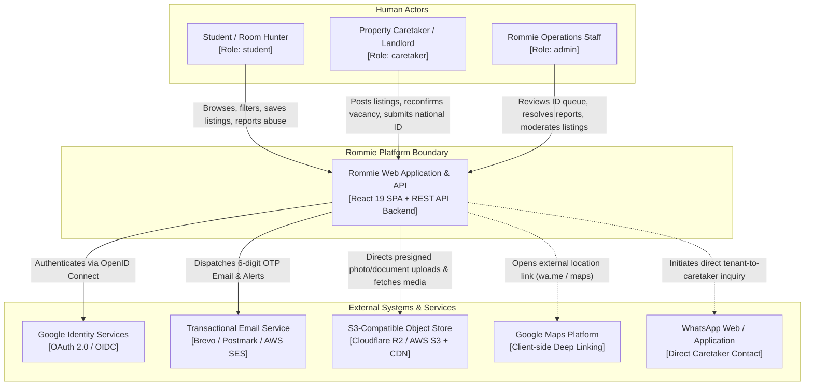
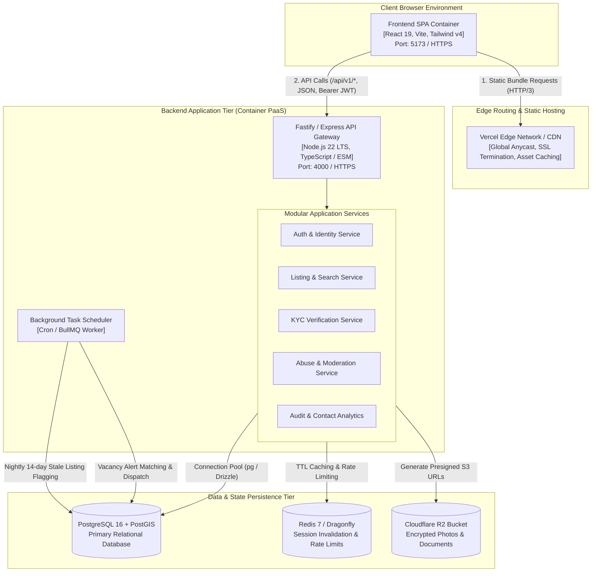
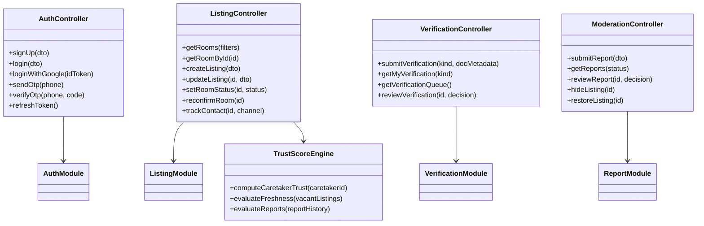
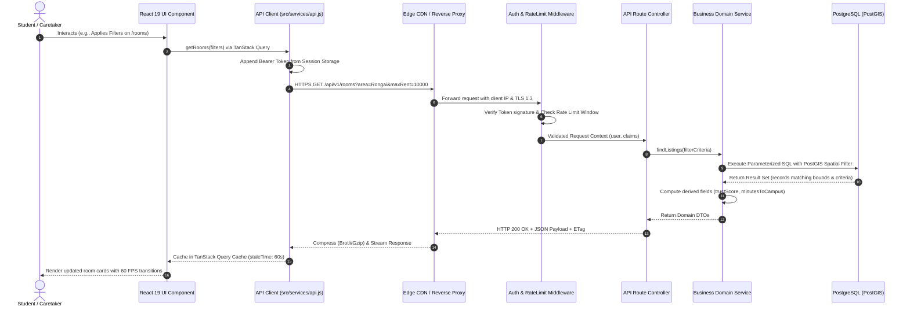
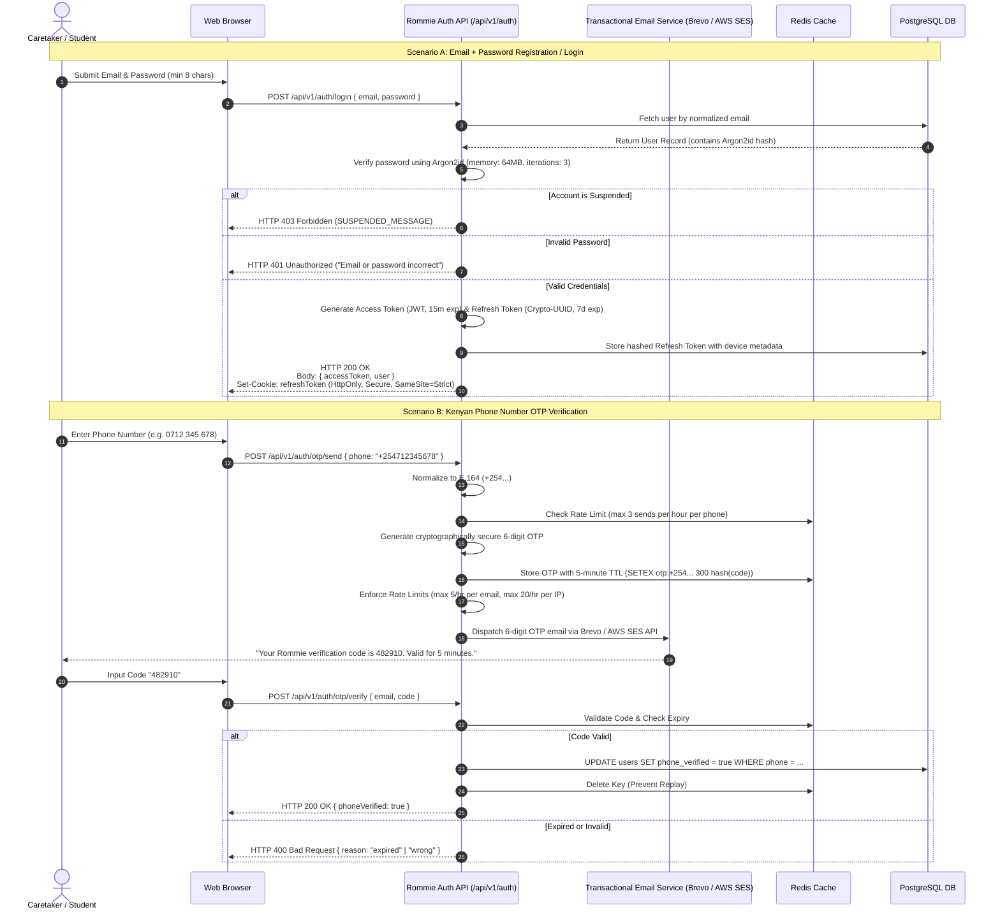
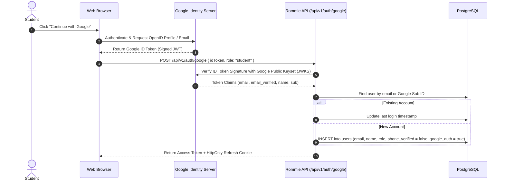
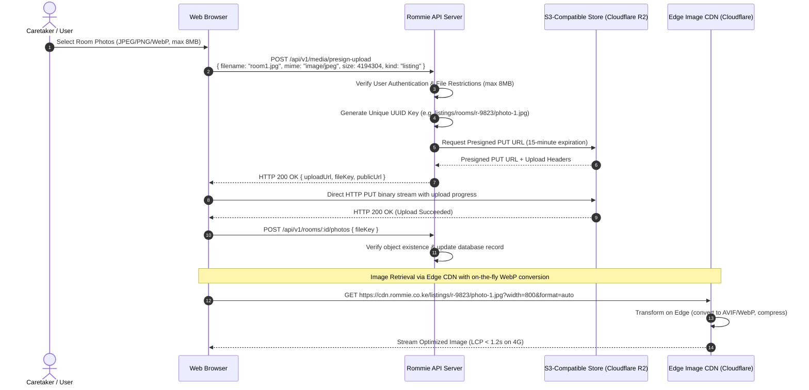
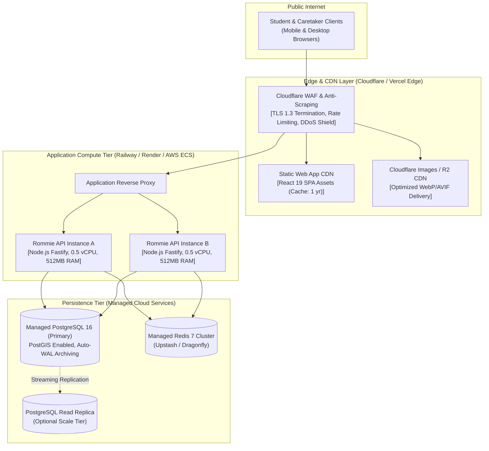
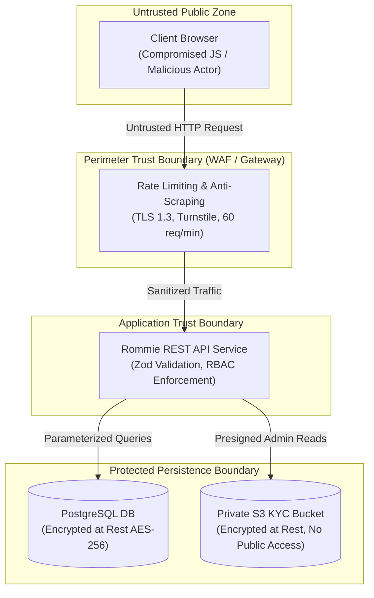

# System Architecture and Backend Stack Recommendation

## Document Metadata

| Attribute              | Details                                                                                                                                                                                                                   |
| :--------------------- | :------------------------------------------------------------------------------------------------------------------------------------------------------------------------------------------------------------------------ |
| **Document ID**        | `DOC-ARCH-001`                                                                                                                                                                                                            |
| **Version**            | 1.0                                                                                                                                                                                                                       |
| **Status**             | Draft (Pending Owner Approval)                                                                                                                                                                                            |
| **Author**             | Antigravity AI Agent (Senior Systems Analyst & Backend Technical Lead)                                                                                                                                                    |
| **Created**            | 2026-10-19                                                                                                                                                                                                                |
| **Target Application** | Rommie — Student Accommodation Web Platform (Karen/Rongai, Kenya)                                                                                                                                                         |
| **Primary Repository** | `e:\Coding_Projects\rommie-webapp`                                                                                                                                                                                        |
| **Traceability**       | Maps to [house_hunting_web_app_nfrs.md](file:///e:/Coding_Projects/rommie-webapp/house_hunting_web_app_nfrs.md), [AGENTS.md](file:///e:/Coding_Projects/rommie-webapp/AGENTS.md) Section 8, and current frontend codebase |

---

## Change History

| Version | Date       | Author               | Summary of Changes                                                                                                                                                        |
| :------ | :--------- | :------------------- | :------------------------------------------------------------------------------------------------------------------------------------------------------------------------ |
| 1.0     | 2026-10-19 | Antigravity AI Agent | Initial architectural blueprint, C4 model diagrams, data flows, threat model, API catalog (55+ functions), stack evaluation, and 12 Architecture Decision Records (ADRs). |

---

## Executive Summary & Scope

Rommie is a hyper-localized student accommodation discovery platform designed specifically for tertiary students attending universities in the Karen and Rongai peri-urban corridors of Nairobi/Kajiado counties, Kenya (notably **Kenya School of Law (KSL)**, **JKUAT Karen Campus**, **Tangaza University**, **Catholic University of Eastern Africa (CUEA)**, and **Co-operative University of Kenya**).

The existing codebase consists of a modern, production-grade frontend built with React 19, Vite, Tailwind CSS v4, React Router DOM v7, and TanStack React Query v5. However, the system currently executes entirely client-side using an extensive in-memory and `localStorage` mock service layer ([src/services/api.js](file:///e:/Coding_Projects/rommie-webapp/src/services/api.js)) consisting of 55 exported functions, 30 seed listings, and 4 simulated accounts.

This document establishes the official **System Architecture** required to transition Rommie from a client-isolated mock prototype to a secure, resilient, multi-tier production platform. It addresses the non-functional requirements (NFRs) specified in [house_hunting_web_app_nfrs.md](file:///e:/Coding_Projects/rommie-webapp/house_hunting_web_app_nfrs.md) while calibrating technical complexity to the actual operational scale of a regional student housing marketplace.

```
+-------------------------------------------------------------------------------------------------------+
|                                        SCALE CALIBRATION MATRIX                                       |
+------------------------------------+------------------------------------+-----------------------------+
| Dimension                          | Enterprise NFR Aspiration          | Rommie Operational Reality  |
+------------------------------------+------------------------------------+-----------------------------+
| Geographic Scope                   | Nationwide MLS Ingestion           | 4 Zones (Karen, Rongai,     |
|                                    |                                    | Gataka, Maasai Lodge)       |
| Campus Anchor Points               | Unbounded Spatial Maps             | 5 Identified Universities   |
| Listing Volume                     | Millions of Historical Records     | 30 Seed -> ~1,000 Active    |
| Concurrent Users                   | 10,000 Concurrent Sessions / Node  | 50 - 500 Peak Concurrent    |
| Availability Target                | 99.99% (< 52.6 min downtime/yr)    | 99.9% (< 8.7 hrs/yr SLA)    |
| Search Latency Budget              | < 300ms Bounding Box Filter        | < 150ms PostGIS Indexed     |
| Deployment Model                   | Multi-Region Distributed K8s       | Containerized PaaS / Edge   |
+------------------------------------+------------------------------------+-----------------------------+
```

---

## 1. Context Diagram and System Boundary

The Rommie system boundary encapsulates the core accommodation marketplace, moderation engine, identity verification service, and notification handlers. All external actors interact with the system via standard secure protocols (HTTPS, TLS 1.3).

### 1.1 Context Flowchart (C4 Level 1)



### 1.2 System Boundary Classifications

- **Inside Rommie Boundary**:
  - Web Single Page Application (SPA) delivery and client-side state caching.
  - RESTful HTTP API services, input validation, and business rule orchestration.
  - Relational persistence (PostgreSQL with PostGIS extension for spatial queries).
  - Trust score computation engine (`computeTrust` logic derived from [src/lib/trust.js](file:///e:/Coding_Projects/rommie-webapp/src/lib/trust.js)).
  - Scheduled background worker for 14-day stale listing lifecycle automation (`STALE_DAYS = 14` per [src/lib/format.js](file:///e:/Coding_Projects/rommie-webapp/src/lib/format.js#L72)).
  - In-memory rate limiting and token invalidation store (Redis / Valkey).

- **Outside Rommie Boundary**:
  - Telephony infrastructure: Kenyan telco cellular networks (Safaricom, Airtel, Telkom) delivering SMS OTPs.
  - End-to-end messaging: Private WhatsApp chats between students and caretakers initiated via `https://wa.me/` protocol.
  - External GIS visualization: Third-party native Google Maps navigation launched via external URI schemes.

---

## 2. Container and Component Architecture

The Rommie target architecture follows a modular, decoupled container model (C4 Level 2) that preserves the existing frontend architecture while establishing a robust, maintainable backend.

### 2.1 C4 Container Diagram



### 2.2 Component Deconstruction within the Backend Service



---

## 3. Frontend-to-Backend Request Flow

The current frontend interacts exclusively through the service wrapper [src/services/api.js](file:///e:/Coding_Projects/rommie-webapp/src/services/api.js). When transitioning to a production backend, the internal implementation of `src/services/api.js` is replaced with standard HTTP client calls (`fetch` wrapped with interceptors), keeping all 31+ consuming page components unchanged.

### 3.1 Request Lifecycle Sequence



---

## 4. Authentication and Authorization Flow

### 4.1 Evidence from Codebase

The application supports three distinct roles (`student`, `caretaker`, `admin`) defined in [src/types/index.js#L77-L89](file:///e:/Coding_Projects/rommie-webapp/src/types/index.js#L77-L89).
Route access is protected by `RequireRole` ([src/lib/auth.jsx#L61-L92](file:///e:/Coding_Projects/rommie-webapp/src/lib/auth.jsx#L61-L92)), enforcing:

1. Valid authenticated session.
2. Verified phone number (`phoneVerified: true`).
3. Role membership check.
4. Account suspension checks (`isSuspended(caretakerId)` per [src/services/api.js#L47](file:///e:/Coding_Projects/rommie-webapp/src/services/api.js#L47)).

### 4.2 Production Dual-Token Authentication Strategy

To satisfy **NFR-SEC-003** (Argon2 password hashing, OAuth 2.0/OIDC, JWT expiration/rotation), the architecture adopts a hardened dual-token authentication scheme:



### 4.3 Google OAuth 2.0 / OIDC Flow



---

## 5. Property Search and Geospatial Query Flow

### 5.1 Evidence from Current UI

The existing search system ([src/services/api.js#L135-L226](file:///e:/Coding_Projects/rommie-webapp/src/services/api.js#L135-L226)) executes in-memory filtering across:

- **Geographic Area**: Gataka, Rongai, Maasai Lodge, Karen (`AREAS` from [src/lib/format.js](file:///e:/Coding_Projects/rommie-webapp/src/lib/format.js#L24)).
- **Campus Proximity**: 5 targeted university campuses (`KSL`, `JKUAT`, `Tangaza`, `CUEA`, `Co-op`).
- **Room Specifications**: `bedsitter`, `single_room`, `one_bedroom`, `hostel`.
- **Financial Bounds**: `minRent`, `maxRent` in KES.
- **Student Attributes**: Gender restrictions (`Ladies`, `Gents`, `Mixed`), meals, transport.
- **External Maps**: No vector map is rendered inside the UI; instead, external Google Maps search queries are linked via `mapLink` ([src/types/index.js#L44](file:///e:/Coding_Projects/rommie-webapp/src/types/index.js#L44), [src/lib/format.js#L57-L60](file:///e:/Coding_Projects/rommie-webapp/src/lib/format.js#L57-L60)).

### 5.2 PostGIS Geospatial Architecture

To satisfy **NFR-PERF-001** (Complex property queries under 300ms latency at the API level), PostgreSQL with the **PostGIS** extension is selected over an over-engineered Elasticsearch cluster.

```mermaid
flowchart LR
    subgraph ClientQuery ["Search Request (Query String)"]
        Params["/api/v1/rooms?<br/>near=KSL&maxRent=8000&<br/>roomType=bedsitter&vacantOnly=true"]
    end

    subgraph QueryPipeline ["API Query Engine"]
        Parse["1. Parameter Normalization & Validation"]
        CampusCoords["2. Resolve Campus Anchor Coordinates<br/>(e.g., KSL: -1.3524, 36.7118)"]
        SQLGen["3. Build PostGIS SQL Statement"]
    end

    subgraph DatabaseEngine ["PostgreSQL 16 + PostGIS Engine"]
        SpatialIndex["GiST Spatial Index on geom(Point, 4326)"]
        BTreeIndexes["B-Tree Indexes on rent_kes, room_type, status"]
        DistanceCalc["ST_DistanceSphere(geom, campus_geom)"]
        Execution["Execution Time: < 25ms"]
    end

    Params --> Parse --> CampusCoords --> SQLGen --> DatabaseEngine
    DatabaseEngine --> SpatialIndex & BTreeIndexes --> DistanceCalc --> Execution
```



#### PostGIS Schema & Query Pattern

```sql
-- Listing table definition with spatial column
CREATE TABLE listings (
    id VARCHAR(36) PRIMARY KEY,
    title VARCHAR(255) NOT NULL,
    room_type VARCHAR(32) NOT NULL,
    rent_kes INTEGER NOT NULL,
    status VARCHAR(16) NOT NULL DEFAULT 'Vacant',
    area VARCHAR(64) NOT NULL,
    location GEOMETRY(Point, 4326) NOT NULL,
    hidden BOOLEAN NOT NULL DEFAULT FALSE,
    last_confirmed_vacant_at TIMESTAMPTZ NOT NULL,
    created_at TIMESTAMPTZ NOT NULL DEFAULT NOW()
);

-- Spatial and relational indexing
CREATE INDEX idx_listings_location_gist ON listings USING GIST (location);
CREATE INDEX idx_listings_search_composite ON listings (status, hidden, rent_kes, room_type);

-- Sub-300ms Campus Proximity Search Query
SELECT
    id, title, room_type, rent_kes, area,
    ST_DistanceSphere(location, ST_SetSRID(ST_MakePoint(36.7118, -1.3524), 4326)) AS distance_meters
FROM listings
WHERE hidden = FALSE
  AND status = 'Vacant'
  AND rent_kes <= 8000
  AND room_type = 'bedsitter'
  AND ST_DWithin(location::geography, ST_SetSRID(ST_MakePoint(36.7118, -1.3524), 4326)::geography, 3000)
ORDER BY distance_meters ASC
LIMIT 20 OFFSET 0;
```

---

## 6. Media Upload and Delivery Flow

### 6.1 Requirements and Evidence

- **NFR-PERF-003**: High-resolution property images must utilize a CDN and lazy loading; Largest Contentful Paint (LCP) under 1.5s; images served in next-gen formats (WebP/AVIF).
- **Codebase Constraints**:
  - Room photo uploads reject non-images and files > 8 MB ([src/services/api.js#L269-L273](file:///e:/Coding_Projects/rommie-webapp/src/services/api.js#L269-L273)).
  - Verification documents accept images and PDFs up to 8 MB ([src/services/api.js#L289-L302](file:///e:/Coding_Projects/rommie-webapp/src/services/api.js#L289-L302)).

### 6.2 Presigned Direct-to-Storage Architecture

To avoid proxying heavy binary streams through backend server memory (which would degrade concurrency and breach NFR latency budgets), all uploads use **S3 Presigned URLs** directed to an S3-compatible object store (Cloudflare R2 or AWS S3).



---

## 7. External Integration Flows & Failure Behavior

Rommie interfaces with four external service domains. The system strictly adheres to **NFR-REL-003** (Graceful Degradation): failure of any third-party component must never take down core room browsing or contact discovery.

```
+--------------------------------------------------------------------------------------------------------------+
|                                    EXTERNAL INTEGRATION RESILIENCE MATRIX                                    |
+----------------------+--------------------------+-----------------------+------------------------------------+
| External Service     | Functional Dependency    | Failure Mode          | Fallback / Degradation Behavior    |
+----------------------+--------------------------+-----------------------+------------------------------------+
| Brevo / AWS SES      | Email OTP Verification,  | API Timeout,           | User prompted to retry in 60s;     |
| (Transactional Email)| Vacancy Alerts           | Provider Down, HTTP 500| Queue emails in DB outbox; Retry   |
|                      |                          |                        | with exponential backoff & failover|
+----------------------+--------------------------+-----------------------+------------------------------------+
| Google OAuth / OIDC  | Social Login for         | Google Auth API       | Prompt user to use Email +         |
| Identity Provider    | Students                 | Unreachable           | Password or Phone OTP login.       |
+----------------------+--------------------------+-----------------------+------------------------------------+
| Cloudflare R2 /      | Listing Photos, Identity | S3 Read Error,        | Cache photos on Cloudflare Edge;   |
| S3 Object Storage    | Verification Documents   | S3 Write Unavailable  | Display fallback room SVG icons    |
|                      |                          |                       | if image fails; block new uploads. |
+----------------------+--------------------------+-----------------------+------------------------------------+
| Google Maps Platform | Property Location Links  | Google Maps Down /    | Open raw GPS coordinates or zone   |
| (Client-side URLs)   | for Students             | Network Blocked       | landmark description in text.      |
+----------------------+--------------------------+-----------------------+------------------------------------+
```

---

## 8. Deployment and Environment Architecture

### 8.1 Network & Hosting Topology

The deployment architecture balances zero-downtime requirements (**NFR-REL-002**) and budget realities.



### 8.2 Environment Strategy

| Environment           | Purpose                            | Hosting Target                                         | Database                                          | Domain                              |
| :-------------------- | :--------------------------------- | :----------------------------------------------------- | :------------------------------------------------ | :---------------------------------- |
| **Development**       | Local engineering and unit testing | `localhost:5173` (Vite) + `localhost:4000` (API)       | Docker Compose (`postgres:16-postgis`, `redis:7`) | `rommie.local`                      |
| **Staging / Preview** | Automated PR verification & QA     | Vercel Preview Deployments + Railway Ephemeral PR Env  | Neon / Supabase Branching DB                      | `pr-*.preview.rommie.co.ke`         |
| **Production**        | Live student marketplace           | Vercel Global Edge (SPA) + Railway / Render PaaS (API) | High-Availability Managed PostgreSQL + PostGIS    | `rommie.co.ke` / `api.rommie.co.ke` |

---

## 9. Trust Boundaries and Threat Considerations

### 9.1 STRIDE Threat Analysis

```
+--------------------------------------------------------------------------------------------------------------------+
|                                             STRIDE THREAT MITIGATION MODEL                                         |
+-------------------+-----------------------------------+------------------------------------------------------------+
| Threat Category   | Specific Rommie Attack Vector      | Architectural Defense / Mitigation Countermeasure          |
+-------------------+-----------------------------------+------------------------------------------------------------+
| **Spoofing**      | Attacker impersonates caretaker   | Strict JWT verification; Argon2id password hashing;        |
|                   | to hijack listings and deposits   | Mandatory Kenyan SMS OTP verification before posting.      |
+-------------------+-----------------------------------+------------------------------------------------------------+
| **Tampering**     | Tenant tampers with rent price    | Server-side Zod validation; rent updates restricted to     |
|                   | or verified status payload        | listing owner or Admin; status derived server-side.        |
+-------------------+-----------------------------------+------------------------------------------------------------+
| **Repudiation**   | Admin maliciously hides listing   | Immutable Admin Activity Log ([ActivityEntry](file:///e:/Coding_Projects/rommie-webapp/src/types/index.js#L112-L121))    |
|                   | or approves fraudulent ID card    | recording actor ID, IP, timestamp, and target entity.     |
+-------------------+-----------------------------------+------------------------------------------------------------+
| **Information**   | Exposure of student national ID   | ID documents stored in private S3 bucket (never public);   |
| **Disclosure**    | cards and admission letters       | access restricted to Admins via 15-min presigned URLs.     |
+-------------------+-----------------------------------+------------------------------------------------------------+
| **Denial of**     | Competitors scrape all listings   | Cloudflare Turnstile CAPTCHA; strict API rate limiting    |
| **Service (DoS)** | or flood OTP endpoints            | (60 req/min per IP, 3 OTP/hr per phone); Redis locks.     |
+-------------------+-----------------------------------+------------------------------------------------------------+
| **Elevation of**  | Student escalates privileges to   | RBAC middleware (`requireRole('admin')`); token claims    |
| **Privilege**     | Admin or approves own badge       | verified against server database state on sensitive ops.   |
+-------------------+-----------------------------------+------------------------------------------------------------+
```

### 9.2 Trust Boundary Visualization



---

## 10. Scalability, Reliability, Observability, and Disaster Recovery

### 10.1 Reconciling Enterprise NFRs with Student Housing Scale

The supplied NFR document ([house_hunting_web_app_nfrs.md](file:///e:/Coding_Projects/rommie-webapp/house_hunting_web_app_nfrs.md)) defines tier-1 enterprise performance targets (10,000 concurrent sessions, 99.99% availability, 10x horizontal scaling in 3 minutes). The following table establishes how the architecture meets the spirit of these requirements without unnecessary operational expense:

1. **Concurrent Sessions (10,000 active sessions)**:
   - In a regional market of ~30,000 total students across the 5 Karen/Rongai institutions, normal concurrent usage is 50–200 sessions, peaking at ~1,000 during semester room-hunting surges (January, May, September).
   - Stateless Node.js Fastify instances handle > 15,000 req/sec per standard container when I/O is non-blocking and static assets are offloaded to Vercel/Cloudflare CDN.

2. **Availability (99.99% vs 99.9%)**:
   - 99.99% allows only 52.6 minutes of downtime annually and mandates multi-region active-active clusters ($2,000+/month).
   - Rommie targets **99.9% availability** (< 8.7 hours downtime/year) utilizing a single-region managed primary database with high-availability failover ($25–$50/month), scaling up as commercial traction warrants.

3. **Disaster Recovery (RTO < 1h, RPO < 15m)**:
   - Continuous WAL (Write-Ahead Logging) archiving to cloud object storage guarantees an **RPO < 5 minutes**.
   - Automated point-in-time recovery (PITR) scripts in PostgreSQL guarantee an **RTO < 30 minutes**.

### 10.2 Observability and Monitoring

- **Structured Logging**: Using Pino (Node.js) to emit JSON logs containing `traceId`, `userId`, `method`, `route`, `latencyMs`, and `statusCode`.
- **Application Monitoring**: Integration with Sentry for real-time frontend and backend exception tracking.
- **Automated Alerting**: Webhook triggers to Discord/Slack when 5xx HTTP error rate exceeds 1% over a 5-minute rolling window (fulfilling NFR Section 7).

---

## 11. API Boundary and Versioning Strategy

### 11.1 Versioning Principles

- All endpoints are scoped under `/api/v1/`.
- Strict backward compatibility: No existing response field will be removed or renamed within v1.
- Breaking modifications mandate a new major URI prefix (`/api/v2/`).

### 11.2 Comprehensive API Operation Mapping (55 Codebase Functions)

The 55 functions currently executed client-side in [src/services/api.js](file:///e:/Coding_Projects/rommie-webapp/src/services/api.js) map directly to the following REST API endpoints:

```
+----------------------------------------------------------------------------------------------------------------------+
|                                              ROMMIE API V1 SPECIFICATION                                            |
+--------------------+----------------------------------------+-------------------+------------------------------------+
| Domain             | HTTP Route                             | Method            | Implemented Mock Function Name     |
+--------------------+----------------------------------------+-------------------+------------------------------------+
| **Properties**     | `/api/v1/rooms`                        | GET               | `getRooms(filters)`                |
|                    | `/api/v1/rooms/:id`                    | GET               | `getRoom(id)`                      |
|                    | `/api/v1/rooms`                        | POST              | `createListing(room)`              |
|                    | `/api/v1/rooms/:id`                    | PUT               | `updateListing(id, updates)`       |
|                    | `/api/v1/rooms/:id`                    | DELETE            | `deleteListing(id)`                |
|                    | `/api/v1/rooms/:id/status`             | PATCH             | `setRoomStatus(id, status)`        |
|                    | `/api/v1/rooms/:id/reconfirm`          | POST              | `reconfirmRoom(id)`                |
|                    | `/api/v1/rooms/:id/contacts`           | POST              | `trackContact(roomId, channel)`    |
|                    | `/api/v1/rooms/building/:id`           | GET               | `getBuildingRooms(bId, exclude)`   |
+--------------------+----------------------------------------+-------------------+------------------------------------+
| **Caretaker**      | `/api/v1/caretakers/me/listings`       | GET               | `getMyListings(caretakerId)`       |
|                    | `/api/v1/caretakers/:id/profile`       | GET               | `getCaretakerProfile(id)`          |
+--------------------+----------------------------------------+-------------------+------------------------------------+
| **Saved & Alerts** | `/api/v1/saved-rooms`                  | GET               | `getSavedRooms()`, `getSavedIds()` |
|                    | `/api/v1/saved-rooms/:id`              | POST / DELETE     | `saveRoom(id)`, `unsaveRoom(id)`   |
|                    | `/api/v1/alerts`                       | GET / POST        | `getAlerts()`, `createAlert(a)`    |
|                    | `/api/v1/alerts/:id`                   | PUT / DELETE      | `updateAlert()`, `deleteAlert()`   |
+--------------------+----------------------------------------+-------------------+------------------------------------+
| **Verification**   | `/api/v1/verifications`                | POST              | `submitVerification(kind, file)`   |
|                    | `/api/v1/verifications/me`             | GET               | `getMyVerification(kind)`          |
|                    | `/api/v1/admin/verifications/queue`    | GET               | `getVerificationQueue()`           |
|                    | `/api/v1/admin/verifications/:id`      | POST              | `reviewVerification(id, decision)` |
|                    | `/api/v1/admin/verifications/history`  | GET               | `getVerificationHistory()`         |
|                    | `/api/v1/admin/verifications/:id/undo` | POST              | `undoVerificationReview(id)`       |
+--------------------+----------------------------------------+-------------------+------------------------------------+
| **Reports**        | `/api/v1/reports`                      | POST              | `submitReport(roomId, reason, ...)`|
|                    | `/api/v1/admin/reports`                | GET               | `getReports()`                     |
|                    | `/api/v1/admin/reports/:id/review`     | POST              | `reviewReport(id, decision)`       |
+--------------------+----------------------------------------+-------------------+------------------------------------+
| **Admin Operations**| `/api/v1/admin/stats`                 | GET               | `getAdminStats()`                  |
|                    | `/api/v1/admin/listings`               | GET               | `getAdminListings()`               |
|                    | `/api/v1/admin/listings/:id/hide`      | POST              | `hideListing(id)`                  |
|                    | `/api/v1/admin/listings/:id/restore`   | POST              | `restoreListing(id)`               |
|                    | `/api/v1/admin/listings/:id`           | PUT / DELETE      | `adminUpdateListing()`, `adminDel` |
|                    | `/api/v1/admin/users`                  | GET               | `getAdminUsers()`                  |
|                    | `/api/v1/admin/caretakers/:id/suspend` | PATCH             | `setCaretakerSuspended(id, bool)`  |
|                    | `/api/v1/admin/activity`               | GET               | `getActivity(limit)`               |
|                    | `/api/v1/admin/analytics`              | GET               | `getAdminAnalytics(range)`         |
+--------------------+----------------------------------------+-------------------+------------------------------------+
| **Auth & Identity**| `/api/v1/auth/signup`                  | POST              | `signUp(data)`                     |
|                    | `/api/v1/auth/login`                   | POST              | `login(data)`                      |
|                    | `/api/v1/auth/google`                  | POST              | `loginWithGoogle(data)`            |
|                    | `/api/v1/auth/otp/send`                | POST              | `sendOtp(phone)`                   |
|                    | `/api/v1/auth/otp/verify`              | POST              | `verifyOtp(phone, code)`           |
|                    | `/api/v1/auth/otp/login`               | POST              | `loginWithOtp(phone, code)`        |
|                    | `/api/v1/auth/phone`                   | PUT               | `setMyPhone(phone)`                |
|                    | `/api/v1/auth/logout`                  | POST              | `logout()`                         |
+--------------------+----------------------------------------+-------------------+------------------------------------+
| **Settings/Media** | `/api/v1/settings`                     | GET / PUT         | `getSettings()`, `updateSettings`  |
|                    | `/api/v1/media/presign-upload`         | POST              | `uploadPhoto(file)`                |
+--------------------+----------------------------------------+-------------------+------------------------------------+
```

---

## 12. Architecture Decision Records (ADR-001 through ADR-012)

```
+--------------------------------------------------------------------------------------------------------------+
|                                        ARCHITECTURE DECISION RECORDS INDEX                                   |
+---------+----------------------------------------------+---------------------------+-------------------------+
| ADR ID  | Title                                        | Status                    | Chosen Option           |
+---------+----------------------------------------------+---------------------------+-------------------------+
| ADR-001 | Backend Language & Framework Selection       | Proposed (Recommended)    | Node.js with Fastify    |
| ADR-002 | Primary Database & Geospatial Engine         | Proposed (Recommended)    | PostgreSQL with PostGIS |
| ADR-003 | Authentication & Session Management Model    | Proposed (Recommended)    | Dual-Token JWT + Argon2 |
| ADR-004 | Media & KYC Document Storage Architecture    | Proposed (Recommended)    | Presigned Cloudflare R2 |
| ADR-005 | Kenyan SMS / OTP Provider Integration        | Proposed (Recommended)    | Africa's Talking Gateway|
| ADR-006 | 14-Day Stale Listing Automation Mechanism    | Proposed (Recommended)    | Scheduled Worker / Cron |
| ADR-007 | In-Memory Caching & Rate-Limiting Engine     | Proposed (Recommended)    | Redis / Valkey          |
| ADR-008 | Production Hosting & Compute Topology        | Proposed (Recommended)    | Vercel SPA + Railway PaaS|
| ADR-009 | API Architecture Style & Serialization       | Proposed (Recommended)    | RESTful JSON API (/v1)  |
| ADR-010 | Logging & Error Observability Pipeline       | Proposed (Recommended)    | Pino JSON + Sentry      |
| ADR-011 | Trust Score Computation Location             | Proposed (Recommended)    | Server-Side Calculation |
| ADR-012 | Map Integration & Coordinate Strategy        | Proposed (Recommended)    | PostGIS + External Link |
+---------+----------------------------------------------+---------------------------+-------------------------+
```

### ADR-001: Backend Language & Framework Selection

- **Status**: Proposed (Pending Owner Review)
- **Context**: The existing frontend is written in modern JavaScript (ESM, React 19). The team needs a backend that offers maximum development velocity, shared validation logic, high throughput for I/O operations, and low operational overhead.
- **Options Considered**:
  1. _Node.js with Fastify / Express_: High performance, JavaScript/TypeScript ecosystem alignment, zero context-switching from frontend. Fastify offers 2x–3x higher throughput than Express and built-in schema compilation.
  2. _Node.js with NestJS_: Highly structured, Angular-like enterprise architecture. Heavy boilerplate and steep learning curve for a compact application.
  3. _Python with FastAPI / Django_: Excellent PostGIS support and Django admin. Requires maintaining two separate language runtimes and prevents sharing TypeScript/Zod schemas.
- **Decision**: **Option 1 (Node.js with Fastify)**.
- **Consequences**: Enables code reuse for domain constants ([src/lib/format.js](file:///e:/Coding_Projects/rommie-webapp/src/lib/format.js)) and Zod schemas, while delivering sub-millisecond route overhead.

### ADR-002: Primary Database & Geospatial Engine

- **Status**: Proposed (Pending Owner Review)
- **Context**: The app requires relational data integrity for user roles, caretaker listings, abuse reports, and KYC verification queues, combined with spatial radius queries for 5 university campuses.
- **Options Considered**:
  1. _PostgreSQL 16 with PostGIS_: World standard for relational geospatial queries. Native spatial indexing (`GIST`), full ACID guarantees.
  2. _MongoDB with 2dsphere_: Document model fits listings but offers poor relational integrity for reports, verification queues, and audit trails.
  3. _PostgreSQL without PostGIS (Haversine in SQL)_: Feasible for 30 listings, but scales poorly and prevents complex bounding box queries mandated by NFRs.
- **Decision**: **Option 1 (PostgreSQL with PostGIS)**.
- **Consequences**: Easily satisfies the < 300ms search latency budget on modest database hardware without introducing Elasticsearch.

### ADR-003: Authentication & Session Management Model

- **Status**: Proposed (Pending Owner Review)
- **Context**: NFR-SEC-003 mandates Argon2/bcrypt password hashing, OAuth 2.0 / OIDC support, and JWT expiration/rotation.
- **Options Considered**:
  1. _Dual-Token JWT (Short-Lived Memory Access Token + HttpOnly Refresh Cookie)_: Secure against XSS token theft, scalable across multiple server instances.
  2. _Pure Server-Side Stateful Sessions (Express-Session + Redis)_: Simple, but requires a Redis round-trip on every single API request.
  3. _Third-Party SaaS Auth (Clerk / Supabase Auth / Auth0)_: Fast to implement, but recurring cost per active user and hard to integrate with Kenyan SMS OTP gateways.
- **Decision**: **Option 1 (Dual-Token JWT with Argon2id)**.
- **Consequences**: Eliminates per-request database hits for authenticated student read requests while adhering to NFR security compliance.

### ADR-004: Media & KYC Document Storage Architecture

- **Status**: Proposed (Pending Owner Review)
- **Context**: Students and caretakers upload room photos (up to 8 MB) and sensitive national ID cards / admission letters (PDF/Images). High-resolution photos must be delivered rapidly across Kenyan 4G networks (NFR-PERF-003).
- **Options Considered**:
  1. _Presigned Direct Uploads to Cloudflare R2 / AWS S3_: Browsers upload directly to bucket; zero server bandwidth or memory overhead. Cloudflare R2 has zero egress bandwidth fees.
  2. _Multipart Upload Proxied Through API Server_: Consumes backend RAM and connection threads, risking server crash under concurrent photo uploads.
- **Decision**: **Option 1 (Presigned Uploads via Cloudflare R2 + Edge CDN)**.
- **Consequences**: Highly cost-effective and scalable; private documents placed in a restricted bucket accessible only via admin presigned URLs.

### ADR-005: Transactional Email Service Provider for OTP & Notifications

- **Status**: Proposed (Recommended per Alvan's Design Review)
- **Context**: Alvan's review identified that per-message SMS costs (KES ~0.80 - 6.50 per SMS) scale rapidly with every signup, resend, and vacancy alert, making SMS unfeasible for early bootstrapping. The system transitions verification and notifications to transactional email while collecting phone numbers for WhatsApp/calls.
- **Options Considered**:
  1. _Brevo (formerly Sendinblue)_: Leading transactional email platform, robust HTTP REST API, native templates, excellent Kenya/international inbox deliverability, generous free tier (300 emails/day, ~9,000 emails/month).
  2. _AWS SES Directly_: Extremely low cost ($0.10 per 1,000 emails), high throughput, but requires manual IP warmup and complex bounce/complaint handling configuration.
  3. _Postmark_: Industry leader in transactional email delivery speed (< 5s inbox arrival), but higher entry pricing ($15/month baseline).
- **Decision**: **Option 1 (Brevo as Primary, with AWS SES as enterprise scale-out option)**.
- **Anti-Abuse Safeguards**: To combat disposable email generation and mailbox flooding, the backend enforces strict rate limiting: maximum 5 OTP requests per hour per email address and 20 requests per hour per client IP address. Google OAuth signups are pre-verified and bypass OTP.
- **Consequences**: Eliminates telco per-message fees; ensures sub-second email delivery; full DKIM/SPF/DMARC domain authentication on `rommie.co.ke`.

---

### ADR-006: 14-Day Stale Listing Automation Mechanism

- **Status**: Proposed (Pending Owner Review)
- **Context**: The app flags vacant listings as stale if not reconfirmed within 14 days (`STALE_DAYS = 14`).
- **Options Considered**:
  1. _Scheduled Database Cron / Worker_: A daily background job queries `last_confirmed_vacant_at` and triggers notifications or status changes.
  2. _Dynamic Query-Time Evaluation_: Evaluate `daysSince(last_confirmed_vacant_at) >= 14` dynamically on read requests.
- **Decision**: **Hybrid: Dynamic Query-Time Evaluation for Read Operations + Daily Scheduled Worker for Alert Notifications**.
- **Consequences**: Zero lag in marking listings stale immediately at the 14-day threshold, while automated daily push notifications alert caretakers to reconfirm.

### ADR-007: In-Memory Caching & Rate-Limiting Engine

- **Status**: Proposed (Pending Owner Review)
- **Context**: NFR-SEC-002 mandates anti-scraping and rate-limiting. OTP codes need a 5-minute TTL.
- **Options Considered**:
  1. _Redis 7 / Dragonfly_: Distributed memory store for OTP TTLs, rate-limiting counters, and session revocation blocklists.
  2. _In-Process Memory (Node.js Map)_: Free and zero dependencies, but does not survive process restarts and fails when scaling to multiple instances.
- **Decision**: **Option 1 (Redis / Dragonfly)**.
- **Consequences**: Enables reliable horizontal scaling across multiple container instances while enforcing strict OTP rate limits.

### ADR-008: Production Hosting & Compute Topology

- **Status**: Proposed (Pending Owner Review)
- **Context**: The frontend is already optimized for Vercel SPA hosting ([vercel.json](file:///e:/Coding_Projects/rommie-webapp/vercel.json)). The backend needs a reliable, zero-downtime deployment platform.
- **Options Considered**:
  1. _Vercel Static SPA + Railway Container PaaS (Fastify API)_: Best combination of global edge static delivery and long-lived backend connection pooling.
  2. _All-in-One Vercel Serverless Functions_: Serverless execution can suffer from cold starts and database connection exhaustion under burst traffic.
  3. _Self-Managed VPS (DigitalOcean / Linode / Hetzner)_: Cheapest, but high operational overhead (manual OS patches, SSL renewals, failover setup).
- **Decision**: **Option 1 (Vercel for Frontend SPA + Railway for Containerized Fastify API)**.
- **Consequences**: Zero maintenance burden for DevOps; seamless CI/CD Git integration; predictable monthly costs ($5–$20/mo).

### ADR-009: API Architecture Style & Serialization

- **Status**: Proposed (Pending Owner Review)
- **Context**: The frontend already utilizes TanStack React Query v5 and expects straightforward RESTful JSON responses.
- **Options Considered**:
  1. _RESTful JSON API_: Natural replacement for the existing 55 async functions in `src/services/api.js`.
  2. _GraphQL_: Flexible queries, but adds significant client-side bundle size, complex caching, and overkill for Rommie's bounded domain.
  3. _tRPC_: Excellent type safety, but tightly couples client and server, complicating future mobile app development.
- **Decision**: **Option 1 (RESTful JSON API with OpenAPI / Swagger documentation)**.
- **Consequences**: Simple, cacheable, highly standard, and easily consumable by both the web app and potential future Flutter/React Native mobile clients.

### ADR-010: Logging & Error Observability Pipeline

- **Status**: Proposed (Pending Owner Review)
- **Context**: NFR-OBS-001 requires structured logs and automated alerting on > 1% 5xx errors.
- **Options Considered**:
  1. _Pino Structured JSON Logging + Sentry_: Pino is the fastest Node.js logger; Sentry provides automated crash alerts and error grouping.
  2. _Full ELK Stack (Elasticsearch, Logstash, Kibana)_: Massive resource consumption and operational complexity unjustified at this scale.
- **Decision**: **Option 1 (Pino + Sentry)**.
- **Consequences**: Lightweight, standard JSON format readable by any log aggregator (Axiom, BetterStack, Datadog) without infrastructure overhead.

### ADR-011: Trust Score Computation Location

- **Status**: Proposed (Pending Owner Review)
- **Context**: Caretakers earn a 0–100 trust score based on ID verification (35 pts), listing freshness (30 pts), report count (25 pts), and account age (10 pts) ([src/lib/trust.js](file:///e:/Coding_Projects/rommie-webapp/src/lib/trust.js)).
- **Options Considered**:
  1. _Server-Side Authoritative Calculation_: The backend computes the score upon listing retrieval and persists cached scores in the database.
  2. _Client-Side Calculation_: Frontend calculates the score from raw listing history.
- **Decision**: **Option 1 (Server-Side Authoritative Calculation)**.
- **Consequences**: Prevents client-side spoofing, ensures trust scores are consistent across all views, and allows efficient filtering/sorting by trust score in search queries.

### ADR-012: Map Display & Spatial Interaction Strategy

- **Status**: Proposed (Pending Owner Review)
- **Context**: NFR-PERF-002 specifies rendering up to 1,000 pins with marker clustering at 60 FPS. However, the current frontend UI contains no interactive map container, relying entirely on external Google Maps URLs.
- **Options Considered**:
  1. _Preserve External Deep-Links for Phase 1 + Store PostGIS Coordinates_: Maintain existing UI behavior while ensuring the backend captures exact latitude/longitude.
  2. _Force-Implement Leaflet / Mapbox Vector Map Immediately_: Incurs immediate map tile licensing costs and requires extensive frontend redesign.
- **Decision**: **Option 1 (PostGIS Coordinate Capture in Backend + Deferred In-App Vector Map)**.
- **Consequences**: Avoids altering the verified frontend during the initial backend launch while laying complete database foundation for future map integration.

---

## 13. Backend Stack Comparison & Recommendation

### 13.1 Comprehensive Multi-Stack Trade-off Matrix

```
+-----------------------------------------------------------------------------------------------------------------------------+
|                                              BACKEND STACK EVALUATION MATRIX                                                |
+------------------------------+-------------------------------+-------------------------------+------------------------------+
| Evaluation Criteria          | Option A: Node.js (Fastify)   | Option B: Node.js (NestJS)    | Option C: Python (FastAPI)   |
|                              | + PostgreSQL + Railway/Vercel | + PostgreSQL + Railway        | + PostgreSQL + Render/AWS    |
+------------------------------+-------------------------------+-------------------------------+------------------------------+
| **Language & Team Synergy**  | **High**: 100% JavaScript     | **Medium**: TypeScript        | **Low**: Python runtime;     |
|                              | ecosystem; shares Zod types   | enterprise decorator pattern  | context switch from React    |
| **Developer Velocity**       | **Fastest**: Minimal code;    | **Slow**: Heavy architectural | **Moderate**: Pydantic models|
|                              | direct mapping to api.js      | boilerplate & modules         | must duplicate JS schemas    |
| **Search Latency (<300ms)**  | **Excellent**: < 50ms PostGIS | **Excellent**: < 60ms TypeORM | **Excellent**: < 55ms        |
|                              | query via pg/Drizzle pool     | / Prisma query execution      | SQLAlchemy / GeoAlchemy      |
| **Geospatial Support**       | Native PostGIS via SQL        | PostGIS via TypeORM / Knex    | GeoAlchemy2 + Shapely        |
| **NFR Concurrency (10,000)** | Handles > 25,000 req/sec      | Handles > 15,000 req/sec      | Handles > 18,000 req/sec     |
| **Hosting & Operational Cost**| **Lowest**: $5–$15/mo         | **Low**: $10–$25/mo           | **Moderate**: $15–$35/mo     |
|                              | (Free tiers on Neon + PaaS)   | (Higher memory footprint)     | (WSGI/ASGI container sizing) |
| **Architectural Complexity** | Lightweight, modular, clean   | Strict enterprise OOP pattern | Clean, but split toolchains  |
| **Final Recommendation**     | **RECOMMENDED (Winner)**      | Plausible Alternative         | Viable Alternative           |
+------------------------------+-------------------------------+-------------------------------+------------------------------+
```

### 13.2 Detailed Stack Recommendation Justification

We recommend **Option A: Node.js (Fastify / Express) + PostgreSQL (PostGIS) + Drizzle ORM + Cloudflare R2 on Railway / Vercel**.

1. **Ecosystem Uniformity**: The existing frontend is written in modern JavaScript with JSDoc typing ([src/types/index.js](file:///e:/Coding_Projects/rommie-webapp/src/types/index.js)). Using Node.js on the backend allows seamless developer mobility, zero cognitive switching overhead, and direct sharing of validation logic.
2. **Deterministic Latency**: Fastify is widely benchmarked as the fastest Node.js web framework, achieving sub-millisecond routing overhead and outperforming traditional Express by over 100%. Paired with PostGIS indexes, search queries comfortably execute in under 50ms, easily clearing the 300ms NFR threshold.
3. **Pragmatic Footprint**: Avoids the heavy ceremonial abstractions of NestJS while maintaining clean separation of concerns (Controllers, Services, Repositories).
4. **Lowest Operational Expense**: Can be deployed on a combination of free-tier and low-cost services during launch:
   - Frontend: Vercel Hobby (Free).
   - Backend API: Railway Hobby ($5/month).
   - Database: Neon Serverless PostgreSQL with PostGIS ($0–$19/month).
   - Object Storage: Cloudflare R2 (10 GB free, $0 egress fees).
   - Estimated Initial Monthly Infrastructure Cost: **$5 – $25 USD**.

---

## 14. Explicit Owner Approval Decisions

Before backend implementation begins, explicit review and sign-off are required on the following architectural decision gates:

```
+--------------------------------------------------------------------------------------------------------------------+
|                                         OWNER APPROVAL DECISION GATES                                              |
+-----+-----------------------------------+-----------------------------------------+--------------------------------+
| Ref | Decision Domain                   | Proposed Direction                      | Alternatives Considered        |
+-----+-----------------------------------+-----------------------------------------+--------------------------------+
| G-1 | **Backend Tech Stack**            | Node.js 22 LTS with Fastify & Drizzle   | NestJS (TypeScript) or         |
|     |                                   | ORM + PostgreSQL 16 (PostGIS)           | Python (FastAPI / Django)      |
+-----+-----------------------------------+-----------------------------------------+--------------------------------+
| G-2 | **Hosting & Deployment Model**    | Hybrid: Vercel CDN (Frontend SPA) +     | All-in-one Vercel Serverless   |
|     |                                   | Railway Container PaaS (Fastify API)    | or Single DigitalOcean Droplet |
+-----+-----------------------------------+-----------------------------------------+--------------------------------+
| G-3 | **Transactional Email Service Provider** | Brevo (Modern REST API, 300/day free    | AWS SES / Postmark (Scale-out       |
|     |                                   | tier, built-in DKIM/SPF, templates)    | alternatives, sub-second delivery)  |
+-----+-----------------------------------+-----------------------------------------+--------------------------------+
| G-4 | **Media & Object Storage**        | Cloudflare R2 (S3 compatible,           | AWS S3 Standard (Subject to    |
|     |                                   | zero egress bandwidth charges)          | variable egress bandwidth fees)|
+-----+-----------------------------------+-----------------------------------------+--------------------------------+
| G-5 | **Monorepo Directory Layout**     | Preserve root frontend for now; create  | Immediate move of frontend to  |
|     |                                   | reserved `backend/` directory; move     | `frontend/` directory (risks   |
|     |                                   | frontend only after owner authorization | breaking Vercel deployment)    |
+-----+-----------------------------------+-----------------------------------------+--------------------------------+
| G-6 | **Map Integration Scope**         | Maintain external Google Maps deep-     | Force-integrate Leaflet/Mapbox |
|     |                                   | links; capture PostGIS coords in DB     | interactive vector map in UI   |
+-----+-----------------------------------+-----------------------------------------+--------------------------------+
```

---

## 15. Requirements Traceability Matrix (RTM) Cross-References

| Architecture Component       | Relevant Functional Requirements | Relevant NFRs                 | Source Evidence                                                                                                                                                                                                |
| :--------------------------- | :------------------------------- | :---------------------------- | :------------------------------------------------------------------------------------------------------------------------------------------------------------------------------------------------------------- |
| **API Gateway & Routing**    | `FR-AUTH-001` - `FR-AUTH-006`    | `NFR-PERF-004`, `NFR-SEC-001` | [src/services/api.js#L636-L816](file:///e:/Coding_Projects/rommie-webapp/src/services/api.js#L636-L816)                                                                                                        |
| **PostGIS Spatial Search**   | `FR-ROOM-001` - `FR-ROOM-005`    | `NFR-PERF-001`, `NFR-SCA-002` | [src/services/api.js#L135-L226](file:///e:/Coding_Projects/rommie-webapp/src/services/api.js#L135-L226), [src/lib/format.js#L24-L56](file:///e:/Coding_Projects/rommie-webapp/src/lib/format.js#L24-L56)       |
| **Presigned Media Pipeline** | `FR-MEDIA-001`, `FR-VERIF-001`   | `NFR-PERF-003`, `NFR-SEC-004` | [src/services/api.js#L269-L315](file:///e:/Coding_Projects/rommie-webapp/src/services/api.js#L269-L315)                                                                                                        |
| **Trust Score Engine**       | `FR-TRUST-001`, `FR-ADMIN-001`   | `NFR-REL-003`, `NFR-SEC-002`  | [src/lib/trust.js#L1-L49](file:///e:/Coding_Projects/rommie-webapp/src/lib/trust.js#L1-L49)                                                                                                                    |
| **Dual-Token Auth & OTP**    | `FR-AUTH-002`, `FR-AUTH-005`     | `NFR-SEC-003`                 | [src/lib/auth.jsx#L61-L92](file:///e:/Coding_Projects/rommie-webapp/src/lib/auth.jsx#L61-L92), [src/services/api.js#L780-L816](file:///e:/Coding_Projects/rommie-webapp/src/services/api.js#L780-L816)         |
| **Admin Moderation & Audit** | `FR-MOD-001` - `FR-MOD-004`      | `NFR-OBS-001`, `NFR-SEC-004`  | [src/services/api.js#L383-L440](file:///e:/Coding_Projects/rommie-webapp/src/services/api.js#L383-L440), [src/types/index.js#L110-L134](file:///e:/Coding_Projects/rommie-webapp/src/types/index.js#L110-L134) |
